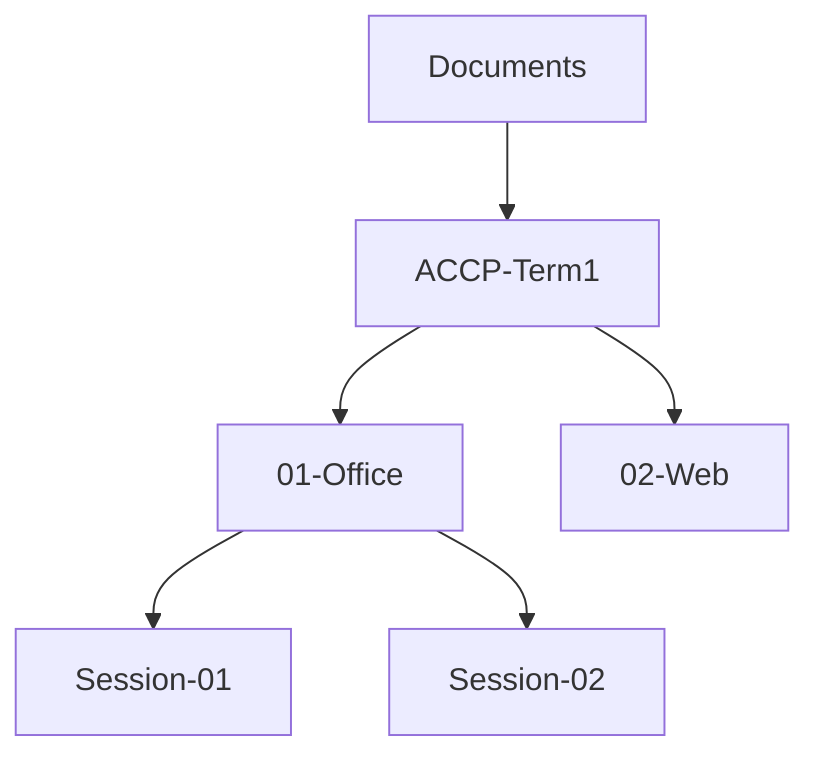

# Session 01: Getting Started with Windows 11 and Microsoft Office 2021

> Module: Effective Productivity through Office Automation · Term 1 (CPISM) · ⏱ ~2 hours

## 🎯 Learning Objectives

By the end of this session you will be able to:

- Name the main Windows 11 editions and pick the right one for home, school or office
- Use Windows 11 features such as Start, Snap Layouts, Virtual Desktops, Widgets and File Explorer tabs
- Organise files and folders with a clean naming system
- List the Office 2021 apps and what each is used for
- Describe what is new in Office 2021 compared with older versions and Microsoft 365

## 📖 Concepts Explained

### 1. What is an operating system?
An **operating system (OS)** is the manager of your computer. Think of it as the principal of a school: it decides which program (student) uses the CPU (classroom), memory (desks) and storage (lockers) and keeps everything orderly. Windows 11 is Microsoft's current desktop OS.

### 2. Windows 11 editions

| Edition | Best for | Key extras |
|---------|----------|------------|
| Home | Personal laptops | Core features, Microsoft Store, Windows Security |
| Pro | Freelancers, small offices | BitLocker encryption, Remote Desktop host, Group Policy, Hyper-V |
| Education / Pro Education | Schools and colleges | Pro features with school management tools |
| Enterprise | Large companies | Advanced security and central management |

> Tip: press `Win + R`, type `winver` and press Enter to see your edition and build.

### 3. Windows 11 features you will use daily

| Feature | How to open | Why it helps |
|---------|-------------|--------------|
| Centred Start menu | `Win` key | Pinned apps + recommended files |
| Snap Layouts | Hover the maximise button or `Win + Z` | Put 2-4 windows side by side |
| Virtual Desktops | `Win + Tab` | Separate "Study" and "Personal" desktops |
| Widgets | `Win + W` | Weather, news, calendar at a glance |
| File Explorer tabs | `Ctrl + T` inside Explorer | Many folders in one window |
| Clipboard history | `Win + V` | Paste something you copied earlier |
| Screenshot tool | `Win + Shift + S` | Capture part of the screen |
| Windows Security | Settings > Privacy & security | Antivirus, firewall, updates |

### 4. Files, folders and naming
A good folder system saves hours. Use **one top folder per course**, then a folder per module, then per session. Name files `YYYY-MM-DD_topic_version` (for example `2026-01-15_budget_v2.xlsx`) so they sort by date automatically.



### 5. Microsoft Office 2021 apps

| App | Used for | Example |
|-----|----------|---------|
| Word | Documents | CV, letter, report |
| Excel | Numbers & data | Marks sheet, budget |
| PowerPoint | Presentations | Project pitch |
| Outlook | Email & calendar | Booking a meeting |
| OneNote | Digital notebook | Class notes |
| Access* | Databases | Small inventory system |
| Publisher* | Flyers and brochures | Event poster |

*Included only in some editions (for example, Professional).

### 6. Office 2021 vs Microsoft 365
- **Office 2021** is a *one-time purchase*: you get the features released at launch, with security updates only.
- **Microsoft 365** is a *subscription*: it keeps getting new features (including Copilot AI), 1 TB OneDrive storage and the latest apps.

New in Office 2021 (highlights): real-time co-authoring, dark mode in more apps, XLOOKUP and dynamic arrays in Excel, improved Ink and Draw tools, stock media (images, icons, 3D models), Line Focus in Word for easier reading, and Accessibility Checker improvements.

## 💻 Code Examples

This module is mostly hands-on, but Windows can also be explored with a small PowerShell script. Open **Terminal** (right-click Start > Terminal) and run the file below.

### Example 1: `system-info.ps1`

📄 Saved in this folder as [`system-info.ps1`](system-info.ps1).

```powershell
# system-info.ps1 - print a short report about this PC
# Run:  powershell -ExecutionPolicy Bypass -File .\system-info.ps1

$os  = Get-CimInstance Win32_OperatingSystem
$cpu = Get-CimInstance Win32_Processor | Select-Object -First 1
$ramGB = [math]::Round($os.TotalVisibleMemorySize / 1MB, 1)

Write-Host "===== My PC Report =====" -ForegroundColor Cyan
Write-Host "Computer name : $env:COMPUTERNAME"
Write-Host "Windows       : $($os.Caption) (build $($os.BuildNumber))"
Write-Host "Processor     : $($cpu.Name)"
Write-Host "RAM           : $ramGB GB"

Get-CimInstance Win32_LogicalDisk -Filter "DriveType=3" | ForEach-Object {
    $free  = [math]::Round($_.FreeSpace / 1GB, 1)
    $total = [math]::Round($_.Size / 1GB, 1)
    Write-Host ("Drive {0}      : {1} GB free of {2} GB" -f $_.DeviceID, $free, $total)
}
```

**How it works**

- `Get-CimInstance` asks Windows for system information (OS, CPU, disks).
- `TotalVisibleMemorySize` is in kilobytes, so dividing by `1MB` (1,048,576) gives gigabytes.
- The `ForEach-Object` loop prints every local hard drive (`DriveType=3`) with free and total space.
- `-ExecutionPolicy Bypass` lets this one script run without changing your system policy.

### Example 2: `make-course-folders.ps1`

📄 Saved in this folder as [`make-course-folders.ps1`](make-course-folders.ps1).

```powershell
# make-course-folders.ps1 - create a tidy folder tree for this term
$root = Join-Path $HOME "Documents\ACCP-Term1"
$modules = "01-Office", "02-Web", "03-Bootstrap-jQuery", "04-Git", "05-SEO", "eProject"

foreach ($m in $modules) {
    $path = Join-Path $root $m
    New-Item -ItemType Directory -Path $path -Force | Out-Null
    Write-Host "Created $path"
}
explorer $root   # open the folder when done
```

**How it works**

- `Join-Path` builds a correct Windows path from pieces.
- `New-Item -ItemType Directory -Force` creates each folder (and does nothing if it already exists).
- `explorer $root` opens File Explorer at the new folder so you can see the result.

## 🧪 Lab Practice

1. Press `Win + R`, run `winver`, and write down your Windows edition and build number.
2. Open three apps (Edge, File Explorer, Notepad). Use `Win + Z` to arrange them in a three-window Snap Layout. Take a screenshot with `Win + Shift + S`.
3. Create two virtual desktops named **Study** and **Personal** (`Win + Tab` > New desktop > right-click to rename).
4. Run `make-course-folders.ps1` (or create the folders by hand) and save a test Word file inside `01-Office` using the `YYYY-MM-DD_topic` naming rule.
5. Open Word, Excel and PowerPoint, go to **File > Account** in each, and note whether you have Office 2021 or Microsoft 365.

## 📝 Assignment

Write a one-page Word document titled **"My Digital Workspace"** that includes: your Windows edition and build, three Windows 11 features you will use most and why, a screenshot of your Snap Layout, and a picture of your folder structure. Save it as `2026-xx-xx_my-workspace.docx` in your `01-Office` folder.

## ❓ Quick Quiz

**Q1.** Which Windows 11 edition includes BitLocker and Remote Desktop hosting?

- a) Home
- b) Pro
- c) S mode
- d) Starter

**Q2.** Which shortcut opens Snap Layouts?

- a) Win + D
- b) Win + Z
- c) Win + L
- d) Win + E

**Q3.** What is the main difference between Office 2021 and Microsoft 365?

**Q4.** Which shortcut shows clipboard history?

- a) Ctrl + V
- b) Win + V
- c) Alt + V
- d) Win + C

**Q5.** Name the Office app best suited for a marks sheet with automatic totals.

<details>
<summary>Show answers</summary>

1. b) Pro
2. b) Win + Z
3. Office 2021 is a one-time purchase with no new features; Microsoft 365 is a subscription that keeps getting new features, cloud storage and Copilot.
4. b) Win + V
5. Microsoft Excel.

</details>

## 💼 Interview Questions

**1. What is an operating system and why do we need one?**

<details>
<summary>Model answer</summary>

It is system software that manages hardware (CPU, memory, storage, devices) and gives applications a common platform and user interface. Without it every program would need to control hardware directly.

</details>

**2. How would you keep company files organised and safe on Windows 11?**

<details>
<summary>Model answer</summary>

Use a clear folder hierarchy and naming convention, store work in OneDrive/SharePoint for backup and version history, keep Windows Security and updates on, and use BitLocker on laptops (Pro edition).

</details>

**3. When would you recommend Microsoft 365 over Office 2021?**

<details>
<summary>Model answer</summary>

When users need the newest features, AI tools like Copilot, cloud storage and multi-device installs; Office 2021 suits offline machines or organisations that want a one-time cost.

</details>

## ✅ Summary

- Windows 11 comes in Home, Pro, Education and Enterprise editions.
- Snap Layouts, Virtual Desktops, Explorer tabs and clipboard history boost productivity.
- A consistent folder and file naming system keeps work findable.
- Office 2021 includes Word, Excel, PowerPoint, Outlook and OneNote (plus Access/Publisher in some editions).
- Microsoft 365 is the always-updated subscription version with cloud and AI features.

---

[⬅ Previous](../README.md) · [🏠 Module Home](../README.md) · [Next ➡](../Session-02-Microsoft-Word-Documents/README.md)

Prepared by Zeeshan Abbas · Aptech Learning North Nazimabad
