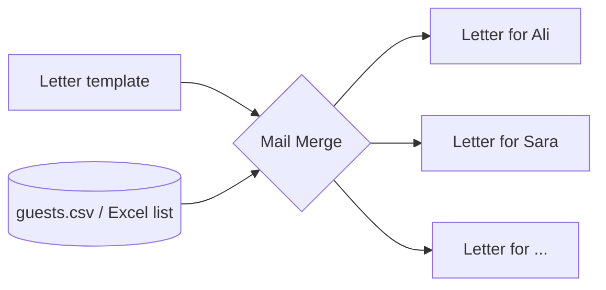

# Session 02: Working with Microsoft Word: Documents, Tables, Templates, Mail Merge and AI

> Module: Effective Productivity through Office Automation · Term 1 (CPISM) · ⏱ ~2 hours

## 🎯 Learning Objectives

By the end of this session you will be able to:

- Navigate the Word ribbon, Backstage view and status bar
- Format a professional document with Styles, headers/footers, page numbers and a table of contents
- Create lists and tables and format them neatly
- Build a reusable template and a simple fillable form
- Insert pictures and shapes, track changes, and run a mail merge
- Use AI tools to draft or rephrase text and check the result

## 📖 Concepts Explained

### 1. The Word interface

| Area | What it does |
|------|--------------|
| Ribbon tabs (Home, Insert, Design, Layout, References, Mailings, Review, View) | Group all commands |
| Quick Access Toolbar | Your favourite buttons (Save, Undo) |
| Backstage view (`File`) | Open, save, print, share, export to PDF |
| Status bar | Word count, page number, zoom, Focus mode |

### 2. Styles: the secret of professional documents
A **Style** is a saved set of formatting (font, size, colour, spacing). Use *Heading 1*, *Heading 2* and *Normal* instead of manually bolding text. Benefits:
- Change one style and the whole document updates.
- Navigation Pane (`Ctrl + F` > Headings) lets you jump between sections.
- **References > Table of Contents** is built automatically from headings.

### 3. Lists and tables
- Bulleted list: `Ctrl + Shift + L`. Numbered list: Home > Numbering. Multilevel list for outlines (1, 1.1, 1.1.1).
- Table: Insert > Table. Use **Table Design** for styles and **Layout** for merging cells, sorting and "Repeat Header Rows".
- Convert text to a table: select tab-separated text > Insert > Table > Convert Text to Table.

### 4. Templates and forms
A **template** (`.dotx`) is a starting file. Save any document as *Word Template* and new files open as copies, so the original stays clean.
A **form** uses *Content Controls* (Developer tab > Controls): plain text box, date picker, drop-down list, check box. Turn on the Developer tab via File > Options > Customize Ribbon.

### 5. Pictures, shapes and layout
Insert > Pictures / Shapes / Icons / SmartArt. Set **Wrap Text** (Square, Tight, In Front of Text) so images sit nicely. Use **Alt Text** for accessibility.

### 6. Reviewing documents
**Review > Track Changes** records every edit so a teacher or manager can *Accept* or *Reject* it. **New Comment** adds notes without changing text. **Compare** shows the difference between two versions.

### 7. Mail Merge
Mail merge joins a **main document** with a **data source** to create personalised copies.



Steps: Mailings > Start Mail Merge > Letters > Select Recipients > Use an Existing List > Insert Merge Field > Preview Results > Finish & Merge.

### 8. AI in Word
- **Microsoft Copilot** (Microsoft 365): "Draft a one-page invitation for a coding meetup".
- **Editor** (Home > Editor): grammar, clarity and similarity check.
- **QuillBot / ChatGPT**: paraphrasing and summarising.

> Rule of thumb: AI writes the first draft, *you* are the editor. Check facts, names, dates and tone, and never paste private data into public AI tools.

## 💻 Code Examples

Two helper files: a data source for mail merge and an optional VBA macro that applies house formatting.

### Example 1: `guests.csv`

📄 Saved in this folder as [`guests.csv`](guests.csv).

```csv
Title,FirstName,LastName,Organisation,City,Email
Mr.,Ali,Raza,Tech Society,Karachi,ali.raza@example.com
Ms.,Sara,Khan,Code Club,Karachi,sara.khan@example.com
Mr.,Usman,Sheikh,Web Makers,Lahore,usman.sheikh@example.com
Ms.,Hira,Ahmed,AI Circle,Islamabad,hira.ahmed@example.com
Mr.,Bilal,Qureshi,Data Folks,Karachi,bilal.q@example.com
```

**How it works**

- The first row holds **field names**; Word shows them in *Insert Merge Field*.
- Each later row becomes one personalised letter.
- Keep it in UTF-8 CSV or an Excel sheet; avoid empty rows in the middle.

### Example 2: `FormatReport.bas`

📄 Saved in this folder as [`FormatReport.bas`](FormatReport.bas).

```vb
' FormatReport.bas - import in Word: Alt+F11 > File > Import File
' Applies a consistent look to the active document.
Sub FormatReport()
    Dim doc As Document
    Set doc = ActiveDocument

    With doc.Styles(wdStyleNormal).Font
        .Name = "Calibri"
        .Size = 11
    End With
    With doc.Styles(wdStyleHeading1).Font
        .Name = "Calibri Light"
        .Size = 18
        .Color = RGB(31, 78, 121)
    End With

    ' Page numbers in the footer of every section
    Dim s As Section
    For Each s In doc.Sections
        s.Footers(wdHeaderFooterPrimary).PageNumbers.Add _
            PageNumberAlignment:=wdAlignPageNumberCenter
    Next s

    MsgBox "Report formatted: " & doc.Paragraphs.Count & " paragraphs.", vbInformation
End Sub
```

**How it works**

- VBA (Visual Basic for Applications) automates Office. `ActiveDocument` is the open file.
- Editing `Styles(...)` changes the style everywhere it is used, which is exactly why Styles are powerful.
- The loop adds centred page numbers to each section footer.
- Save the document as `.docm` (macro-enabled) if you want to keep the macro inside it.

## 🧪 Lab Practice

1. Type a two-page report on *"Uses of AI in Education"*. Apply Heading 1/Heading 2 styles, then insert an automatic Table of Contents on page 1.
2. Add a header with your name, a footer with page numbers, and a 4 × 4 table of AI tools (Tool, Company, Use, Free?). Apply a table style and repeat the header row.
3. Turn on the Developer tab and build a **Student Registration Form** with a text box (Name), date picker (DOB), drop-down (Course) and check box (Agree to rules). Save it as a template `.dotx`.
4. Use `guests.csv` and the wording in `letter-template.txt` to run a mail merge. Preview all five letters and finish to a new document.
5. Ask an AI tool to rewrite your report introduction more formally. Turn on Track Changes, paste the improved text, and accept only the changes you agree with.

## 📝 Assignment

Create a **professional CV template** in Word: styles for headings, a two-column table for skills, a profile picture with square wrapping, and content controls for Name, Phone and Email. Save as `cv-template.dotx`, then make one filled copy as PDF.

## ❓ Quick Quiz

**Q1.** Which feature builds a Table of Contents automatically?

- a) Bold text
- b) Heading styles
- c) Text boxes
- d) WordArt

**Q2.** Which file extension is a Word template?

- a) .docx
- b) .dotx
- c) .docm
- d) .pdf

**Q3.** In mail merge, what is the 'data source'?

**Q4.** Where do you find content controls for forms?

- a) Insert tab
- b) Developer tab
- c) Design tab
- d) View tab

**Q5.** Why should you review AI-generated text before using it?

<details>
<summary>Show answers</summary>

1. b) Heading styles
2. b) .dotx
3. The list (Excel/CSV/Outlook contacts) holding the values for each merged copy.
4. b) Developer tab
5. AI can produce wrong facts, wrong tone or plagiarised wording; the author is responsible for the final content.

</details>

## 💼 Interview Questions

**1. Why use Styles instead of manual formatting?**

<details>
<summary>Model answer</summary>

Styles keep formatting consistent, allow global changes in one step, power the Navigation Pane and automatic TOC, and improve accessibility for screen readers.

</details>

**2. Explain mail merge with a business example.**

<details>
<summary>Model answer</summary>

A bank sends 2,000 personalised fee reminder letters: one Word letter with merge fields plus an Excel list of customers produces 2,000 letters or emails in minutes.

</details>

**3. How does Track Changes help a team?**

<details>
<summary>Model answer</summary>

It records who changed what, so a reviewer can accept or reject each edit and nothing is lost; comments allow discussion without altering the text.

</details>

## ✅ Summary

- Use Styles for every heading; the TOC and Navigation Pane depend on them.
- Tables, lists and SmartArt organise information clearly.
- Templates (`.dotx`) and content-control forms save time and reduce errors.
- Track Changes and Comments make reviewing safe and transparent.
- Mail merge = template + data source = many personalised documents.
- AI drafts; you verify and edit.

---

[⬅ Previous](../Session-01-Windows-11-and-Office-2021/README.md) · [🏠 Module Home](../README.md) · [Next ➡](../Session-03-Windows-and-Word-Practice-Lab/README.md)

Prepared by Zeeshan Abbas · Aptech Learning North Nazimabad
