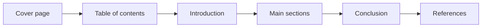

# Session 03: Practice Lab: Windows 11 and Word Skills

> Module: Effective Productivity through Office Automation · Term 1 (CPISM) · ⏱ ~2 hours

## 🎯 Learning Objectives

By the end of this session you will be able to:

- Revise Windows 11 navigation and file management under time pressure
- Produce a complete multi-page Word report from raw text
- Combine styles, tables, images, TOC and citations in one document
- Run a mail merge that sends personalised emails
- Self-assess your work using a checklist

## 📖 Concepts Explained

This is a **practice and revision session**. There is no new theory; instead you will apply everything from Sessions 01-02 in realistic tasks.

### Quick revision table

| Skill | Shortcut / Location |
|-------|---------------------|
| Snap windows | `Win + Z`, `Win + ←/→` |
| Search files | `Win + S` or Explorer search box |
| Rename file | Select + `F2` |
| Apply Heading 1 | `Ctrl + Alt + 1` |
| Insert page break | `Ctrl + Enter` |
| Update TOC / fields | Select all `Ctrl + A` then `F9` |
| Track Changes on/off | `Ctrl + Shift + E` |
| Show formatting marks | `Ctrl + Shift + 8` |

### How a professional report is structured



### Citations and references
Word can manage sources: **References > Insert Citation > Add New Source**, then **Bibliography** inserts a reference list in APA, MLA or another style. This avoids plagiarism and keeps formatting consistent.

### Mail merge to email
Instead of printing letters, choose **Mailings > Start Mail Merge > E-mail Messages**. The data source needs an *Email* column, and Outlook must be set up on the PC. Finish with **Send E-mail Messages** and pick the Email field as *To*.

### Self-check rubric

| Criteria | Points |
|----------|--------|
| Correct styles on all headings | 2 |
| Working, updated TOC | 2 |
| Table formatted with header row | 2 |
| Image with alt text and wrapping | 1 |
| Header/footer with page numbers | 1 |
| Citations + bibliography | 2 |
| **Total** | **10** |

## 💻 Code Examples

Use the raw text file below as input for the report task. It has no formatting on purpose; your job is to make it professional.

### Example 1: `raw-report.txt`

📄 Saved in this folder as [`raw-report.txt`](raw-report.txt).

```text
Smart Campus Report
Introduction
Colleges in Pakistan are adopting digital tools to manage classes, attendance and fees.
Digital Attendance
QR codes and face recognition reduce manual registers and save teachers time.
Online Classrooms
Google Classroom and Microsoft Teams let students submit work and get feedback quickly.
Challenges
Internet load-shedding, device cost and training needs remain the biggest barriers.
Tool | Purpose | Cost
Microsoft Teams | Classes and chat | Free for education
Google Classroom | Assignments | Free
Moodle | Learning management | Open source
Conclusion
With planning and training, a smart campus improves learning and transparency.
```

**How it works**

- Every short line (`Introduction`, `Digital Attendance`...) should become a **Heading 1** or **Heading 2**.
- The pipe-separated lines are a table: replace `|` with tabs or use *Convert Text to Table* with `|` as the separator (Other: `|`).
- Add a cover page (Insert > Cover Page) and a TOC after it.

### Example 2: `students-email.csv`

📄 Saved in this folder as [`students-email.csv`](students-email.csv).

```csv
FirstName,Email,Batch,Marks
Ayesha,ayesha@example.com,2601A,86
Hamza,hamza@example.com,2601A,74
Fatima,fatima@example.com,2601B,91
Daniyal,daniyal@example.com,2601B,68
```

**How it works**

- Used for an **email** mail merge: `Email` becomes the *To* field.
- Insert `«FirstName»`, `«Batch»` and `«Marks»` inside the message body.
- Use *Rules > If...Then...Else* to add "Excellent work!" when Marks > 85.

## 🧪 Lab Practice

1. **Speed drill (10 min):** create the folder `Practice-Lab-03`, make three files inside, rename them with `F2`, snap Explorer and Word side by side, and pin the folder to Quick Access.
2. **Report build (40 min):** turn `raw-report.txt` into a 3-page report with cover page, TOC, styled headings, the tool table, one picture with alt text, header and page numbers.
3. **Citations (15 min):** add two sources (a website and a book) using References > Insert Citation, then insert a Bibliography at the end.
4. **Email merge (20 min):** use `students-email.csv` to create a results email with an `If...Then...Else` rule. Preview every record (send only if your teacher allows).
5. **Self-assess (10 min):** score your report with the rubric above and fix anything missing.

## 📝 Assignment

Pick any topic from your field (for example *"Cyber Security for Small Businesses"*) and produce a 4-page report using the same structure. It must contain at least three citations, one SmartArt diagram and a table. Export it to PDF and keep the `.docx` too.

## ❓ Quick Quiz

**Q1.** Which key updates all fields, including the TOC, after selecting the document?

- a) F5
- b) F7
- c) F9
- d) F12

**Q2.** Which mail merge type sends personalised messages through Outlook?

- a) Letters
- b) Labels
- c) E-mail Messages
- d) Directory

**Q3.** How can you turn pipe-separated text into a table?

**Q4.** What does `Ctrl + Enter` insert?

**Q5.** Why add alt text to an image?

<details>
<summary>Show answers</summary>

1. c) F9
2. c) E-mail Messages
3. Select it > Insert > Table > Convert Text to Table, and choose 'Other' with the `|` character as separator.
4. A page break.
5. Screen readers read it aloud for visually impaired users, and it describes the image if it fails to load.

</details>

## 💼 Interview Questions

**1. How do you avoid plagiarism when writing reports?**

<details>
<summary>Model answer</summary>

Write in your own words, cite every source with Word's citation manager, include a bibliography, and run a similarity check (for example, Editor's similarity tool).

</details>

**2. A 50-page document has inconsistent fonts. How would you fix it quickly?**

<details>
<summary>Model answer</summary>

Apply/modify Styles: select similar text, use Styles to apply Normal/Headings, then modify each style once; or clear formatting (`Ctrl + Space`) and re-apply styles.

</details>

**3. What is a conditional rule in mail merge?**

<details>
<summary>Model answer</summary>

A rule like If...Then...Else that inserts different text per record based on a field value, e.g., a congratulation line only for high scores.

</details>

## ✅ Summary

- Practice sessions turn knowledge into speed and confidence.
- A professional report = cover + TOC + styled sections + references.
- Convert Text to Table and Citations save formatting time.
- Email mail merge with rules creates smart personalised messages.
- Always self-check with a rubric before submitting.

---

[⬅ Previous](../Session-02-Microsoft-Word-Documents/README.md) · [🏠 Module Home](../README.md) · [Next ➡](../Session-04-Excel-Formulas-Functions-and-Charts/README.md)

Prepared by Zeeshan Abbas · Aptech Learning North Nazimabad
