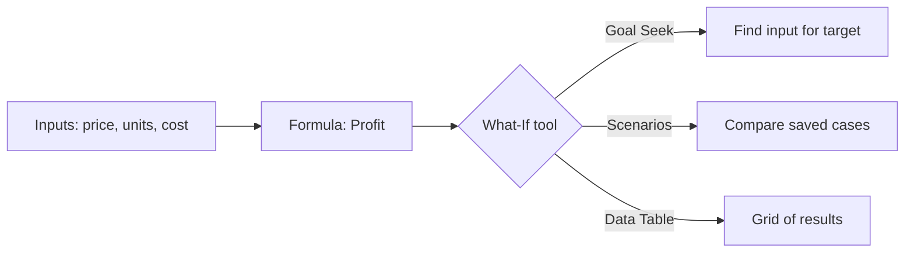

# Session 05: Data Analysis and Security in Microsoft Excel

> Module: Effective Productivity through Office Automation · Term 1 (CPISM) · ⏱ ~2 hours

## 🎯 Learning Objectives

By the end of this session you will be able to:

- Sort, filter and remove duplicates from a data set
- Summarise data with SUMIFS, COUNTIFS, Subtotals and Goal Seek
- Use What-If tools: Scenario Manager and Data Tables
- Protect cells, sheets and workbook structure
- Encrypt a workbook with a password and understand the levels of protection

## 📖 Concepts Explained

### 1. Preparing data
Analysis is only as good as the data. Before analysing:
- **Remove Duplicates** (Data tab).
- **TRIM** extra spaces: `=TRIM(A2)`; fix case with `=PROPER(A2)`.
- **Text to Columns** splits "Karachi-South" into two columns.

### 2. Sort and Filter
- **Custom Sort**: Data > Sort > add levels (City A-Z, then Amount largest to smallest).
- **AutoFilter** (`Ctrl + Shift + L`): filter by text, number (top 10, above average) or colour.
- **Advanced Filter** copies matching rows to another place using a criteria range.

### 3. Summarising

| Tool | Use |
|------|-----|
| `SUMIFS(sum_range, crit_range1, crit1, ...)` | Total sales for *Karachi* in *January* |
| `COUNTIFS(...)` | How many orders above Rs 5,000 in Lahore |
| `AVERAGEIFS(...)` | Average order per product |
| Data > Subtotal | Grouped totals with outline buttons 1-2-3 |

### 4. What-If Analysis
- **Goal Seek**: "What price gives profit of Rs 100,000?" Excel changes one input until the formula reaches your target.
- **Scenario Manager**: save Best/Expected/Worst case sets of inputs and compare them in a summary report.
- **Data Table**: see results for many input values at once (e.g., loan instalment for different interest rates).
- **Forecast Sheet**: predicts future values from a time series.



### 5. Levels of protection

| Level | Where | What it stops | Strength |
|-------|-------|---------------|----------|
| Lock/unlock cells + **Protect Sheet** | Review tab | Editing formulas or chosen cells | Light (prevents mistakes) |
| **Protect Workbook** (structure) | Review tab | Adding, deleting, renaming sheets | Light |
| **Allow Edit Ranges** | Review tab | Only certain ranges with their own password | Light |
| **Encrypt with Password** | File > Info > Protect Workbook | Opening the file at all | Strong (AES encryption) |
| **Mark as Final** / Read-only recommended | File > Info | Accidental edits | Advisory only |
| Sensitivity labels / IRM | Microsoft 365 | Sharing outside organisation | Strong (organisation policy) |

> All cells are *Locked* by default, but locking only works after **Protect Sheet** is turned on. So: unlock input cells first (Format Cells > Protection > untick Locked), then protect the sheet.

> If you forget an encryption password, Microsoft cannot recover it. Store it in a password manager.

## 💻 Code Examples

Import `sales.csv`, then build the analysis described in `analysis-steps.txt`.

### Example 1: `sales.csv`

📄 Saved in this folder as [`sales.csv`](sales.csv).

```csv
OrderID,Date,City,Product,Units,UnitPrice
1001,2026-01-03,Karachi,Laptop,2,150000
1002,2026-01-05,Lahore,Mouse,10,1500
1003,2026-01-08,Karachi,Keyboard,5,3500
1004,2026-01-12,Islamabad,Laptop,1,155000
1005,2026-01-15,Karachi,Monitor,3,42000
1006,2026-02-02,Lahore,Laptop,2,148000
1007,2026-02-06,Karachi,Mouse,15,1400
1008,2026-02-09,Islamabad,Monitor,2,43000
1009,2026-02-14,Lahore,Keyboard,8,3300
1010,2026-02-20,Karachi,Laptop,3,149000
1011,2026-03-01,Islamabad,Mouse,12,1500
1012,2026-03-04,Karachi,Monitor,4,41000
1012,2026-03-04,Karachi,Monitor,4,41000
1013,2026-03-10,Lahore,Monitor,1,44000
1014,2026-03-18,Karachi,Keyboard,6,3400
```

**How it works**

- Notice order **1012 appears twice**: a deliberate duplicate for you to remove.
- Add a column `Amount` with `=E2*F2` and a column `Month` with `=TEXT(B2,"mmm")`.

### Example 2: `analysis-steps.txt`

📄 Saved in this folder as [`analysis-steps.txt`](analysis-steps.txt).

```text
1. Data > Remove Duplicates (all columns)  -> 14 unique rows remain
2. Amount (G2)          =E2*F2
   Month  (H2)          =TEXT(B2,"mmm")
3. Summary sheet:
   Karachi total        =SUMIFS(Sales!G:G,Sales!C:C,"Karachi")
   Karachi in Feb       =SUMIFS(Sales!G:G,Sales!C:C,"Karachi",Sales!H:H,"Feb")
   Laptop orders        =COUNTIFS(Sales!D:D,"Laptop")
   Big orders (>100k)   =COUNTIFS(Sales!G:G,">100000")
   Avg mouse units      =AVERAGEIFS(Sales!E:E,Sales!D:D,"Mouse")
4. Profit model (sheet "Model"):
   B1 Price 1500 | B2 Units 1000 | B3 Cost per unit 900 | B4 Fixed cost 250000
   B5 Profit  =B1*B2-(B3*B2+B4)
   Goal Seek: Set cell B5, To value 500000, By changing B2  -> units needed
5. Protection:
   Unlock B1:B4 -> Review > Protect Sheet (password optional)
   File > Info > Protect Workbook > Encrypt with Password
```

**How it works**

- `SUMIFS` adds `Amount` only where every condition is true (city and month).
- Goal Seek works backwards: it changes `Units` until `Profit` equals 500,000 (answer: 1,250 units).
- Unlocking inputs before protecting lets users type new prices while formulas stay safe.

## 🧪 Lab Practice

1. Import `sales.csv`, remove the duplicate order, add `Amount` and `Month`, and format as a Table.
2. Sort by City (A-Z) then Amount (largest first). Then filter to show only Laptop orders above Rs 200,000.
3. Build the Summary sheet with SUMIFS, COUNTIFS and AVERAGEIFS from `analysis-steps.txt`.
4. Create the Profit model and use Goal Seek to find the units needed for Rs 500,000 profit. Then create three scenarios (Best/Expected/Worst) and generate a Scenario Summary.
5. Unlock input cells, protect the Model sheet, protect workbook structure, and finally save an encrypted copy. Try to type in a formula cell to confirm protection works.

## 📝 Assignment

Create a **Loan Calculator** sheet: inputs for amount, annual rate and years; instalment with `=PMT(rate/12, years*12, -amount)`; a one-variable Data Table showing instalments for rates 10%-20%; Goal Seek to find the amount affordable for a Rs 25,000 instalment. Protect everything except the input cells.

## ❓ Quick Quiz

**Q1.** Which tool changes one input to reach a target result?

- a) Scenario Manager
- b) Goal Seek
- c) Data Table
- d) Subtotal

**Q2.** Cell locking takes effect only after...

- a) Saving as PDF
- b) Protect Sheet is turned on
- c) Encrypting
- d) Sorting

**Q3.** Write a formula to total Amount (G) where City (C) is Lahore.

**Q4.** Which protection actually encrypts the file?

- a) Protect Sheet
- b) Mark as Final
- c) Encrypt with Password
- d) Allow Edit Ranges

**Q5.** What does Remove Duplicates do?

<details>
<summary>Show answers</summary>

1. b) Goal Seek
2. b) Protect Sheet is turned on
3. `=SUMIFS(G:G,C:C,"Lahore")`
4. c) Encrypt with Password
5. Deletes rows that repeat the same values in the selected columns, keeping the first occurrence.

</details>

## 💼 Interview Questions

**1. How would you prepare messy data before analysis?**

<details>
<summary>Model answer</summary>

Remove duplicates, trim spaces, fix data types (text to numbers/dates), split columns, standardise names/case, and validate future entries with Data Validation.

</details>

**2. Difference between Goal Seek and Scenario Manager?**

<details>
<summary>Model answer</summary>

Goal Seek finds one input value for a single target; Scenario Manager stores several sets of input values and compares their outcomes side by side.

</details>

**3. Is sheet protection real security?**

<details>
<summary>Model answer</summary>

No, it mainly prevents accidental changes and can be bypassed by determined users. For confidentiality use file encryption, access control in OneDrive/SharePoint, or sensitivity labels.

</details>

## ✅ Summary

- Clean data first: duplicates, spaces, types.
- Sort, Filter, SUMIFS/COUNTIFS and Subtotal answer business questions.
- Goal Seek, Scenarios, Data Tables and Forecast Sheet support decisions.
- Protection has levels: cell/sheet, workbook structure, encryption, labels.
- Lock formulas, unlock inputs, then protect.

---

[⬅ Previous](../Session-04-Excel-Formulas-Functions-and-Charts/README.md) · [🏠 Module Home](../README.md) · [Next ➡](../Session-06-PivotTables-and-PivotCharts/README.md)

Prepared by Zeeshan Abbas · Aptech Learning North Nazimabad
