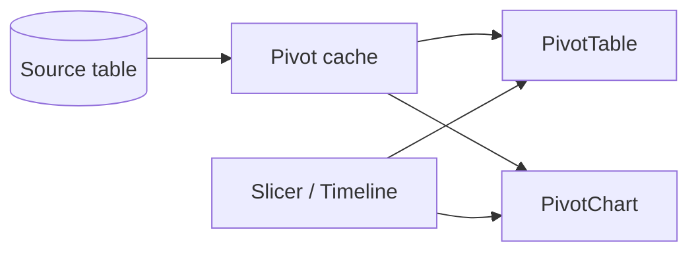

# Session 06: PivotTables and PivotCharts in Microsoft Excel

> Module: Effective Productivity through Office Automation · Term 1 (CPISM) · ⏱ ~2 hours

## 🎯 Learning Objectives

By the end of this session you will be able to:

- Explain what a PivotTable is and when to use it
- Create a PivotTable from a formatted table and arrange Rows, Columns, Values and Filters
- Group dates and numbers, change summary type and show values as %
- Add Slicers and a Timeline for interactive filtering
- Create PivotCharts and explain how they differ from PivotTables

## 📖 Concepts Explained

### 1. Why PivotTables?
Imagine 10,000 sales rows. Your manager asks: *"Total sales per city per month?"* Writing SUMIFS for every combination is slow. A **PivotTable** answers it in seconds by dragging fields, and you can "pivot" (rotate) the view to answer the next question.

### 2. The four areas

| Area | Puts the field... | Example |
|------|-------------------|---------|
| Rows | Down the left side | City |
| Columns | Across the top | Month |
| Values | In the middle (calculated) | Sum of Amount |
| Filters | Above the table as a drop-down | Product |



### 3. Must-know options
- **Value Field Settings**: Sum, Count, Average, Max, Min.
- **Show Values As**: % of Grand Total, % of Row, Running Total, Rank.
- **Group**: right-click dates > Group by Months/Quarters/Years; numbers into ranges (0-10, 10-20).
- **Refresh** (`Alt + F5`): PivotTables do *not* update automatically when source data changes.
- **Calculated Field**: PivotTable Analyze > Fields, Items & Sets (e.g., `Tax = Amount * 0.17`).
- **Design tab**: report layout (Compact, Outline, Tabular), banded rows, grand totals on/off.

### 4. Slicers and Timelines
A **Slicer** is a button panel for filtering (click "Karachi"). A **Timeline** is a slider for dates. One slicer can control several PivotTables via *Report Connections*, which is how simple dashboards are made.

### 5. PivotChart vs PivotTable

| | PivotTable | PivotChart |
|-|-----------|------------|
| Shows | Numbers in a grid | Visual chart |
| Best for | Exact values, detail | Patterns and comparisons |
| Filtering | Field buttons, slicers | Same, linked to its PivotTable |
| Independence | Can exist alone | Always linked to a PivotTable |
| Chart types | n/a | Most types except scatter, bubble, stock, treemap |

### 6. Good practice
1. Source must be a clean table: one header row, no blank rows/columns, no merged cells.
2. Use **Format as Table** so new rows are included after Refresh.
3. Put each PivotTable on its own sheet with a clear name (`Pvt_CityMonth`).

## 💻 Code Examples

Use the larger data set below (also usable in Power Query). The recipe file lists four pivots to build.

### Example 1: `orders.csv`

📄 Saved in this folder as [`orders.csv`](orders.csv).

```csv
Date,Region,City,Category,Product,Salesperson,Units,Amount
2026-01-04,South,Karachi,Electronics,Laptop,Ahsan,2,300000
2026-01-09,North,Lahore,Accessories,Mouse,Maria,20,30000
2026-01-15,North,Islamabad,Electronics,Monitor,Kamran,3,126000
2026-01-22,South,Karachi,Accessories,Keyboard,Ahsan,10,35000
2026-02-03,North,Lahore,Electronics,Laptop,Maria,1,150000
2026-02-11,South,Hyderabad,Electronics,Monitor,Nida,2,84000
2026-02-18,South,Karachi,Accessories,Headphones,Nida,8,48000
2026-02-25,North,Islamabad,Accessories,Mouse,Kamran,15,22500
2026-03-02,South,Karachi,Electronics,Laptop,Ahsan,4,600000
2026-03-09,North,Lahore,Accessories,Keyboard,Maria,12,40800
2026-03-16,South,Hyderabad,Accessories,Mouse,Nida,25,36000
2026-03-23,North,Islamabad,Electronics,Laptop,Kamran,2,310000
2026-04-01,South,Karachi,Electronics,Monitor,Ahsan,5,205000
2026-04-08,North,Lahore,Electronics,Monitor,Maria,3,129000
2026-04-15,South,Karachi,Accessories,Headphones,Nida,6,36000
2026-04-22,North,Islamabad,Accessories,Keyboard,Kamran,9,31500
```

**How it works**

- Each row is one order. `Region`, `City`, `Category`, `Product` and `Salesperson` are text fields for Rows/Columns/Filters; `Units` and `Amount` go in Values.
- Format as a Table named `Orders` before inserting the PivotTable.

### Example 2: `pivot-recipes.txt`

📄 Saved in this folder as [`pivot-recipes.txt`](pivot-recipes.txt).

```text
Pivot 1 - Sales by City
  Rows: City            Values: Sum of Amount (Number, thousands separator)
  Sort: largest to smallest

Pivot 2 - City x Month
  Rows: City   Columns: Date (group by Months)   Values: Sum of Amount

Pivot 3 - Share of Category
  Rows: Category        Values: Sum of Amount -> Show Values As % of Grand Total

Pivot 4 - Salesperson performance
  Rows: Salesperson     Values: Sum of Units, Sum of Amount, Count of Product
  Calculated field: Commission = Amount * 0.02
  Filter: Region

Dashboard
  Insert Slicers: Region, Category   Insert Timeline: Date
  Report Connections: link both slicers to Pivots 1-4
  PivotCharts: Column (Pivot 1), Line (Pivot 2), Doughnut (Pivot 3)
```

**How it works**

- Each recipe tells you which field goes into which area.
- *Show Values As % of Grand Total* turns raw rupees into shares, which is perfect for a doughnut chart.
- Connecting slicers to all pivots makes one click filter the whole dashboard.

## 🧪 Lab Practice

1. Format `orders.csv` as a table `Orders`, then Insert > PivotTable > New Worksheet. Build **Pivot 1** and sort it.
2. Build **Pivot 2** and group dates by Month. Switch the layout to Tabular form.
3. Build **Pivot 3** with % of Grand Total and **Pivot 4** with the calculated Commission field.
4. Add a Region slicer, Category slicer and Date timeline; connect them to all pivots. Create three PivotCharts and arrange everything on a sheet called `Dashboard`.
5. Add two new rows to the source table, then press **Refresh All** and confirm the pivots update.

## 📝 Assignment

Download any open data CSV (for example from a government open-data portal or use your own expense records), and build a one-sheet **dashboard** with at least two PivotTables, two PivotCharts, one slicer and one timeline. Write three insights you discovered in a text box on the sheet.

## ❓ Quick Quiz

**Q1.** Which PivotTable area produces drop-down filtering above the table?

- a) Rows
- b) Columns
- c) Values
- d) Filters

**Q2.** Do PivotTables update automatically when source data changes?

**Q3.** Which tool gives a date slider for filtering?

- a) Slicer
- b) Timeline
- c) Sparkline
- d) Form

**Q4.** Can a PivotChart exist without a PivotTable?

**Q5.** Which option shows each category's share of total sales?

- a) Running Total
- b) % of Grand Total
- c) Rank
- d) Difference From

<details>
<summary>Show answers</summary>

1. d) Filters
2. No, you must Refresh (Alt + F5 or Refresh All).
3. b) Timeline
4. No, a PivotChart is always based on (linked to) a PivotTable.
5. b) % of Grand Total

</details>

## 💼 Interview Questions

**1. Describe a situation where you would use a PivotTable instead of formulas.**

<details>
<summary>Model answer</summary>

When summarising large data by several dimensions that change often, such as sales by region and month for a meeting; pivots are faster to build, easy to rearrange and less error-prone.

</details>

**2. What must the source data look like for a good PivotTable?**

<details>
<summary>Model answer</summary>

A single header row with unique names, one record per row, no blank rows/columns, no merged cells, consistent data types, ideally formatted as an Excel Table.

</details>

**3. What is a calculated field?**

<details>
<summary>Model answer</summary>

A new field defined by a formula using other pivot fields (e.g., Commission = Amount * 2%), calculated inside the PivotTable without changing source data.

</details>

## ✅ Summary

- PivotTables summarise large data by dragging fields into Rows, Columns, Values and Filters.
- Group dates/numbers and change Show Values As for deeper insight.
- Slicers and Timelines make pivots interactive; connect them for dashboards.
- PivotCharts visualise a PivotTable and stay linked to it.
- Always Refresh after the source changes.

---

[⬅ Previous](../Session-05-Excel-Data-Analysis-and-Security/README.md) · [🏠 Module Home](../README.md) · [Next ➡](../Session-07-PowerPoint-Fundamentals/README.md)

Prepared by Zeeshan Abbas · Aptech Learning North Nazimabad
