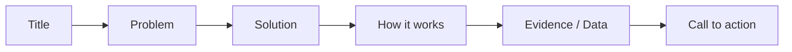

# Session 07: Understanding Microsoft PowerPoint: Creating Presentations

> Module: Effective Productivity through Office Automation · Term 1 (CPISM) · ⏱ ~2 hours

## 🎯 Learning Objectives

By the end of this session you will be able to:

- Explain where PowerPoint fits in business and academic communication
- Use the PowerPoint interface: slide pane, notes, views and the ribbon
- Create a presentation from a theme, using layouts and placeholders
- Apply Slide Master for consistent branding
- Present using Presenter View and export to PDF or video

## 📖 Concepts Explained

### 1. Why presentations matter
A presentation supports a speaker; it is not a document. Good slides are **visual, short and focused**: one idea per slide.

### 2. Interface tour

| Part | Purpose |
|------|---------|
| Slide thumbnails (left) | Reorder, duplicate, hide slides |
| Slide pane (centre) | Edit the current slide |
| Notes pane (bottom) | Speaker notes, visible only to you in Presenter View |
| Views (View tab) | Normal, Outline, Slide Sorter, Notes Page, Reading |
| Status bar | Slide number, notes toggle, zoom |

### 3. Building blocks
- **Theme** (Design tab): colours, fonts and effects together.
- **Layout** (Home > Layout): Title Slide, Title and Content, Two Content, Comparison, Section Header...
- **Placeholders**: dotted boxes that accept text, pictures, tables, charts, video.
- **Designer** (Design > Designer, Microsoft 365): suggests layouts for your content automatically.

### 4. Slide Master: brand once, apply everywhere
View > Slide Master. Changes to the top (parent) master affect all layouts: logo, footer, fonts. Analogy: Slide Master is the **uniform** of your slides.

### 5. The 10-20-30 and 6x6 guidelines
- Around 10 slides, 20 minutes, minimum 30 pt font for a pitch.
- Max 6 bullets, max ~6 words each. Use images and charts instead of paragraphs.



### 6. Delivering the talk
- **Presenter View** (`Alt + F5`): see notes, next slide and timer while the audience sees only the slide.
- Slide Show shortcuts: `B` black screen, `W` white screen, number + `Enter` jumps to a slide, `Ctrl + P` pen.
- **Rehearse with Coach** (Slide Show tab, Microsoft 365) gives feedback on pace and filler words.

### 7. Sharing
File > Export > Create PDF/XPS, Create a Video (MP4), or Package Presentation for CD (keeps fonts and links). Use **Reuse Slides** to borrow slides from another deck.

## 💻 Code Examples

Write your outline first; PowerPoint can import it. Save the text below as a `.txt` or paste it into **View > Outline**: each top-level line becomes a slide title and tab-indented lines become bullets. (You can also open it via Home > New Slide > Slides from Outline.)

### Example 1: `pitch-outline.txt`

📄 Saved in this folder as [`pitch-outline.txt`](pitch-outline.txt).

```text
Smart Attendance System
	Team: Byte Builders - Batch 2601
The Problem
	Paper registers waste 10 minutes per class
	Proxy attendance is common
Our Solution
	QR code check-in from the student's phone
	Live dashboard for teachers
How It Works
	Teacher shows a QR code
	Student scans within 60 seconds
	Record saved to the cloud
Benefits
	Saves time
	Accurate reports for parents
Next Steps
	Pilot in two classes
	Collect feedback
```

**How it works**

- Lines with no tab = slide titles (6 slides here).
- Lines starting with a tab = bullet points under that title.
- After importing, apply a theme and use Designer or layouts to replace some bullets with icons and pictures.

### Example 2: `slide-checklist.md`

📄 Saved in this folder as [`slide-checklist.md`](slide-checklist.md).

```markdown
# Slide quality checklist
- [ ] One idea per slide, title states the point
- [ ] No more than 6 bullets, short phrases
- [ ] Font size >= 24 pt (titles >= 36 pt)
- [ ] High contrast text and background
- [ ] Images are relevant, high quality, with alt text
- [ ] Same fonts and colours everywhere (Slide Master)
- [ ] Slide numbers in the footer
- [ ] Speaker notes written for every slide
- [ ] Ran Review > Check Accessibility
```

**How it works**

- Run through this list before every submission or talk.
- It is written as a Markdown task list so you can tick items on GitHub.

## 🧪 Lab Practice

1. Create a new presentation from a theme. Import `pitch-outline.txt` with Home > New Slide > Slides from Outline.
2. Change layouts: make slide 1 a Title Slide and slide 4 a *Two Content* layout with an icon on one side.
3. Open Slide Master: add a small logo in the corner, slide numbers in the footer, and change the heading font for all slides.
4. Write speaker notes for each slide, then start Presenter View (`Alt + F5`) and practise the shortcuts `B`, `W` and the pen.
5. Export the deck as PDF and as an MP4 video (low quality is fine), then check the slide checklist.

## 📝 Assignment

Build a 7-slide presentation **"Why I chose a career in technology"**: a title slide, three content slides with pictures, one slide with a simple chart (insert from Excel data), a Section Header, and a thank-you slide. Use Slide Master for branding and write notes for every slide.

## ❓ Quick Quiz

**Q1.** Which view lets you rearrange many slides quickly?

- a) Normal
- b) Slide Sorter
- c) Notes Page
- d) Reading

**Q2.** What does the Slide Master control?

**Q3.** Which key blacks out the screen during a slide show?

- a) W
- b) B
- c) Esc
- d) F5

**Q4.** Where do speaker notes appear when presenting?

**Q5.** Name two export formats besides .pptx.

<details>
<summary>Show answers</summary>

1. b) Slide Sorter
2. The shared design (fonts, colours, logo, footer, placeholder positions) of all slide layouts in the presentation.
3. b) B
4. Only on the presenter's screen in Presenter View, not on the projector.
5. PDF and MP4 video (also images, handouts, packaged CD).

</details>

## 💼 Interview Questions

**1. What makes a presentation effective?**

<details>
<summary>Model answer</summary>

Clear goal and story, one idea per slide, visuals over text, consistent design, readable fonts, rehearsed delivery and a clear call to action.

</details>

**2. How do you keep a 40-slide company deck consistent?**

<details>
<summary>Model answer</summary>

Use a corporate template and Slide Master with defined layouts, theme colours and fonts; avoid manual formatting on individual slides.

</details>

**3. How do you prepare if the projector or laptop fails?**

<details>
<summary>Model answer</summary>

Carry a PDF and the packaged deck on USB and cloud, know the content well enough to speak without slides, and print key notes.

</details>

## ✅ Summary

- Slides support the speaker; keep them visual and brief.
- Themes, layouts and placeholders speed up design.
- Slide Master applies branding across the deck.
- Presenter View shows notes and timer only to you.
- Export to PDF or video to share safely.

---

[⬅ Previous](../Session-06-PivotTables-and-PivotCharts/README.md) · [🏠 Module Home](../README.md) · [Next ➡](../Session-08-Excel-and-PowerPoint-Practice-Lab/README.md)

Prepared by Zeeshan Abbas · Aptech Learning North Nazimabad
