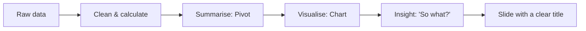

# Session 08: Practice Lab: Excel Analysis to PowerPoint Story

> Module: Effective Productivity through Office Automation · Term 1 (CPISM) · ⏱ ~2 hours

## 🎯 Learning Objectives

By the end of this session you will be able to:

- Revise formulas, data tools, PivotTables and charts from Sessions 04-06
- Link Excel charts into PowerPoint so they update automatically
- Turn numbers into a short data story
- Combine Word, Excel and PowerPoint skills in one deliverable
- Review and complete pending assignments from Sessions 01-07

## 📖 Concepts Explained

This is a **practice and integration session**. You will move data from Excel into a presentation.

### Paste options when moving a chart into PowerPoint

| Option | What you get | Updates when Excel changes? |
|--------|--------------|-----------------------------|
| Use Destination Theme & Embed Workbook | A copy of chart + data inside the pptx | No |
| Keep Source Formatting & Link Data | Chart linked to the original xlsx | Yes (Chart Design > Refresh Data) |
| Picture | A static image | No |

> Use **Link** for weekly reports, **Embed** when sending the file to someone without the workbook, **Picture** for final PDFs.

### From data to story (the "So what?" test)



A weak slide title is "Sales by City". A strong one is **"Karachi brings 58% of sales, so we should open a second store there"**. The title states the insight; the chart is the evidence.

### Choosing the right chart (revision)

| Question | Chart |
|----------|-------|
| Which is biggest? | Bar / Column |
| How did it change? | Line |
| What share? | Pie / Doughnut (few parts) |
| Is there a relationship? | Scatter |
| Target vs actual? | Combo (column + line) |

### Revision checklist for Sessions 04-07
- [ ] I can explain `$A$1` vs `A1`.
- [ ] I can write IF, COUNTIF, SUMIFS and XLOOKUP without help.
- [ ] I can run Goal Seek and protect a sheet.
- [ ] I can build a PivotTable with a slicer.
- [ ] I can use Slide Master and Presenter View.

## 💻 Code Examples

Use this monthly KPI data. The steps file explains the full flow from Excel to PowerPoint.

### Example 1: `kpi.csv`

📄 Saved in this folder as [`kpi.csv`](kpi.csv).

```csv
Month,Target,Actual,NewStudents,Dropouts
Jan,120,105,40,3
Feb,120,118,35,2
Mar,130,142,52,4
Apr,130,125,38,5
May,140,151,60,2
Jun,140,133,41,6
```

**How it works**

- `Target` vs `Actual` is perfect for a combo chart (columns for actual, line for target).
- Add `Achievement %` = `=C2/B2` and conditional formatting (green >= 100%).

### Example 2: `lab-steps.txt`

📄 Saved in this folder as [`lab-steps.txt`](lab-steps.txt).

```text
 EXCEL
 1. Import kpi.csv, Format as Table, add Achievement % (=[@Actual]/[@Target])
 2. Insert > Combo chart: Actual = Clustered Column, Target = Line
 3. Add =AVERAGE(), =MAX() and an XLOOKUP that returns the month with the max Actual:
    =XLOOKUP(MAX(C2:C7),C2:C7,A2:A7)
 4. Save as kpi-report.xlsx

 POWERPOINT
 5. New deck, apply a theme, title slide "Half-Year Admissions Review"
 6. Copy the chart in Excel -> in PowerPoint: Paste Special > Keep Source Formatting & Link Data
 7. Write an insight title, e.g. "We beat target in March and May"
 8. Change one value in Excel, return to PowerPoint: Chart Design > Refresh Data
 9. Add a summary table slide and a "Recommendations" slide
10. Export PDF
```

**How it works**

- Step 3 uses `XLOOKUP` with `MAX` to find *which* month had the best result.
- Steps 6-8 prove the link: the slide chart changes after Refresh Data.

## 🧪 Lab Practice

1. Complete steps 1-4 in `lab-steps.txt` and check that your combo chart has a title, legend and data labels on the line.
2. Complete steps 5-10 and confirm the linked chart refreshes.
3. Rewrite every slide title in your deck so it passes the "So what?" test.
4. Write a one-page Word memo summarising the results, and paste the chart into it as a *Picture*.
5. Go through the revision checklist above; finish any pending Session 01-07 assignments.

## 📝 Assignment

Using `orders.csv` from Session 06 (or your own data), build a 5-slide **Sales Review** deck with at least two linked charts and one PivotChart image. Every slide title must be an insight. Submit `.xlsx`, `.pptx` and `.pdf`.

## ❓ Quick Quiz

**Q1.** Which paste option keeps a chart updated from Excel?

- a) Picture
- b) Embed workbook
- c) Link Data
- d) Paste text

**Q2.** Which chart compares target with actual best?

- a) Pie
- b) Combo
- c) Radar
- d) Area

**Q3.** Rewrite 'Admissions by Month' as an insight title.

**Q4.** What happens to an embedded chart when the original workbook changes?

**Q5.** Which formula returns the month with the highest Actual?

<details>
<summary>Show answers</summary>

1. c) Link Data
2. b) Combo
3. For example: 'Admissions beat target in March and May'.
4. Nothing; embedded data is a separate copy inside the presentation.
5. `=XLOOKUP(MAX(C2:C7),C2:C7,A2:A7)`

</details>

## 💼 Interview Questions

**1. How do you present data to non-technical managers?**

<details>
<summary>Model answer</summary>

Lead with the insight in the title, show one simple chart per point, remove clutter, give context (target, last year) and end with a recommendation.

</details>

**2. Linked vs embedded charts: pros and cons?**

<details>
<summary>Model answer</summary>

Linked: always current, smaller file, but breaks if the workbook moves. Embedded: self-contained and portable, but larger and must be updated manually.

</details>

**3. How do you check your numbers before a presentation?**

<details>
<summary>Model answer</summary>

Cross-check totals with a second method (pivot vs SUMIFS), check filters, look for outliers, and have a colleague review.

</details>

## ✅ Summary

- Excel calculates; PowerPoint tells the story.
- Link charts for living reports, embed for portability, paste pictures for final copies.
- Insight titles make slides meaningful.
- Pick charts by the question you are answering.
- Use the checklist to close gaps before moving on.

---

[⬅ Previous](../Session-07-PowerPoint-Fundamentals/README.md) · [🏠 Module Home](../README.md) · [Next ➡](../Session-09-PowerPoint-Advanced-Animations-Morph-and-AI/README.md)

Prepared by Zeeshan Abbas · Aptech Learning North Nazimabad
