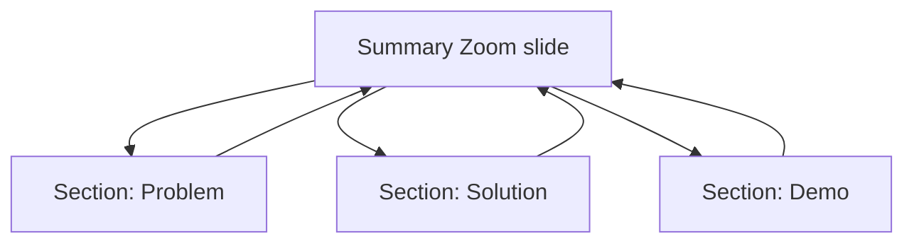

# Session 09: PowerPoint Advanced: Animations, Morph, Zoom, Icons, 3D and AI

> Module: Effective Productivity through Office Automation · Term 1 (CPISM) · ⏱ ~2 hours

## 🎯 Learning Objectives

By the end of this session you will be able to:

- Use the Home, Insert and Design tabs efficiently
- Apply entrance, emphasis, exit and motion-path animations with the Animation Pane
- Create smooth Morph transitions
- Use Summary, Section and Slide Zoom for non-linear navigation
- Insert and style Icons, SVG graphics and 3D models
- Generate and refine a presentation with AI tools; use Review and View features

## 📖 Concepts Explained

### 1. Tabs at a glance

| Tab | Highlights |
|-----|------------|
| Home | New Slide, Layout, Reset, Arrange, Shape Fill, Designer |
| Insert | Pictures, Icons, 3D Models, Shapes, SmartArt, Chart, Video, Zoom, Equation |
| Design | Themes, Variants, Slide Size (16:9 / 4:3), Format Background |
| Review | Spelling, Comments, Compare, Accessibility, Translate |
| View | Slide Master, Outline, Guides, Gridlines, Zoom |

### 2. Animations vs Transitions
- **Transition** = how the *whole slide* enters (Fade, Push, Morph).
- **Animation** = how an *object* on the slide moves.

| Animation type | Colour in menu | Example use |
|----------------|----------------|-------------|
| Entrance | Green | Bullet appears one at a time |
| Emphasis | Yellow | Pulse a key number |
| Exit | Red | Remove a wrong answer |
| Motion Path | Lines | Move a car across a map |

Use the **Animation Pane** to order effects and set *Start: On Click / With Previous / After Previous*, plus duration and delay. **Animation Painter** copies an animation to other objects. Keep it subtle: animation should guide attention, not entertain.

### 3. Morph transition
Morph animates the change between two slides that share the same objects. Steps:
1. Build slide A.
2. Duplicate it (`Ctrl + D`) to make slide B.
3. On slide B move/resize/recolour the objects.
4. Apply **Transitions > Morph** to slide B.

Tip: name objects with `!!` prefix (Selection Pane, e.g. `!!circle`) to force Morph to match them.

### 4. Zoom
- **Summary Zoom**: one slide with thumbnails of chosen sections; click to jump and return.
- **Section Zoom**: link to a section.
- **Slide Zoom**: link to a single slide.



### 5. Icons, SVG and 3D models
- Insert > Icons gives free SVG icons. SVG = scalable vector graphics, so they stay sharp at any size and you can recolour them. Right-click > *Convert to Shape* to edit parts.
- Insert > 3D Models > Stock 3D Models; rotate with the 3D handle and use **3D Animations** (Turntable, Swing). Combined with Morph, a 3D model can spin between slides.

### 6. Creating presentations with AI
- **Copilot in PowerPoint** (Microsoft 365): "Create a presentation about renewable energy in Pakistan with 8 slides".
- **Designer** proposes layouts; **Microsoft Designer** or other image tools create images.
- Workflow: AI outline > you fix the story > AI layout ideas > you check facts, images (licensing) and accessibility.

### 7. Review and View
Comments with @mentions for teamwork, **Compare** two versions, **Check Accessibility**, **Translate**. View > Guides and Gridlines for neat alignment.

## 💻 Code Examples

A storyboard file and a prompt file help you plan animations and AI usage before touching the mouse.

### Example 1: `morph-storyboard.md`

📄 Saved in this folder as [`morph-storyboard.md`](morph-storyboard.md).

```markdown
# Morph storyboard: "How a web page loads"
| Slide | Objects (same names on every slide) | Change |
|-------|-------------------------------------|--------|
| 1 | !!browser, !!server, !!packet | packet next to browser |
| 2 | !!browser, !!server, !!packet | packet moves to server (Morph) |
| 3 | !!browser, !!server, !!packet | server glows (Emphasis: Pulse) |
| 4 | !!browser, !!server, !!packet | packet returns, browser shows page (Morph) |

Animation Pane (slide 3):
1. !!server  Emphasis > Pulse   Start: After Previous  Duration 0.5s
2. Caption   Entrance > Fade    Start: After Previous  Delay 0.25s
```

**How it works**

- Planning object names and changes in a table makes Morph predictable.
- The `!!` prefix ensures PowerPoint pairs the same object across slides.

### Example 2: `ai-prompts.txt`

📄 Saved in this folder as [`ai-prompts.txt`](ai-prompts.txt).

```text
PROMPT 1 (outline)
Create an 8-slide outline for first-year IT students titled "Staying Safe Online".
Audience: 17-20 years old. Tone: friendly. Each slide: title + 3 short bullets.

PROMPT 2 (speaker notes)
Write 60-word speaker notes for this slide: <paste slide text>

PROMPT 3 (improve)
Rewrite these bullets to be under 6 words each, keep meaning: <paste bullets>

VERIFY BEFORE USING
- Are facts and numbers correct? (check an official source)
- Is the image free to use? (Insert > Stock Images is safe)
- Did I remove any personal or private data?
```

**How it works**

- Good prompts state audience, length, tone and format.
- The verification list keeps you responsible for accuracy and copyright.

## 🧪 Lab Practice

1. Build the 4-slide Morph sequence from `morph-storyboard.md` using shapes and icons. Rename objects in the Selection Pane (`Alt + F10`).
2. On a bullet slide, animate bullets to appear one by one (Entrance > Fade, After Previous) and add a Pulse emphasis to a key statistic.
3. Create three sections (Problem, Solution, Demo) and add a **Summary Zoom** slide at the start. Test navigation in Slide Show.
4. Insert a stock 3D model, rotate it, and apply a Turntable 3D animation. Duplicate the slide and Morph it to a new angle.
5. Use `ai-prompts.txt` with an AI tool to draft an 8-slide outline, import it, then run Check Accessibility and fix every issue.

## 📝 Assignment

Create an interactive **"Our Solar System"** (or any topic) deck: a Summary Zoom menu, at least two Morph transitions, one 3D model or SVG icon set, sensible animations, and an AI-assisted outline that you have fact-checked (add a "Sources" slide).

## ❓ Quick Quiz

**Q1.** Which transition animates objects between two similar slides?

- a) Fade
- b) Push
- c) Morph
- d) Wipe

**Q2.** What colour are Exit animations in the gallery?

- a) Green
- b) Yellow
- c) Red
- d) Blue

**Q3.** Why are SVG icons better than JPG for logos?

**Q4.** What is the difference between Summary Zoom and Slide Zoom?

**Q5.** What does the `!!` prefix do in object names?

<details>
<summary>Show answers</summary>

1. c) Morph
2. c) Red
3. SVGs are vectors: they scale without blur and can be recoloured or edited.
4. Summary Zoom creates a menu of several sections on one slide; Slide Zoom links to one specific slide.
5. It forces Morph to match objects with the same name across slides.

</details>

## 💼 Interview Questions

**1. When are animations harmful?**

<details>
<summary>Model answer</summary>

When they distract, slow the talk or are inconsistent; use them only to reveal information step by step or highlight something.

</details>

**2. How would you use AI to make a deck faster while keeping quality?**

<details>
<summary>Model answer</summary>

Use AI for outlines, wording and layout ideas; then verify facts, edit for audience, ensure licensed images, and run accessibility checks.

</details>

**3. How can PowerPoint help non-linear presentations?**

<details>
<summary>Model answer</summary>

Zoom (Summary/Section/Slide), hyperlinks and action buttons let the presenter jump to topics based on audience questions.

</details>

## ✅ Summary

- Transitions move slides; animations move objects.
- Morph creates smooth motion between duplicated slides.
- Zoom adds interactive, non-linear navigation.
- Icons/SVG and 3D models give modern visuals.
- AI accelerates drafting, but you must verify and refine.

---

[⬅ Previous](../Session-08-Excel-and-PowerPoint-Practice-Lab/README.md) · [🏠 Module Home](../README.md) · [Next ➡](../Session-10-Microsoft-OneNote/README.md)

Prepared by Zeeshan Abbas · Aptech Learning North Nazimabad
