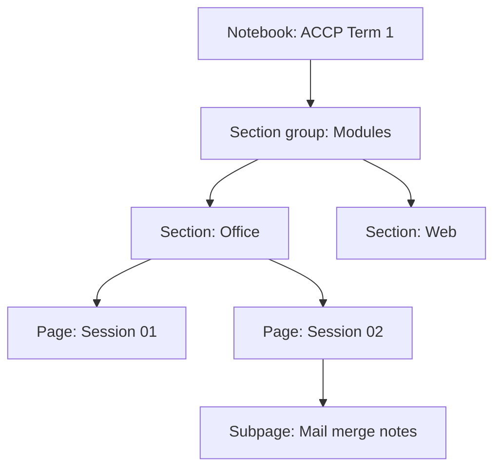

# Session 10: Understanding Microsoft OneNote: Your Digital Notebook

> Module: Effective Productivity through Office Automation · Term 1 (CPISM) · ⏱ ~2 hours

## 🎯 Learning Objectives

By the end of this session you will be able to:

- Explain the OneNote structure of notebooks, section groups, sections and pages
- Capture typed, handwritten, audio and web content
- Use tags, to-do lists, search and templates
- Use tools such as Math, Immersive Reader, Dictate and Researcher
- Share and sync notebooks across devices

## 📖 Concepts Explained

### 1. Structure (like a physical binder)



| Binder | OneNote |
|--------|---------|
| Binder | Notebook |
| Divider tabs | Sections (colour-coded) |
| Sheets | Pages and subpages |

OneNote saves automatically. Notebooks live in OneDrive, so they sync to phone, laptop and the web.

### 2. Capturing anything
- Click anywhere and type: each block is a movable **note container**.
- **Draw** tab: handwriting, highlighter, *Ink to Text*, *Ink to Shape*.
- **Insert**: pictures, files (as printout or attachment), tables, audio and video recording, links.
- **Web Clipper** browser extension and **Send to OneNote** (`Win + Shift + S` then send) collect research.
- **Dictate** (Home tab): speak and OneNote types.

### 3. Organise and find
- **Tags** (`Ctrl + 1` To Do, `Ctrl + 2` Important, `Ctrl + 3` Question). *Find Tags* builds a summary page of all tagged items.
- **Search** (`Ctrl + E`) finds text, even inside pictures (OCR) and handwriting.
- **Page templates** (desktop app: Insert > Page Templates) for lecture notes, meeting notes, to-do lists.
- Link pages with `[[Page name]]` wiki-links.

### 4. Learning tools
| Tool | Helps you |
|------|-----------|
| Math | Solve and graph handwritten or typed equations |
| Immersive Reader | Read aloud, line focus, syllables, translation |
| Researcher / Copilot (M365) | Find sources or summarise notes |
| Translate | Translate a selection or page |

### 5. Collaborating
Share > invite people (can edit / can view). Changes sync live; author initials show who wrote what. **Page Versions** (History tab) restore older content. Teachers use **Class Notebook** in Teams for handouts and private student spaces.

### 6. What's new (recent versions)
Dark mode, improved sticky notes sync, Ink replay, better tag search, Copilot summaries in Microsoft 365, and sorting pages. The older *OneNote 2016* desktop app and the new *OneNote* app have merged features over time; on Windows use the app called simply **OneNote**.

## 💻 Code Examples

OneNote needs no code, but templates make notes consistent. Copy these into a OneNote page and save as your own template (desktop app: Insert > Page Templates > Save current page as a template).

### Example 1: `cornell-notes-template.md`

📄 Saved in this folder as [`cornell-notes-template.md`](cornell-notes-template.md).

```markdown
# Session __: ____________________   Date: ___/___/____

| Cue / Questions (left) | Notes (right) |
|------------------------|---------------|
| What is ...?           |               |
| Why does ...?          |               |
| Example?               |               |

**Summary (3 lines, in my own words):**
1.
2.
3.

**To Do** (Ctrl + 1)
- [ ] Finish lab task
- [ ] Revise quiz
```

**How it works**

- The Cornell method splits a page into questions, notes and a summary, which improves recall.
- The to-do items become OneNote check boxes when you press `Ctrl + 1`.

### Example 2: `meeting-notes-template.md`

📄 Saved in this folder as [`meeting-notes-template.md`](meeting-notes-template.md).

```markdown
# Meeting: ________________   Date/Time: ________
**Attendees:**
**Agenda:**
1.
2.
**Decisions:**
-
**Action items:**
| Task | Owner | Due |
|------|-------|-----|
|      |       |     |
**Next meeting:**
```

**How it works**

- Use it with Outlook: from a calendar item choose *Meeting Notes* to insert details automatically.
- Assign action items with tags and `@mentions` in shared notebooks.

## 🧪 Lab Practice

1. Create a notebook **ACCP Term 1** in OneDrive with a section group *Modules* and sections Office, Web, Git, SEO.
2. In Office > *Session 10* page, paste the Cornell template, type notes, and tag three items (To Do, Important, Question). Use *Find Tags* to summarise them.
3. Handwrite (or draw with the mouse) an equation like `2x + 6 = 14` and use **Math** to solve it. Try *Ink to Text* on a handwritten word.
4. Clip a web article using OneNote Web Clipper (or copy-paste with source link), then search for a word from it with `Ctrl + E`.
5. Share the notebook with a classmate as *Can edit*, both edit the same page, and view the author names and Page Versions.

## 📝 Assignment

Build a **Study Planner notebook** for the rest of this term: one page per module with a weekly to-do table, a Cornell page for one session of each module, and a tagged "Questions for teacher" page. Share a view-only link with your instructor.

## ❓ Quick Quiz

**Q1.** Put in order from biggest to smallest: page, notebook, section.

**Q2.** Which shortcut adds a To Do tag?

- a) Ctrl + 1
- b) Ctrl + T
- c) Ctrl + D
- d) Alt + 1

**Q3.** Can OneNote search text inside images?

- a) Yes, using OCR
- b) No
- c) Only PDFs
- d) Only in Teams

**Q4.** Where do OneNote notebooks sync from?

**Q5.** Name one learning tool in OneNote and what it does.

<details>
<summary>Show answers</summary>

1. Notebook > Section > Page.
2. a) Ctrl + 1
3. a) Yes, using OCR
4. OneDrive (or SharePoint for organisations).
5. Immersive Reader reads text aloud and improves readability; Math solves equations.

</details>

## 💼 Interview Questions

**1. How would you use OneNote in a project team?**

<details>
<summary>Model answer</summary>

A shared notebook with sections for requirements, meetings and research; meeting templates with action items, tags for tasks, and links to files in OneDrive/Teams.

</details>

**2. OneNote vs Word: when to use which?**

<details>
<summary>Model answer</summary>

OneNote for free-form, evolving notes and research; Word for formal, structured documents that will be printed or submitted.

</details>

**3. How do you recover something deleted from a shared notebook?**

<details>
<summary>Model answer</summary>

Check Page Versions in the History tab or the Notebook Recycle Bin.

</details>

## ✅ Summary

- Notebook > Section group > Section > Page > Subpage.
- Capture typing, ink, audio, web clips and files anywhere on a page.
- Tags and search make notes actionable and findable.
- Math, Immersive Reader and Dictate support learning.
- OneDrive sharing enables live collaboration and version history.

---

[⬅ Previous](../Session-09-PowerPoint-Advanced-Animations-Morph-and-AI/README.md) · [🏠 Module Home](../README.md) · [Next ➡](../Session-11-Outlook-Teams-and-OneDrive/README.md)

Prepared by Zeeshan Abbas · Aptech Learning North Nazimabad
