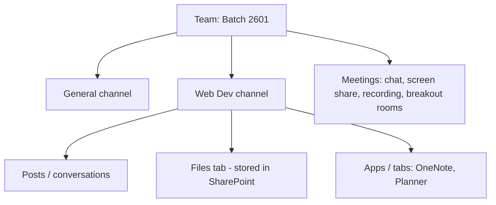

# Session 11: Communicating and Collaborating: Outlook, Skype/Teams and OneDrive

> Module: Effective Productivity through Office Automation · Term 1 (CPISM) · ⏱ ~2 hours

## 🎯 Learning Objectives

By the end of this session you will be able to:

- Explain the functions of Outlook: mail, calendar, contacts, tasks
- Organise email with folders, categories, rules, flags and Focused Inbox
- Schedule meetings and share a calendar
- Compare Skype, Skype for Business and Microsoft Teams, and use Teams for chats, channels and meetings
- Use OneDrive to store, share, co-author and sync files with your PC

## 📖 Concepts Explained

### 1. Outlook: your communication hub

| Module | Use |
|--------|-----|
| Mail | Send, receive, organise email |
| Calendar | Appointments, meetings, reminders |
| People | Contacts and groups |
| To Do / Tasks | Flagged emails and task lists |

**Professional email checklist:** clear subject, greeting, short paragraphs, one request per email, polite closing, signature, check attachments before Send.

### 2. Organising the inbox
- **Folders** for projects; **Categories** (colour labels) across folders, e.g. *Red = Urgent*, *Blue = Course*.
- **Rules** (Home > Rules): "Move messages from noreply@classroom.google.com to folder Classroom".
- **Flags** turn email into a to-do with a due date.
- **Focused Inbox** separates important mail from newsletters.
- **Quick Steps**: one-click actions such as *Move to Done + mark read*.
- Search filters: `from:ali hasattachments:yes`.

### 3. Calendar
New Meeting > add attendees > **Scheduling Assistant** shows when people are free > add a Teams meeting link > Send. Use recurring events for classes, set reminders, and share your calendar with *Can view when I'm busy*.

### 4. Skype, Skype for Business and Teams

| Product | Status | Purpose |
|---------|--------|---------|
| Skype | Retired by Microsoft in May 2025 (users moved to Teams Free) | Personal calls and chat |
| Skype for Business | Retired; replaced by Teams | Business calls and meetings |
| Microsoft Teams | Current | Chat, meetings, channels, files, apps |

Teams structure:



Etiquette: reply in threads, use @mentions sparingly, mute when not speaking, blur background, and share a specific window rather than your whole screen.

### 5. OneDrive: files in the cloud
- Store files online and access from any device; free accounts get 5 GB, Microsoft 365 gets 1 TB.
- **Share** > *Anyone/People you choose*, *Can edit/Can view*, optional expiry date and password (M365).
- **Co-authoring**: several people edit a Word/Excel/PowerPoint file at the same time.
- **Version history** restores older copies; the **Recycle bin** keeps deleted files for 30 days.
- **Sync** with the PC: OneDrive folder in File Explorer. Status icons: cloud = online only, green tick = available on this device, solid green = always keep on device. **Files On-Demand** saves disk space.
- **Known Folder Backup** protects Desktop, Documents and Pictures automatically.

## 💻 Code Examples

Templates and a sample rule plan you can reuse at work.

### Example 1: `email-template.txt`

📄 Saved in this folder as [`email-template.txt`](email-template.txt).

```text
Subject: Request: Lab access on Saturday 10 AM - Batch 2601

Dear Ms. Sana,

I hope you are well. Our eProject group (4 students) needs the computer
lab on Saturday from 10:00 AM to 1:00 PM to complete our website testing.

Could you please confirm if Lab 3 is available?

Thank you for your support.

Kind regards,
Ali Raza
ACCP Term 1, Batch 2601
Aptech Learning North Nazimabad
```

**How it works**

- The subject states the action, topic and context so it is easy to search later.
- One clear request with all details (who, what, when, where) gets a faster reply.

### Example 2: `outlook-rules-plan.md`

📄 Saved in this folder as [`outlook-rules-plan.md`](outlook-rules-plan.md).

```markdown
# My Outlook organisation plan
| Rule name | Condition | Action |
|-----------|-----------|--------|
| Classroom | From contains `classroom.google.com` | Move to folder *Classroom* |
| Teacher   | From is my instructor | Category *Blue - Course*, flag for follow-up |
| Newsletters | Subject contains `newsletter` OR `unsubscribe` in body | Move to *Read Later* |
| Invoices  | Has attachment AND subject contains `invoice` | Category *Green - Money* |

Quick Step "Done": Mark as read + Move to *Archive*
```

**How it works**

- Plan rules on paper first so they do not conflict.
- Rules run top to bottom; use *Stop processing more rules* for important ones.

## 🧪 Lab Practice

1. In Outlook (desktop or outlook.com) create folders *Classroom*, *Course*, *Read Later* and two of the rules from `outlook-rules-plan.md`. Send yourself test emails to confirm.
2. Create colour categories and a Quick Step; flag two emails with due dates and view them in To Do.
3. Schedule a recurring weekly study meeting with a Teams link using the Scheduling Assistant and invite a classmate.
4. In Teams create a team (or use the class team), post in a channel, @mention a teammate, upload a file in Files, and co-edit it at the same time.
5. In OneDrive share a folder with *Can view* and a file with *Can edit*; set one file to *Always keep on this device*; restore an older version from Version history.

## 📝 Assignment

Run a 20-minute **virtual group meeting** in Teams for your eProject team: send the Outlook invite with an agenda, share a OneDrive folder, take notes in a shared OneNote page, and email meeting minutes afterwards using a professional template. Submit screenshots of each step.

## ❓ Quick Quiz

**Q1.** Which Outlook feature colour-labels emails across folders?

- a) Rules
- b) Categories
- c) Folders
- d) Archive

**Q2.** What replaced Skype for Business?

- a) Zoom
- b) Microsoft Teams
- c) Outlook
- d) Yammer

**Q3.** What does the cloud icon mean on a OneDrive file?

**Q4.** Which Outlook tool shows when attendees are free?

**Q5.** How long does OneDrive keep deleted files in the Recycle bin by default?

- a) 7 days
- b) 30 days
- c) 1 year
- d) Forever

<details>
<summary>Show answers</summary>

1. b) Categories
2. b) Microsoft Teams
3. The file is online-only; it downloads when you open it (Files On-Demand).
4. The Scheduling Assistant.
5. b) 30 days

</details>

## 💼 Interview Questions

**1. How do you manage a busy inbox?**

<details>
<summary>Model answer</summary>

Rules and folders for routine mail, categories and flags for priorities, Focused Inbox, quick steps, scheduled time blocks for email, and unsubscribing from noise.

</details>

**2. Why share a link instead of attaching a file?**

<details>
<summary>Model answer</summary>

Everyone works on one version, permissions can be controlled or revoked, large files are not limited by email size, and version history is kept.

</details>

**3. Teams channel post vs chat: when to use each?**

<details>
<summary>Model answer</summary>

Channel posts for team-wide, topic-based, searchable conversations; private chat for quick one-to-one or small-group discussions.

</details>

## ✅ Summary

- Outlook combines mail, calendar, people and tasks.
- Folders, categories, rules, flags and quick steps tame the inbox.
- Skype products are retired; Teams is the collaboration platform.
- Teams = teams, channels, chats, meetings and files.
- OneDrive stores, shares, co-authors and syncs files with version history.

---

[⬅ Previous](../Session-10-Microsoft-OneNote/README.md) · [🏠 Module Home](../README.md) · [Next ➡](../Session-12-Collaboration-Practice-Lab-and-Review/README.md)

Prepared by Zeeshan Abbas · Aptech Learning North Nazimabad
