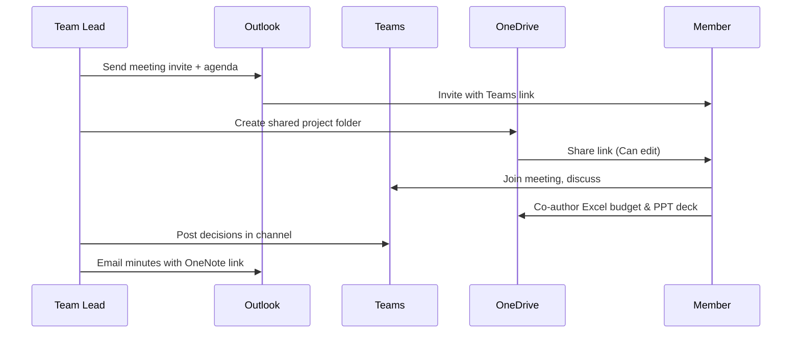

# Session 12: Practice Lab: Collaboration Workflow and Module Review

> Module: Effective Productivity through Office Automation · Term 1 (CPISM) · ⏱ ~2 hours

## 🎯 Learning Objectives

By the end of this session you will be able to:

- Revise PowerPoint advanced features, OneNote, Outlook, Teams and OneDrive
- Run a complete team workflow across Microsoft 365 apps
- Prepare the module mini-project for submission
- Self-test with a mixed review quiz
- Plan how these skills support the web development modules ahead

## 📖 Concepts Explained

This final **practice and review session** links every app together, the way real offices work.

### The connected workflow



### Which app for which job? (revision)

| Job | Best app |
|-----|----------|
| Formal report or letter | Word |
| Calculations, lists, analysis | Excel |
| Visual pitch | PowerPoint |
| Personal or shared notes | OneNote |
| External communication, calendar | Outlook |
| Team chat, meetings | Teams |
| Storage, sharing, backup | OneDrive |

### Module review: top 15 skills

| # | Skill | Session |
|---|-------|---------|
| 1 | Snap Layouts, virtual desktops, file naming | 01 |
| 2 | Styles + automatic TOC | 02 |
| 3 | Mail merge | 02-03 |
| 4 | Templates and forms | 02 |
| 5 | Relative/absolute references | 04 |
| 6 | IF/IFS, COUNTIF, XLOOKUP | 04 |
| 7 | Charts | 04 |
| 8 | SUMIFS, Goal Seek, scenarios | 05 |
| 9 | Protection and encryption | 05 |
| 10 | PivotTables, slicers, PivotCharts | 06 |
| 11 | Slide Master, Presenter View | 07 |
| 12 | Morph, Zoom, 3D | 09 |
| 13 | OneNote tags and sharing | 10 |
| 14 | Outlook rules and calendar | 11 |
| 15 | OneDrive sharing and version history | 11 |

### How this helps in web development
- Excel: plan content inventories and SEO keyword lists.
- Word: write project reports and documentation for the eProject.
- PowerPoint: present your eProject in the viva.
- Teams/OneDrive: collaborate with your team (alongside GitHub later).

## 💻 Code Examples

A submission checklist and a task tracker for the mini-project.

### Example 1: `project-tracker.csv`

📄 Saved in this folder as [`project-tracker.csv`](project-tracker.csv).

```csv
Task,Owner,App,DueDate,Status
Write invitation template,Member 1,Word,2026-02-10,Not started
Prepare guest list,Member 2,Excel,2026-02-10,Not started
Budget workbook with pivot,Member 2,Excel,2026-02-12,Not started
Pitch deck with Morph & Zoom,Member 3,PowerPoint,2026-02-14,Not started
Meeting notes notebook,Member 4,OneNote,2026-02-09,Not started
Calendar invite & minutes,Team Lead,Outlook,2026-02-09,Not started
Shared folder & permissions,Team Lead,OneDrive,2026-02-08,Not started
```

**How it works**

- Import into Excel, format as a table, add a drop-down (Data Validation) for Status: *Not started, In progress, Done*.
- Add conditional formatting so overdue tasks (`DueDate < TODAY()` and not Done) turn red: `=AND($D2<TODAY(),$E2<>"Done")`.

### Example 2: `submission-checklist.md`

📄 Saved in this folder as [`submission-checklist.md`](submission-checklist.md).

```markdown
# Mini-project submission checklist
- [ ] Word: template (.dotx) + merged letters (.docx/.pdf)
- [ ] Excel: Income, Expenses, Summary sheets; SUM/IF/XLOOKUP; chart; PivotTable; protected Summary
- [ ] PowerPoint: 6-8 slides, Slide Master, 1 Morph, 1 Summary Zoom, notes
- [ ] OneNote: Planning, Meetings, To-Do sections with tags
- [ ] Outlook: meeting invite screenshot + minutes email
- [ ] Teams: channel with files tab showing shared files
- [ ] OneDrive: one folder link, correct permissions (view for teacher)
- [ ] AI usage note: what AI drafted and how I verified it
- [ ] File names follow YYYY-MM-DD_topic_version
```

**How it works**

- Tick each item before sending your OneDrive link.
- The AI usage note encourages honest, responsible use of AI tools.

## 🧪 Lab Practice

1. Form teams of four and assign roles using `project-tracker.csv` in a shared Excel file on OneDrive (co-author it live).
2. The team lead sends an Outlook invite with a Teams link and agenda; everyone joins, and one person takes notes in shared OneNote.
3. Each member completes their app deliverable in the shared folder; use comments and @mentions to review each other's work.
4. Rehearse the pitch deck in Presenter View; use Rehearse with Coach if available.
5. Complete the review quiz below individually, then compare answers as a team.

## 📝 Assignment

Finish and submit the **module mini-project** described in the module README using `submission-checklist.md`. Add a one-page reflection in Word: which app saved you the most time, and what you would automate next.

## ❓ Quick Quiz

**Q1.** Which Excel feature lets one click filter several PivotTables?

- a) Freeze Panes
- b) Slicer with Report Connections
- c) Flash Fill
- d) Goal Seek

**Q2.** Which Word feature produces 100 personalised letters from a list?

**Q3.** Which PowerPoint feature smoothly animates objects between slides?

**Q4.** You deleted a file from OneDrive yesterday. Where do you find it?

- a) Teams chat
- b) OneDrive Recycle bin
- c) Outlook Junk
- d) Excel

**Q5.** Which tool is best for a team's quick daily conversations?

- a) Outlook
- b) Teams
- c) Word
- d) OneNote

<details>
<summary>Show answers</summary>

1. b) Slicer with Report Connections
2. Mail Merge.
3. Morph transition.
4. b) OneDrive Recycle bin
5. b) Teams

</details>

## 💼 Interview Questions

**1. Describe how you would organise a team project using Microsoft 365.**

<details>
<summary>Model answer</summary>

Teams for communication, a shared OneDrive/SharePoint folder for files, co-authored Office documents, OneNote for notes, Outlook calendar for meetings, and Planner or an Excel tracker for tasks.

</details>

**2. What productivity habit from this module will you keep?**

<details>
<summary>Model answer</summary>

For example: consistent file naming plus cloud storage with version history, or Outlook rules and flags for a clean inbox.

</details>

**3. How do you use AI responsibly in office work?**

<details>
<summary>Model answer</summary>

Use it for drafts and summaries, never paste confidential data into public tools, verify facts and numbers, and disclose AI use where required.

</details>

## ✅ Summary

- Real work combines Outlook, Teams, OneDrive and the Office apps.
- Use the right app for each job.
- Shared folders, co-authoring and version history make teamwork safe.
- Review the top 15 skills and close any gaps.
- These skills support documentation and presentation in the web modules and eProject.

---

[⬅ Previous](../Session-11-Outlook-Teams-and-OneDrive/README.md) · [🏠 Module Home](../README.md) · [Next ➡](../../02-Progressive-Website-Development/README.md)

Prepared by Zeeshan Abbas · Aptech Learning North Nazimabad
