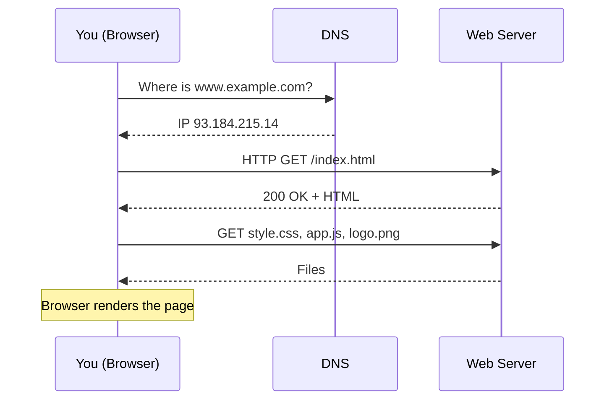

# Session 01: Introduction to the Web and HTML5: Page Structure, Text Formatting and Hyperlinks

> Module: Progressive Website Development (HTML5, CSS3 and JavaScript) · Term 1 (CPISM) · ⏱ ~2 hours

## 🎯 Learning Objectives

By the end of this session you will be able to:

- Explain how browsers, servers, URLs and HTML work together, and how HTML evolved to HTML5
- Describe the roles of HTML, CSS, JavaScript (and libraries like jQuery) in a web page
- Write a valid HTML5 document with DOCTYPE, head and body
- Use headings, paragraphs, formatting tags, preformatted text, quotes, lists and entities
- Create hyperlinks with absolute and relative paths, email links and in-page anchors

## 📖 Concepts Explained

### 1. How the web works



### 2. The three layers of a page

| Layer | Technology | Analogy (a house) |
|-------|------------|-------------------|
| Structure | HTML | Walls and rooms |
| Presentation | CSS | Paint and furniture |
| Behaviour | JavaScript | Electricity, doors that open |

**jQuery** is a JavaScript *library* that once made DOM work easier; you will use it in Module 03.

### 3. A short history
HTML 1 (1991, Tim Berners-Lee) > HTML 4.01 (1999) > XHTML (stricter) > **HTML5** (2014) > today the **HTML Living Standard** maintained by WHATWG and updated continuously. HTML5 added semantic tags (`<header>`, `<nav>`, `<article>`), native `<audio>`/`<video>`, `<canvas>`, new form inputs, and APIs like Geolocation and Web Storage. All modern browsers (Chrome, Edge, Firefox, Safari) support it, which made HTML5 ideal for mobile devices: one responsive site works everywhere without plug-ins like Flash.

### 4. Anatomy of an element

```
<a href="about.html" title="About us">About</a>
└┬┘ └──────── attributes ────────┘ └content┘ └closing tag┘
opening tag
```

- **Container (paired) tags** wrap content: `<p>...</p>`.
- **Void (standalone) tags** have no content: `<br>`, ``, `<hr>`, `<meta>`, `<input>`.
- **Attributes** add information: `id`, `class`, `href`, `src`, `alt`, `lang`. Global attributes work on every element.
- **Entities** show reserved or special characters: `&lt;` (<), `&gt;` (>), `&amp;` (&), `&copy;` (©), `&nbsp;` (non-breaking space).
- HTML values are text; data "types" in the spec include URLs, numbers, colours, dates and booleans (e.g. `disabled`).

### 5. Formatting text

| Purpose | Tag |
|---------|-----|
| Headings (one `h1` per page) | `<h1>`-`<h6>` |
| Paragraph / line break | `<p>`, `<br>` |
| Important / emphasis | `<strong>`, `<em>` |
| Bold / italic (style only) | `<b>`, `<i>` |
| Highlight, small print | `<mark>`, `<small>` |
| Sub/superscript | `<sub>`, `<sup>` (H<sub>2</sub>O, x<sup>2</sup>) |
| Code, keyboard keys | `<code>`, `<kbd>` (monospaced) |
| Preformatted (keeps spaces) | `<pre>` |
| Long / short quotation | `<blockquote>`, `<q>` |

Lists: unordered `<ul>`, ordered `<ol>` (attributes `type`, `start`, `reversed`), description `<dl><dt><dd>`. Lists can be nested.

Background colour and images are set with **CSS** today (`background-color`, `background-image`); the old `bgcolor` attribute is obsolete.

### 6. Hyperlinks and paths

| Path type | Example | Use |
|-----------|---------|-----|
| Absolute URL | `https://developer.mozilla.org/` | Other websites |
| Relative (same folder) | `about.html` | Pages in your site |
| Relative (sub-folder) | `pages/contact.html` | |
| Relative (parent) | `../index.html` | Go up one folder |
| Root-relative | `/images/logo.png` | From site root (on a server) |

Special links: `mailto:info@example.com`, `tel:+922112345678`, in-page anchor `#section-id`, download `download` attribute, new tab `target="_blank" rel="noopener"`.

## 💻 Code Examples

### Example 1: `index.html`

📄 Saved in this folder as [`index.html`](index.html).

```html
<!DOCTYPE html>
<html lang="en">
<head>
  <meta charset="UTF-8">
  <meta name="viewport" content="width=device-width, initial-scale=1.0">
  <title>My First Web Page</title>
</head>
<body>
  <h1>Welcome to Karachi Tech Hub</h1>
  <p>This page is written in <strong>HTML5</strong>. It is <em>simple</em> but valid.</p>

  <nav>
    <a href="#courses">Courses</a> |
    <a href="about.html">About us</a> |
    <a href="https://developer.mozilla.org/" target="_blank" rel="noopener">MDN Docs</a> |
    <a href="mailto:info@example.com?subject=Course%20enquiry">Email us</a>
  </nav>

  <h2 id="courses">Our Courses</h2>
  <ol>
    <li>Web Design
      <ul>
        <li>HTML5</li>
        <li>CSS3</li>
      </ul>
    </li>
    <li>JavaScript</li>
    <li>Version Control with Git</li>
  </ol>

  <h2>Glossary</h2>
  <dl>
    <dt>HTML</dt><dd>The structure of a web page.</dd>
    <dt>CSS</dt><dd>The style of a web page.</dd>
  </dl>

  <h2>Formatting demo</h2>
  <p>Water is H<sub>2</sub>O and area is r<sup>2</sup>. Press <kbd>Ctrl</kbd> + <kbd>S</kbd> to save.</p>
  <p><mark>Highlighted</mark>, <small>small print</small>, and code: <code>&lt;p&gt;Hello&lt;/p&gt;</code></p>
  <pre>
Name      Course
Ali       HTML5
Sara      CSS3
  </pre>
  <blockquote cite="https://www.w3.org/">
    The power of the Web is in its universality.
  </blockquote>
  <hr>
  <p>&copy; 2026 Karachi Tech Hub</p>
</body>
</html>
```

**How it works**

- `<!DOCTYPE html>` tells the browser to use modern standards mode.
- `<html lang="en">` sets the language for screen readers and search engines.
- `<meta charset="UTF-8">` supports every language (including Urdu), and the `viewport` meta tag makes the page fit mobile screens.
- The nav shows four link types: in-page anchor (`#courses` jumps to `id="courses"`), relative (`about.html`), absolute (MDN) and `mailto:`.
- Nested `<ul>` inside `<li>` creates a sub-list; `<dl>` pairs terms and descriptions.
- `&lt;` and `&gt;` display `<` and `>` instead of being read as tags.

### Example 2: `about.html`

📄 Saved in this folder as [`about.html`](about.html).

```html
<!DOCTYPE html>
<html lang="en">
<head>
  <meta charset="UTF-8">
  <meta name="viewport" content="width=device-width, initial-scale=1.0">
  <title>About Us</title>
</head>
<body>
  <h1>About Karachi Tech Hub</h1>
  <p>We teach modern web development to beginners.</p>
  <p>Call us: <a href="tel:+922100000000">021-0000-0000</a></p>
  <p><a href="index.html">&larr; Back to Home</a></p>
</body>
</html>
```

**How it works**

- `index.html` and `about.html` are in the same folder, so a plain relative link works both ways.
- `tel:` links open the phone dialer on mobile devices.
- `&larr;` is the entity for a left arrow (←).

## 🧪 Lab Practice

1. Install VS Code and the Live Server extension. Open this session folder and run `index.html` with *Open with Live Server*.
2. Type `!` then `Tab` in a new file to generate an HTML5 skeleton (Emmet). Create `profile.html` with your name in `<h1>`, a paragraph about you, and a nested list of hobbies.
3. Add a description list of five web terms and a `<pre>` block showing a small timetable.
4. Link `profile.html` to `index.html` and back. Add an email link and an anchor link that jumps to a section at the bottom.
5. Validate both files at the W3C Markup Validator and fix every error.

## 📝 Assignment

Create a three-page mini site `home.html`, `courses.html`, `contact.html` in a folder `my-site`. Every page must share the same navigation, use at least six different formatting tags, one nested list, one entity, and links of every type learned today (relative, absolute, anchor, mailto, tel).

## ❓ Quick Quiz

**Q1.** Which declaration starts every HTML5 document?

- a) <html5>
- b) <!DOCTYPE html>
- c) <?xml?>
- d) <meta html5>

**Q2.** Which of these is a void (standalone) element?

- a) <p>
- b) <a>
- c) 
- d) <li>

**Q3.** Which entity displays the < symbol?

- a) &gt;
- b) &lt;
- c) &amp;
- d) &copy;

**Q4.** Write a link from `pages/contact.html` back to `index.html` in the parent folder.

**Q5.** What is the difference between `<strong>` and `<b>`?

<details>
<summary>Show answers</summary>

1. b) <!DOCTYPE html>
2. c) 
3. b) &lt;
4. `<a href="../index.html">Home</a>`
5. `<strong>` means important content (semantic, read with emphasis by screen readers); `<b>` is only visual bold.

</details>

## 💼 Interview Questions

**1. What happens when you type a URL in the browser?**

<details>
<summary>Model answer</summary>

DNS resolves the domain to an IP, the browser opens a connection (TCP/TLS), sends an HTTP request, receives HTML, then requests CSS/JS/images, builds the DOM and CSSOM, and renders the page.

</details>

**2. Why is the DOCTYPE important?**

<details>
<summary>Model answer</summary>

It switches the browser into standards mode; without it, browsers use quirks mode and layout may break.

</details>

**3. Absolute vs relative URLs - when do you use each?**

<details>
<summary>Model answer</summary>

Absolute for external resources; relative for files within your own site so links keep working when the site moves to another domain or folder.

</details>

## ✅ Summary

- HTML = structure, CSS = style, JavaScript = behaviour.
- HTML5 is now a Living Standard with semantic tags, media and APIs.
- Every page needs DOCTYPE, `<html lang>`, `<head>` with charset/viewport/title, and `<body>`.
- Use semantic formatting tags, lists and entities correctly.
- Links can be absolute, relative, anchors, email or phone.

---

[⬅ Previous](../README.md) · [🏠 Module Home](../README.md) · [Next ➡](../Session-02-Practice-Lab-HTML-Multi-Page-Site/README.md)

Prepared by Zeeshan Abbas · Aptech Learning North Nazimabad
