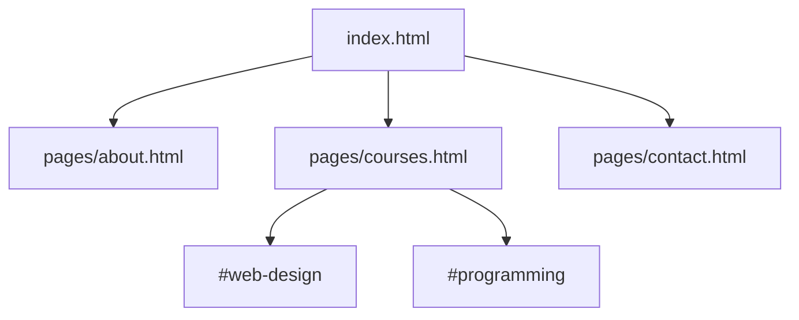

# Session 02: Practice Lab: Building a Multi-page HTML Site

> Module: Progressive Website Development (HTML5, CSS3 and JavaScript) · Term 1 (CPISM) · ⏱ ~2 hours

## 🎯 Learning Objectives

By the end of this session you will be able to:

- Plan a small website with a sitemap and folder structure
- Write clean, indented, valid HTML for several linked pages
- Apply text formatting, lists and entities in real content
- Use relative paths across sub-folders correctly
- Debug broken links and markup with DevTools and the validator

## 📖 Concepts Explained

This is a **practice session** for Session 01. Build first, then check against the rules below.

### Plan before you code



Folder structure:

```
recipe-site/
├── index.html
├── pages/
│   ├── about.html
│   └── recipes.html
└── images/
```

### Clean code rules
1. Lower-case tag and file names, no spaces in file names (`chicken-karahi.html`).
2. Indent nested elements with 2 spaces.
3. Always close container tags and quote attribute values.
4. One `<h1>` per page, headings in order (do not jump from h2 to h4).
5. Every page has a `<title>` that describes it.

### Debugging toolkit

| Problem | How to find it |
|---------|----------------|
| Link goes to 404 | Hover the link and read the URL in the status bar; check `../` levels |
| Layout looks wrong | DevTools (`F12`) > Elements to see the real tree |
| Missing closing tag | W3C validator error list |
| Special character shows as ? | Add `<meta charset="UTF-8">` and save file as UTF-8 |

## 💻 Code Examples

Starter solution for a recipe site. Files sit in this folder: `index.html` and `pages/recipes.html`.

### Example 1: `index.html`

📄 Saved in this folder as [`index.html`](index.html).

```html
<!DOCTYPE html>
<html lang="en">
<head>
  <meta charset="UTF-8">
  <meta name="viewport" content="width=device-width, initial-scale=1.0">
  <title>Desi Recipes - Home</title>
</head>
<body>
  <h1>Desi Recipes</h1>
  <p>Simple Pakistani recipes for students living away from home.</p>
  <p>
    <a href="pages/recipes.html">All recipes</a> |
    <a href="pages/recipes.html#karahi">Jump to Chicken Karahi</a>
  </p>
  <h2>Why cook at home?</h2>
  <ul>
    <li>Saves money &ndash; up to 50% compared with delivery</li>
    <li>Healthier food</li>
    <li>A useful life skill</li>
  </ul>
  <p><small>&copy; 2026 Desi Recipes. Made for practice.</small></p>
</body>
</html>
```

**How it works**

- `pages/recipes.html#karahi` opens another page **and** jumps to the element with `id="karahi"`.
- `&ndash;` is an en dash, `&copy;` a copyright sign.

### Example 2: `pages/recipes.html`

📄 Saved in this folder as [`pages/recipes.html`](pages/recipes.html).

```html
<!DOCTYPE html>
<html lang="en">
<head>
  <meta charset="UTF-8">
  <meta name="viewport" content="width=device-width, initial-scale=1.0">
  <title>Recipes - Desi Recipes</title>
</head>
<body>
  <p><a href="../index.html">&larr; Home</a></p>
  <h1>Recipes</h1>
  <p>Contents: <a href="#daal">Daal Chawal</a> &middot; <a href="#karahi">Chicken Karahi</a></p>

  <h2 id="daal">Daal Chawal</h2>
  <h3>Ingredients</h3>
  <ul>
    <li>1 cup masoor daal</li>
    <li>2 cups rice</li>
    <li>Salt, turmeric, red chilli</li>
  </ul>
  <h3>Steps</h3>
  <ol>
    <li>Wash and boil the daal with spices for 20 minutes.</li>
    <li>Cook rice separately.</li>
    <li>Serve hot with <em>achaar</em>.</li>
  </ol>

  <h2 id="karahi">Chicken Karahi</h2>
  <blockquote>Cook on high flame for the authentic taste.</blockquote>
  <ol start="1">
    <li>Fry chicken in oil until golden.</li>
    <li>Add tomatoes, ginger, garlic and green chillies.</li>
    <li>Cook until oil separates; garnish with coriander.</li>
  </ol>
  <p><a href="#">Back to top &uarr;</a></p>
</body>
</html>
```

**How it works**

- The page is inside `pages/`, so the Home link uses `../` to go up one folder.
- `<a href="#">` with an empty fragment scrolls to the top of the page.
- `<h3>` sub-headings keep the heading order correct under each `<h2>`.

## 🧪 Lab Practice

1. Draw a sitemap for a site about your favourite hobby (4 pages). Create the folder structure with `pages/` and `images/`.
2. Build the home page with a navigation paragraph linking to every page, and a table of contents using anchors.
3. Fill each page with real content: at least one ordered list, one unordered list, one blockquote and one `<pre>` or `<code>` example.
4. Deliberately break a link (wrong `../`) and an unclosed tag; find both using DevTools and the W3C validator, then fix them.
5. Ask a classmate to navigate your site without instructions. Note anything confusing and improve it.

## 📝 Assignment

Finish your 4-page hobby site. Submit a zip containing the folder plus a screenshot showing *"Document checking completed. No errors or warnings"* from the W3C validator for every page.

## ❓ Quick Quiz

**Q1.** A page in `pages/` links to `images/logo.png` at the root level. What is the correct path?

**Q2.** Which link jumps to `<h2 id="faq">` on the same page?

- a) <a href="faq">
- b) <a href="#faq">
- c) <a name="faq">
- d) <a href=".faq">

**Q3.** Why avoid spaces in file names?

**Q4.** How many `<h1>` elements should a normal page have?

- a) 0
- b) 1
- c) 3
- d) Unlimited

**Q5.** Which tool lists HTML errors like missing closing tags?

<details>
<summary>Show answers</summary>

1. `../images/logo.png`
2. b) <a href="#faq">
3. Spaces become `%20` in URLs and often cause broken links on servers.
4. b) 1
5. The W3C Markup Validation Service (validator.w3.org).

</details>

## 💼 Interview Questions

**1. How do you organise files for a static website?**

<details>
<summary>Model answer</summary>

A root `index.html`, sub-folders for pages, `css/`, `js/` and `images/`, lower-case hyphenated names, and relative paths so the site can be moved.

</details>

**2. What tools do you use to debug HTML?**

<details>
<summary>Model answer</summary>

Browser DevTools (Elements panel, Console for 404s), the W3C validator and an editor with linting/Emmet.

</details>

**3. Why does heading order matter?**

<details>
<summary>Model answer</summary>

Screen readers and search engines use headings to understand structure; skipping levels confuses navigation.

</details>

## ✅ Summary

- Plan a sitemap and folders before coding.
- Write clean, indented, valid HTML.
- `../` moves up one folder; `#id` targets an anchor.
- DevTools and the validator are your debugging partners.

---

[⬅ Previous](../Session-01-Intro-to-Web-HTML5-Text-and-Links/README.md) · [🏠 Module Home](../README.md) · [Next ➡](../Session-03-CSS3-Selectors-Box-Model-and-Positioning/README.md)

Prepared by Zeeshan Abbas · Aptech Learning North Nazimabad
