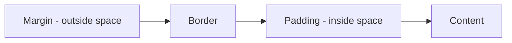

# Session 03: Introduction to CSS3: Selectors, Text Styling, Box Model, Positioning and Float

> Module: Progressive Website Development (HTML5, CSS3 and JavaScript) · Term 1 (CPISM) · ⏱ ~2 hours

## 🎯 Learning Objectives

By the end of this session you will be able to:

- Add CSS with inline, internal and external style sheets and explain the cascade
- Use type, class, ID, descendant, child, attribute and pseudo-class selectors
- Style text, fonts, spans, indentation, alignment and line spacing
- Explain selector specificity and style links with pseudo-classes
- Explain the box model and use padding, border, margin and `box-sizing`
- Position elements with `position` (static, relative, absolute, fixed, sticky) and `float`

## 📖 Concepts Explained

### 1. CSS syntax and where to write it

```css
selector { property: value; }
h1       { color: navy; font-size: 2rem; }
```

| Method | Example | Use |
|--------|---------|-----|
| Inline | `<p style="color:red">` | Quick tests only |
| Internal | `<style>` in `<head>` | Single-page demos |
| External | `<link rel="stylesheet" href="style.css">` | Real projects (cached, reusable) |

**Cascade**: when rules conflict, the browser decides by (1) importance (`!important`), (2) specificity, (3) source order (later wins). Some properties (colour, font) are **inherited** by children.

### 2. Selectors

| Selector | Example | Selects |
|----------|---------|---------|
| Type | `p` | All paragraphs |
| Class | `.card` | Elements with `class="card"` (reusable) |
| ID | `#main` | The one element with `id="main"` |
| Descendant (nested) | `nav a` | Links anywhere inside nav |
| Child | `ul > li` | Direct children only |
| Group | `h1, h2` | Both |
| Attribute | `a[target="_blank"]` | Links opening new tabs |
| Pseudo-class | `a:hover`, `li:nth-child(odd)`, `input:focus` | States/positions |
| Pseudo-element | `p::first-line`, `.btn::after` | Part of an element |

New in CSS3 and beyond: `:nth-child()`, `:not()`, `:is()`, `:has()`, attribute operators `^=` `$=` `*=`, and functions like `calc()`, `rgb()/hsl()` with alpha, `var()` for custom properties.

### 3. Specificity (who wins?)
Count as (IDs, classes/attributes/pseudo-classes, elements):

| Selector | Score |
|----------|-------|
| `p` | 0,0,1 |
| `.intro` | 0,1,0 |
| `p.intro` | 0,1,1 |
| `#hero .intro p` | 1,1,1 |
| inline style | beats all selectors |

Tip: prefer classes; avoid IDs and `!important` for styling.

### 4. Styling links (LVHA order)
`a:link`, `a:visited`, `a:hover`, `a:active` - write them in this order ("**L**o**V**e **HA**te") so hover is not overridden. Add `:focus-visible` for keyboard users.

### 5. Text and fonts
`font-family` (with fallbacks), `font-size` (`rem` preferred), `font-weight`, `font-style`, `line-height` (vertical spacing), `letter-spacing`, `text-align` (horizontal alignment), `text-indent` (paragraph indentation), `text-transform`, `text-decoration`, `text-shadow`. Use `<span>` to style part of a line inline.

### 6. The box model



Total width (default `content-box`) = width + padding + border. With `box-sizing: border-box`, padding and border are *inside* the width, which is much easier, so most projects start with `*, *::before, *::after { box-sizing: border-box; }`.

### 7. Positioning and float

| Value | Behaviour |
|-------|-----------|
| `static` | Default, normal flow |
| `relative` | Nudged from its normal place; becomes a reference for absolute children |
| `absolute` | Removed from flow; placed relative to nearest positioned ancestor |
| `fixed` | Stays in the viewport while scrolling (e.g. chat button) |
| `sticky` | Normal until a scroll threshold, then sticks (e.g. table headers) |

`z-index` controls stacking. `float: left/right` wraps text around images; clear it with `clear: both` or a parent with `display: flow-root`. For page layouts use Flexbox/Grid (Session 07) instead of floats.

## 💻 Code Examples

### Example 1: `index.html`

📄 Saved in this folder as [`index.html`](index.html).

```html
<!DOCTYPE html>
<html lang="en">
<head>
  <meta charset="UTF-8">
  <meta name="viewport" content="width=device-width, initial-scale=1.0">
  <title>CSS Basics Demo</title>
  <link rel="stylesheet" href="style.css">
</head>
<body>
  <header id="top" class="site-header">
    <h1>CSS Basics</h1>
    <nav>
      <a href="#box">Box model</a>
      <a href="#position">Positioning</a>
      <a href="https://developer.mozilla.org/docs/Web/CSS" target="_blank" rel="noopener">MDN</a>
    </nav>
  </header>

  <main>
    <p class="intro">CSS turns plain HTML into a <span class="highlight">beautiful</span> page.</p>

    <section id="box">
      <h2>Box model</h2>
      <div class="box">I have padding, a border and margin.</div>
    </section>

    <section id="position">
      <h2>Positioning</h2>
      <div class="card">
        <span class="badge">NEW</span>
        
        <p>This image floats left so the text wraps around it. The red badge is positioned
           absolutely inside the card because the card is <code>position: relative</code>.</p>
      </div>
      <ul class="list">
        <li>HTML</li><li>CSS</li><li>JavaScript</li><li>Git</li>
      </ul>
    </section>
  </main>
  <a href="#top" class="to-top" aria-label="Back to top">&uarr;</a>
</body>
</html>
```

**How it works**

- The external stylesheet is linked with `<link rel="stylesheet">`.
- Classes like `.card`, `.badge` and `.float-left` give CSS hooks without repeating styles.
- The `.to-top` link will be fixed in the corner of the screen.

### Example 2: `style.css`

📄 Saved in this folder as [`style.css`](style.css).

```css
/* Reset: easier sizing */
*, *::before, *::after { box-sizing: border-box; }

body {
  font-family: "Segoe UI", Roboto, Arial, sans-serif;
  line-height: 1.6;
  margin: 0;
  color: #222;
  background-color: #f6f8fa;
}

/* Sticky header with nested (descendant) selector */
.site-header {
  position: sticky;
  top: 0;
  background: #1f4e79;
  color: white;
  padding: 0.75rem 1.5rem;
}
.site-header nav a { color: #cfe3ff; margin-right: 1rem; }

/* Link states in LVHA order */
a:link    { color: #0a58ca; }
a:visited { color: #6f42c1; }
a:hover   { text-decoration: none; }
a:active  { color: crimson; }
a:focus-visible { outline: 3px solid orange; }

main { max-width: 800px; margin: 0 auto; padding: 1rem; }

.intro {
  font-size: 1.25rem;
  text-indent: 2em;
  text-align: justify;
}
.highlight { background: yellow; font-weight: bold; }

/* Box model */
.box {
  width: 300px;
  padding: 20px;
  border: 5px dashed #1f4e79;
  margin: 20px 0;
  background: white;
}

/* Positioning */
.card { position: relative; background: white; padding: 1rem; border-radius: 8px; display: flow-root; }
.badge {
  position: absolute;
  top: -10px;
  right: -10px;
  background: crimson;
  color: white;
  padding: 2px 8px;
  border-radius: 999px;
  font-size: 0.75rem;
}
.float-left { float: left; margin: 0 1rem 0.5rem 0; border-radius: 50%; }

/* Pseudo-classes for zebra list */
.list li:nth-child(odd) { background: #e9f2ff; }
.list li:hover { padding-left: 0.5rem; }

/* Specificity demo: ID beats class */
#position h2 { color: darkgreen; }
.card p::first-line { font-weight: 600; }

.to-top {
  position: fixed;
  right: 1rem;
  bottom: 1rem;
  background: #1f4e79;
  color: white !important;
  width: 2.5rem;
  height: 2.5rem;
  border-radius: 50%;
  display: grid;
  place-items: center;
  text-decoration: none;
}
```

**How it works**

- `box-sizing: border-box` keeps `.box` exactly 300px wide including padding and border.
- The header is `sticky`, so it scrolls normally until it reaches the top, then sticks.
- `.card` is `relative`, so the absolutely positioned `.badge` is placed relative to the card's corner.
- `display: flow-root` on `.card` contains the floated image (no collapsing).
- `:nth-child(odd)` stripes the list; `::first-line` styles only the first line of a paragraph.
- `#position h2` has higher specificity than any class-only rule, so it is green.

## 🧪 Lab Practice

1. Open the demo with Live Server. In DevTools > Elements, select `.box` and look at the box-model diagram in the *Computed* tab. Change padding live.
2. Change `.box` to `box-sizing: content-box` and note the new total width. Explain the difference in a comment in `style.css`.
3. Write three conflicting rules for the same paragraph (type, class, ID). Predict the winner with specificity scores, then check in DevTools.
4. Style your Session 02 hobby site with an external stylesheet: fonts, colours, link states, a sticky header and a floated image.
5. Create a "Back to top" button with `position: fixed` and a notification badge with `position: absolute`.

## 📝 Assignment

Design a **business card page**: a centred card 350px wide (border-box), a circular photo floated left, name in a Google Font, a highlighted job title using `<span>`, social links with all four link states, and a corner badge using absolute positioning.

## ❓ Quick Quiz

**Q1.** Which selector has the highest specificity?

- a) div p
- b) .menu a
- c) #nav a
- d) a:hover

**Q2.** With `box-sizing: border-box`, a 200px box with 20px padding is how wide?

- a) 160px
- b) 200px
- c) 240px
- d) 220px

**Q3.** Which position value keeps an element visible while scrolling the whole page?

- a) relative
- b) absolute
- c) fixed
- d) static

**Q4.** What is the correct order for link pseudo-classes?

**Q5.** Absolute elements are positioned relative to what?

<details>
<summary>Show answers</summary>

1. c) #nav a
2. b) 200px
3. c) fixed
4. :link, :visited, :hover, :active (LVHA).
5. The nearest ancestor with a position other than static (otherwise the initial containing block).

</details>

## 💼 Interview Questions

**1. Explain the CSS cascade.**

<details>
<summary>Model answer</summary>

The browser resolves conflicting declarations by origin and importance, then specificity, then source order; inherited values apply when nothing is set directly.

</details>

**2. What does `box-sizing: border-box` change?**

<details>
<summary>Model answer</summary>

Width and height include padding and border, so elements keep the size you set, making layouts predictable.

</details>

**3. Difference between `relative`, `absolute` and `sticky`?**

<details>
<summary>Model answer</summary>

Relative offsets an element from its normal spot and keeps its space; absolute removes it from flow and positions against a positioned ancestor; sticky behaves like relative until a scroll threshold, then like fixed within its container.

</details>

## ✅ Summary

- Use external stylesheets; the cascade decides conflicts.
- Selectors target elements by type, class, ID, relationship, attribute or state.
- Specificity: inline > ID > class > element.
- Box model = content + padding + border + margin; use border-box.
- Positioning (relative/absolute/fixed/sticky) and float place elements precisely.

---

[⬅ Previous](../Session-02-Practice-Lab-HTML-Multi-Page-Site/README.md) · [🏠 Module Home](../README.md) · [Next ➡](../Session-04-Practice-Lab-Styling-with-CSS/README.md)

Prepared by Zeeshan Abbas · Aptech Learning North Nazimabad
