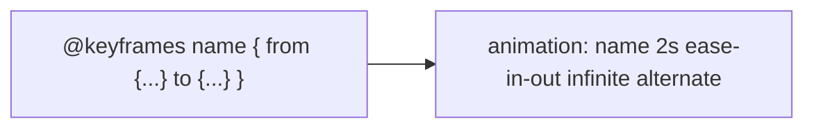

# Session 05: Displaying Graphics and CSS3 Animation

> Module: Progressive Website Development (HTML5, CSS3 and JavaScript) · Term 1 (CPISM) · ⏱ ~2 hours

## 🎯 Learning Objectives

By the end of this session you will be able to:

- Choose the right image format (JPEG, PNG, GIF, SVG, WebP, AVIF)
- Insert, size and pad images, and make them responsive with `srcset`, `<picture>` and `object-fit`
- Use figures, captions and background images
- Create CSS transitions and transforms
- Build keyframe animations and respect reduced-motion preferences on mobile devices

## 📖 Concepts Explained

### 1. Image formats

| Format | Best for | Transparency | Animation |
|--------|----------|--------------|-----------|
| JPEG | Photos | No | No |
| PNG | Screenshots, logos with transparency | Yes | No |
| GIF | Simple animations (old) | Yes (1-bit) | Yes |
| SVG | Icons, logos (vector) | Yes | Yes (CSS/SMIL) |
| WebP / AVIF | Modern photos, smaller files | Yes | Yes |

### 2. Inserting and sizing images

```html

```

- `alt` is required: describe the image (empty `alt=""` for decorative images).
- `width`/`height` attributes reserve space and stop layout shift.
- `loading="lazy"` delays off-screen images.
- CSS: `max-width: 100%; height: auto;` makes images shrink on small screens.
- `padding`, `border`, `border-radius`, `box-shadow` frame an image; `object-fit: cover` crops nicely inside a fixed box.

### 3. Responsive images

```html
<picture>
  <source srcset="hero.avif" type="image/avif">
  <source srcset="hero.webp" type="image/webp">
  
</picture>
```

The browser picks the first format it supports. `srcset` with `sizes` lets it pick the right resolution.

### 4. Figures and backgrounds
`<figure>` + `<figcaption>` groups an image with its caption. Decorative images belong in CSS: `background-image`, `background-size: cover`, `background-position: center`, and gradients `linear-gradient(...)`.

### 5. Transforms and transitions
- **Transform**: `translate()`, `rotate()`, `scale()`, `skew()` change appearance without affecting layout.
- **Transition**: smoothly animates a property change, e.g. on `:hover`.

```css
.card { transition: transform 0.3s ease, box-shadow 0.3s; }
.card:hover { transform: translateY(-6px) scale(1.02); }
```

### 6. Keyframe animations



| Property | Example |
|----------|---------|
| `animation-name` | `bounce` |
| `animation-duration` | `1.5s` |
| `animation-timing-function` | `ease`, `linear`, `steps(4)` |
| `animation-delay` | `0.5s` |
| `animation-iteration-count` | `3`, `infinite` |
| `animation-direction` | `alternate` |
| `animation-fill-mode` | `forwards` |

Animate only `transform` and `opacity` for smooth 60 fps performance, especially on mobile.

### 7. CSS3 on mobile devices
- Use media queries to simplify effects on small screens.
- Respect users who prefer less motion:

```css
@media (prefers-reduced-motion: reduce) { * { animation: none !important; transition: none !important; } }
```

- Touch screens have no hover: make sure content does not depend on `:hover` alone.

## 💻 Code Examples

### Example 1: `index.html`

📄 Saved in this folder as [`index.html`](index.html).

```html
<!DOCTYPE html>
<html lang="en">
<head>
  <meta charset="UTF-8">
  <meta name="viewport" content="width=device-width, initial-scale=1.0">
  <title>Graphics & Animation</title>
  <link rel="stylesheet" href="style.css">
</head>
<body>
  <section class="hero">
    <h1 class="fade-in">Explore Pakistan</h1>
    <p class="fade-in delay">Mountains, beaches and history</p>
    <div class="loader" aria-hidden="true"></div>
  </section>

  <main class="gallery">
    <figure class="photo">
      
      <figcaption>Northern valleys</figcaption>
    </figure>
    <figure class="photo">
      
      <figcaption>Lakes</figcaption>
    </figure>
    <figure class="photo">
      
      <figcaption>Rivers</figcaption>
    </figure>
  </main>

  <p class="center">
    
  </p>
</body>
</html>
```

**How it works**

- Images use `alt`, `width`, `height` and `loading="lazy"` for accessibility and performance.
- Each `<figure>` groups an image with its caption.
- `logo.svg` is a vector file in this folder; it stays sharp at any size.

### Example 2: `style.css`

📄 Saved in this folder as [`style.css`](style.css).

```css
*, *::before, *::after { box-sizing: border-box; }
body { margin: 0; font-family: system-ui, sans-serif; background: #f4f6f8; }

.hero {
  min-height: 60vh;
  display: grid; place-items: center; text-align: center; color: white;
  background:
    linear-gradient(rgba(0,0,0,.45), rgba(0,0,0,.45)),
    url("https://picsum.photos/id/1036/1600/900") center / cover no-repeat;
}
.hero h1 { font-size: clamp(2rem, 6vw, 4rem); margin: 0; }

/* Keyframe animation */
@keyframes fadeUp {
  from { opacity: 0; transform: translateY(30px); }
  to   { opacity: 1; transform: translateY(0); }
}
.fade-in { animation: fadeUp 1s ease-out both; }
.delay   { animation-delay: 0.4s; }

@keyframes spin { to { transform: rotate(360deg); } }
.loader {
  width: 40px; height: 40px; border-radius: 50%;
  border: 4px solid rgba(255,255,255,.3); border-top-color: white;
  animation: spin 1s linear infinite;
}

/* Image gallery with transitions */
.gallery { display: flex; flex-wrap: wrap; gap: 1rem; justify-content: center; padding: 2rem 1rem; }
.photo {
  margin: 0; width: min(100%, 300px);
  background: white; padding: 0.5rem; border-radius: 12px;
  box-shadow: 0 2px 8px rgba(0,0,0,.1);
  transition: transform .3s ease, box-shadow .3s ease;
}
.photo img { width: 100%; height: 200px; object-fit: cover; border-radius: 8px; display: block; }
.photo figcaption { text-align: center; padding-top: .5rem; font-weight: 600; }
.photo:hover, .photo:focus-within { transform: translateY(-6px) rotate(-1deg); box-shadow: 0 12px 24px rgba(0,0,0,.2); }

.center { text-align: center; }
.spin:hover { animation: spin 2s linear infinite; }

@media (prefers-reduced-motion: reduce) {
  *, *::before, *::after { animation: none !important; transition: none !important; }
}
```

**How it works**

- The hero background stacks a dark gradient over a photo so white text is readable.
- `@keyframes fadeUp` moves text up while fading in; `both` keeps the start/end states.
- The loader is a circle whose top border is white; rotating it creates a spinner.
- `object-fit: cover` crops all gallery images to the same 200px height without stretching.
- The reduced-motion media query switches animation off for users who request it.

### Example 3: `logo.svg`

📄 Saved in this folder as [`logo.svg`](logo.svg).

```xml
<svg xmlns="http://www.w3.org/2000/svg" viewBox="0 0 120 120" role="img" aria-label="Logo">
  <circle cx="60" cy="60" r="56" fill="#1f4e79"/>
  <polygon points="60,22 95,90 25,90" fill="#ffc107"/>
  <text x="60" y="80" font-family="Arial" font-size="20" text-anchor="middle" fill="#1f4e79">PK</text>
</svg>
```

**How it works**

- SVG is XML text describing shapes: a circle, a triangle (polygon) and text.
- `viewBox` defines the drawing coordinates, so the image scales without blur.

## 🧪 Lab Practice

1. Run the page and hover over gallery cards. In DevTools > *Animations* panel, slow down the animations to watch them.
2. Change the hero image to a local file in an `images/` folder and add a `<picture>` element with a WebP version (convert with any image tool or squoosh.app).
3. Create a `@keyframes pulse` animation that scales a button from 1 to 1.08 and back, repeating infinitely.
4. Write a CSS-only animated loading bar using `@keyframes` and `width` or `transform: scaleX()`.
5. Turn on *Emulate prefers-reduced-motion* in DevTools Rendering panel and confirm animations stop.

## 📝 Assignment

Build an **animated product showcase**: a hero with gradient-over-image background, three product figures with hover transitions, an SVG logo you draw yourself, one keyframe entrance animation and one infinite animation, plus a reduced-motion fallback.

## ❓ Quick Quiz

**Q1.** Which format is best for a logo that must stay sharp at every size?

- a) JPEG
- b) PNG
- c) SVG
- d) GIF

**Q2.** Which properties are cheapest to animate?

- a) width and height
- b) top and left
- c) transform and opacity
- d) margin and padding

**Q3.** What does `object-fit: cover` do?

**Q4.** Difference between a transition and a keyframe animation?

**Q5.** Why add width and height attributes to ``?

<details>
<summary>Show answers</summary>

1. c) SVG
2. c) transform and opacity
3. Scales the image to fill its box while keeping its aspect ratio, cropping the overflow.
4. A transition animates between two states when a property changes (e.g. hover); keyframe animations define multiple steps and can run automatically and repeat.
5. The browser reserves space before the image loads, preventing layout shift (better CLS).

</details>

## 💼 Interview Questions

**1. How do you optimise images for the web?**

<details>
<summary>Model answer</summary>

Choose the right format (WebP/AVIF/SVG), compress, serve responsive sizes with srcset/picture, lazy-load off-screen images and set dimensions.

</details>

**2. How do you make animations accessible?**

<details>
<summary>Model answer</summary>

Keep them subtle and short, avoid flashing, respect prefers-reduced-motion and never hide essential information behind motion or hover.

</details>

**3. What is the difference between `` and CSS background images?**

<details>
<summary>Model answer</summary>

`` is content with alt text and is indexed; backgrounds are decorative, set in CSS, and invisible to screen readers.

</details>

## ✅ Summary

- Pick formats by content: JPEG/WebP photos, PNG transparency, SVG icons.
- Always give alt text and dimensions; use lazy loading and responsive images.
- Transforms + transitions create smooth hover effects.
- `@keyframes` defines multi-step animations.
- Design for mobile and reduced motion.

---

[⬅ Previous](../Session-04-Practice-Lab-Styling-with-CSS/README.md) · [🏠 Module Home](../README.md) · [Next ➡](../Session-06-Practice-Lab-Gallery-and-Animated-Banner/README.md)

Prepared by Zeeshan Abbas · Aptech Learning North Nazimabad
