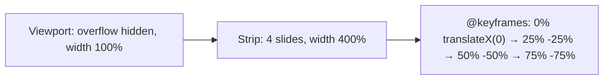

# Session 06: Practice Lab: Responsive Gallery and Animated Banner

> Module: Progressive Website Development (HTML5, CSS3 and JavaScript) · Term 1 (CPISM) · ⏱ ~2 hours

## 🎯 Learning Objectives

By the end of this session you will be able to:

- Build an image gallery with captions and hover effects
- Create a CSS-only image slider with keyframes
- Use `<picture>`, `srcset` and lazy loading
- Combine transforms for 3D card flips
- Audit image accessibility

## 📖 Concepts Explained

**Practice session** for Session 05.

### Techniques used today

| Technique | Key CSS |
|-----------|---------|
| CSS slider | `@keyframes` moving a strip with `transform: translateX()` |
| 3D flip card | `perspective`, `transform-style: preserve-3d`, `backface-visibility: hidden`, `rotateY(180deg)` |
| Caption overlay | `position: absolute` on figcaption + `opacity` transition |
| Ken Burns zoom | `animation` of `scale` on a background |

### How the CSS slider works



### Image accessibility audit
- [ ] Every informative image has meaningful `alt`.
- [ ] Decorative images have `alt=""` or are CSS backgrounds.
- [ ] Text on images has enough contrast (use an overlay).
- [ ] Animations can be paused or are reduced for `prefers-reduced-motion`.

## 💻 Code Examples

### Example 1: `index.html`

📄 Saved in this folder as [`index.html`](index.html).

```html
<!DOCTYPE html>
<html lang="en">
<head>
  <meta charset="UTF-8">
  <meta name="viewport" content="width=device-width, initial-scale=1.0">
  <title>Gallery Lab</title>
  <link rel="stylesheet" href="style.css">
</head>
<body>
  <div class="slider" aria-label="Featured photos">
    <div class="strip">
      
      
      
      
    </div>
  </div>

  <h2 class="title">Flip cards</h2>
  <div class="cards">
    <div class="flip" tabindex="0">
      <div class="inner">
        <div class="front"></div>
        <div class="back"><h3>Puppy</h3><p>Hover or focus to flip me.</p></div>
      </div>
    </div>
    <div class="flip" tabindex="0">
      <div class="inner">
        <div class="front"></div>
        <div class="back"><h3>Cozy</h3><p>3D transforms in CSS.</p></div>
      </div>
    </div>
  </div>
</body>
</html>
```

**How it works**

- The slider has four images; the last repeats the first (with empty alt because it is a duplicate) so the loop looks seamless.
- `tabindex="0"` makes flip cards focusable so keyboard users can flip them too.

### Example 2: `style.css`

📄 Saved in this folder as [`style.css`](style.css).

```css
body { margin: 0; font-family: system-ui, sans-serif; background: #111; color: #eee; }

/* CSS-only slider */
.slider { overflow: hidden; width: 100%; }
.strip { display: flex; width: 400%; animation: slide 12s infinite; }
.strip img { width: 25%; height: 45vh; object-fit: cover; }
@keyframes slide {
  0%, 25%   { transform: translateX(0); }
  30%, 55%  { transform: translateX(-25%); }
  60%, 85%  { transform: translateX(-50%); }
  90%, 100% { transform: translateX(-75%); }
}
.slider:hover .strip { animation-play-state: paused; }

.title { text-align: center; }

/* 3D flip cards */
.cards { display: flex; gap: 2rem; justify-content: center; flex-wrap: wrap; padding: 1rem; }
.flip { width: 220px; height: 220px; perspective: 800px; }
.inner { position: relative; width: 100%; height: 100%; transition: transform .7s; transform-style: preserve-3d; }
.flip:hover .inner, .flip:focus .inner { transform: rotateY(180deg); }
.front, .back {
  position: absolute; inset: 0; border-radius: 16px; overflow: hidden;
  backface-visibility: hidden;
}
.front img { width: 100%; height: 100%; object-fit: cover; }
.back { background: #1f4e79; transform: rotateY(180deg); display: grid; place-content: center; text-align: center; padding: 1rem; }

@media (prefers-reduced-motion: reduce) {
  .strip { animation: none; }
  .inner { transition: none; }
}
```

**How it works**

- The strip is 4 slides wide; each keyframe pair holds a slide still, then moves 25% to the next.
- Hovering the slider pauses it with `animation-play-state: paused`.
- The flip card's `.back` starts rotated 180° and hidden by `backface-visibility`; rotating `.inner` reveals it.
- `perspective` on the parent gives the 3D depth effect.

## 🧪 Lab Practice

1. Run the lab and change the slider timing to 16s. Add a fifth slide (adjust widths and keyframes).
2. Add dot indicators under the slider that animate in sync (hint: same duration, different keyframes).
3. Add a third flip card with your own image and text.
4. Create a caption overlay gallery: figcaption hidden (`opacity: 0`) and shown on hover/focus.
5. Run the accessibility audit checklist and fix two issues.

## 📝 Assignment

Make a **portfolio header** with a CSS-only slider of three of your designs and a row of 3D flip cards (front: project image, back: project name and tools). It must pause on hover and respect reduced motion.

## ❓ Quick Quiz

**Q1.** Which property hides the back side of a rotated element?

- a) visibility
- b) backface-visibility
- c) display
- d) opacity

**Q2.** How can you pause a CSS animation on hover?

**Q3.** Why is `tabindex="0"` added to the flip card?

**Q4.** Which property gives depth to child 3D transforms?

- a) depth
- b) perspective
- c) z-index
- d) translateZ

**Q5.** Why does the slider strip have `width: 400%`?

<details>
<summary>Show answers</summary>

1. b) backface-visibility
2. `animation-play-state: paused` in a `:hover` rule.
3. So keyboard users can focus it and trigger the flip with `:focus`.
4. b) perspective
5. It holds four slides side by side, each 25% of the strip (100% of the viewport).

</details>

## 💼 Interview Questions

**1. Can you build a carousel without JavaScript? What are the limits?**

<details>
<summary>Model answer</summary>

Yes, with keyframes or scroll-snap, but you lose fine control (arbitrary navigation, swipe tracking, announcements for screen readers), so JS is often added.

</details>

**2. How do you keep hover effects usable on touch devices?**

<details>
<summary>Model answer</summary>

Also trigger them on :focus/:focus-within or tap, and never hide essential content behind hover.

</details>

**3. What is `perspective` in CSS?**

<details>
<summary>Model answer</summary>

It sets the distance between the viewer and the z=0 plane, giving 3D transformed children a sense of depth.

</details>

## ✅ Summary

- Keyframes + transforms can create sliders and effects with CSS only.
- 3D flips need perspective, preserve-3d and backface-visibility.
- Pause and reduce motion for comfort and accessibility.
- Always audit alt text and contrast.

---

[⬅ Previous](../Session-05-Graphics-and-CSS3-Animation/README.md) · [🏠 Module Home](../README.md) · [Next ➡](../Session-07-Flexbox-and-Grid-Layouts/README.md)

Prepared by Zeeshan Abbas · Aptech Learning North Nazimabad
