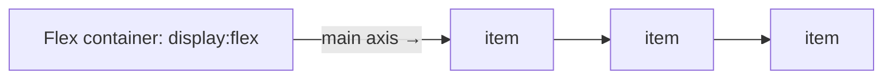

# Session 07: Understanding Layouts in CSS3: Flexbox and Grid

> Module: Progressive Website Development (HTML5, CSS3 and JavaScript) · Term 1 (CPISM) · ⏱ ~2 hours

## 🎯 Learning Objectives

By the end of this session you will be able to:

- Explain when to use Flexbox (one dimension) and Grid (two dimensions)
- Use flex container properties: `display`, `flex-direction`, `justify-content`, `align-items`, `flex-wrap`, `gap`
- Use flex item properties: `flex-grow`, `flex-shrink`, `flex-basis`, `order`, `align-self`
- Define grids with `grid-template-columns/rows`, `fr`, `repeat()`, `minmax()` and `auto-fit`
- Place items with line numbers and `grid-template-areas`
- Combine Flexbox and Grid with media queries for responsive pages

## 📖 Concepts Explained

### 1. Flexbox vs Grid

| | Flexbox | Grid |
|-|---------|------|
| Dimensions | One (row **or** column) | Two (rows **and** columns) |
| Thinks from | Content outwards | Layout inwards |
| Great for | Navbars, button groups, centring, cards in a row | Page layouts, galleries, dashboards |

Analogy: Flexbox is a **queue of people** that can stretch or squeeze; Grid is a **chessboard** where you place pieces on squares.

### 2. Flexbox



| Container property | Values |
|--------------------|--------|
| `flex-direction` | `row` (default), `column`, `row-reverse` |
| `justify-content` (main axis) | `flex-start`, `center`, `space-between`, `space-around`, `space-evenly` |
| `align-items` (cross axis) | `stretch`, `center`, `flex-start`, `flex-end`, `baseline` |
| `flex-wrap` | `nowrap`, `wrap` |
| `gap` | `1rem` |

| Item property | Meaning |
|---------------|---------|
| `flex-grow` | Share of extra space |
| `flex-shrink` | How much it shrinks |
| `flex-basis` | Starting size |
| `flex: 1 1 200px` | Shorthand: grow shrink basis |
| `order` | Visual order |
| `align-self` | Override cross-axis alignment |

Perfect centring: `display:flex; justify-content:center; align-items:center;`

### 3. Grid

| Property | Example |
|----------|---------|
| `grid-template-columns` | `200px 1fr 1fr` / `repeat(3, 1fr)` |
| `grid-template-rows` | `auto 1fr auto` |
| `gap` | `1rem 2rem` |
| `fr` unit | fraction of free space |
| `minmax(200px, 1fr)` | never smaller than 200px |
| `repeat(auto-fit, minmax(220px, 1fr))` | responsive columns without media queries |
| `grid-column: 1 / 3` / `span 2` | place an item across lines |
| `grid-template-areas` | name regions visually |
| `justify-items`, `align-items`, `place-items` | align inside cells |

```
"header header"
"sidebar main"
"footer footer"
```

### 4. Media queries (mobile first)

```css
.layout { display: grid; grid-template-areas: "header" "main" "sidebar" "footer"; }
@media (min-width: 768px) {
  .layout { grid-template-columns: 250px 1fr; grid-template-areas: "header header" "sidebar main" "footer footer"; }
}
```

Write styles for small screens first, then add `min-width` queries for bigger screens.

## 💻 Code Examples

### Example 1: `index.html`

📄 Saved in this folder as [`index.html`](index.html).

```html
<!DOCTYPE html>
<html lang="en">
<head>
  <meta charset="UTF-8">
  <meta name="viewport" content="width=device-width, initial-scale=1.0">
  <title>Flexbox & Grid</title>
  <link rel="stylesheet" href="style.css">
</head>
<body>
  <div class="layout">
    <header class="header">
      <strong class="brand">Dashboard</strong>
      <nav class="menu">
        <a href="#">Home</a><a href="#">Reports</a><a href="#">Settings</a>
      </nav>
    </header>

    <aside class="sidebar">
      <h2>Filters</h2>
      <p>Grid area: sidebar</p>
    </aside>

    <main class="main">
      <section class="stats">
        <div class="stat">Students <b>120</b></div>
        <div class="stat">Batches <b>6</b></div>
        <div class="stat grow">Attendance <b>92%</b></div>
      </section>

      <section class="cards">
        <article class="card">HTML</article>
        <article class="card">CSS</article>
        <article class="card wide">JavaScript (spans 2 columns)</article>
        <article class="card">Git</article>
        <article class="card">SEO</article>
        <article class="card">Bootstrap</article>
      </section>

      <div class="center-box">Perfectly centred</div>
    </main>

    <footer class="footer">Footer area</footer>
  </div>
</body>
</html>
```

**How it works**

- `.layout` will be a Grid with named areas; the header and stats use Flexbox inside it.
- `.card.wide` will span two grid columns.

### Example 2: `style.css`

📄 Saved in this folder as [`style.css`](style.css).

```css
*, *::before, *::after { box-sizing: border-box; }
body { margin: 0; font-family: system-ui, sans-serif; background: #eef2f7; }

/* ---- Page layout with Grid areas (mobile first) ---- */
.layout {
  min-height: 100vh;
  display: grid;
  grid-template-rows: auto auto 1fr auto;
  grid-template-areas:
    "header"
    "sidebar"
    "main"
    "footer";
}
.header  { grid-area: header; }
.sidebar { grid-area: sidebar; background: #dbe4f0; padding: 1rem; }
.main    { grid-area: main; padding: 1rem; }
.footer  { grid-area: footer; background: #1f2937; color: white; text-align: center; padding: 1rem; }

@media (min-width: 768px) {
  .layout {
    grid-template-columns: 240px 1fr;
    grid-template-rows: auto 1fr auto;
    grid-template-areas:
      "header header"
      "sidebar main"
      "footer footer";
  }
}

/* ---- Flexbox header ---- */
.header {
  display: flex; justify-content: space-between; align-items: center; flex-wrap: wrap; gap: .5rem;
  background: #1f4e79; color: white; padding: .75rem 1rem;
}
.menu { display: flex; gap: 1rem; }
.menu a { color: white; text-decoration: none; }

/* ---- Flex stats with grow ---- */
.stats { display: flex; gap: 1rem; flex-wrap: wrap; margin-bottom: 1rem; }
.stat { flex: 1 1 150px; background: white; padding: 1rem; border-radius: 10px; display: flex; flex-direction: column; }
.stat b { font-size: 1.6rem; color: #1f4e79; }
.grow { flex-grow: 2; }

/* ---- Responsive card grid (no media query needed) ---- */
.cards { display: grid; grid-template-columns: repeat(auto-fit, minmax(180px, 1fr)); gap: 1rem; }
.card { background: white; padding: 2rem 1rem; border-radius: 10px; text-align: center; font-weight: 600; }
.wide { grid-column: span 2; background: #fff7d6; }

/* ---- Centring ---- */
.center-box {
  margin-top: 1rem; height: 150px; border: 2px dashed #1f4e79; border-radius: 10px;
  display: flex; justify-content: center; align-items: center;
}
```

**How it works**

- On phones the layout is one column (header, sidebar, main, footer). From 768px, `grid-template-areas` puts the sidebar beside main.
- The header uses `justify-content: space-between` to push the brand and menu apart.
- `.stat { flex: 1 1 150px }` means: start at 150px, grow and shrink equally; `.grow` takes double the extra space.
- `repeat(auto-fit, minmax(180px, 1fr))` creates as many 180px+ columns as fit, which is responsive without media queries.
- `.wide { grid-column: span 2 }` stretches one card across two columns.

## 🧪 Lab Practice

1. Resize the browser (or use DevTools device toolbar) and watch the layout switch at 768px. Turn on the Grid and Flex overlays in DevTools.
2. Change `justify-content` in `.header` to each value (`center`, `space-around`, `space-evenly`) and note the difference.
3. Use `order: -1` to move the third stat to the front visually.
4. Add a right-hand `ads` area to the desktop layout using `grid-template-areas` with three columns.
5. Play the official-style learning games *Flexbox Froggy* and *Grid Garden* (search online) to level 10 each, or recreate their first five levels in CodePen.

## 📝 Assignment

Build a **responsive news homepage**: Grid page layout with header, featured story spanning two columns, a sidebar of trending items and footer; Flexbox for the navbar and article meta rows. It must have one layout for mobile and one for desktop (min-width media query).

## ❓ Quick Quiz

**Q1.** Which layout system is two-dimensional?

- a) Flexbox
- b) Grid
- c) Float
- d) Inline-block

**Q2.** Which property aligns flex items along the main axis?

- a) align-items
- b) justify-content
- c) align-content
- d) place-self

**Q3.** What does `1fr` mean?

**Q4.** Write a grid rule for responsive columns at least 200px wide.

**Q5.** How do you centre a child horizontally and vertically with Flexbox?

<details>
<summary>Show answers</summary>

1. b) Grid
2. b) justify-content
3. One fraction of the remaining free space in the grid container.
4. `grid-template-columns: repeat(auto-fit, minmax(200px, 1fr));`
5. `display:flex; justify-content:center; align-items:center;` on the parent.

</details>

## 💼 Interview Questions

**1. When do you choose Flexbox over Grid?**

<details>
<summary>Model answer</summary>

Flexbox for one-dimensional components where content size drives layout (navbars, toolbars); Grid for two-dimensional page or gallery layouts where you control rows and columns.

</details>

**2. What is mobile-first CSS?**

<details>
<summary>Model answer</summary>

Writing base styles for small screens and adding min-width media queries to enhance for larger screens, which keeps CSS simpler and faster on mobile.

</details>

**3. Explain `flex: 1 1 0` vs `flex: 1 1 auto`.**

<details>
<summary>Model answer</summary>

With basis 0 all space is shared equally so items end equal width; with auto, items start from their content size and extra space is shared, so widths differ.

</details>

## ✅ Summary

- Flexbox = one axis; Grid = rows and columns.
- Container properties arrange; item properties fine-tune.
- `fr`, `repeat`, `minmax`, `auto-fit` make grids responsive.
- `grid-template-areas` makes layouts readable.
- Combine both with mobile-first media queries.

---

[⬅ Previous](../Session-06-Practice-Lab-Gallery-and-Animated-Banner/README.md) · [🏠 Module Home](../README.md) · [Next ➡](../Session-08-Practice-Lab-Responsive-Layouts/README.md)

Prepared by Zeeshan Abbas · Aptech Learning North Nazimabad
