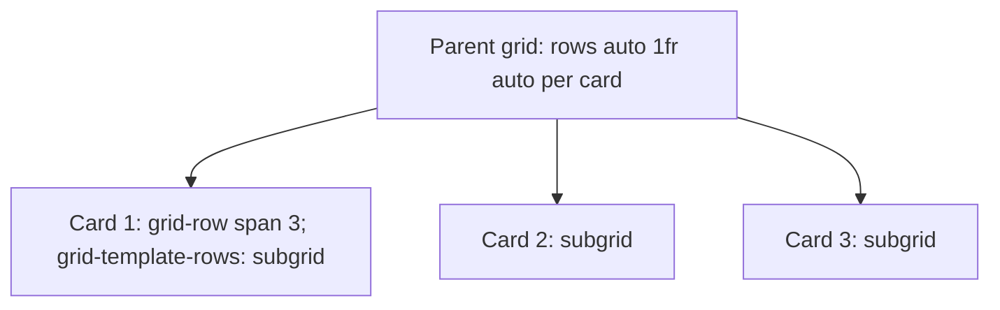

# Session 09: New Features of CSS: Subgrid, New Viewport Units and Nesting

> Module: Progressive Website Development (HTML5, CSS3 and JavaScript) · Term 1 (CPISM) · ⏱ ~2 hours

## 🎯 Learning Objectives

By the end of this session you will be able to:

- Explain the problem subgrid solves and align nested content with `grid-template-rows: subgrid`
- Use new viewport units `svh`, `lvh`, `dvh` and `vi`/`vb` correctly on mobile
- Write native CSS nesting with `&`
- Use modern helpers: `:has()`, `clamp()`, container queries and logical properties
- Check browser support with MDN and Can I use

## 📖 Concepts Explained

### 1. Subgrid
Problem: cards in a grid each have a title, text and button. Titles have different lengths, so the buttons do not line up. **Subgrid** lets a child grid *borrow* its parent's tracks so every card's rows align.



```css
.cards { display: grid; grid-template-columns: repeat(auto-fit, minmax(220px, 1fr)); }
.card  { display: grid; grid-row: span 3; grid-template-rows: subgrid; }
```

### 2. New viewport units
On mobile, `100vh` can be taller than the visible screen because the browser's address bar appears/disappears.

| Unit | Meaning |
|------|---------|
| `vh` / `vw` | 1% of the (large) viewport height/width |
| `svh` | Small viewport height (address bar visible) - always fits |
| `lvh` | Large viewport height (bar hidden) |
| `dvh` | Dynamic: changes as the bar shows/hides |
| `vi` / `vb` | 1% of the inline / block size (writing-mode aware) |
| `vmin` / `vmax` | Smaller / larger of vw and vh |

Use `min-height: 100svh` for full-screen hero sections that must not be cut off.

### 3. Native CSS nesting
Previously only possible with Sass; now supported in all modern browsers.

```css
.card {
  padding: 1rem;
  & h3 { margin: 0; }          /* .card h3 */
  &:hover { outline: 2px solid; } /* .card:hover */
  .dark & { background: #222; }  /* .dark .card */
  @media (min-width: 768px) { padding: 2rem; }
}
```

Keep nesting shallow (max 3 levels) so specificity stays low and CSS stays readable.

### 4. Other modern features worth knowing

| Feature | Example | Why |
|---------|---------|-----|
| `:has()` "parent selector" | `.card:has(img) { padding-top: 0; }` | Style a parent by its children |
| Container queries | `@container (min-width: 400px) {...}` | Components respond to their own width |
| `clamp()` | `font-size: clamp(1rem, 2.5vw, 1.5rem)` | Fluid typography |
| Logical properties | `margin-inline`, `padding-block` | Works in RTL languages like Urdu |
| `aspect-ratio` | `aspect-ratio: 16 / 9` | Responsive boxes |
| `accent-color` | `accent-color: purple` | Brand checkboxes |

### 5. Checking support
Look at the *Browser compatibility* table at the bottom of every MDN page or on caniuse.com. Use `@supports (grid-template-rows: subgrid) { ... }` to apply features only where available.

## 💻 Code Examples

### Example 1: `index.html`

📄 Saved in this folder as [`index.html`](index.html).

```html
<!DOCTYPE html>
<html lang="en">
<head>
  <meta charset="UTF-8">
  <meta name="viewport" content="width=device-width, initial-scale=1.0">
  <title>Modern CSS</title>
  <link rel="stylesheet" href="style.css">
</head>
<body>
  <section class="hero">
    <h1>Modern CSS</h1>
    <p>This hero is exactly one small-viewport tall (100svh).</p>
  </section>

  <section class="cards">
    <article class="card">
      <h3>Subgrid</h3>
      <p>Rows line up across cards.</p>
      <a href="#" class="btn">Learn</a>
    </article>
    <article class="card">
      <h3>New viewport units that work on mobile browsers</h3>
      <p>svh, lvh and dvh solve the address-bar problem. This text is longer on purpose to show alignment.</p>
      <a href="#" class="btn">Learn</a>
    </article>
    <article class="card">
      
      <h3>Nesting</h3>
      <p>Write related rules together.</p>
      <a href="#" class="btn">Learn</a>
    </article>
  </section>

  <section class="widget-area">
    <div class="widget"><h3>Container query</h3><p>I change layout based on my container width, not the screen.</p></div>
  </section>
</body>
</html>
```

**How it works**

- Three cards with different title and text lengths, one with an image, to show subgrid and `:has()`.
- `.widget-area` is a container for a container query.

### Example 2: `style.css`

📄 Saved in this folder as [`style.css`](style.css).

```css
:root { --brand: #7c3aed; }
*, *::before, *::after { box-sizing: border-box; }
body { margin: 0; font-family: system-ui, sans-serif; background: #faf7ff; }

.hero {
  min-height: 100svh;               /* never hidden behind mobile browser bars */
  display: grid; place-content: center; text-align: center;
  background: linear-gradient(135deg, var(--brand), #db2777); color: white;
  & h1 { font-size: clamp(2.5rem, 10vi, 6rem); margin: 0; }
}

.cards {
  display: grid;
  grid-template-columns: repeat(auto-fit, minmax(240px, 1fr));
  gap: 1.5rem;
  padding: 2rem clamp(1rem, 5vw, 4rem);
}

.card {
  display: grid;
  grid-row: span 3;
  grid-template-rows: subgrid;      /* title, text, button rows shared */
  gap: .75rem;
  background: white; padding: 1.25rem; border-radius: 16px;
  box-shadow: 0 4px 14px rgb(0 0 0 / .08);

  & h3 { margin: 0; color: var(--brand); }
  & p  { margin: 0; }
  & .btn {
    align-self: end; justify-self: start;
    background: var(--brand); color: white; padding: .5rem 1rem; border-radius: 8px; text-decoration: none;
    &:hover { filter: brightness(1.15); }
  }

  /* card that contains an image needs 4 rows */
  &:has(img) { grid-row: span 4; }
  & img { width: 100%; aspect-ratio: 2 / 1; object-fit: cover; border-radius: 10px; }
}

/* Container queries */
.widget-area { container-type: inline-size; margin: 0 auto 3rem; width: min(700px, 100% - 2rem); }
.widget { padding: 1rem; background: #ede9fe; border-radius: 12px; }
@container (min-width: 500px) {
  .widget { display: flex; gap: 1rem; align-items: center; }
  .widget h3 { white-space: nowrap; }
}

/* Fallback where subgrid is not supported */
@supports not (grid-template-rows: subgrid) {
  .card { display: flex; flex-direction: column; }
  .card .btn { margin-top: auto; }
}
```

**How it works**

- `.hero` uses `100svh` and `clamp(..., 10vi, ...)` for fluid, mobile-safe sizing.
- Each `.card` spans three parent rows and uses `subgrid`, so all titles, paragraphs and buttons share row heights and line up.
- `&:has(img)` gives the image card a fourth row, a parent selector that was impossible before.
- Native nesting (`& h3`, `&:hover` inside `.btn`) keeps component styles together.
- The container query changes `.widget` to a row when its container is at least 500px wide.
- `@supports not` provides a Flexbox fallback for older browsers.

## 🧪 Lab Practice

1. Open the page in DevTools and enable the Grid overlay with *subgrid* shown. Remove `grid-template-rows: subgrid` and observe the buttons misalign.
2. In device mode on a phone preset, compare `100vh`, `100svh` and `100dvh` for the hero (use Chrome's mobile emulation or a real phone).
3. Rewrite your Session 04 cafe stylesheet using nesting for `.header`, `.card` and `.footer`.
4. Use `:has()` to highlight a form field's label when the input inside is `:focus` (`label:has(input:focus)`).
5. Look up `subgrid`, `:has()` and CSS nesting on MDN and note the first browser versions that support them.

## 📝 Assignment

Build a **blog listing page** of six cards with images, tags, titles, excerpts and *Read more* buttons perfectly aligned with subgrid; use nesting for all card styles, `100svh` for the hero, and one container query for a sidebar widget.

## ❓ Quick Quiz

**Q1.** Which value makes a child grid reuse its parent's row tracks?

- a) inherit
- b) subgrid
- c) auto-fit
- d) masonry

**Q2.** Which unit always fits the visible mobile screen with toolbars shown?

- a) vh
- b) lvh
- c) svh
- d) vmax

**Q3.** In native nesting, what does `&` represent?

**Q4.** Which selector styles a card only if it contains an image?

**Q5.** How do you apply CSS only if the browser supports subgrid?

<details>
<summary>Show answers</summary>

1. b) subgrid
2. c) svh
3. The parent selector (the selector of the rule it is nested in).
4. `.card:has(img)`
5. `@supports (grid-template-rows: subgrid) { ... }`

</details>

## 💼 Interview Questions

**1. What problem does subgrid solve?**

<details>
<summary>Model answer</summary>

Aligning content of nested grid items (like card titles and buttons) to shared tracks across siblings, which previously needed fixed heights or JS.

</details>

**2. Why was 100vh a problem on mobile?**

<details>
<summary>Model answer</summary>

Mobile browsers calculate vh with the toolbar hidden, so 100vh content overflowed when the toolbar was visible; svh/dvh fix this.

</details>

**3. Media queries vs container queries?**

<details>
<summary>Model answer</summary>

Media queries respond to the viewport; container queries respond to the size of a component's container, making reusable components.

</details>

## ✅ Summary

- Subgrid aligns nested content across cards.
- Use svh/dvh/lvh instead of vh for mobile full-height sections.
- Native nesting groups related rules; keep it shallow.
- `:has()`, container queries and clamp() enable smarter CSS.
- Check support and provide fallbacks with `@supports`.

---

[⬅ Previous](../Session-08-Practice-Lab-Responsive-Layouts/README.md) · [🏠 Module Home](../README.md) · [Next ➡](../Session-10-Practice-Lab-Modern-CSS-Components/README.md)

Prepared by Zeeshan Abbas · Aptech Learning North Nazimabad
