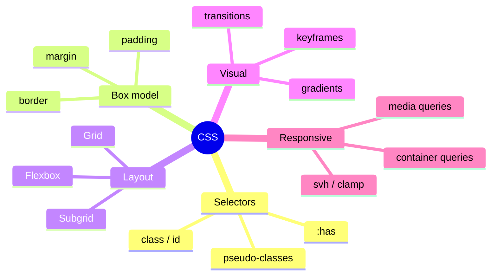

# Session 10: Practice Lab: Modern CSS Components

> Module: Progressive Website Development (HTML5, CSS3 and JavaScript) · Term 1 (CPISM) · ⏱ ~2 hours

## 🎯 Learning Objectives

By the end of this session you will be able to:

- Build a component library page using nesting and custom properties
- Align a product grid with subgrid
- Create a dark mode using `:has()` and `prefers-color-scheme`
- Make components responsive with container queries
- Review all CSS concepts from Sessions 03-09

## 📖 Concepts Explained

**Practice session** for Session 09 and CSS revision.

### Dark mode strategies

| Strategy | Code | Who decides |
|----------|------|-------------|
| System preference | `@media (prefers-color-scheme: dark)` | OS setting |
| Checkbox toggle with `:has()` | `html:has(#dark:checked) { ... }` | User click, no JS |
| `color-scheme` property | `:root { color-scheme: light dark; }` | Browser styles form controls |
| `light-dark()` function | `color: light-dark(#111, #eee);` | Follows `color-scheme` |

### CSS revision map



## 💻 Code Examples

### Example 1: `index.html`

📄 Saved in this folder as [`index.html`](index.html).

```html
<!DOCTYPE html>
<html lang="en">
<head>
  <meta charset="UTF-8">
  <meta name="viewport" content="width=device-width, initial-scale=1.0">
  <title>Component Lab</title>
  <link rel="stylesheet" href="style.css">
</head>
<body>
  <header class="topbar">
    <strong>ShopUI</strong>
    <label class="switch"><input type="checkbox" id="dark"> Dark mode</label>
  </header>

  <main class="products">
    <article class="product">
      
      <h2>Travel Kit</h2>
      <p>Everything for your next trip north.</p>
      <p class="price">Rs 8,500</p>
      <button>Add to cart</button>
    </article>
    <article class="product">
      
      <h2>Wireless Headphones with Noise Cancelling</h2>
      <p>Long battery life.</p>
      <p class="price">Rs 12,000</p>
      <button>Add to cart</button>
    </article>
    <article class="product">
      
      <h2>Phone</h2>
      <p>Fast, light and stylish with a great camera for night photos.</p>
      <p class="price">Rs 65,000</p>
      <button>Add to cart</button>
    </article>
  </main>
</body>
</html>
```

**How it works**

- The checkbox `#dark` will toggle dark mode using only CSS `:has()`.
- Each product has five rows (image, title, text, price, button) for subgrid.

### Example 2: `style.css`

📄 Saved in this folder as [`style.css`](style.css).

```css
:root {
  color-scheme: light dark;
  --bg: #f6f7fb; --surface: #ffffff; --text: #1d2433; --brand: #2563eb; --radius: 14px;
}
@media (prefers-color-scheme: dark) {
  :root { --bg: #0f172a; --surface: #1e293b; --text: #e2e8f0; }
}
html:has(#dark:checked) { --bg: #0f172a; --surface: #1e293b; --text: #e2e8f0; color-scheme: dark; }

*, *::before, *::after { box-sizing: border-box; }
body { margin: 0; font-family: system-ui, sans-serif; background: var(--bg); color: var(--text); transition: background .3s, color .3s; }

.topbar {
  display: flex; justify-content: space-between; align-items: center;
  padding: 1rem 1.5rem; background: var(--surface);
  & strong { color: var(--brand); font-size: 1.3rem; }
}
.switch { display: flex; gap: .5rem; align-items: center; cursor: pointer; & input { accent-color: var(--brand); } }

.products {
  display: grid; gap: 1.5rem; padding: 2rem;
  grid-template-columns: repeat(auto-fit, minmax(250px, 1fr));
  container-type: inline-size;
}
.product {
  display: grid; grid-row: span 5; grid-template-rows: subgrid; gap: .5rem;
  background: var(--surface); border-radius: var(--radius); padding: 1rem;
  & img { width: 100%; aspect-ratio: 4 / 3; object-fit: cover; border-radius: calc(var(--radius) - 4px); }
  & h2 { font-size: 1.1rem; margin: 0; }
  & p  { margin: 0; }
  & .price { font-weight: 800; color: var(--brand); }
  & button {
    border: 0; border-radius: 10px; padding: .7rem; font-weight: 700; cursor: pointer;
    background: var(--brand); color: white;
    &:hover { filter: brightness(1.1); }
    &:focus-visible { outline: 3px solid orange; outline-offset: 2px; }
  }
}
@container (min-width: 900px) {
  .product h2 { font-size: 1.3rem; }
}
```

**How it works**

- Colours are variables. They change through `prefers-color-scheme` (system setting) or `html:has(#dark:checked)` (user toggle, no JavaScript).
- `color-scheme` tells the browser to theme scrollbars and form controls too.
- `.product` spans five parent rows with subgrid so prices and buttons align across products.
- All component rules are nested, and the container query enlarges titles when the product area is wide.

## 🧪 Lab Practice

1. Run the lab and toggle the checkbox. Then switch your OS to dark mode and reload.
2. Add a fourth product with a very long title; confirm alignment still holds.
3. Add a `.badge` (e.g. *Sale*) positioned in the corner of one product image using nesting and `position`.
4. Add a keyframe animation that briefly scales the button when hovered (respect reduced motion).
5. Self-check: explain each line of `style.css` to a partner; mark any line you cannot explain and look it up on MDN.

## 📝 Assignment

Build a **mini UI kit page** with buttons (primary/secondary/disabled), alerts (success/warning/error), a card, a navbar and a form field, all themed by CSS variables, with a CSS-only dark mode toggle and nesting throughout.

## ❓ Quick Quiz

**Q1.** Which media feature detects the OS dark theme?

- a) prefers-contrast
- b) prefers-color-scheme
- c) color-gamut
- d) dark-mode

**Q2.** How can CSS react to a checkbox being checked anywhere on the page?

**Q3.** What does `color-scheme: light dark` do?

**Q4.** Which property colours native checkboxes and radio buttons?

- a) accent-color
- b) caret-color
- c) fill
- d) tint

**Q5.** Why use `calc(var(--radius) - 4px)` on the image?

<details>
<summary>Show answers</summary>

1. b) prefers-color-scheme
2. `html:has(#id:checked)` (or a parent with `:has()`).
3. Tells the browser the page supports both, so built-in UI like form controls and scrollbars match the theme.
4. a) accent-color
5. So the inner radius is slightly smaller than the card's radius, which looks visually correct inside padding.

</details>

## 💼 Interview Questions

**1. How would you implement dark mode?**

<details>
<summary>Model answer</summary>

Define colour tokens as CSS variables, switch them with prefers-color-scheme and/or a user toggle (class or :has), store the user's choice (localStorage), and set color-scheme for native controls.

</details>

**2. What makes a CSS component reusable?**

<details>
<summary>Model answer</summary>

Scoped class names, variables for theming, container queries instead of page-specific media queries, and no dependence on page structure.

</details>

**3. What are the risks of deep nesting?**

<details>
<summary>Model answer</summary>

High specificity, hard-to-override rules and bloated selectors; keep nesting shallow.

</details>

## ✅ Summary

- Variables + :has() + prefers-color-scheme enable dark mode.
- Subgrid aligns real product grids.
- Nesting and container queries keep components self-contained.
- You have now covered the core of modern CSS.

---

[⬅ Previous](../Session-09-Modern-CSS-Subgrid-Viewport-Units-and-Nesting/README.md) · [🏠 Module Home](../README.md) · [Next ➡](../Session-11-Semantic-Layout-and-HTML5-Forms/README.md)

Prepared by Zeeshan Abbas · Aptech Learning North Nazimabad
