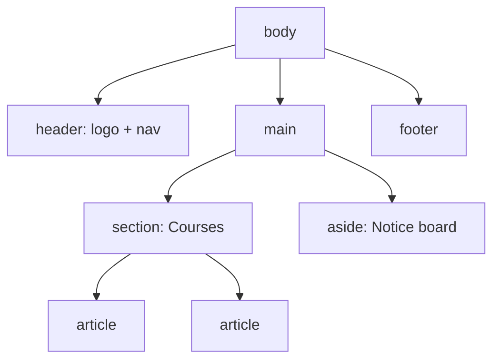

# Session 11: HTML5 Semantic Layout, Navigation and Forms

> Module: Progressive Website Development (HTML5, CSS3 and JavaScript) · Term 1 (CPISM) · ⏱ ~2 hours

## 🎯 Learning Objectives

By the end of this session you will be able to:

- Use HTML5 semantic elements to structure a page and explain when to use `<div>`
- Build an accessible navigation bar
- Create forms with labels, fieldsets and the correct `action`/`method`
- Use HTML5 input types: email, tel, url, number, range, date, color, search
- Apply form attributes (required, pattern, min/max, placeholder, autocomplete) and elements (datalist, output, meter, progress)
- Explain hidden fields and built-in validation

## 📖 Concepts Explained

### 1. Semantic elements

| Element | Meaning |
|---------|---------|
| `<header>` | Intro of the page or a section (logo, title) |
| `<nav>` | Major navigation links |
| `<main>` | Unique main content (one per page) |
| `<section>` | Thematic group with a heading |
| `<article>` | Self-contained content (blog post, product) |
| `<aside>` | Related side content |
| `<footer>` | Closing info: copyright, contacts |
| `<figure>`/`<figcaption>` | Media with caption |
| `<time>`, `<address>`, `<mark>` | Specific meanings |

`<div>` is a **generic division** with no meaning; use it only for styling/grouping when no semantic element fits.



Why semantics? Screen readers announce landmarks, search engines understand structure, and code is easier to read.

### 2. Navigation bar
Put links in a `<ul>` inside `<nav aria-label="Main">` and mark the current page with `aria-current="page"`.

### 3. Form basics

| Part | Purpose |
|------|---------|
| `<form action="/register" method="post">` | Where and how data is sent |
| `<label for="id">` | Clickable caption, read by screen readers |
| `<input name="...">` | `name` is the key sent to the server |
| `<fieldset>` + `<legend>` | Group related fields |
| `<select>`, `<textarea>`, `<button>` | Other controls |

`GET` puts data in the URL (searches); `POST` sends it in the request body (logins, registrations).

### 4. HTML5 input types

| Type | Mobile keyboard / UI | Validation |
|------|---------------------|------------|
| `email` | @ key | Must look like an email |
| `tel` | Number pad | Use `pattern` |
| `url` | .com key | Must be a URL |
| `number` | Spinner | `min`, `max`, `step` |
| `range` | Slider | `min`, `max` |
| `date`, `time`, `datetime-local`, `month`, `week` | Picker | `min`, `max` |
| `color` | Colour picker | |
| `search` | Search key, clear button | |
| `file` | File chooser | `accept`, `multiple` |
| `hidden` | Not shown | Sends a fixed value (e.g. form source) |

### 5. Form attributes and elements
- Attributes: `required`, `placeholder`, `pattern`, `minlength`, `maxlength`, `min`, `max`, `step`, `autocomplete`, `autofocus`, `readonly`, `disabled`, `multiple`, `form`, `novalidate`.
- Elements: `<datalist>` (suggestions), `<output>` (calculation result), `<progress>` (task completion), `<meter>` (gauge, e.g. password strength).
- Validation pseudo-classes: `:valid`, `:invalid`, `:user-invalid` (after user interaction), `:required`.

> Client-side validation helps users, but the **server must validate again**: anyone can bypass browser checks.

**Hidden fields** (`type="hidden"`) carry data the user does not edit, such as a campaign source or record ID. They are visible in the page source, so never put secrets in them.

## 💻 Code Examples

### Example 1: `index.html`

📄 Saved in this folder as [`index.html`](index.html).

```html
<!DOCTYPE html>
<html lang="en">
<head>
  <meta charset="UTF-8">
  <meta name="viewport" content="width=device-width, initial-scale=1.0">
  <title>Student Registration</title>
  <link rel="stylesheet" href="style.css">
</head>
<body>
  <header class="site-header">
    <a href="#" class="logo">Tech Academy</a>
    <nav aria-label="Main">
      <ul>
        <li><a href="#" aria-current="page">Register</a></li>
        <li><a href="#">Courses</a></li>
        <li><a href="#">Contact</a></li>
      </ul>
    </nav>
  </header>

  <main>
    <h1>Student Registration</h1>
    <form action="https://httpbin.org/post" method="post" class="form">
      <input type="hidden" name="source" value="website-2026">

      <fieldset>
        <legend>Personal details</legend>
        <label for="name">Full name</label>
        <input id="name" name="name" required minlength="3" autocomplete="name" placeholder="e.g. Ayesha Khan">

        <label for="email">Email</label>
        <input id="email" name="email" type="email" required autocomplete="email">

        <label for="phone">Mobile (03XX-XXXXXXX)</label>
        <input id="phone" name="phone" type="tel" pattern="03[0-9]{2}-[0-9]{7}" placeholder="0300-1234567" required>

        <label for="dob">Date of birth</label>
        <input id="dob" name="dob" type="date" min="1990-01-01" max="2012-12-31">
      </fieldset>

      <fieldset>
        <legend>Course</legend>
        <label for="course">Programme</label>
        <input id="course" name="course" list="courses" required>
        <datalist id="courses">
          <option value="ACCP in AI"></option>
          <option value="Web Development"></option>
          <option value="Graphic Design"></option>
        </datalist>

        <p>Preferred timing</p>
        <label><input type="radio" name="timing" value="morning" required> Morning</label>
        <label><input type="radio" name="timing" value="evening"> Evening</label>

        <label for="hours">Study hours per week: <output id="hoursOut" for="hours">10</output></label>
        <input id="hours" name="hours" type="range" min="2" max="30" value="10"
               oninput="hoursOut.value = this.value">

        <label for="color">Favourite colour (for your ID card)</label>
        <input id="color" name="color" type="color" value="#1f4e79">

        <label for="site">Portfolio URL (optional)</label>
        <input id="site" name="site" type="url" placeholder="https://">
      </fieldset>

      <label for="about">Tell us about yourself</label>
      <textarea id="about" name="about" rows="4" maxlength="300"></textarea>

      <p>Profile completion: <progress value="70" max="100">70%</progress></p>
      <p>Seats filled: <meter value="18" min="0" max="25" low="10" high="20" optimum="5">18 of 25</meter></p>

      <label><input type="checkbox" name="terms" required> I agree to the rules</label>
      <button type="submit">Register</button>
      <button type="reset" class="secondary">Clear</button>
    </form>
  </main>

  <footer><p>&copy; 2026 Tech Academy &middot; <address>Karachi, Pakistan</address></p></footer>
</body>
</html>
```

**How it works**

- Semantic layout: `header` + `nav` + `main` + `footer`; the nav is a list with `aria-current` on the active link.
- The form posts to `httpbin.org/post`, a free testing service that echoes back what you sent, so you can see the submitted data.
- `pattern="03[0-9]{2}-[0-9]{7}"` validates a Pakistani mobile number format.
- `<datalist>` suggests courses while still allowing typing; `<output>` shows the range value live.
- `<progress>` shows completion; `<meter>` shows a measurement with low/high thresholds.
- `type="hidden"` sends `source=website-2026` without showing a field.

### Example 2: `style.css`

📄 Saved in this folder as [`style.css`](style.css).

```css
*, *::before, *::after { box-sizing: border-box; }
body { margin: 0; font-family: system-ui, sans-serif; background: #f3f6fb; color: #1d2433; }
.site-header { display: flex; justify-content: space-between; align-items: center; padding: 1rem 1.5rem; background: #1f4e79; }
.logo { color: white; font-weight: 800; text-decoration: none; }
nav ul { display: flex; gap: 1rem; list-style: none; margin: 0; padding: 0; }
nav a { color: #dbe8ff; text-decoration: none; }
nav a[aria-current="page"] { color: white; border-bottom: 2px solid #ffc107; }

main { width: min(640px, 100% - 2rem); margin: 2rem auto; }
.form { display: grid; gap: .5rem; background: white; padding: 1.5rem; border-radius: 14px; }
fieldset { border: 1px solid #d6deea; border-radius: 10px; display: grid; gap: .5rem; margin: 0 0 1rem; }
legend { font-weight: 700; padding: 0 .5rem; }
input:not([type="radio"], [type="checkbox"], [type="range"], [type="color"]), textarea {
  padding: .6rem; border: 1px solid #b8c4d6; border-radius: 8px; font: inherit;
}
input:focus, textarea:focus { outline: 3px solid #93c5fd; border-color: #2563eb; }
input:user-invalid { border-color: crimson; background: #fff5f5; }
input:user-valid { border-color: seagreen; }
button { padding: .7rem 1.2rem; border: 0; border-radius: 8px; background: #1f4e79; color: white; font-weight: 700; cursor: pointer; }
.secondary { background: #6b7280; }
footer { text-align: center; padding: 1rem; }
address { display: inline; font-style: normal; }
```

**How it works**

- `:user-invalid` shows red borders only after the user interacts with a field, which is friendlier than `:invalid` on page load.
- The `:not(...)` selector styles text-like inputs but skips radios, checkboxes, range and colour.
- Each `fieldset` is a small grid so labels and inputs stack neatly.

## 🧪 Lab Practice

1. Submit the form with empty fields and note the browser messages. Then fill it correctly and look at the JSON echoed by httpbin.
2. Open the page on your phone (or DevTools device mode) and tap the email, tel and date fields to see different keyboards/pickers.
3. Add a password field with `minlength="8"` and a `<meter>` labelled *Strength*.
4. Add `<select multiple>` for languages known, and a `file` input that accepts only images (`accept="image/*"`).
5. Run the page through the W3C validator and the Lighthouse *Accessibility* audit in DevTools; fix all form label issues.

## 📝 Assignment

Create a **job application page** using semantic layout (header/nav/main/aside/footer) and a form with at least eight different input types, two fieldsets, a datalist, a hidden field, pattern validation for CNIC (`[0-9]{5}-[0-9]{7}-[0-9]`), and custom styles for valid/invalid states.

## ❓ Quick Quiz

**Q1.** Which element should wrap the unique main content of a page?

- a) <section>
- b) <main>
- c) <article>
- d) <div>

**Q2.** Which HTTP method should a login form use?

- a) GET
- b) POST
- c) PUT
- d) HEAD

**Q3.** What is the purpose of the `name` attribute on inputs?

**Q4.** Which element gives typing suggestions but allows free text?

- a) <select>
- b) <datalist>
- c) <option>
- d) <output>

**Q5.** Why must the server validate data even if HTML5 validates it?

<details>
<summary>Show answers</summary>

1. b) <main>
2. b) POST
3. It is the key under which the value is sent to the server.
4. b) <datalist>
5. Browser validation can be disabled or bypassed (dev tools, scripts), so the server is the real security check.

</details>

## 💼 Interview Questions

**1. `<section>` vs `<article>` vs `<div>`?**

<details>
<summary>Model answer</summary>

Article is self-contained and reusable on its own; section groups related content with a heading; div has no meaning and is only for styling/grouping.

</details>

**2. How do you make forms accessible?**

<details>
<summary>Model answer</summary>

Every control has a visible `<label for>`, group with fieldset/legend, clear error messages, correct input types and autocomplete, keyboard focus styles and sufficient contrast.

</details>

**3. What are hidden fields used for, and what is the risk?**

<details>
<summary>Model answer</summary>

Passing non-editable data like IDs or tracking source; the risk is users can see and change them, so never trust or store secrets in them.

</details>

## ✅ Summary

- Semantic elements describe meaning: header, nav, main, section, article, aside, footer.
- Forms need action, method, names and labels.
- HTML5 input types give better keyboards and built-in validation.
- Attributes and elements like pattern, datalist, output, meter and progress enrich forms.
- Always validate on the server too.

---

[⬅ Previous](../Session-10-Practice-Lab-Modern-CSS-Components/README.md) · [🏠 Module Home](../README.md) · [Next ➡](../Session-12-Practice-Lab-Forms-and-Review/README.md)

Prepared by Zeeshan Abbas · Aptech Learning North Nazimabad
