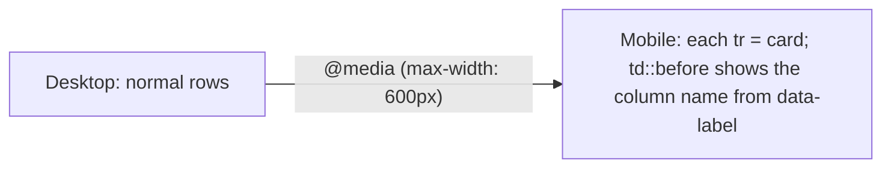

# Session 14: Practice Lab: Data Tables and a Media Page

> Module: Progressive Website Development (HTML5, CSS3 and JavaScript) · Term 1 (CPISM) · ⏱ ~2 hours

## 🎯 Learning Objectives

By the end of this session you will be able to:

- Build complex accessible tables with grouped headers
- Create a responsive table that stacks into cards on mobile
- Build a media gallery page with video, audio and captions
- Use `<details>` and `<iframe>` responsibly
- Test media in multiple browsers

## 📖 Concepts Explained

**Practice session** for Session 13.

### Grouped headers
Use two header rows: the first has `colspan` group titles (*Term marks*), the second has the individual columns. Use `scope="colgroup"` on group headers.

### Stacked table on mobile (CSS trick)



### Responsive embeds
`aspect-ratio: 16 / 9; width: 100%;` on an `<iframe>` keeps YouTube embeds the right shape at any width.

### Media testing checklist
- [ ] Plays in Chrome, Firefox and on a phone
- [ ] Captions visible and in sync
- [ ] Poster image shows before play
- [ ] Page still works if the media fails to load (fallback link)

## 💻 Code Examples

### Example 1: `index.html`

📄 Saved in this folder as [`index.html`](index.html).

```html
<!DOCTYPE html>
<html lang="en">
<head>
  <meta charset="UTF-8">
  <meta name="viewport" content="width=device-width, initial-scale=1.0">
  <title>Results & Media Lab</title>
  <link rel="stylesheet" href="style.css">
</head>
<body>
  <main>
    <h1>Term 1 Results</h1>
    <table class="results">
      <caption>Marks out of 100</caption>
      <thead>
        <tr>
          <th rowspan="2" scope="col">Student</th>
          <th colspan="3" scope="colgroup">Modules</th>
          <th rowspan="2" scope="col">Average</th>
        </tr>
        <tr><th scope="col">Web</th><th scope="col">Git</th><th scope="col">SEO</th></tr>
      </thead>
      <tbody>
        <tr><th scope="row" data-label="Student">Ayesha</th><td data-label="Web">88</td><td data-label="Git">92</td><td data-label="SEO">79</td><td data-label="Average">86.3</td></tr>
        <tr><th scope="row" data-label="Student">Hamza</th><td data-label="Web">71</td><td data-label="Git">65</td><td data-label="SEO">80</td><td data-label="Average">72.0</td></tr>
        <tr><th scope="row" data-label="Student">Zara</th><td data-label="Web">95</td><td data-label="Git">90</td><td data-label="SEO">93</td><td data-label="Average">92.7</td></tr>
      </tbody>
    </table>

    <h2>Lecture recording</h2>
    <div class="embed">
      <iframe src="https://www.youtube-nocookie.com/embed/UB1O30fR-EE"
              title="HTML crash course video" loading="lazy"
              allow="accelerometer; encrypted-media; picture-in-picture" allowfullscreen></iframe>
    </div>
  </main>
</body>
</html>
```

**How it works**

- The first header row uses `rowspan` and `colspan` with `scope="colgroup"` for the *Modules* group.
- Each cell carries `data-label` with its column name for the mobile card view.
- `youtube-nocookie.com` is YouTube's privacy-enhanced embed domain; the `title` describes the frame for screen readers.

### Example 2: `style.css`

📄 Saved in this folder as [`style.css`](style.css).

```css
body { margin: 0; font-family: system-ui, sans-serif; background: #f5f7fa; }
main { width: min(900px, 100% - 2rem); margin: 2rem auto; }

.results { width: 100%; border-collapse: collapse; background: white; }
.results caption { text-align: left; font-weight: 700; padding: .5rem 0; }
.results th, .results td { border: 1px solid #d5dce6; padding: .6rem; text-align: center; }
.results thead th { background: #0f766e; color: white; }

@media (max-width: 600px) {
  .results thead { position: absolute; width: 1px; height: 1px; overflow: hidden; clip-path: inset(50%); }
  .results tr { display: block; margin-bottom: 1rem; border: 1px solid #d5dce6; border-radius: 10px; overflow: hidden; }
  .results th, .results td { display: flex; justify-content: space-between; border: 0; border-bottom: 1px solid #eef1f5; text-align: right; }
  .results th[scope="row"] { background: #ccfbf1; }
  .results [data-label]::before { content: attr(data-label); font-weight: 700; text-align: left; }
}

.embed iframe { width: 100%; aspect-ratio: 16 / 9; border: 0; border-radius: 12px; }
```

**How it works**

- Below 600px the header row is visually hidden (still read by screen readers) and each row becomes a card.
- `content: attr(data-label)` prints the column name before each value.
- `aspect-ratio: 16 / 9` keeps the embedded video correctly shaped.

## 🧪 Lab Practice

1. Run the lab and switch DevTools to a 375px phone. Confirm the table becomes cards.
2. Add a *Rank* column and a `<tfoot>` row showing the class average for each module.
3. Add a local `<video>` with two sources and a `.vtt` caption file of three cues you write.
4. Build a mini podcast player list: three `<audio>` elements inside `<article>` cards with `<details>` transcripts.
5. Test the page in two browsers and on a real phone; note any differences.

## 📝 Assignment

Make a **"Course Catalogue"** page with a grouped-header fee table (Course | Duration | Fee: Monthly/Total) that stacks on mobile, plus an embedded intro video and one audio testimonial with transcript.

## ❓ Quick Quiz

**Q1.** Which scope value is correct for a header spanning a group of columns?

- a) col
- b) row
- c) colgroup
- d) group

**Q2.** What does `content: attr(data-label)` do?

**Q3.** Why use `youtube-nocookie.com` in embeds?

**Q4.** Which property keeps an iframe at 16:9?

- a) ratio
- b) aspect-ratio
- c) object-fit
- d) height: auto

**Q5.** Why hide the thead visually instead of `display:none` on mobile?

<details>
<summary>Show answers</summary>

1. c) colgroup
2. Inserts the element's `data-label` attribute value as generated content.
3. It is YouTube's privacy-enhanced mode that does not set tracking cookies until the user plays the video.
4. b) aspect-ratio
5. Visually hidden content is still available to screen readers; display:none removes it completely.

</details>

## 💼 Interview Questions

**1. Describe a technique for responsive data tables.**

<details>
<summary>Model answer</summary>

Horizontal scroll wrapper, hiding less important columns, or transforming rows into stacked cards with data-label pseudo-elements.

</details>

**2. What are data-* attributes?**

<details>
<summary>Model answer</summary>

Custom attributes for storing extra information on elements, readable in CSS via attr() and in JavaScript via dataset.

</details>

**3. Security considerations when embedding iframes?**

<details>
<summary>Model answer</summary>

Embed trusted sources only, use `sandbox` and `allow` attributes to limit permissions, `loading="lazy"` for performance, and a descriptive title.

</details>

## ✅ Summary

- Grouped headers use rowspan/colspan and scope=colgroup.
- Data tables can stack into cards on mobile.
- Responsive iframes need aspect-ratio.
- Test media across browsers and devices.

---

[⬅ Previous](../Session-13-HTML5-Tables-Audio-and-Video/README.md) · [🏠 Module Home](../README.md) · [Next ➡](../Session-15-JavaScript-Fundamentals/README.md)

Prepared by Zeeshan Abbas · Aptech Learning North Nazimabad
