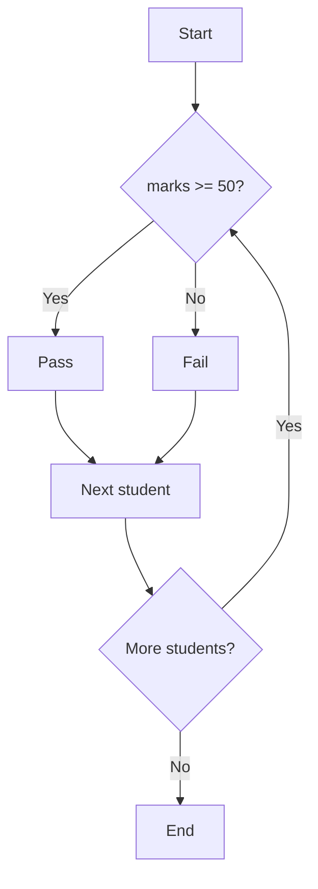

# Session 15: JavaScript I: Variables, Operators, Decisions, Loops, Arrays and Events

> Module: Progressive Website Development (HTML5, CSS3 and JavaScript) · Term 1 (CPISM) · ⏱ ~2 hours

## 🎯 Learning Objectives

By the end of this session you will be able to:

- Explain scripting, client-side vs server-side JavaScript, and how to add JS to a page
- Declare variables with `let` and `const` and use the JS data types
- Display output with `console.log`, `alert`, DOM text and template literals; use escape sequences and built-in functions
- Use operators, regular expressions and decision statements (`if`, `switch`, ternary)
- Use loops (`for`, `while`, `do...while`, `for...of`, `for...in`), `break` and `continue`
- Work with single- and multi-dimensional arrays and handle events

## 📖 Concepts Explained

### 1. What is scripting?
A **script** is a program run by another program, here the **browser**. JavaScript makes pages interactive: validate forms, change content, call APIs.

| | Client-side JS | Server-side JS |
|-|----------------|----------------|
| Runs in | Browser | Server (Node.js) |
| Can access | DOM, user events, localStorage | Files, databases, network |
| Example | Show/hide a menu | Save a registration in a database |

Add JS with `<script src="app.js" defer></script>` at the end of `<head>`. `defer` waits until HTML is parsed. Libraries like **jQuery** (Module 03) build on top of JavaScript. (*jQuery Mobile* is no longer maintained; use responsive CSS or modern frameworks instead.)

### 2. Variables and data types

```js
const school = "Aptech";   // cannot be reassigned
let marks = 85;            // can change
```

Avoid `var` (old, function-scoped). Types: `string`, `number`, `bigint`, `boolean`, `undefined`, `null`, `symbol` and `object` (arrays, functions, objects). Check with `typeof`.

### 3. Showing information
`console.log()` (DevTools console), `alert()` / `prompt()` / `confirm()` (pop-ups), `element.textContent = ...` (on the page). **Template literals** use backticks: `` `Hello ${name}` ``.
Escape sequences: `\n` new line, `\t` tab, `\"` quote, `\\` backslash.
Built-in functions: `parseInt()`, `parseFloat()`, `Number()`, `String()`, `isNaN()`, `Math.round()`, `Math.random()`, `Date()`.

### 4. Operators

| Type | Operators |
|------|-----------|
| Arithmetic | `+ - * / % **` `++ --` |
| Assignment | `= += -= *= /=` `??=` |
| Comparison | `=== !== > < >= <=` (use `===`, not `==`) |
| Logical | `&& || !` |
| Nullish / optional | `??`, `?.` |
| Ternary | `cond ? a : b` |

### 5. Regular expressions
Patterns for text: `/^03\d{2}-\d{7}$/.test(phone)` checks a mobile number. `\d` digit, `\w` word char, `+` one or more, `{n}` exactly n, `^`/`$` start/end, `i` flag ignore case.

### 6. Decisions and loops



| Loop | Use |
|------|-----|
| `for (let i = 0; i < n; i++)` | Known count |
| `while (cond)` | Unknown count, check first |
| `do { } while (cond)` | Runs at least once |
| `for (const x of array)` | Values of an array |
| `for (const key in object)` | Keys of an object |

`break` exits a loop; `continue` skips to the next iteration.

### 7. Arrays
`const fruits = ["apple", "mango"];` index from 0. Methods: `push`, `pop`, `shift`, `unshift`, `includes`, `indexOf`, `join`, `slice`, `splice`, `sort`, plus `forEach`, `map`, `filter`, `reduce`. Multi-dimensional: `const grid = [[1,2],[3,4]]; grid[1][0] // 3`.

### 8. Events
Events are things that happen: `click`, `input`, `submit`, `keydown`, `mouseover`, `load`. Prefer `addEventListener` over inline `onclick`:

```js
button.addEventListener("click", () => { /* handler */ });
```

## 💻 Code Examples

### Example 1: `index.html`

📄 Saved in this folder as [`index.html`](index.html).

```html
<!DOCTYPE html>
<html lang="en">
<head>
  <meta charset="UTF-8">
  <meta name="viewport" content="width=device-width, initial-scale=1.0">
  <title>JavaScript Basics</title>
  <script src="app.js" defer></script>
  <style>
    body { font-family: system-ui, sans-serif; max-width: 700px; margin: 2rem auto; padding: 0 1rem; }
    input, button { padding: .5rem; font: inherit; }
    .pass { color: green; } .fail { color: crimson; }
    table { border-collapse: collapse; margin-top: 1rem; } td { border: 1px solid #ccc; padding: .3rem .6rem; }
  </style>
</head>
<body>
  <h1>Grade Calculator</h1>
  <label for="marks">Marks (0-100):</label>
  <input id="marks" type="number" min="0" max="100">
  <button id="checkBtn">Check grade</button>
  <p id="result" aria-live="polite"></p>

  <h2>Phone validator (RegExp)</h2>
  <input id="phone" placeholder="0300-1234567">
  <span id="phoneMsg"></span>

  <h2>Class report</h2>
  <button id="reportBtn">Generate report</button>
  <div id="report"></div>

  <h2>Times table</h2>
  <div id="table"></div>
</body>
</html>
```

**How it works**

- `defer` loads `app.js` without blocking and runs it after the HTML is ready.
- `aria-live="polite"` makes screen readers announce the result when it changes.

### Example 2: `app.js`

📄 Saved in this folder as [`app.js`](app.js).

```javascript
// ---------- 1. Variables, types and output ----------
const institute = "Tech Academy";
let year = 2026;
console.log(`Welcome to ${institute}, ${year}!`);
console.log(typeof institute, typeof year, typeof true, typeof null); // string number boolean object
console.log("Line one\nLine two\t(tabbed) and a \"quote\"");

// ---------- 2. Decision making ----------
function getGrade(marks) {
  if (marks >= 80) return "A";
  else if (marks >= 65) return "B";
  else if (marks >= 50) return "C";
  return "F";
}

const marksInput = document.querySelector("#marks");
const result = document.querySelector("#result");

document.querySelector("#checkBtn").addEventListener("click", () => {
  const marks = Number(marksInput.value);
  if (marksInput.value === "" || isNaN(marks) || marks < 0 || marks > 100) {
    result.textContent = "Please enter a number from 0 to 100.";
    result.className = "fail";
    return;
  }
  const grade = getGrade(marks);
  const status = grade === "F" ? "Fail" : "Pass";     // ternary operator
  result.textContent = `Marks: ${marks} → Grade ${grade} (${status})`;
  result.className = status === "Pass" ? "pass" : "fail";

  switch (grade) {
    case "A": console.log("Excellent!"); break;
    case "B": console.log("Very good"); break;
    default:  console.log("Keep practising");
  }
});

// ---------- 3. Regular expression + input event ----------
const phonePattern = /^03\d{2}-\d{7}$/;
document.querySelector("#phone").addEventListener("input", (event) => {
  const ok = phonePattern.test(event.target.value);
  const msg = document.querySelector("#phoneMsg");
  msg.textContent = ok ? " ✔ valid" : " ✖ format 03XX-XXXXXXX";
  msg.className = ok ? "pass" : "fail";
});

// ---------- 4. Arrays and loops ----------
const students = ["Ayesha", "Hamza", "Fatima", "Daniyal", "Zara"];
const scores   = [86, 45, 91, 0, 77];          // 0 = absent

document.querySelector("#reportBtn").addEventListener("click", () => {
  let lines = [];
  let total = 0, counted = 0;

  for (let i = 0; i < students.length; i++) {
    if (scores[i] === 0) {               // skip absent students
      lines.push(`${students[i]}: absent`);
      continue;
    }
    total += scores[i];
    counted++;
    lines.push(`${students[i]}: ${scores[i]} (${getGrade(scores[i])})`);
  }

  const passed = scores.filter(s => s >= 50).length;
  const average = (total / counted).toFixed(1);
  lines.push(`Average: ${average} | Passed: ${passed}`);
  document.querySelector("#report").innerHTML = lines.map(l => `<div>${l}</div>`).join("");
});

// while and do...while
let countdown = 3;
while (countdown > 0) { console.log("while:", countdown); countdown--; }
let tries = 0;
do { tries++; } while (tries < 1);   // runs once even though the condition is false afterwards
console.log("do...while ran", tries, "time(s)");

// for...of and for...in
for (const name of students) { if (name === "Fatima") { console.log("Found Fatima"); break; } }
const course = { title: "PWD", sessions: 20, online: true };
for (const key in course) console.log(`${key} = ${course[key]}`);

// ---------- 5. Multi-dimensional array: times table ----------
const table = [];
for (let r = 1; r <= 5; r++) {
  const row = [];
  for (let c = 1; c <= 5; c++) row.push(r * c);
  table.push(row);
}
console.log("table[2][3] =", table[2][3]); // 3 x 4 = 12
document.querySelector("#table").innerHTML =
  "<table>" + table.map(row => "<tr>" + row.map(v => `<td>${v}</td>`).join("") + "</tr>").join("") + "</table>";
```

**How it works**

- Section 1 shows `const`/`let`, template literals, `typeof` (note the famous `typeof null === "object"` quirk) and escape sequences.
- `getGrade` uses `if...else if`; the click handler validates input, uses a ternary for Pass/Fail and a `switch` for messages.
- The phone field listens to the `input` event and tests a regular expression on every keystroke.
- The report loop uses `continue` to skip absent students, `filter` to count passes and `toFixed(1)` to round.
- `while`, `do...while`, `for...of` with `break`, and `for...in` over object keys are all demonstrated in the console.
- A nested loop builds a 5 × 5 two-dimensional array and renders it as a table.

## 🧪 Lab Practice

1. Open the page with Live Server and the DevTools Console (`F12`). Read every console message and match it to the code.
2. Add an input event so the grade updates as you type (no button click).
3. Write a loop that prints all even numbers from 1 to 50 using `continue` for odd numbers.
4. Add a CNIC validator with the regex `/^\d{5}-\d{7}-\d$/`.
5. Create a 2D array of three students with three marks each and print each student's total using nested loops.

## 📝 Assignment

Build a **Simple Calculator & Converter** page: two number inputs and buttons for +, −, ×, ÷, % (handle divide-by-zero with `if`), a `switch`-based operation chooser, a temperature converter (°C ⇄ °F), and a history list stored in an array and displayed with a loop.

## ❓ Quick Quiz

**Q1.** Which keyword declares a variable that cannot be reassigned?

- a) var
- b) let
- c) const
- d) static

**Q2.** What is the result of `"5" === 5`?

- a) true
- b) false
- c) undefined
- d) error

**Q3.** Which loop always runs at least once?

- a) for
- b) while
- c) do...while
- d) for...of

**Q4.** What does `continue` do inside a loop?

**Q5.** How do you access the value 12 in `const t = [[1,2],[3,12]]`?

<details>
<summary>Show answers</summary>

1. c) const
2. b) false
3. c) do...while
4. Skips the rest of the current iteration and moves to the next one.
5. `t[1][1]`

</details>

## 💼 Interview Questions

**1. Difference between `let`, `const` and `var`?**

<details>
<summary>Model answer</summary>

`let` and `const` are block-scoped; `const` cannot be reassigned; `var` is function-scoped, hoisted and can be redeclared, which causes bugs.

</details>

**2. Why use `===` instead of `==`?**

<details>
<summary>Model answer</summary>

`===` compares value and type without coercion; `==` converts types first, leading to surprises like `0 == ""` being true.

</details>

**3. What is event handling?**

<details>
<summary>Model answer</summary>

Running code in response to events (click, input, submit) by attaching listeners with addEventListener; the handler receives an event object with details.

</details>

## ✅ Summary

- JavaScript adds behaviour; load it with `<script defer>`.
- Use `const` by default, `let` when values change.
- Operators, regex and if/switch make decisions.
- Loops repeat work; break/continue control them.
- Arrays (including 2D) store lists; events connect code to user actions.

---

[⬅ Previous](../Session-14-Practice-Lab-Data-Tables-and-Media-Page/README.md) · [🏠 Module Home](../README.md) · [Next ➡](../Session-16-Practice-Lab-JavaScript-Fundamentals/README.md)

Prepared by Zeeshan Abbas · Aptech Learning North Nazimabad
