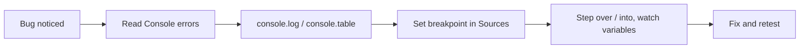

# Session 16: Practice Lab: JavaScript Fundamentals

> Module: Progressive Website Development (HTML5, CSS3 and JavaScript) · Term 1 (CPISM) · ⏱ ~2 hours

## 🎯 Learning Objectives

By the end of this session you will be able to:

- Solve small logic problems with conditions and loops
- Use array methods `map`, `filter`, `reduce`, `find`, `sort`
- Validate a form with JavaScript and regular expressions
- Debug code with breakpoints and `console` methods
- Build a mini interactive app: a number guessing game

## 📖 Concepts Explained

**Practice session** for Session 15.

### Array method cheat sheet

| Method | Returns | Example |
|--------|---------|---------|
| `map` | New array, transformed | `prices.map(p => p * 1.17)` |
| `filter` | New array, matching items | `marks.filter(m => m >= 50)` |
| `reduce` | Single value | `marks.reduce((sum, m) => sum + m, 0)` |
| `find` | First match or undefined | `users.find(u => u.id === 3)` |
| `some` / `every` | Boolean | `marks.every(m => m > 0)` |
| `sort` | Sorted (same array) | `[...nums].sort((a, b) => a - b)` |

### Debugging workflow



Tips: `console.table(array)` prints a neat table; the `debugger;` statement pauses execution when DevTools is open.

## 💻 Code Examples

### Example 1: `index.html`

📄 Saved in this folder as [`index.html`](index.html).

```html
<!DOCTYPE html>
<html lang="en">
<head>
  <meta charset="UTF-8">
  <meta name="viewport" content="width=device-width, initial-scale=1.0">
  <title>Guess the Number</title>
  <script src="game.js" defer></script>
  <style>
    body { font-family: system-ui, sans-serif; display: grid; place-items: center; min-height: 100svh; margin: 0; background: #0f172a; color: #e2e8f0; }
    .card { background: #1e293b; padding: 2rem; border-radius: 16px; width: min(420px, 92vw); text-align: center; }
    input, button { font: inherit; padding: .6rem; border-radius: 8px; border: 0; }
    button { background: #22c55e; color: #052e16; font-weight: 700; cursor: pointer; }
    #msg { min-height: 1.5em; font-weight: 600; }
  </style>
</head>
<body>
  <main class="card">
    <h1>Guess the Number</h1>
    <p>I am thinking of a number between 1 and 100. You have 7 tries.</p>
    <form id="guessForm">
      <input id="guess" type="number" min="1" max="100" required aria-label="Your guess">
      <button>Guess</button>
    </form>
    <p id="msg" aria-live="polite"></p>
    <p>Tries left: <strong id="left">7</strong></p>
    <p>Previous: <span id="history">-</span></p>
    <button id="restart" hidden>Play again</button>
  </main>
</body>
</html>
```

**How it works**

- A small form with one number input; messages are announced with `aria-live`.
- The *Play again* button starts hidden and is shown when the game ends.

### Example 2: `game.js`

📄 Saved in this folder as [`game.js`](game.js).

```javascript
const MAX_TRIES = 7;
let secret, triesLeft, guesses;

const form = document.querySelector("#guessForm");
const input = document.querySelector("#guess");
const msg = document.querySelector("#msg");
const left = document.querySelector("#left");
const historyEl = document.querySelector("#history");
const restart = document.querySelector("#restart");

function newGame() {
  secret = Math.floor(Math.random() * 100) + 1;   // 1..100
  triesLeft = MAX_TRIES;
  guesses = [];
  msg.textContent = "";
  left.textContent = triesLeft;
  historyEl.textContent = "-";
  input.disabled = false;
  restart.hidden = true;
  input.focus();
}

function endGame(text) {
  msg.textContent = text;
  input.disabled = true;
  restart.hidden = false;
}

form.addEventListener("submit", (event) => {
  event.preventDefault();                 // stop page reload
  const guess = Number(input.value);
  if (!Number.isInteger(guess) || guess < 1 || guess > 100) {
    msg.textContent = "Enter a whole number from 1 to 100.";
    return;
  }
  if (guesses.includes(guess)) {
    msg.textContent = `You already tried ${guess}.`;
    return;
  }

  guesses.push(guess);
  triesLeft--;
  left.textContent = triesLeft;
  historyEl.textContent = [...guesses].sort((a, b) => a - b).join(", ");

  if (guess === secret) {
    endGame(`🎉 Correct! ${secret} in ${guesses.length} tries.`);
  } else if (triesLeft === 0) {
    endGame(`Game over. The number was ${secret}.`);
  } else {
    const diff = Math.abs(secret - guess);
    const hint = diff <= 5 ? "very close" : diff <= 15 ? "close" : "far";
    msg.textContent = `${guess > secret ? "Too high" : "Too low"} (${hint}).`;
  }
  input.value = "";
  input.focus();
});

restart.addEventListener("click", newGame);
newGame();

// ---- Extra practice: array methods in the console ----
const marks = [72, 45, 90, 66, 38, 81];
console.table(marks.map((m, i) => ({ student: i + 1, marks: m, pass: m >= 50 })));
console.log("Total:", marks.reduce((sum, m) => sum + m, 0));
console.log("First above 85:", marks.find(m => m > 85));
console.log("All above 30?", marks.every(m => m > 30));
```

**How it works**

- `Math.floor(Math.random() * 100) + 1` gives a whole number from 1 to 100.
- `event.preventDefault()` stops the form from reloading the page on submit.
- `guesses.includes()` prevents duplicate guesses; a copied, sorted array shows history without changing the original order.
- A nested ternary turns the distance into a hint (very close / close / far).
- The console section practises `map`, `reduce`, `find`, `every` and `console.table`.

## 🧪 Lab Practice

1. Play the game and set a breakpoint on `const guess = ...` in DevTools > Sources. Step through one guess and watch `secret`.
2. Add a difficulty selector (Easy 1-50 / Hard 1-500) that changes the range and number of tries.
3. Store the best score (fewest tries) in a variable and display it after each win.
4. Write `fizzBuzz(n)` that logs numbers 1..n, replacing multiples of 3 with *Fizz*, 5 with *Buzz*, both with *FizzBuzz*.
5. Given `const products = [{name:'Pen',price:50},{name:'Bag',price:2500},{name:'Book',price:800}]`, use `filter`, `map` and `reduce` to get the total of items above Rs 100.

## 📝 Assignment

Build a **Quiz App** with 5 multiple-choice questions stored in an array of objects. Show one question at a time, track the score, show the correct answer after each choice, and display a final result with a percentage and grade.

## ❓ Quick Quiz

**Q1.** Which method returns a new array with only matching items?

- a) map
- b) filter
- c) reduce
- d) forEach

**Q2.** Why call `event.preventDefault()` in a submit handler?

**Q3.** What does `[...arr].sort((a,b) => a-b)` do?

**Q4.** Which statement pauses code when DevTools is open?

- a) pause;
- b) stop;
- c) debugger;
- d) break;

**Q5.** What is returned by `[1,2,3].reduce((s, n) => s + n, 0)`?

<details>
<summary>Show answers</summary>

1. b) filter
2. To stop the browser's default form submission/page reload so JavaScript can handle it.
3. Sorts a copy of the array numerically ascending, leaving the original unchanged.
4. c) debugger;
5. 6

</details>

## 💼 Interview Questions

**1. Explain map vs forEach.**

<details>
<summary>Model answer</summary>

`map` returns a new array of transformed values; `forEach` just runs a function for each item and returns undefined.

</details>

**2. How do you debug JavaScript in the browser?**

<details>
<summary>Model answer</summary>

Read console errors, add logs, use breakpoints and step through code in the Sources panel, inspect variables and the call stack, and check the Network tab for failed requests.

</details>

**3. Why should `sort` be given a compare function for numbers?**

<details>
<summary>Model answer</summary>

Default sort converts items to strings, so `[10, 9, 1]` sorts as `[1, 10, 9]`; `(a,b)=>a-b` sorts numerically.

</details>

## ✅ Summary

- Practice turns syntax into problem-solving skill.
- map/filter/reduce/find handle most array tasks.
- Forms are controlled with submit events and preventDefault.
- Breakpoints beat guessing when debugging.

---

[⬅ Previous](../Session-15-JavaScript-Fundamentals/README.md) · [🏠 Module Home](../README.md) · [Next ➡](../Session-17-JavaScript-Functions-Objects-DOM-and-JSON/README.md)

Prepared by Zeeshan Abbas · Aptech Learning North Nazimabad
