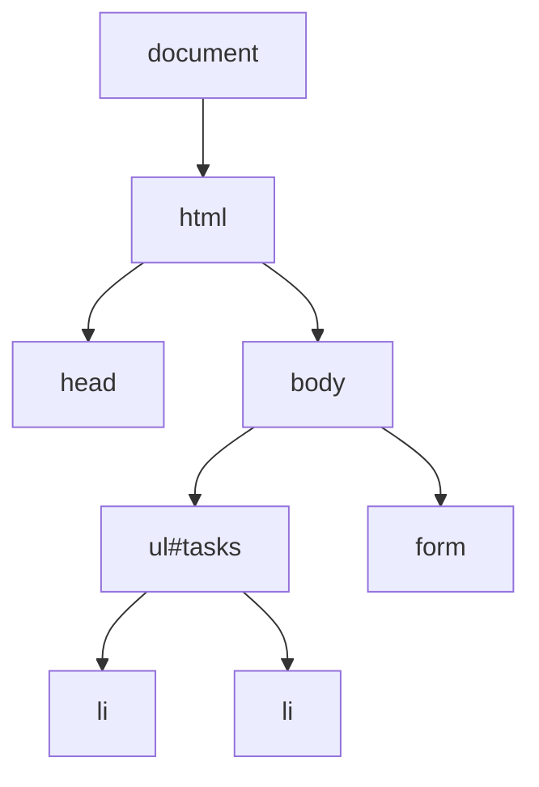

# Session 17: JavaScript II: Functions, Objects, Browser Objects, DOM and JSON

> Module: Progressive Website Development (HTML5, CSS3 and JavaScript) · Term 1 (CPISM) · ⏱ ~2 hours

## 🎯 Learning Objectives

By the end of this session you will be able to:

- Write functions with parameters, default values and return statements, including arrow functions
- Create and use objects and classes, including private class fields and methods
- Use browser objects: `window`, `document`, `location`, `history`, `navigator`
- Select, create, change and remove DOM elements and handle events with delegation
- Convert data with `JSON.stringify` and `JSON.parse`, and load JSON with `fetch`
- Use promises, `async/await` and `Promise.any`

## 📖 Concepts Explained

### 1. Functions

```js
function add(a, b = 0) { return a + b; }      // declaration with default parameter
const square = n => n * n;                      // arrow function
```

- **Parameters** are placeholders; **arguments** are the actual values passed.
- `return` sends a value back and ends the function. Without it, the function returns `undefined`.
- Functions are values: pass them to other functions (callbacks), e.g. `button.addEventListener("click", handler)`.
- **Scope**: variables declared inside a function are not visible outside.

### 2. Objects and classes

```js
const student = { name: "Sara", marks: [80, 90], average() { return (this.marks[0] + this.marks[1]) / 2; } };
student.name;          // dot notation
student["marks"];      // bracket notation
const { name } = student;   // destructuring
```

Classes are blueprints. **Private** fields and methods start with `#` and can only be used inside the class (ES2022):

```js
class BankAccount {
  #balance = 0;
  deposit(x) { this.#validate(x); this.#balance += x; }
  #validate(x) { if (x <= 0) throw new Error("Invalid amount"); }
  get balance() { return this.#balance; }
}
```

### 3. Browser Object Model (BOM)

| Object | Examples |
|--------|----------|
| `window` | `innerWidth`, `setTimeout()`, `alert()`, `scrollTo()` |
| `document` | The page (DOM root) |
| `location` | `href`, `reload()`, `search` (query string) |
| `history` | `back()`, `forward()` |
| `navigator` | `language`, `onLine`, `geolocation`, `clipboard` |
| `screen` | `width`, `height` |

### 4. The DOM
The browser turns HTML into a tree of objects, the **Document Object Model**.



| Task | Code |
|------|------|
| Select | `document.querySelector(".card")`, `querySelectorAll("li")` |
| Read/change text | `el.textContent = "Hi"` |
| Change classes | `el.classList.add/remove/toggle("done")` |
| Attributes / data | `el.setAttribute("aria-expanded","true")`, `el.dataset.id` |
| Create & insert | `document.createElement("li")`, `list.append(li)` |
| Remove | `el.remove()` |
| Style | `el.style.color = "red"` (prefer classes) |

**Event delegation**: put one listener on a parent and check `event.target`, which handles items added later.

> Use `textContent` for user input; `innerHTML` with untrusted text can allow script injection (XSS).

### 5. JSON
**JavaScript Object Notation** is a text format for data exchange. Keys must be in double quotes.

```js
const text = JSON.stringify({ id: 1, done: false });  // object → string
const obj  = JSON.parse('{"id":1,"done":false}');      // string → object
```

### 6. Promises and async/await
A **Promise** represents a future result (pending → fulfilled or rejected). `fetch()` returns a promise.

```js
async function load() {
  const res = await fetch("data.json");
  if (!res.ok) throw new Error(res.status);
  return res.json();
}
```

| Combinator | Resolves when |
|------------|---------------|
| `Promise.all` | All succeed (fails if any fails) |
| `Promise.allSettled` | All finish (success or failure) |
| `Promise.race` | The first settles |
| `Promise.any` (ES2021) | The **first succeeds**; rejects with `AggregateError` only if all fail |

`Promise.any` is handy for trying several mirrors/servers and using whichever responds successfully first.

## 💻 Code Examples

### Example 1: `index.html`

📄 Saved in this folder as [`index.html`](index.html).

```html
<!DOCTYPE html>
<html lang="en">
<head>
  <meta charset="UTF-8">
  <meta name="viewport" content="width=device-width, initial-scale=1.0">
  <title>Task Manager</title>
  <link rel="stylesheet" href="style.css">
  <script src="app.js" type="module"></script>
</head>
<body>
  <main class="app">
    <h1>Task Manager</h1>
    <p id="info"></p>
    <form id="taskForm">
      <input id="taskInput" placeholder="New task..." required aria-label="New task">
      <button>Add</button>
    </form>
    <ul id="tasks"></ul>
    <p id="stats"></p>
    <button id="exportBtn" type="button">Show JSON</button>
    <pre id="json"></pre>
  </main>
</body>
</html>
```

**How it works**

- `type="module"` runs `app.js` as an ES module (deferred automatically, strict mode, allows top-level `await`).
- `#tasks` starts empty; JavaScript fills it from `tasks.json` and user input.

### Example 2: `tasks.json`

📄 Saved in this folder as [`tasks.json`](tasks.json).

```json
[
  { "id": 1, "title": "Revise CSS Grid", "done": true },
  { "id": 2, "title": "Finish JavaScript lab", "done": false },
  { "id": 3, "title": "Push project to GitHub", "done": false }
]
```

**How it works**

- Valid JSON: double-quoted keys and strings, no trailing commas, no comments.
- It must be served over HTTP (Live Server) for `fetch` to load it.

### Example 3: `app.js`

📄 Saved in this folder as [`app.js`](app.js).

```javascript
// ---------- A class with private fields and methods ----------
class TaskList {
  #tasks = [];
  #nextId = 1;

  constructor(initial = []) {
    initial.forEach(t => this.#tasks.push(t));
    this.#nextId = Math.max(0, ...initial.map(t => t.id)) + 1;
  }
  add(title) {
    const clean = this.#sanitize(title);
    if (!clean) throw new Error("Title required");
    const task = { id: this.#nextId++, title: clean, done: false };
    this.#tasks.push(task);
    return task;
  }
  toggle(id) {
    const task = this.#tasks.find(t => t.id === id);
    if (task) task.done = !task.done;
  }
  remove(id) { this.#tasks = this.#tasks.filter(t => t.id !== id); }
  get all() { return [...this.#tasks]; }
  get stats() {
    const done = this.#tasks.filter(t => t.done).length;
    return { total: this.#tasks.length, done, pending: this.#tasks.length - done };
  }
  #sanitize(text) { return text.trim().slice(0, 80); }
}

// ---------- Promise.any: first successful source wins ----------
async function loadTasks() {
  const sources = ["missing-file.json", "tasks.json"];   // the first one fails on purpose
  const attempts = sources.map(async url => {
    const res = await fetch(url);
    if (!res.ok) throw new Error(`${url}: ${res.status}`);
    return res.json();
  });
  try {
    return await Promise.any(attempts);
  } catch (err) {                 // AggregateError when all fail
    console.warn("All sources failed", err.errors);
    return [];
  }
}

// ---------- DOM helpers ----------
const listEl = document.querySelector("#tasks");
const statsEl = document.querySelector("#stats");

function createTaskItem(task) {
  const li = document.createElement("li");
  li.dataset.id = task.id;
  li.classList.toggle("done", task.done);

  const label = document.createElement("span");
  label.textContent = task.title;           // safe: no HTML injection

  const del = document.createElement("button");
  del.textContent = "✕";
  del.className = "delete";
  del.setAttribute("aria-label", `Delete ${task.title}`);

  li.append(label, del);
  return li;
}

function render(list) {
  listEl.replaceChildren(...list.all.map(createTaskItem));
  const { total, done, pending } = list.stats;   // destructuring
  statsEl.textContent = `Total ${total} · Done ${done} · Pending ${pending}`;
}

// ---------- Top-level await (allowed in modules) ----------
const tasks = new TaskList(await loadTasks());
render(tasks);

// Browser objects
document.querySelector("#info").textContent =
  `Language: ${navigator.language} · Window width: ${window.innerWidth}px · Online: ${navigator.onLine}`;

// ---------- Events ----------
document.querySelector("#taskForm").addEventListener("submit", e => {
  e.preventDefault();
  const input = document.querySelector("#taskInput");
  try {
    tasks.add(input.value);
    input.value = "";
    render(tasks);
  } catch (err) {
    alert(err.message);
  }
});

// Event delegation: one listener handles every current and future <li>
listEl.addEventListener("click", e => {
  const li = e.target.closest("li");
  if (!li) return;
  const id = Number(li.dataset.id);
  if (e.target.matches(".delete")) tasks.remove(id);
  else tasks.toggle(id);
  render(tasks);
});

document.querySelector("#exportBtn").addEventListener("click", () => {
  document.querySelector("#json").textContent = JSON.stringify(tasks.all, null, 2);
});

// console.log(tasks.#tasks);  // SyntaxError: private field cannot be accessed outside the class
```

**How it works**

- `TaskList` keeps its data in **private** fields (`#tasks`, `#nextId`) and a private method `#sanitize`; outside code can only use the public methods and getters.
- `loadTasks` starts two fetches; `Promise.any` returns the first that **succeeds**, so the missing file is ignored. If both failed, an `AggregateError` is caught.
- `createTaskItem` builds elements with `createElement`, `textContent` (safe from XSS), `dataset` and `classList`.
- `render` uses `replaceChildren` to redraw the list and object destructuring for stats.
- `await loadTasks()` at the top level works because the script is a module.
- One click listener on `<ul>` uses `closest()` and `matches()` to handle toggling and deleting for all items (event delegation).
- `JSON.stringify(data, null, 2)` pretty-prints the tasks as JSON text.

### Example 4: `style.css`

📄 Saved in this folder as [`style.css`](style.css).

```css
body { margin: 0; font-family: system-ui, sans-serif; background: #f1f5f9; }
.app { width: min(560px, 100% - 2rem); margin: 2rem auto; background: white; padding: 1.5rem; border-radius: 16px; }
#info { color: #64748b; font-size: .9rem; }
form { display: flex; gap: .5rem; }
input { flex: 1; padding: .6rem; border: 1px solid #cbd5e1; border-radius: 8px; font: inherit; }
button { padding: .6rem 1rem; border: 0; border-radius: 8px; background: #2563eb; color: white; cursor: pointer; }
ul { list-style: none; padding: 0; }
li { display: flex; justify-content: space-between; align-items: center; padding: .6rem; border-bottom: 1px solid #e2e8f0; cursor: pointer; }
li.done span { text-decoration: line-through; color: #94a3b8; }
.delete { background: #ef4444; padding: .2rem .6rem; }
pre { background: #0f172a; color: #a5f3fc; padding: 1rem; border-radius: 8px; overflow: auto; }
```

**How it works**

- `li.done span` strikes through completed tasks, toggled by `classList.toggle("done", ...)` in JavaScript.

## 🧪 Lab Practice

1. Run with Live Server. In the Network tab, see `missing-file.json` fail (404) while `tasks.json` succeeds. Explain how `Promise.any` handled it.
2. Add a *Clear completed* button that removes all done tasks (add a public method to `TaskList`).
3. Save tasks to `localStorage` with `JSON.stringify` after every change and load them on startup (preview of Session 18).
4. Try `console.log(tasks.#tasks)` in the console and read the error. Write a getter that returns only pending tasks.
5. Use the `location` and `history` objects: add buttons *Reload* and *Back*.

## 📝 Assignment

Build a **Contacts Book**: a `Contact` class with private `#phone` validation (regex), a list rendered with DOM methods, search filtering on `input`, delete via event delegation, and initial data loaded from `contacts.json` with `fetch` and `async/await`.

## ❓ Quick Quiz

**Q1.** What does a function return if it has no `return` statement?

- a) null
- b) 0
- c) undefined
- d) false

**Q2.** How do you declare a private field in a class?

**Q3.** Which promise combinator resolves with the first successful promise?

- a) Promise.all
- b) Promise.race
- c) Promise.any
- d) Promise.allSettled

**Q4.** Which converts a JavaScript object to a JSON string?

- a) JSON.parse
- b) JSON.stringify
- c) toString
- d) JSON.encode

**Q5.** Why use `textContent` instead of `innerHTML` for user input?

<details>
<summary>Show answers</summary>

1. c) undefined
2. Prefix it with `#`, e.g. `#balance = 0;`.
3. c) Promise.any
4. b) JSON.stringify
5. textContent inserts plain text, preventing injected HTML/scripts (XSS).

</details>

## 💼 Interview Questions

**1. Explain the DOM.**

<details>
<summary>Model answer</summary>

The DOM is the browser's object tree representation of the HTML document; JavaScript reads and modifies it to change content, structure and style dynamically.

</details>

**2. What is event delegation and why use it?**

<details>
<summary>Model answer</summary>

Attaching one listener to a parent and using event.target to handle events from children; it works for dynamically added elements and uses fewer listeners.

</details>

**3. Difference between Promise.race and Promise.any?**

<details>
<summary>Model answer</summary>

race settles with the first promise to settle (even a rejection); any resolves with the first fulfilment and only rejects if all reject (AggregateError).

</details>

## ✅ Summary

- Functions take parameters, return values and can be passed around.
- Objects group data and behaviour; classes support private `#` members.
- BOM objects (window, location, history, navigator) talk to the browser.
- The DOM API selects, creates, updates and removes elements.
- JSON + fetch + async/await load data; Promise.any picks the first success.

---

[⬅ Previous](../Session-16-Practice-Lab-JavaScript-Fundamentals/README.md) · [🏠 Module Home](../README.md) · [Next ➡](../Session-18-ES2022-Canvas-and-Web-Storage/README.md)

Prepared by Zeeshan Abbas · Aptech Learning North Nazimabad
