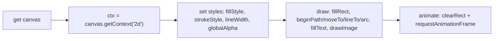

# Session 18: ECMAScript 2022, HTML5 Canvas and Web Storage

> Module: Progressive Website Development (HTML5, CSS3 and JavaScript) · Term 1 (CPISM) · ⏱ ~2 hours

## 🎯 Learning Objectives

By the end of this session you will be able to:

- Describe key ECMAScript 2022 features: top-level await, class fields, static initialization blocks, `.at()`, `Object.hasOwn`, error `cause`
- Draw lines, shapes, colours with transparency, images and text on `<canvas>`
- Create interactive canvas events with JavaScript (and know the jQuery equivalent)
- Include external content in pages with `fetch` and `<iframe>`
- Use `localStorage`, `sessionStorage` and IndexedDB
- Compare native apps and HTML5 apps, and list ways to convert web apps to installable apps

## 📖 Concepts Explained

### 1. ECMAScript 2022 (ES13) highlights

| Feature | Example |
|---------|---------|
| Top-level `await` (modules) | `const data = await fetch(url).then(r => r.json());` |
| Public & private class fields | `class A { count = 0; #secret = 1; }` |
| Private methods / `#x in obj` | `static isA(o) { return #secret in o; }` |
| **Static initialization block** | `class Config { static { /* runs once when class is defined */ } }` |
| `.at()` | `arr.at(-1)` → last item |
| `Object.hasOwn(obj, key)` | Safer `hasOwnProperty` |
| Error `cause` | `new Error("Save failed", { cause: err })` |
| RegExp `/d` flag | Match indices |

Newer editions (ES2023-ES2025) added `toSorted()`, `findLast()`, `Object.groupBy()`, `Set` methods and more. Browsers support ES2022 fully today.

### 2. Canvas basics
`<canvas id="c" width="600" height="400">` is a bitmap you draw on with JavaScript. Coordinates start at the **top-left (0,0)**.



| Task | Method |
|------|--------|
| Rectangle | `fillRect(x,y,w,h)`, `strokeRect` |
| Line | `beginPath(); moveTo(); lineTo(); stroke();` |
| Circle | `arc(x, y, r, 0, Math.PI*2)` |
| Colour + transparency | `fillStyle = "rgb(37 99 235 / 0.5)"`, `globalAlpha = 0.5` |
| Gradient | `createLinearGradient()` |
| Text | `font = "24px sans-serif"; fillText("Hi", x, y)` |
| Image | `drawImage(img, x, y, w, h)` |
| Clear | `clearRect(0,0,w,h)` |

Canvas vs SVG: canvas is pixels (great for games, charts with many points); SVG is vector DOM elements (great for icons, scalable diagrams).

**Events on canvas**: listen on the canvas element (`click`, `pointermove`) and compute the position with `getBoundingClientRect()`. In jQuery the same is `$("#c").on("click", handler)`.

### 3. Including external content
- `fetch("partials/footer.html")` then insert with `innerHTML` (trusted files only) to reuse a footer on many pages.
- `<iframe>` embeds another page (maps, videos).
- `<object>`/`<embed>` for PDFs (older approach).

### 4. Web Storage

| | `localStorage` | `sessionStorage` | Cookies | IndexedDB |
|-|----------------|------------------|---------|-----------|
| Lifetime | Until deleted | Until tab closes | Expiry date | Until deleted |
| Size | ~5 MB per origin | ~5 MB | ~4 KB | Large (hundreds of MB+) |
| Data | Strings | Strings | Strings | Objects, files, indexes |
| API | Sync, simple | Sync, simple | Sent to server with every request | Async, transactions |

```js
localStorage.setItem("theme", "dark");
localStorage.getItem("theme");            // "dark"
localStorage.setItem("cart", JSON.stringify(cart));
```

Do not store passwords or tokens in Web Storage: any script on the page can read it.

**IndexedDB** is a browser database for larger structured data (offline notes, cached products). It stores objects in *object stores*, uses *transactions*, and works asynchronously.

### 5. Native apps vs HTML5 (web) apps

| | Native app | HTML5 / Progressive Web App |
|-|------------|-----------------------------|
| Built with | Kotlin/Java (Android), Swift (iOS) | HTML, CSS, JS |
| Install | App stores | Browser "Install" / Add to Home Screen, or store via wrappers |
| Device access | Full | Growing (camera, geolocation, notifications) |
| Performance | Best | Good for most apps |
| One codebase | No (per platform) | Yes |
| Updates | Store review | Instant on the server |

Converting HTML5 apps to native/installable apps: (1) make it a **PWA** with a web app manifest and service worker; (2) wrap it with **Capacitor** or **Apache Cordova** to produce Android/iOS packages; (3) use **Trusted Web Activity** (Bubblewrap) to publish a PWA on Google Play; (4) frameworks like React Native or Flutter rewrite the UI natively.

## 💻 Code Examples

### Example 1: `index.html`

📄 Saved in this folder as [`index.html`](index.html).

```html
<!DOCTYPE html>
<html lang="en">
<head>
  <meta charset="UTF-8">
  <meta name="viewport" content="width=device-width, initial-scale=1.0">
  <title>Canvas & Storage</title>
  <script src="app.js" type="module"></script>
  <style>
    body { font-family: system-ui, sans-serif; max-width: 760px; margin: 1.5rem auto; padding: 0 1rem; }
    canvas { border: 1px solid #cbd5e1; border-radius: 12px; max-width: 100%; touch-action: none; }
    .row { display: flex; gap: .5rem; flex-wrap: wrap; align-items: center; margin: .5rem 0; }
  </style>
</head>
<body>
  <h1>Canvas Drawing Pad</h1>
  <div class="row">
    <label>Colour <input type="color" id="color" value="#2563eb"></label>
    <label>Size <input type="range" id="size" min="2" max="30" value="6"></label>
    <button id="clear">Clear</button>
    <button id="save">Save drawing</button>
  </div>
  <canvas id="pad" width="700" height="350" aria-label="Drawing area"></canvas>

  <h2>Notes (localStorage) &amp; visits (sessionStorage)</h2>
  <textarea id="note" rows="3" cols="50" placeholder="Type - it saves automatically"></textarea>
  <p id="visits"></p>

  <h2>Shared footer loaded with fetch</h2>
  <div id="footer"></div>
</body>
</html>
```

**How it works**

- The canvas has a fixed drawing resolution (700 × 350) but scales down on phones with `max-width: 100%`.
- `touch-action: none` lets finger drawing work without scrolling the page.

### Example 2: `app.js`

📄 Saved in this folder as [`app.js`](app.js).

```javascript
// ===== ES2022 features =====
class Settings {
  static defaults;
  static {                                    // static initialization block
    const saved = localStorage.getItem("pad-settings");
    Settings.defaults = saved ? JSON.parse(saved) : { color: "#2563eb", size: 6 };
  }
  static save(s) { localStorage.setItem("pad-settings", JSON.stringify(s)); }
}
const colors = ["red", "green", "blue"];
console.log("Last colour with .at(-1):", colors.at(-1));
console.log("Object.hasOwn:", Object.hasOwn(Settings.defaults, "color"));

// ===== Canvas =====
const canvas = document.querySelector("#pad");
const ctx = canvas.getContext("2d");
const colorInput = document.querySelector("#color");
const sizeInput = document.querySelector("#size");
colorInput.value = Settings.defaults.color;
sizeInput.value = Settings.defaults.size;

function drawBackground() {
  const g = ctx.createLinearGradient(0, 0, canvas.width, 0);
  g.addColorStop(0, "#f8fafc");
  g.addColorStop(1, "#e0f2fe");
  ctx.fillStyle = g;
  ctx.fillRect(0, 0, canvas.width, canvas.height);

  ctx.globalAlpha = 0.35;                       // transparency
  ctx.fillStyle = "#f59e0b";
  ctx.beginPath(); ctx.arc(640, 60, 40, 0, Math.PI * 2); ctx.fill();   // sun
  ctx.globalAlpha = 1;

  ctx.strokeStyle = "#94a3b8"; ctx.lineWidth = 1;                       // baseline
  ctx.beginPath(); ctx.moveTo(0, 320); ctx.lineTo(canvas.width, 320); ctx.stroke();

  ctx.fillStyle = "#334155";
  ctx.font = "20px system-ui";
  ctx.fillText("Draw here ✏️", 16, 32);
}

// Restore saved drawing (an image) or draw a fresh background
const savedImage = localStorage.getItem("pad-image");
if (savedImage) {
  const img = new Image();
  img.onload = () => ctx.drawImage(img, 0, 0);
  img.src = savedImage;
} else {
  drawBackground();
}

// Pointer events work for mouse, pen and touch
let drawing = false;
function pos(e) {
  const r = canvas.getBoundingClientRect();
  return { x: (e.clientX - r.left) * (canvas.width / r.width),
           y: (e.clientY - r.top) * (canvas.height / r.height) };
}
canvas.addEventListener("pointerdown", e => {
  drawing = true;
  const p = pos(e);
  ctx.beginPath(); ctx.moveTo(p.x, p.y);
});
canvas.addEventListener("pointermove", e => {
  if (!drawing) return;
  const p = pos(e);
  ctx.lineTo(p.x, p.y);
  ctx.strokeStyle = colorInput.value;
  ctx.lineWidth = sizeInput.value;
  ctx.lineCap = "round";
  ctx.stroke();
});
window.addEventListener("pointerup", () => { drawing = false; });

[colorInput, sizeInput].forEach(el => el.addEventListener("change", () =>
  Settings.save({ color: colorInput.value, size: Number(sizeInput.value) })));

document.querySelector("#clear").addEventListener("click", () => {
  ctx.clearRect(0, 0, canvas.width, canvas.height);
  drawBackground();
  localStorage.removeItem("pad-image");
});
document.querySelector("#save").addEventListener("click", () => {
  try {
    localStorage.setItem("pad-image", canvas.toDataURL("image/png"));
    alert("Saved! Reload the page to see it restored.");
  } catch (err) {
    throw new Error("Could not save drawing", { cause: err });   // ES2022 error cause
  }
});

// ===== localStorage & sessionStorage =====
const note = document.querySelector("#note");
note.value = localStorage.getItem("note") ?? "";
note.addEventListener("input", () => localStorage.setItem("note", note.value));

const visits = Number(sessionStorage.getItem("visits") ?? 0) + 1;
sessionStorage.setItem("visits", visits);
document.querySelector("#visits").textContent = `Page loads in this tab: ${visits} (resets when the tab closes)`;

// ===== Include external content (top-level await) =====
try {
  const html = await fetch("footer.html").then(r => r.text());
  document.querySelector("#footer").innerHTML = html;       // trusted local file only
} catch {
  document.querySelector("#footer").textContent = "Footer could not load.";
}
```

**How it works**

- The `Settings` class uses a **static initialization block** to load saved settings once, when the class is defined.
- `.at(-1)` and `Object.hasOwn` are other ES2022 helpers.
- `drawBackground` shows gradients, `globalAlpha` transparency, arcs (circle), lines and text.
- Pointer events (`pointerdown/move/up`) draw with mouse, pen or finger; `pos()` converts screen coordinates to canvas coordinates even when the canvas is scaled.
- `canvas.toDataURL()` turns the drawing into a PNG string saved in `localStorage`, then restored with `drawImage` on reload.
- `new Error(..., { cause })` keeps the original error for debugging.
- The note is saved on every keystroke in `localStorage`; the visit counter uses `sessionStorage`, which resets per tab.
- `footer.html` is fetched and inserted using top-level `await`.

### Example 3: `footer.html`

📄 Saved in this folder as [`footer.html`](footer.html).

```html
<footer style="padding:1rem;background:#0f172a;color:#e2e8f0;border-radius:12px">
  <strong>Tech Academy</strong> · This footer lives in its own file and is reused on many pages.
</footer>
```

**How it works**

- A partial HTML file. Loading it with `fetch` means one change updates every page that includes it.

### Example 4: `indexeddb-demo.js`

📄 Saved in this folder as [`indexeddb-demo.js`](indexeddb-demo.js).

```javascript
// indexeddb-demo.js - paste into the console on any page served over http(s)
const request = indexedDB.open("schoolDB", 1);

request.onupgradeneeded = () => {               // runs first time / on version change
  const db = request.result;
  const store = db.createObjectStore("students", { keyPath: "roll" });
  store.createIndex("byBatch", "batch");
};

request.onsuccess = () => {
  const db = request.result;
  const tx = db.transaction("students", "readwrite");
  const store = tx.objectStore("students");
  store.put({ roll: "S001", name: "Ayesha", batch: "2601A" });
  store.put({ roll: "S002", name: "Hamza", batch: "2601B" });

  tx.oncomplete = () => {
    const read = db.transaction("students").objectStore("students").get("S001");
    read.onsuccess = () => console.log("Found:", read.result);
  };
};
request.onerror = () => console.error("DB error", request.error);
```

**How it works**

- `indexedDB.open(name, version)` opens (or creates) a database; `onupgradeneeded` creates the object store and an index.
- Writes happen inside a `readwrite` **transaction**; reading uses `get(key)`.
- Check the data in DevTools > Application > IndexedDB.

## 🧪 Lab Practice

1. Draw on the pad, click *Save*, reload, and confirm the drawing returns. Inspect `localStorage` in DevTools > Application.
2. Add buttons to draw a rectangle, a circle and a triangle at random positions with random semi-transparent colours.
3. Create a simple bouncing-ball animation with `requestAnimationFrame` and `clearRect`.
4. Run `indexeddb-demo.js` in the console of the page, then view the database in DevTools.
5. Use a `static {}` block in a class that sets up a list of allowed colours, and test `.at()` on it.

## 📝 Assignment

Build a **Shopping Cart** page: products rendered from a JS array, *Add to cart* buttons, cart stored in `localStorage` as JSON (survives reloads), a canvas bar chart that draws the quantity of each item, and a *Clear cart* button. Write a short comparison in your README of when you would use IndexedDB instead.

## ❓ Quick Quiz

**Q1.** Which ES2022 feature runs code once when a class is defined?

- a) constructor
- b) static initialization block
- c) getter
- d) private field

**Q2.** Which canvas method draws a circle path?

- a) circle()
- b) arc()
- c) ellipseRect()
- d) round()

**Q3.** What is the difference between localStorage and sessionStorage?

**Q4.** How do you store an object in localStorage?

**Q5.** Name one way to turn an HTML5 app into an installable mobile app.

<details>
<summary>Show answers</summary>

1. b) static initialization block
2. b) arc()
3. localStorage persists until cleared; sessionStorage is cleared when the tab/window closes.
4. Convert it with `JSON.stringify()` before `setItem`, and `JSON.parse()` after `getItem`.
5. Make it a PWA (manifest + service worker), or wrap it with Capacitor/Cordova, or publish via Trusted Web Activity.

</details>

## 💼 Interview Questions

**1. Canvas vs SVG?**

<details>
<summary>Model answer</summary>

Canvas is an immediate-mode pixel bitmap drawn by script, good for games and many objects; SVG is retained-mode vector elements in the DOM, accessible, scalable and easy to style.

</details>

**2. Why not store auth tokens in localStorage?**

<details>
<summary>Model answer</summary>

Any JavaScript on the page (including injected XSS) can read it; httpOnly secure cookies are safer for session tokens.

</details>

**3. What is top-level await and where can you use it?**

<details>
<summary>Model answer</summary>

Using await outside an async function at the top of an ES module; only in modules (`type="module"`), and it pauses the module's evaluation until resolved.

</details>

## ✅ Summary

- ES2022 added class fields, private methods, static blocks, top-level await, `.at()`, `Object.hasOwn` and error causes.
- Canvas draws shapes, colours, images and text with a 2D context.
- Pointer events make canvas interactive on all devices.
- localStorage/sessionStorage store strings; IndexedDB stores large structured data.
- HTML5 apps can become installable via PWA features or wrappers.

---

[⬅ Previous](../Session-17-JavaScript-Functions-Objects-DOM-and-JSON/README.md) · [🏠 Module Home](../README.md) · [Next ➡](../Session-19-Geolocation-Drag-and-Drop-Mobile-Websites-and-Mini-Project/README.md)

Prepared by Zeeshan Abbas · Aptech Learning North Nazimabad
