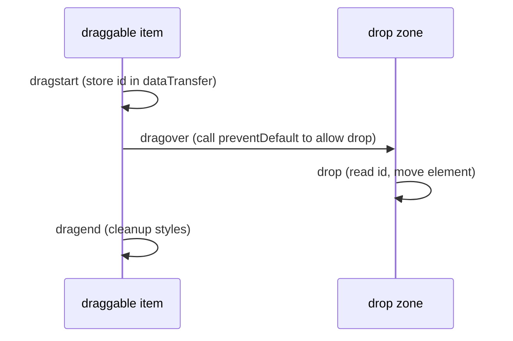

# Session 19: HTML5 Geolocation, APIs, Building Mobile Websites and the Mini Project

> Module: Progressive Website Development (HTML5, CSS3 and JavaScript) · Term 1 (CPISM) · ⏱ ~2 hours

## 🎯 Learning Objectives

By the end of this session you will be able to:

- Use the Geolocation API with permissions, errors and privacy in mind
- Show a location on a map (Google Maps or OpenStreetMap)
- Implement HTML5 drag and drop
- Explain why Application Cache was removed and what replaced it (service workers, web app manifest)
- Explain the need for mobile websites and compare HTML5/CSS frameworks
- Build a responsive mini project combining HTML, CSS and JavaScript

## 📖 Concepts Explained

### 1. Geolocation API

```js
navigator.geolocation.getCurrentPosition(success, error, { enableHighAccuracy: true, timeout: 10000 });
```

- Works only on **secure origins** (`https://` or `localhost`) and only after the user allows it.
- `success(position)` gives `position.coords.latitude`, `longitude`, `accuracy`.
- `error(err)` codes: 1 permission denied, 2 position unavailable, 3 timeout.
- `watchPosition()` tracks movement (e.g. delivery rider); stop with `clearWatch()`.
- Privacy: ask only when needed, explain why, never store location without consent.

### 2. Maps
- **Google Maps JavaScript API** needs an API key from Google Cloud (with billing enabled), then you create `new google.maps.Map(...)` and markers. Restrict the key to your domain.
- **Simple, key-free options**: link to `https://www.google.com/maps?q=LAT,LNG`, or embed an **OpenStreetMap** iframe; the open-source **Leaflet** library shows interactive OSM maps.

### 3. Drag and Drop API



Add `draggable="true"` to items. Note: native HTML5 DnD does not work with touch on many mobile browsers; use pointer events or a library for mobile.

### 4. Application Cache → Service Workers
HTML5 originally had **Application Cache** (`manifest="app.appcache"`) for offline sites. It was buggy and has been **removed from all modern browsers**. Today we use:
- **Service workers**: scripts that intercept network requests and serve cached files offline.
- **Web app manifest** (`manifest.webmanifest`): name, icons, colours, so the site can be installed (PWA).

### 5. Why mobile websites?
Most Pakistani internet users browse on phones. A mobile-friendly site loads fast on 3G/4G, has touch-sized buttons (≥ 44px), readable text without zoom, and ranks better in search (mobile-first indexing).

### 6. HTML5/CSS frameworks

| Framework | Strength |
|-----------|----------|
| Bootstrap 5 | Grid + ready components (Module 03) |
| Tailwind CSS | Utility classes, highly customisable |
| Foundation | Flexible, accessible components |
| Bulma | Pure CSS, Flexbox-based |
| Ionic | Mobile-style UI for hybrid apps |

### 7. Steps to build a responsive page
1. Add the viewport meta tag.
2. Write semantic HTML.
3. Mobile-first CSS: fluid widths, `max-width: 100%` images, Flex/Grid.
4. Add `min-width` media queries where content breaks.
5. Use relative units (`rem`, `%`, `clamp()`).
6. Add JavaScript progressively (page still works without it).
7. Test on devices, run Lighthouse.

## 💻 Code Examples

### Example 1: `index.html`

📄 Saved in this folder as [`index.html`](index.html).

```html
<!DOCTYPE html>
<html lang="en">
<head>
  <meta charset="UTF-8">
  <meta name="viewport" content="width=device-width, initial-scale=1.0">
  <meta name="theme-color" content="#0f766e">
  <title>Karachi Explorer - Mini Project</title>
  <link rel="manifest" href="manifest.webmanifest">
  <link rel="stylesheet" href="style.css">
  <script src="app.js" defer></script>
</head>
<body>
  <header class="top">
    <h1>Karachi Explorer</h1>
    <button id="themeBtn" aria-pressed="false">🌙 Dark</button>
  </header>

  <main>
    <section class="card">
      <h2>Where am I?</h2>
      <button id="locateBtn">Find my location</button>
      <p id="locMsg" aria-live="polite"></p>
      <iframe id="map" title="Map of your location" hidden loading="lazy"></iframe>
    </section>

    <section class="card">
      <h2>Plan your day (drag places into your list)</h2>
      <div class="dnd">
        <ul id="places" class="zone" aria-label="Places">
          <li draggable="true" id="p1">Clifton Beach</li>
          <li draggable="true" id="p2">Quaid's Mausoleum</li>
          <li draggable="true" id="p3">Frere Hall</li>
          <li draggable="true" id="p4">Port Grand</li>
        </ul>
        <ul id="plan" class="zone" aria-label="My plan"></ul>
      </div>
    </section>

    <section class="card">
      <h2>Search places</h2>
      <input id="search" type="search" placeholder="Type to filter...">
      <div id="grid" class="grid"></div>
    </section>
  </main>
  <footer>Mini project · HTML5 + CSS3 + JavaScript</footer>
</body>
</html>
```

**How it works**

- The manifest link and `theme-color` meta tag make the site installable as a PWA (with the service worker).
- Three features: geolocation with a map, drag-and-drop day planner, and a searchable grid loaded from `places.json`.

### Example 2: `app.js`

📄 Saved in this folder as [`app.js`](app.js).

```javascript
// ---------- Theme toggle saved in localStorage ----------
const themeBtn = document.querySelector("#themeBtn");
function applyTheme(t) {
  document.documentElement.dataset.theme = t;
  themeBtn.textContent = t === "dark" ? "☀️ Light" : "🌙 Dark";
  themeBtn.setAttribute("aria-pressed", t === "dark");
}
applyTheme(localStorage.getItem("theme") ?? "light");
themeBtn.addEventListener("click", () => {
  const next = document.documentElement.dataset.theme === "dark" ? "light" : "dark";
  localStorage.setItem("theme", next);
  applyTheme(next);
});

// ---------- Geolocation + OpenStreetMap embed ----------
const msg = document.querySelector("#locMsg");
const map = document.querySelector("#map");
document.querySelector("#locateBtn").addEventListener("click", () => {
  if (!("geolocation" in navigator)) { msg.textContent = "Geolocation is not supported."; return; }
  msg.textContent = "Locating...";
  navigator.geolocation.getCurrentPosition(
    ({ coords }) => {
      const { latitude: lat, longitude: lon, accuracy } = coords;
      msg.innerHTML = `Lat ${lat.toFixed(4)}, Lon ${lon.toFixed(4)} (±${Math.round(accuracy)} m) · ` +
        `<a href="https://www.google.com/maps?q=${lat},${lon}" target="_blank" rel="noopener">Open in Google Maps</a>`;
      const d = 0.01;
      map.src = `https://www.openstreetmap.org/export/embed.html?bbox=${lon - d},${lat - d},${lon + d},${lat + d}&layer=mapnik&marker=${lat},${lon}`;
      map.hidden = false;
    },
    (err) => {
      const reasons = { 1: "Permission denied.", 2: "Position unavailable.", 3: "Timed out." };
      msg.textContent = reasons[err.code] ?? err.message;
    },
    { enableHighAccuracy: true, timeout: 10000 }
  );
});

// ---------- Drag and drop ----------
document.querySelectorAll("[draggable=true]").forEach(item => {
  item.addEventListener("dragstart", e => {
    e.dataTransfer.setData("text/plain", item.id);
    item.classList.add("dragging");
  });
  item.addEventListener("dragend", () => item.classList.remove("dragging"));
});
document.querySelectorAll(".zone").forEach(zone => {
  zone.addEventListener("dragover", e => { e.preventDefault(); zone.classList.add("over"); });
  zone.addEventListener("dragleave", () => zone.classList.remove("over"));
  zone.addEventListener("drop", e => {
    e.preventDefault();
    zone.classList.remove("over");
    const el = document.getElementById(e.dataTransfer.getData("text/plain"));
    if (el) zone.append(el);
  });
});

// ---------- Data from JSON + search filter ----------
const grid = document.querySelector("#grid");
let places = [];
function show(list) {
  grid.replaceChildren(...list.map(p => {
    const card = document.createElement("article");
    card.className = "place";
    const h3 = document.createElement("h3"); h3.textContent = p.name;
    const span = document.createElement("span"); span.textContent = p.type;
    card.append(h3, span);
    return card;
  }));
  if (!list.length) grid.textContent = "No places found.";
}
fetch("places.json")
  .then(r => r.json())
  .then(data => { places = data; show(places); })
  .catch(() => { grid.textContent = "Could not load places."; });

document.querySelector("#search").addEventListener("input", e => {
  const q = e.target.value.trim().toLowerCase();
  show(places.filter(p => (p.name + " " + p.type).toLowerCase().includes(q)));
});

// ---------- Service worker for offline support ----------
if ("serviceWorker" in navigator) {
  navigator.serviceWorker.register("sw.js").catch(err => console.warn("SW failed", err));
}
```

**How it works**

- The theme toggle stores the choice in `localStorage` and sets `data-theme` on `<html>` for CSS.
- Geolocation shows coordinates, a Google Maps link (no API key needed) and an OpenStreetMap embed; errors are translated into friendly messages.
- Drag and drop stores the item id in `dataTransfer`, allows dropping with `preventDefault()` on `dragover`, and moves the element on `drop`. Items can be dragged both ways.
- Places come from `places.json` with `fetch`; the search box filters them live.
- Registering `sw.js` enables offline caching (service workers need http(s); Live Server's localhost works).

### Example 3: `places.json`

📄 Saved in this folder as [`places.json`](places.json).

```json
[
  { "name": "Clifton Beach", "type": "Beach" },
  { "name": "Quaid's Mausoleum", "type": "Monument" },
  { "name": "Frere Hall", "type": "Heritage" },
  { "name": "Port Grand", "type": "Food street" },
  { "name": "Mohatta Palace", "type": "Museum" },
  { "name": "Karachi Zoo", "type": "Park" }
]
```

**How it works**

- The data source for the searchable grid. Add more places to see the grid grow.

### Example 4: `sw.js`

📄 Saved in this folder as [`sw.js`](sw.js).

```javascript
// sw.js - a minimal "cache first" service worker
const CACHE = "explorer-v1";
const FILES = ["./", "index.html", "style.css", "app.js", "places.json", "manifest.webmanifest"];

self.addEventListener("install", e => {
  e.waitUntil(caches.open(CACHE).then(c => c.addAll(FILES)));
});

self.addEventListener("activate", e => {
  e.waitUntil(caches.keys().then(keys =>
    Promise.all(keys.filter(k => k !== CACHE).map(k => caches.delete(k)))));
});

self.addEventListener("fetch", e => {
  if (e.request.method !== "GET") return;
  e.respondWith(caches.match(e.request).then(hit => hit || fetch(e.request)));
});
```

**How it works**

- On **install** it caches the app files; on **activate** it deletes old caches.
- On **fetch** it serves files from the cache first, falling back to the network, so the app opens offline.
- Change `CACHE` to `explorer-v2` when you update files so users get the new version.

### Example 5: `manifest.webmanifest`

📄 Saved in this folder as [`manifest.webmanifest`](manifest.webmanifest).

```json
{
  "name": "Karachi Explorer",
  "short_name": "Explorer",
  "start_url": "./index.html",
  "display": "standalone",
  "background_color": "#ffffff",
  "theme_color": "#0f766e",
  "icons": [
    { "src": "icon.svg", "sizes": "any", "type": "image/svg+xml" }
  ]
}
```

**How it works**

- Describes how the installed app looks: name, start page, colours and icon.
- `display: standalone` opens it without the browser address bar, like a native app.

### Example 6: `icon.svg`

📄 Saved in this folder as [`icon.svg`](icon.svg).

```xml
<svg xmlns="http://www.w3.org/2000/svg" viewBox="0 0 512 512">
  <rect width="512" height="512" rx="96" fill="#0f766e"/>
  <path d="M256 96c-62 0-112 50-112 112 0 84 112 208 112 208s112-124 112-208c0-62-50-112-112-112zm0 152a40 40 0 1 1 0-80 40 40 0 0 1 0 80z" fill="#fff"/>
</svg>
```

**How it works**

- A simple map-pin icon referenced by the manifest. SVG icons scale to any size.

### Example 7: `style.css`

📄 Saved in this folder as [`style.css`](style.css).

```css
:root { --bg: #f0fdfa; --surface: #fff; --text: #134e4a; --brand: #0f766e; }
[data-theme="dark"] { --bg: #042f2e; --surface: #134e4a; --text: #ccfbf1; --brand: #2dd4bf; }
*, *::before, *::after { box-sizing: border-box; }
body { margin: 0; font-family: system-ui, sans-serif; background: var(--bg); color: var(--text); }
.top { display: flex; justify-content: space-between; align-items: center; padding: 1rem; background: var(--brand); color: white; }
.top h1 { margin: 0; font-size: clamp(1.2rem, 4vw, 1.8rem); }
button { min-height: 44px; padding: .5rem 1rem; border: 0; border-radius: 10px; background: var(--surface); color: var(--text); font: inherit; cursor: pointer; }
main { width: min(1000px, 100% - 2rem); margin: 1rem auto; display: grid; gap: 1rem; }
.card { background: var(--surface); padding: 1rem; border-radius: 14px; }
.card > button { background: var(--brand); color: white; }
#map { width: 100%; aspect-ratio: 16 / 9; border: 0; border-radius: 10px; }
.dnd { display: grid; gap: 1rem; grid-template-columns: 1fr 1fr; }
.zone { min-height: 160px; list-style: none; padding: .5rem; margin: 0; border: 2px dashed var(--brand); border-radius: 10px; }
.zone.over { background: rgb(45 212 191 / .15); }
.zone li { padding: .6rem; margin: .3rem 0; background: var(--bg); border-radius: 8px; cursor: grab; }
.dragging { opacity: .5; }
input[type=search] { width: 100%; padding: .7rem; border-radius: 10px; border: 1px solid #99f6e4; font: inherit; }
.grid { display: grid; gap: .75rem; margin-top: .75rem; grid-template-columns: repeat(auto-fit, minmax(160px, 1fr)); }
.place { background: var(--bg); padding: .8rem; border-radius: 10px; }
.place h3 { margin: 0 0 .25rem; font-size: 1rem; }
footer { text-align: center; padding: 1rem; opacity: .8; }
@media (max-width: 480px) { .dnd { grid-template-columns: 1fr; } }
```

**How it works**

- `[data-theme="dark"]` overrides colour variables when JavaScript sets the attribute.
- Buttons have `min-height: 44px` for comfortable touch targets.
- The drag-and-drop zones sit side by side and stack below 480px.

## 🧪 Lab Practice

1. Run the project with Live Server (localhost counts as secure). Allow location and check the map. Then deny permission and read the error message.
2. Drag places into *My plan*. Save the plan order to `localStorage` and restore it on reload.
3. In DevTools > Application, check the Manifest and Service Workers panels. Tick *Offline* in the Network tab and reload: the page should still open.
4. Add a *Distance from me* label to each place (add `lat`/`lon` to `places.json` and use the Haversine formula).
5. Run a Lighthouse audit (Performance, Accessibility, Best Practices, SEO) and fix two suggestions.

## 📝 Assignment

Complete the **module mini-project** (see the module README: *City Explorer*) using this session's code as a starting point. Requirements: semantic multi-page site, Grid gallery, form with validation, geolocation, drag-and-drop or canvas feature, JSON data with fetch, localStorage theme, installable PWA, and a Lighthouse score above 90 for Accessibility.

## ❓ Quick Quiz

**Q1.** On which origins does the Geolocation API work?

- a) Any http page
- b) Secure origins (https or localhost)
- c) Only file://
- d) Only mobile apps

**Q2.** Which event must call `preventDefault()` to allow dropping?

- a) dragstart
- b) dragover
- c) dragend
- d) drag

**Q3.** What replaced HTML5 Application Cache?

**Q4.** Name two HTML5/CSS frameworks for responsive sites.

**Q5.** What is the minimum recommended touch target size?

- a) 20px
- b) 32px
- c) 44px
- d) 100px

<details>
<summary>Show answers</summary>

1. b) Secure origins (https or localhost)
2. b) dragover
3. Service workers (with the Cache API) plus the web app manifest.
4. For example Bootstrap and Tailwind CSS (also Foundation, Bulma).
5. c) 44px

</details>

## 💼 Interview Questions

**1. How do you handle a user denying location permission?**

<details>
<summary>Model answer</summary>

Catch the error callback, explain the impact politely, offer a manual alternative (enter city), and never repeatedly prompt.

</details>

**2. What is a Progressive Web App?**

<details>
<summary>Model answer</summary>

A website that uses HTTPS, a web app manifest and a service worker to be installable, fast and work offline, behaving like a native app.

</details>

**3. Why design mobile-first?**

<details>
<summary>Model answer</summary>

Most users are on phones, it forces content prioritisation, produces lighter CSS for small devices and aligns with search engines' mobile-first indexing.

</details>

## ✅ Summary

- Geolocation needs permission and a secure origin; handle errors kindly.
- Maps can be linked/embedded without keys or built with Google Maps/Leaflet.
- Drag and drop uses dragstart, dragover (preventDefault) and drop.
- Application Cache is gone; service workers and manifests power offline PWAs.
- Mobile-first responsive design and frameworks speed up real projects.

---

[⬅ Previous](../Session-18-ES2022-Canvas-and-Web-Storage/README.md) · [🏠 Module Home](../README.md) · [Next ➡](../Session-20-Practice-Lab-JavaScript-Projects-and-Module-Review/README.md)

Prepared by Zeeshan Abbas · Aptech Learning North Nazimabad
