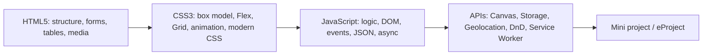

# Session 20: Practice Lab: JavaScript Projects and Module Review

> Module: Progressive Website Development (HTML5, CSS3 and JavaScript) · Term 1 (CPISM) · ⏱ ~2 hours

## 🎯 Learning Objectives

By the end of this session you will be able to:

- Revise JavaScript functions, objects, DOM, JSON, ES2022, canvas, storage and HTML5 APIs
- Build a complete small app combining fetch, DOM, storage and events
- Refactor code into small reusable functions
- Prepare and polish the module mini-project
- Self-assess against a module-wide checklist before the eProject

## 📖 Concepts Explained

**Practice and review session** for Sessions 15-19 and the whole module.

### Module skills map



### Clean code checklist for JavaScript
- [ ] Use `const`/`let`, never `var`.
- [ ] Functions do one job and have clear names (`renderList`, `saveCart`).
- [ ] No repeated code: extract a function.
- [ ] Handle errors (`try/catch`, `.catch`, check `res.ok`).
- [ ] Use `textContent` for user data.
- [ ] Keep data (arrays/objects) separate from rendering (DOM).
- [ ] Comment *why*, not *what*.

### Pattern: state → render

```js
let state = load();                 // 1. data
function render() { /* draw state into the DOM */ }
function update(change) { state = change(state); save(state); render(); }  // 2. one place to change data
```

Frameworks like React use the same idea, so learning it now prepares you for later terms.

### Final module checklist

| Area | Evidence |
|------|----------|
| Valid semantic HTML | W3C validator screenshot |
| Responsive CSS | Screenshots at 375 / 768 / 1280 px |
| Accessibility | Lighthouse ≥ 90, keyboard test |
| JavaScript | Console has no errors |
| APIs | At least two HTML5 APIs used |
| Code quality | Folder structure + comments |

## 💻 Code Examples

### Example 1: `index.html`

📄 Saved in this folder as [`index.html`](index.html).

```html
<!DOCTYPE html>
<html lang="en">
<head>
  <meta charset="UTF-8">
  <meta name="viewport" content="width=device-width, initial-scale=1.0">
  <title>Expense Tracker</title>
  <link rel="stylesheet" href="style.css">
  <script src="app.js" type="module"></script>
</head>
<body>
  <main class="app">
    <h1>Expense Tracker</h1>
    <form id="form" class="row">
      <input id="title" placeholder="What did you spend on?" required aria-label="Title">
      <input id="amount" type="number" min="1" step="1" placeholder="Rs" required aria-label="Amount">
      <select id="category" aria-label="Category">
        <option>Food</option><option>Transport</option><option>Bills</option><option>Other</option>
      </select>
      <button>Add</button>
    </form>
    <p class="total">Total: <strong id="total">Rs 0</strong></p>
    <canvas id="chart" width="600" height="220" aria-label="Spending by category chart"></canvas>
    <ul id="list"></ul>
  </main>
</body>
</html>
```

**How it works**

- A small but complete app: form input, list, total and a canvas chart.

### Example 2: `app.js`

📄 Saved in this folder as [`app.js`](app.js).

```javascript
// ----- state -----
const KEY = "expenses-v1";
const CATEGORIES = ["Food", "Transport", "Bills", "Other"];
let expenses = JSON.parse(localStorage.getItem(KEY) ?? "[]");

// ----- pure helpers (no DOM) -----
const formatRs = n => `Rs ${n.toLocaleString("en-PK")}`;
const totalOf = list => list.reduce((sum, e) => sum + e.amount, 0);
const byCategory = list =>
  CATEGORIES.map(c => ({ category: c, amount: totalOf(list.filter(e => e.category === c)) }));

function save() { localStorage.setItem(KEY, JSON.stringify(expenses)); }

function update(changeFn) {
  expenses = changeFn(expenses);
  save();
  render();
}

// ----- rendering -----
const listEl = document.querySelector("#list");
const totalEl = document.querySelector("#total");
const canvas = document.querySelector("#chart");
const ctx = canvas.getContext("2d");

function renderList() {
  listEl.replaceChildren(...expenses.map(e => {
    const li = document.createElement("li");
    li.dataset.id = e.id;
    li.innerHTML = `<span></span><span class="cat"></span><b></b><button class="del" aria-label="Delete">✕</button>`;
    const [title, cat, amount] = li.querySelectorAll("span, b");
    title.textContent = e.title;              // user text via textContent
    cat.textContent = e.category;
    amount.textContent = formatRs(e.amount);
    return li;
  }));
}

function renderChart() {
  const data = byCategory(expenses);
  const max = Math.max(1, ...data.map(d => d.amount));
  const barW = canvas.width / data.length - 30;
  ctx.clearRect(0, 0, canvas.width, canvas.height);
  ctx.font = "14px system-ui";
  data.forEach((d, i) => {
    const h = (d.amount / max) * (canvas.height - 50);
    const x = 15 + i * (barW + 30);
    const y = canvas.height - 25 - h;
    ctx.fillStyle = ["#2563eb", "#16a34a", "#f59e0b", "#9333ea"][i];
    ctx.fillRect(x, y, barW, h);
    ctx.fillStyle = "#334155";
    ctx.fillText(d.category, x, canvas.height - 8);
    ctx.fillText(d.amount ? formatRs(d.amount) : "", x, y - 6);
  });
}

function render() {
  renderList();
  renderChart();
  totalEl.textContent = formatRs(totalOf(expenses));
}

// ----- events -----
document.querySelector("#form").addEventListener("submit", e => {
  e.preventDefault();
  const title = document.querySelector("#title");
  const amount = document.querySelector("#amount");
  const category = document.querySelector("#category");
  update(list => [...list, {
    id: crypto.randomUUID(),
    title: title.value.trim(),
    amount: Number(amount.value),
    category: category.value,
  }]);
  e.target.reset();
  title.focus();
});

listEl.addEventListener("click", e => {
  if (!e.target.matches(".del")) return;
  const id = e.target.closest("li").dataset.id;
  update(list => list.filter(x => x.id !== id));
});

render();
```

**How it works**

- **State**: `expenses` is loaded from `localStorage`; `update()` is the single place that changes it, saves it and re-renders.
- **Pure helpers** (`formatRs`, `totalOf`, `byCategory`) have no side effects, so they are easy to test.
- `toLocaleString("en-PK")` formats numbers with thousands separators.
- `renderList` uses a small HTML template but fills user data with `textContent` for safety.
- `renderChart` draws a scaled bar chart on canvas for each category.
- `crypto.randomUUID()` gives each expense a unique id for deleting via event delegation.

### Example 3: `style.css`

📄 Saved in this folder as [`style.css`](style.css).

```css
*, *::before, *::after { box-sizing: border-box; }
body { margin: 0; font-family: system-ui, sans-serif; background: #f8fafc; color: #0f172a; }
.app { width: min(680px, 100% - 2rem); margin: 2rem auto; background: white; padding: 1.5rem; border-radius: 16px; box-shadow: 0 6px 24px rgb(0 0 0 / .06); }
.row { display: grid; gap: .5rem; grid-template-columns: 1fr; }
@media (min-width: 600px) { .row { grid-template-columns: 2fr 1fr 1fr auto; } }
input, select, button { font: inherit; padding: .6rem; border-radius: 8px; border: 1px solid #cbd5e1; }
button { background: #2563eb; color: white; border: 0; cursor: pointer; }
.total { font-size: 1.2rem; }
canvas { width: 100%; height: auto; }
ul { list-style: none; padding: 0; }
li { display: grid; grid-template-columns: 1fr auto auto auto; gap: .75rem; align-items: center; padding: .5rem 0; border-bottom: 1px solid #e2e8f0; }
.cat { font-size: .8rem; background: #e0e7ff; padding: .1rem .5rem; border-radius: 999px; }
.del { background: #ef4444; padding: .2rem .55rem; }
```

**How it works**

- The form is one column on phones and a four-column row from 600px.
- Each list item is a small grid: title, category pill, amount, delete button.

## 🧪 Lab Practice

1. Run the Expense Tracker, add ten expenses, reload, and confirm data persists. Inspect the stored JSON in DevTools.
2. Add a month filter (`<input type="month">`) and store a date on each expense.
3. Add an *Export JSON* button that downloads the data (`Blob` + `URL.createObjectURL` + `<a download>`).
4. Refactor one of your earlier labs (Session 16 or 17) into the state → render pattern.
5. Go through the final module checklist with your mini-project and fix every gap.

## 📝 Assignment

Submit the **module mini-project** (City Explorer) as a folder with a `README.md` describing features, screenshots (mobile/desktop), Lighthouse scores and a list of the HTML5 APIs you used. This becomes the base for your eProject.

## ❓ Quick Quiz

**Q1.** What is a pure function?

**Q2.** Which method creates a unique id in modern browsers?

- a) Math.id()
- b) crypto.randomUUID()
- c) Date.uuid()
- d) uuid()

**Q3.** Why have a single `update()` function in the state → render pattern?

**Q4.** Which number format shows Rs 12,500 with separators?

**Q5.** Name three HTML5 APIs from this module.

<details>
<summary>Show answers</summary>

1. A function whose output depends only on its inputs and which has no side effects (no DOM, storage or global changes).
2. b) crypto.randomUUID()
3. So every change saves and re-renders consistently from one place, reducing bugs.
4. `(12500).toLocaleString("en-PK")` with an Rs prefix.
5. Canvas, Web Storage, IndexedDB, Geolocation, Drag and Drop, Service Workers (any three).

</details>

## 💼 Interview Questions

**1. How do you structure a vanilla JavaScript app?**

<details>
<summary>Model answer</summary>

Separate state, pure logic and rendering; use modules; one update path; event delegation; persistence layer (localStorage/API); handle errors.

</details>

**2. What would you check before deploying a website?**

<details>
<summary>Model answer</summary>

HTML validation, responsive layouts, accessibility and performance audits, console errors, broken links, meta tags, favicon, HTTPS and cross-browser testing.

</details>

**3. How does this module prepare you for frameworks like React?**

<details>
<summary>Model answer</summary>

Understanding DOM, events, state and rendering, modules and async data means frameworks are just more structured tools for the same ideas.

</details>

## ✅ Summary

- You can now build complete front-end apps with HTML, CSS and JavaScript.
- State → render keeps apps predictable.
- Pure helper functions are easy to reuse and test.
- Use the module checklist to polish your mini project before the eProject.

---

[⬅ Previous](../Session-19-Geolocation-Drag-and-Drop-Mobile-Websites-and-Mini-Project/README.md) · [🏠 Module Home](../README.md) · [Next ➡](../../03-Bootstrap-and-jQuery-for-Responsive-Web-Pages/README.md)

Prepared by Zeeshan Abbas · Aptech Learning North Nazimabad
