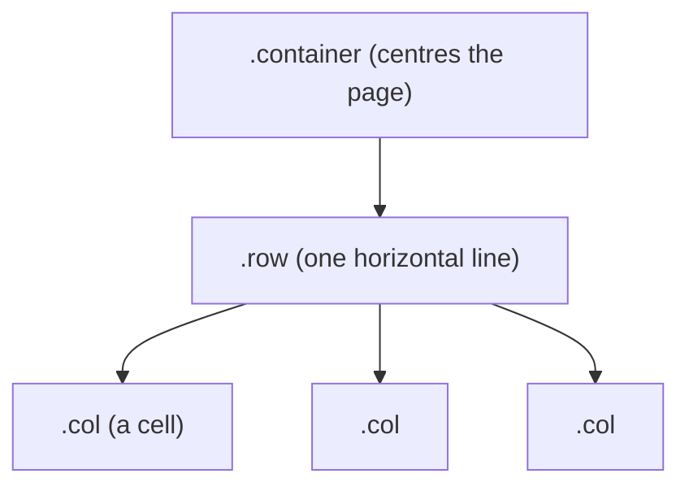

# Session 01: Bootstrap Fundamentals and the Grid System

> Module: Bootstrap and jQuery for Responsive Web Pages · Term 1 (CPISM) · ⏱ ~2 hours

## 🎯 Learning Objectives

By the end of this session you will be able to:

- Explain what a CSS framework is and why Bootstrap saves time
- Add Bootstrap 5 to a page using the CDN or downloaded files
- Use containers, rows and columns to build a layout
- Explain the 12-column idea and the six responsive breakpoints
- Build a layout that changes from 1 to 2 to 4 columns as the screen grows

## 📖 Concepts Explained

### 1. What is Bootstrap?
**Bootstrap** is a free, open-source **front-end framework**: a ready-made collection of CSS classes and small JavaScript components. Instead of writing your own CSS for every button, grid or menu, you add a class name such as `btn btn-primary` and the style is done.

> 🧱 **Analogy:** Writing CSS from zero is like making bricks by hand. Bootstrap gives you a box of ready bricks of the same size, so you can focus on designing the house.

| Without Bootstrap | With Bootstrap |
|-------------------|----------------|
| Write media queries yourself | Breakpoints already built in |
| Style each button and form by hand | One class gives a consistent look |
| Test layout bugs in every browser | Tested by thousands of developers |

Bootstrap is **mobile-first**: styles are written for small screens first, then extended for bigger screens.

### 2. Adding Bootstrap to a page

| Method | How | When to use |
|--------|-----|-------------|
| **CDN** (Content Delivery Network) | Paste a `<link>` and a `<script>` tag | Learning, quick projects (needs internet) |
| **Local files** | Download from getbootstrap.com, put `css/` and `js/` in your project | Offline work, full control |
| **npm** | `npm install bootstrap` | Bigger projects with build tools (later terms) |

Every Bootstrap page needs three things: the **viewport meta tag**, the **CSS link** in `<head>`, and the **JS bundle** before `</body>` (only for interactive components).

### 3. The grid: container → row → column



- **`.container`** has a max width that grows with the screen; **`.container-fluid`** is always 100% wide.
- **`.row`** holds columns. Columns must be direct children of a row.
- **`.col-*`** splits the row. A row has **12 equal parts**, so `col-6` is half, `col-4` is one third, `col-3` is a quarter.
- **`g-*`** classes (`g-0` to `g-5`) set the gap (gutter) between columns.

### 4. Breakpoints
A **breakpoint** is a screen width where the layout is allowed to change.

| Name | Class infix | Starts at | Typical device |
|------|-------------|-----------|----------------|
| Extra small | *(none)* | 0 px | Phones |
| Small | `sm` | 576 px | Large phones |
| Medium | `md` | 768 px | Tablets |
| Large | `lg` | 992 px | Laptops |
| Extra large | `xl` | 1200 px | Desktops |
| Extra extra large | `xxl` | 1400 px | Big monitors |

`col-md-6` means "half width **from medium upward**". Below medium it falls back to the smaller rule (e.g. `col-12`). You can stack several classes on one element: `col-12 col-md-6 col-lg-3`.

## 💻 Code Examples

### Example 1: Basic grid

📄 Saved in this folder as [`grid.html`](grid.html).

```html
<!DOCTYPE html>
<html lang="en">
<head>
  <meta charset="UTF-8">
  <!-- Step 1: viewport tag - REQUIRED for responsive pages on phones -->
  <meta name="viewport" content="width=device-width, initial-scale=1">
  <title>Bootstrap Grid Basics</title>
  <!-- Step 2: load Bootstrap CSS from the CDN -->
  <link rel="stylesheet" href="https://cdn.jsdelivr.net/npm/bootstrap@5.3.3/dist/css/bootstrap.min.css">
  <style>
    /* Only to SEE the columns - Bootstrap does not need this */
    .box { background: #e7f1ff; border: 1px solid #0d6efd; padding: 12px; text-align: center; }
  </style>
</head>
<body>
  <!-- Step 3: a container centres the content and adds side padding -->
  <div class="container my-4">
    <h1>My First Grid</h1>

    <!-- Row A: three equal columns (12 / 3 = 4 each) -->
    <div class="row">
      <div class="col box">Column 1</div>
      <div class="col box">Column 2</div>
      <div class="col box">Column 3</div>
    </div>

    <!-- Row B: fixed sizes, they must add up to 12 (8 + 4) -->
    <div class="row mt-3">
      <div class="col-8 box">Main content (8)</div>
      <div class="col-4 box">Sidebar (4)</div>
    </div>

    <!-- Row C: g-3 adds a gap (gutter) between the columns -->
    <div class="row g-3 mt-1">
      <div class="col-6"><div class="box">Half</div></div>
      <div class="col-6"><div class="box">Half</div></div>
    </div>
  </div>

  <!-- Step 4: Bootstrap JS (needed later for menus, modals, etc.) -->
  <script src="https://cdn.jsdelivr.net/npm/bootstrap@5.3.3/dist/js/bootstrap.bundle.min.js"></script>
</body>
</html>
```

**How it works**

- The viewport tag stops phones from zooming out; without it Bootstrap cannot be responsive.
- Row A uses plain `col`, so the three cells share the width equally.
- Row B uses `col-8` + `col-4` = 12, a classic content + sidebar layout.
- The small `<style>` block only colours the boxes so you can see them.

### Example 2: Breakpoints in action

📄 Saved in this folder as [`breakpoints.html`](breakpoints.html).

```html
<!DOCTYPE html>
<html lang="en">
<head>
  <meta charset="UTF-8">
  <meta name="viewport" content="width=device-width, initial-scale=1">
  <title>Responsive Breakpoints</title>
  <link rel="stylesheet" href="https://cdn.jsdelivr.net/npm/bootstrap@5.3.3/dist/css/bootstrap.min.css">
</head>
<body>
  <div class="container my-4">
    <h1 class="h3">Resize the browser window</h1>
    <p>Phone: 1 card per row · Tablet (md): 2 per row · Desktop (lg): 4 per row</p>

    <!-- col-12 = full width on phones
         col-md-6 = half width from 768px
         col-lg-3 = quarter width from 992px -->
    <div class="row g-3">
      <div class="col-12 col-md-6 col-lg-3">
        <div class="p-3 bg-primary text-white rounded">HTML</div>
      </div>
      <div class="col-12 col-md-6 col-lg-3">
        <div class="p-3 bg-success text-white rounded">CSS</div>
      </div>
      <div class="col-12 col-md-6 col-lg-3">
        <div class="p-3 bg-warning rounded">JavaScript</div>
      </div>
      <div class="col-12 col-md-6 col-lg-3">
        <div class="p-3 bg-danger text-white rounded">Bootstrap</div>
      </div>
    </div>

    <!-- This badge tells you which breakpoint is active right now -->
    <p class="mt-4">
      Current screen:
      <span class="badge bg-dark d-inline d-sm-none">XS (phone)</span>
      <span class="badge bg-dark d-none d-sm-inline d-md-none">SM</span>
      <span class="badge bg-dark d-none d-md-inline d-lg-none">MD (tablet)</span>
      <span class="badge bg-dark d-none d-lg-inline d-xl-none">LG (laptop)</span>
      <span class="badge bg-dark d-none d-xl-inline">XL or bigger</span>
    </p>
  </div>
</body>
</html>
```

**How it works**

- Each card has three classes; Bootstrap picks the one that matches the current width.
- `d-none` hides an element and `d-md-inline` shows it from medium up, so only one badge is visible at a time.
- Open DevTools (`F12`) → device toolbar (`Ctrl+Shift+M`) and try iPhone, iPad and desktop sizes.

## 🧪 Lab Practice

1. Open `grid.html` with Live Server. Change Row B to `col-9` and `col-3`. What happens if the numbers add up to 13?
2. Replace `.container` with `.container-fluid` and compare on a wide screen.
3. In `breakpoints.html`, change the cards so tablets show **3** per row (hint: `col-md-4`; add two more cards).
4. Add `g-0` and then `g-5` to a row and watch the gaps change.
5. Build a 3-row page skeleton: header row (12), content row (3 + 6 + 3), footer row (12).

## 📝 Assignment

Create `portfolio-layout.html`: a header, a row of **6 project boxes** that show 1 per row on phones, 2 on tablets and 3 on laptops, and a footer with two columns (about + contact). Use only Bootstrap classes, no custom CSS except colours.

## ❓ Quick Quiz

**Q1.** How many columns does one Bootstrap row have?

- a) 10
- b) 12
- c) 16
- d) Unlimited

**Q2.** Which class gives half width only from 768 px upward?

- a) `col-6`
- b) `col-sm-6`
- c) `col-md-6`
- d) `col-lg-6`

**Q3.** Which tag is required for responsive behaviour on phones?

**Q4.** What is the difference between `.container` and `.container-fluid`?

**Q5.** Why is Bootstrap called mobile-first?

<details>
<summary>Show answers</summary>

1. b) 12
2. c) `col-md-6`
3. `<meta name="viewport" content="width=device-width, initial-scale=1">`
4. `.container` has a fixed max width per breakpoint; `.container-fluid` is always full width.
5. Its base styles target small screens; larger-screen rules are added on top with breakpoint classes.

</details>

## 💼 Interview Questions

**1. What is a CSS framework and why use one?**

<details>
<summary>Model answer</summary>

A pre-written set of CSS (and often JS) for common UI needs like grids, buttons and forms. It speeds up development, gives a consistent look and is already tested across browsers.

</details>

**2. Explain the Bootstrap grid.**

<details>
<summary>Model answer</summary>

Content goes in a container, rows group columns, and each row is divided into 12 units. Column classes with breakpoint infixes (sm, md, lg, xl, xxl) set how many units a column takes at each screen size.

</details>

**3. CDN or local files: which would you choose?**

<details>
<summary>Model answer</summary>

CDN for quick setup and caching benefits; local files when the site must work offline or you need full control over versions. Large projects usually install via npm.

</details>

## ✅ Summary

- Bootstrap is a mobile-first CSS/JS framework that saves styling time.
- Add it with a CDN link and script, plus the viewport meta tag.
- Layout = container → row → columns; each row has 12 units.
- Breakpoint classes (`col-md-6`, `col-lg-3`) change the layout per screen size.

---

[⬅ Previous](../README.md) · [🏠 Module Home](../README.md) · [Next ➡](../Session-02-Bootstrap-Components-and-Navigation/README.md)

Prepared by Zeeshan Abbas · Aptech Learning North Nazimabad
