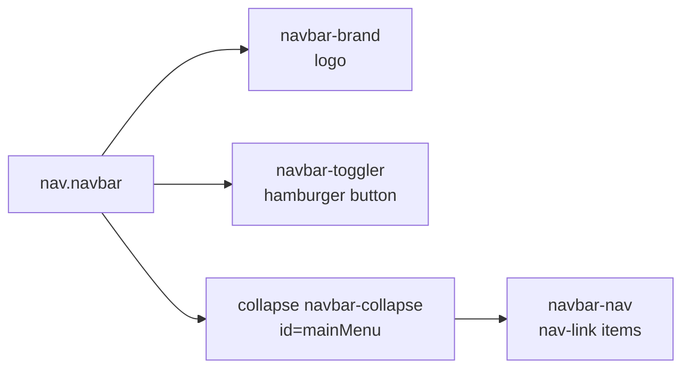

# Session 02: Bootstrap Components and Navigation

> Module: Bootstrap and jQuery for Responsive Web Pages · Term 1 (CPISM) · ⏱ ~2 hours

## 🎯 Learning Objectives

By the end of this session you will be able to:

- Explain what a Bootstrap component is and how classes + `data-bs-*` attributes work together
- Style buttons, badges, alerts, cards and progress bars
- Build a responsive navbar that turns into a hamburger menu on phones
- Add interactive components: modal, accordion (collapse) and tabs
- Explain why the Bootstrap JS bundle is needed for some components

## 📖 Concepts Explained

### 1. What is a component?
A **component** is a ready-made piece of user interface (UI) such as a button, card or menu. In Bootstrap you build a component by writing normal HTML and adding the right **class names**. Interactive components also use **data attributes** (`data-bs-toggle`, `data-bs-target`) that the Bootstrap JavaScript reads.

> 🍱 **Analogy:** Components are like items on a set menu. You do not cook each one; you pick it by name (class) and it arrives ready.

### 2. Static components (CSS only)

| Component | Main classes | Use it for |
|-----------|-------------|------------|
| Button | `btn btn-primary`, `btn-outline-*`, `btn-lg`, `btn-sm` | Actions and links |
| Badge | `badge bg-danger` | Small counts or labels ("New", "4") |
| Alert | `alert alert-success` | Messages to the user |
| Card | `card`, `card-body`, `card-title`, `card-img-top` | Products, courses, profiles |
| Progress | `progress`, `progress-bar` | Show completion |

**Theme colours** repeat everywhere: `primary` (blue), `secondary` (grey), `success` (green), `danger` (red), `warning` (yellow), `info` (cyan), `light`, `dark`. Learn them once, use them on buttons, alerts, badges and backgrounds (`bg-*`) and text (`text-*`).

### 3. The responsive navbar
A navbar has four parts:



- `navbar-expand-lg` = links show in a row from **large** screens; below that they hide behind the hamburger.
- The toggler's `data-bs-target="#mainMenu"` must match the `id` of the collapse `div`. This is the most common mistake.
- `data-bs-theme="dark"` gives light text for dark backgrounds.

### 4. Interactive components (need JS)

| Component | Trigger attribute | Target |
|-----------|------------------|--------|
| Modal (popup box) | `data-bs-toggle="modal"` | `.modal` with an id |
| Collapse / Accordion | `data-bs-toggle="collapse"` | `.collapse` with an id |
| Tabs / Pills | `data-bs-toggle="tab"` | `.tab-pane` with an id |
| Carousel (slider) | `data-bs-ride="carousel"` | Covered in Session 06 |
| Dismiss alert | `data-bs-dismiss="alert"` | Parent alert |

These work only if `bootstrap.bundle.min.js` is loaded. "Bundle" means it also contains **Popper**, the library used by dropdowns and tooltips.

## 💻 Code Examples

### Example 1: Navbar and hero

📄 Saved in this folder as [`navbar.html`](navbar.html).

```html
<!DOCTYPE html>
<html lang="en">
<head>
  <meta charset="UTF-8">
  <meta name="viewport" content="width=device-width, initial-scale=1">
  <title>Responsive Navbar</title>
  <link rel="stylesheet" href="https://cdn.jsdelivr.net/npm/bootstrap@5.3.3/dist/css/bootstrap.min.css">
</head>
<body>
  <!-- navbar-expand-lg: menu is open on large screens, collapsed (hamburger) below -->
  <nav class="navbar navbar-expand-lg bg-dark" data-bs-theme="dark">
    <div class="container">
      <!-- Brand / logo text -->
      <a class="navbar-brand" href="#">TechAcademy</a>

      <!-- Hamburger button: data-bs-target must match the id below -->
      <button class="navbar-toggler" type="button"
              data-bs-toggle="collapse" data-bs-target="#mainMenu"
              aria-controls="mainMenu" aria-expanded="false" aria-label="Toggle menu">
        <span class="navbar-toggler-icon"></span>
      </button>

      <!-- The links that collapse on small screens -->
      <div class="collapse navbar-collapse" id="mainMenu">
        <ul class="navbar-nav ms-auto">  <!-- ms-auto pushes links to the right -->
          <li class="nav-item"><a class="nav-link active" aria-current="page" href="#">Home</a></li>
          <li class="nav-item"><a class="nav-link" href="#">Courses</a></li>
          <li class="nav-item"><a class="nav-link" href="#">About</a></li>
          <li class="nav-item"><a class="nav-link" href="#">Contact</a></li>
        </ul>
      </div>
    </div>
  </nav>

  <!-- Simple hero section with call-to-action buttons -->
  <header class="container text-center py-5">
    <h1 class="display-5">Learn Web Development</h1>
    <p class="lead">Short, practical courses for beginners.</p>
    <a href="#" class="btn btn-primary btn-lg">Join Now</a>
    <a href="#" class="btn btn-outline-secondary btn-lg">View Courses</a>
  </header>

  <!-- Bootstrap JS bundle makes the hamburger button work -->
  <script src="https://cdn.jsdelivr.net/npm/bootstrap@5.3.3/dist/js/bootstrap.bundle.min.js"></script>
</body>
</html>
```

**How it works**

- On a laptop the four links sit on the right (`ms-auto` = margin-start auto).
- Make the window narrow: the links disappear and the ☰ button appears. Clicking it opens the `#mainMenu` collapse.
- `display-5` and `lead` are typography classes for big headings and intro text.

### Example 2: Components gallery

📄 Saved in this folder as [`components.html`](components.html).

```html
<!DOCTYPE html>
<html lang="en">
<head>
  <meta charset="UTF-8">
  <meta name="viewport" content="width=device-width, initial-scale=1">
  <title>Bootstrap Components</title>
  <link rel="stylesheet" href="https://cdn.jsdelivr.net/npm/bootstrap@5.3.3/dist/css/bootstrap.min.css">
</head>
<body class="container my-4">

  <!-- 1. Buttons and a badge -->
  <h2 class="h4">Buttons</h2>
  <button class="btn btn-success">Save</button>
  <button class="btn btn-danger">Delete</button>
  <button class="btn btn-primary">Inbox <span class="badge bg-light text-dark">4</span></button>

  <!-- 2. Alert that can be closed -->
  <div class="alert alert-warning alert-dismissible mt-3" role="alert">
    Admissions close on Friday!
    <button type="button" class="btn-close" data-bs-dismiss="alert" aria-label="Close"></button>
  </div>

  <!-- 3. A card with a progress bar -->
  <div class="card mb-3" style="max-width: 20rem;">
    <div class="card-body">
      <h5 class="card-title">HTML Course</h5>
      <p class="card-text">You have finished 60% of this course.</p>
      <div class="progress" role="progressbar" aria-valuenow="60" aria-valuemin="0" aria-valuemax="100">
        <div class="progress-bar" style="width: 60%">60%</div>
      </div>
    </div>
  </div>

  <!-- 4. Modal: the button opens the box with id="infoModal" -->
  <button class="btn btn-dark" data-bs-toggle="modal" data-bs-target="#infoModal">Open modal</button>
  <div class="modal fade" id="infoModal" tabindex="-1" aria-labelledby="infoTitle" aria-hidden="true">
    <div class="modal-dialog">
      <div class="modal-content">
        <div class="modal-header">
          <h5 class="modal-title" id="infoTitle">Class Timing</h5>
          <button type="button" class="btn-close" data-bs-dismiss="modal" aria-label="Close"></button>
        </div>
        <div class="modal-body">Mon, Wed, Fri · 6 pm to 8 pm</div>
      </div>
    </div>
  </div>

  <!-- 5. Accordion for FAQs: only one item open at a time -->
  <h2 class="h4 mt-4">FAQ</h2>
  <div class="accordion" id="faq">
    <div class="accordion-item">
      <h3 class="accordion-header">
        <button class="accordion-button" data-bs-toggle="collapse" data-bs-target="#q1">Do I need a laptop?</button>
      </h3>
      <div id="q1" class="accordion-collapse collapse show" data-bs-parent="#faq">
        <div class="accordion-body">Yes, any laptop with 8 GB RAM is enough.</div>
      </div>
    </div>
    <div class="accordion-item">
      <h3 class="accordion-header">
        <button class="accordion-button collapsed" data-bs-toggle="collapse" data-bs-target="#q2">Are classes recorded?</button>
      </h3>
      <div id="q2" class="accordion-collapse collapse" data-bs-parent="#faq">
        <div class="accordion-body">Yes, recordings are shared after each class.</div>
      </div>
    </div>
  </div>

  <!-- 6. Tabs (nav-tabs) -->
  <ul class="nav nav-tabs mt-4" role="tablist">
    <li class="nav-item"><button class="nav-link active" data-bs-toggle="tab" data-bs-target="#morning">Morning</button></li>
    <li class="nav-item"><button class="nav-link" data-bs-toggle="tab" data-bs-target="#evening">Evening</button></li>
  </ul>
  <div class="tab-content border border-top-0 p-3">
    <div class="tab-pane fade show active" id="morning">9 am to 11 am batch</div>
    <div class="tab-pane fade" id="evening">6 pm to 8 pm batch</div>
  </div>

  <script src="https://cdn.jsdelivr.net/npm/bootstrap@5.3.3/dist/js/bootstrap.bundle.min.js"></script>
</body>
</html>
```

**How it works**

- The alert's close button uses `data-bs-dismiss="alert"`; no JavaScript of your own is needed.
- The progress bar width is set with `style="width: 60%"`; ARIA attributes tell screen readers the value.
- The modal button points to `#infoModal`; `fade` adds a smooth animation.
- `data-bs-parent="#faq"` makes the accordion close other items when one opens.
- Tab buttons point to `.tab-pane` ids; `show active` marks the first visible pane.

## 🧪 Lab Practice

1. In `navbar.html`, change `navbar-expand-lg` to `navbar-expand-md`. At what width does the hamburger now appear?
2. Add a **Dropdown** item "Courses ▾" with three links (copy the dropdown example from the Bootstrap docs and adapt it).
3. In `components.html`, create three cards in a grid row (`col-md-4`) for HTML, CSS and JS with different progress values.
4. Add a third FAQ item to the accordion.
5. Change the tabs to pills (`nav-pills`) and add a "Weekend" tab.

## 📝 Assignment

Build `institute-home.html`: a dark responsive navbar, a hero with two buttons, a row of three course cards with badges ("New", "Popular"), an "Enroll" button that opens a modal with batch timings, and a 3-question FAQ accordion.

## ❓ Quick Quiz

**Q1.** Which class makes a navbar expand only on medium screens and up?

- a) `navbar-md`
- b) `navbar-expand-md`
- c) `navbar-collapse-md`
- d) `expand-md`

**Q2.** Which file must be loaded for modals to open?

- a) bootstrap.min.css
- b) bootstrap-icons.css
- c) bootstrap.bundle.min.js
- d) jquery.min.js

**Q3.** Which attribute connects a button to the element it controls?

**Q4.** What does `alert-dismissible` together with `data-bs-dismiss="alert"` do?

**Q5.** Name four Bootstrap theme colour names.

<details>
<summary>Show answers</summary>

1. b) `navbar-expand-md`
2. c) bootstrap.bundle.min.js
3. `data-bs-target` (with `data-bs-toggle` for the action type)
4. Adds a close button that removes the alert when clicked.
5. Any four of: primary, secondary, success, danger, warning, info, light, dark.

</details>

## 💼 Interview Questions

**1. How does a Bootstrap navbar collapse on mobile?**

<details>
<summary>Model answer</summary>

The `navbar-expand-*` class sets the breakpoint. Below it, links sit inside a `.collapse` div that is hidden; the toggler button has `data-bs-toggle="collapse"` and `data-bs-target` pointing to that div's id, and Bootstrap JS shows or hides it.

</details>

**2. Does Bootstrap 5 need jQuery?**

<details>
<summary>Model answer</summary>

No. Bootstrap 5 uses plain JavaScript. Bootstrap 4 needed jQuery. You can still use jQuery alongside Bootstrap 5 for your own code.

</details>

**3. What is the difference between a modal and an alert?**

<details>
<summary>Model answer</summary>

An alert is an inline message inside the page flow. A modal is a dialog shown above the page with a backdrop; the user must close it before interacting with the page again.

</details>

## ✅ Summary

- Components = HTML + Bootstrap classes (+ data attributes for interactive ones).
- Theme colours are shared by buttons, alerts, badges, text and backgrounds.
- A navbar uses brand, toggler and a collapse div; ids must match.
- Modals, accordions and tabs need `bootstrap.bundle.min.js`.

---

[⬅ Previous](../Session-01-Bootstrap-Fundamentals-and-Grid-System/README.md) · [🏠 Module Home](../README.md) · [Next ➡](../Session-03-Getting-Started-with-jQuery/README.md)

Prepared by Zeeshan Abbas · Aptech Learning North Nazimabad
