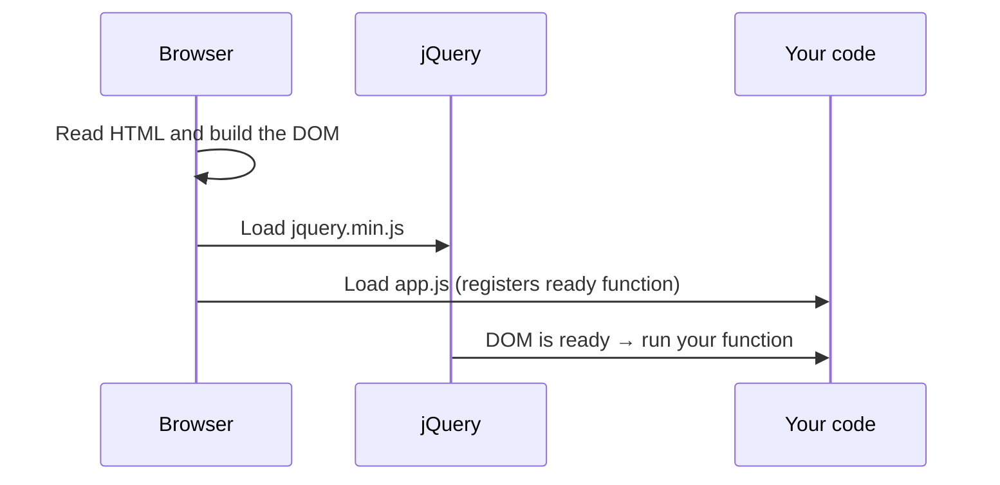

# Session 03: Getting Started with jQuery

> Module: Bootstrap and jQuery for Responsive Web Pages · Term 1 (CPISM) · ⏱ ~2 hours

## 🎯 Learning Objectives

By the end of this session you will be able to:

- Explain what jQuery is and how it relates to plain JavaScript
- Add jQuery to a page from a CDN or a local file
- Use `$(document).ready()` so code runs after the HTML loads
- Select elements with CSS-style selectors and handle events with `.on()`
- Show, hide and toggle elements, and add, remove or toggle CSS classes

## 📖 Concepts Explained

### 1. What is jQuery?
**jQuery** is a small JavaScript **library**: a file of ready-made functions that make common browser tasks shorter. It is famous for the motto *"write less, do more"*.

| Task | Plain JavaScript | jQuery |
|------|------------------|--------|
| Select by id | `document.querySelector("#box")` | `$("#box")` |
| Hide | `box.style.display = "none"` | `$("#box").hide()` |
| Click event | `box.addEventListener("click", fn)` | `$("#box").on("click", fn)` |
| Change text | `box.textContent = "Hi"` | `$("#box").text("Hi")` |

> 🔧 **Analogy:** JavaScript is a full toolbox. jQuery is a power drill from that toolbox: it does the same job, faster and with less effort.

**Is jQuery still used?** Yes. Millions of existing websites, WordPress themes and plugins use it, so you will meet it at work. Modern JavaScript can do the same things, so learn both: knowing jQuery makes old code easy to maintain.

### 2. Adding jQuery

```html
<!-- CDN (needs internet) -->
<script src="https://code.jquery.com/jquery-3.7.1.min.js"></script>
<!-- Local file (download it into a js/ folder) -->
<script src="js/jquery-3.7.1.min.js"></script>
```

Always load jQuery **before** your own script, otherwise `$` is not defined yet. The `.min.js` version is "minified" (spaces removed) so it downloads faster.

### 3. The `$` function and document ready
`$` (or `jQuery`) is one function that does many jobs. Its most common job is **select elements**: `$("selector")`.

Code must wait for the page to load, or the elements will not exist yet:

```js
$(document).ready(function () { /* your code */ });
$(function () { /* same thing, shorter */ });
```



### 4. Selectors (same as CSS)

| Selector | Selects |
|----------|---------|
| `$("p")` | All `<p>` elements |
| `$("#title")` | Element with `id="title"` |
| `$(".card")` | All elements with class `card` |
| `$("#courses li")` | `<li>` inside `#courses` |
| `$("li:first")` | The first `<li>` |
| `$(this)` | The element that fired the event |

A selection can contain **many** elements; methods like `.hide()` apply to all of them at once (no loop needed).

### 5. Events
Use `.on("eventName", function)`. Common events: `click`, `dblclick`, `mouseenter`, `mouseleave`, `input`, `change`, `submit`, `keyup`. Inside the function, `$(this)` is the element that was clicked.

### 6. Show/hide and classes

| Method | Effect |
|--------|--------|
| `.hide()` / `.show()` / `.toggle()` | Change visibility |
| `.addClass("x")` / `.removeClass("x")` / `.toggleClass("x")` | Change CSS classes |
| `.css("color", "red")` | Set one inline style |
| `.text()` / `.val()` | Read or write text / input value |

Tip: prefer **classes** over `.css()`; keep design in CSS and behaviour in JS.

## 💻 Code Examples

### Example 1: The page

📄 Saved in this folder as [`index.html`](index.html).

```html
<!DOCTYPE html>
<html lang="en">
<head>
  <meta charset="UTF-8">
  <meta name="viewport" content="width=device-width, initial-scale=1">
  <title>jQuery Basics</title>
  <link rel="stylesheet" href="https://cdn.jsdelivr.net/npm/bootstrap@5.3.3/dist/css/bootstrap.min.css">
  <style>
    .highlight { background: #fff3cd; }   /* class added/removed by jQuery */
  </style>
</head>
<body class="container my-4">
  <h1 id="title">Hello jQuery</h1>

  <!-- 1. Show / hide / toggle -->
  <button id="hideBtn" class="btn btn-secondary">Hide text</button>
  <button id="showBtn" class="btn btn-secondary">Show text</button>
  <button id="toggleBtn" class="btn btn-primary">Toggle text</button>
  <p id="message" class="mt-3">This paragraph can disappear and come back.</p>

  <!-- 2. Classes: click a list item to highlight it -->
  <h2 class="h5">Click a course</h2>
  <ul class="list-group mb-3" id="courses">
    <li class="list-group-item">HTML</li>
    <li class="list-group-item">CSS</li>
    <li class="list-group-item">JavaScript</li>
  </ul>

  <!-- 3. Reading input with an event -->
  <label for="nameInput" class="form-label">Type your name:</label>
  <input id="nameInput" class="form-control mb-2" placeholder="e.g. Ayesha">
  <p>Welcome, <strong id="nameOut">guest</strong>!</p>

  <!-- Step 1: load jQuery FIRST, then our own file -->
  <script src="https://code.jquery.com/jquery-3.7.1.min.js"></script>
  <script src="app.js"></script>
</body>
</html>
```

**How it works**

- jQuery is loaded first, then `app.js`, both just before `</body>`.
- `.highlight` is a normal CSS class that jQuery will add and remove.

### Example 2: The jQuery code

📄 Saved in this folder as [`app.js`](app.js).

```javascript
// Wait until the HTML is ready, then run our code.
// $(function () { ... }) is the short form of $(document).ready(function () { ... })
$(function () {

  // ---------- 1. Change text with a selector ----------
  // $("#title") selects the element with id="title"
  $("#title").text("Hello jQuery - it works!");

  // ---------- 2. Show, hide and toggle ----------
  $("#hideBtn").on("click", function () {
    $("#message").hide();        // make the paragraph invisible
  });

  $("#showBtn").on("click", function () {
    $("#message").show();        // make it visible again
  });

  $("#toggleBtn").on("click", function () {
    $("#message").toggle();      // hide if visible, show if hidden
  });

  // ---------- 3. Add / remove / toggle a CSS class ----------
  // "#courses li" selects every <li> inside #courses
  $("#courses li").on("click", function () {
    // $(this) = the exact <li> that was clicked
    $(this).toggleClass("highlight");
  });

  // Double-click removes the highlight from ALL items
  $("#courses").on("dblclick", function () {
    $("#courses li").removeClass("highlight");
  });

  // ---------- 4. Read an input value on every key press ----------
  $("#nameInput").on("input", function () {
    let typedName = $(this).val();          // .val() reads the input value

    if (typedName === "") {
      typedName = "guest";                  // default when the box is empty
    }

    $("#nameOut").text(typedName);          // write it into the page
  });

  // ---------- 5. Hover events ----------
  $("#title").on("mouseenter", function () {
    $(this).css("color", "#0d6efd");        // blue when the mouse is over it
  });

  $("#title").on("mouseleave", function () {
    $(this).css("color", "");               // back to normal
  });

});
```

**How it works**

- Everything sits inside `$(function () { ... })`, so it runs after the DOM is ready.
- Each button has its own click handler calling `hide`, `show` or `toggle`.
- `$("#courses li")` attaches one handler to all three list items; `$(this)` picks the clicked one.
- The `input` event fires on every key press; `.val()` reads the box and `.text()` writes the greeting.
- `mouseenter`/`mouseleave` give a simple hover effect using `.css()`.

## 🧪 Lab Practice

1. Open the page, then open the DevTools Console and type `$("li").hide()`. Then `$("li").show()`.
2. Add a fourth button "Make big" that adds the Bootstrap class `fs-1` to `#message` with `toggleClass`.
3. Change the course click so only **one** item is highlighted at a time (remove from all, then add to `$(this)`).
4. Add a character counter under the name input: `Characters: 5`.
5. Move the two `<script>` tags in the wrong order and read the error in the Console. Fix it again.

## 📝 Assignment

Build a **Services** page with three Bootstrap cards. Each card has a "Read more" button that toggles a hidden paragraph inside that card only (hint: `$(this).siblings("p").toggle()` or `$(this).closest(".card").find("p")`). The button text should change between "Read more" and "Read less".

## ❓ Quick Quiz

**Q1.** What does `$("#menu")` select?

- a) All elements with class menu
- b) The element with id menu
- c) All `<menu>` tags
- d) Nothing

**Q2.** Which method hides an element if visible and shows it if hidden?

- a) `.switch()`
- b) `.hide()`
- c) `.toggle()`
- d) `.flip()`

**Q3.** Why do we wrap code in `$(document).ready()`?

**Q4.** What does `$(this)` mean inside a click handler?

**Q5.** Which method reads the value of a text input?

<details>
<summary>Show answers</summary>

1. b) The element with id menu
2. c) `.toggle()`
3. So it runs only after the HTML elements exist in the DOM.
4. The element that triggered the event, wrapped as a jQuery object.
5. `.val()`

</details>

## 💼 Interview Questions

**1. What is the difference between a library and a framework?**

<details>
<summary>Model answer</summary>

You call a library when you need it (jQuery). A framework gives the structure and calls your code (Angular, Laravel). Bootstrap is often called a CSS framework because it sets your layout system.

</details>

**2. What is `$` in jQuery?**

<details>
<summary>Model answer</summary>

An alias for the `jQuery` function. It selects elements, creates elements from HTML strings, and registers ready handlers.

</details>

**3. Why load jQuery before your script?**

<details>
<summary>Model answer</summary>

Scripts run in order. If your code runs first, `$` is undefined and you get "ReferenceError: $ is not defined".

</details>

## ✅ Summary

- jQuery is a JS library that shortens DOM work: `$(selector).method()`.
- Load jQuery first, then your code, and wrap code in `$(function(){})`.
- Selectors are the same as CSS; `.on()` handles events.
- `hide/show/toggle` change visibility; `addClass/removeClass/toggleClass` change style.

---

[⬅ Previous](../Session-02-Bootstrap-Components-and-Navigation/README.md) · [🏠 Module Home](../README.md) · [Next ➡](../Session-04-Practice-Lab-Bootstrap-and-jQuery-Basics/README.md)

Prepared by Zeeshan Abbas · Aptech Learning North Nazimabad
