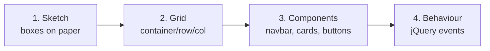

# Session 04: Practice Lab: Bootstrap Layout with jQuery Interactions

> Module: Bootstrap and jQuery for Responsive Web Pages · Term 1 (CPISM) · ⏱ ~2 hours

## 🎯 Learning Objectives

By the end of this lab you will be able to:

- Plan a small business page on paper and turn it into a Bootstrap grid
- Combine a responsive navbar, cards and a form-like contact box
- Use jQuery to toggle content inside the correct card with `closest()` and `find()`
- Switch a dark theme on and off with `toggleClass()` and `hasClass()`
- Give simple feedback messages to the user after checking an input

## 📖 Concepts Explained

### 1. How to approach a lab
Professional developers do not start typing straight away. Follow these four steps every time:



### 2. The page we are building: "FixIt Services"

| Part | Bootstrap pieces | jQuery behaviour |
|------|------------------|------------------|
| A. Navbar | `navbar-expand-md`, toggler, collapse | Dark mode button |
| B. Services | `row g-4`, `col-12 col-sm-6 col-lg-4`, `card h-100` | Details toggle, hover lift |
| C. Contact | `form-control`, `btn-success` | Check phone number, show message |

### 3. Moving around the DOM (traversing)
When the same button appears in three cards, `$(".details").toggle()` would open **all three**. We need only the paragraph in the clicked card. jQuery can "walk" from one element to another:

| Method | Direction | Example |
|--------|-----------|---------|
| `.closest(".card")` | Up to the nearest matching parent | button → its card |
| `.find(".details")` | Down to matching children | card → its paragraph |
| `.siblings()` | Sideways, same parent | button → paragraph next to it |
| `.parent()` | One level up | |

> 🏠 **Analogy:** `closest()` is "go up to my house", `find()` is "look for the kitchen inside it".

### 4. Keep style in CSS, behaviour in JS
We never write colours in `app.js`. Instead `style.css` defines classes (`.details`, `.hovered`, `body.dark`) and jQuery only adds or removes them. This keeps code clean and easy to change later.

## 💻 Code Examples

### File 1: `index.html`
📄 Open [`index.html`](index.html) in this folder. It has three parts: navbar (A), services grid (B) and contact box (C). Each service card contains a `.more-btn` button and a hidden `.details` paragraph. Scripts are loaded at the bottom in this order: Bootstrap bundle → jQuery → `app.js`.

### File 2: `style.css`

📄 Saved in this folder as [`style.css`](style.css).

```css
/* Details text is hidden at the start; jQuery shows it */
.details {
  display: none;
}

/* Card lifts a little when the mouse is over it (class added by jQuery) */
.service.hovered {
  box-shadow: 0 0.5rem 1rem rgba(0, 0, 0, 0.15);
  transform: translateY(-4px);
  transition: all 0.2s;
}

/* Dark mode: jQuery adds this class to <body> */
body.dark {
  background: #1e1e1e;
  color: #f1f1f1;
}

body.dark .card {
  background: #2b2b2b;
  color: #f1f1f1;
}
```

**How it works**

- `.details` starts hidden with `display: none`; jQuery's `toggle()` switches it.
- `.hovered` adds a shadow and lifts the card 4 px.
- `body.dark .card` styles cards only when the body has the `dark` class.

### File 3: `app.js`

📄 Saved in this folder as [`app.js`](app.js).

```javascript
$(function () {

  // Task 1: "Details" button shows/hides the text inside ITS OWN card
  $(".more-btn").on("click", function () {
    const card = $(this).closest(".card");      // go up to the card of this button
    card.find(".details").toggle();             // toggle only that card's paragraph

    // Change the button text
    if ($(this).text() === "Details") {
      $(this).text("Hide");
    } else {
      $(this).text("Details");
    }
  });

  // Task 2: hover effect using a CSS class
  $(".service").on("mouseenter", function () {
    $(this).addClass("hovered");
  });
  $(".service").on("mouseleave", function () {
    $(this).removeClass("hovered");
  });

  // Task 3: dark mode switch
  $("#themeBtn").on("click", function () {
    $("body").toggleClass("dark");

    // hasClass() returns true or false
    if ($("body").hasClass("dark")) {
      $(this).text("Light mode");
    } else {
      $(this).text("Dark mode");
    }
  });

  // Task 4: very small phone check (11 digits starting with 03)
  $("#callBtn").on("click", function () {
    const phone = $("#phone").val().trim();     // trim() removes extra spaces

    if (phone.length === 11 && phone.startsWith("03")) {
      $("#feedback").text("Thank you! We will call you soon.")
                    .attr("class", "mt-2 text-success");
    } else {
      $("#feedback").text("Please enter an 11-digit number like 03001234567.")
                    .attr("class", "mt-2 text-danger");
    }
  });

});
```

**How it works**

- **Task 1** walks up to the clicked button's card, then down to its `.details`. The button label switches between "Details" and "Hide".
- **Task 2** adds and removes the `hovered` class on mouse enter/leave.
- **Task 3** toggles `dark` on `<body>`; `hasClass()` decides the button label.
- **Task 4** trims the phone value, checks length and the `03` prefix, then writes a coloured message. `.text()` and `.attr()` are **chained** on one line.

## 🧪 Lab Practice

Complete these steps in order. Test in the browser after each one.

1. **Layout:** Add a fourth service card "Painting". Check it shows 1 / 2 / 3 per row on phone / tablet / laptop.
2. **Hero:** Add a hero section above services with a heading, one sentence and a "Book now" button that links to `#contact`.
3. **Count:** Show a line under the heading: "Services available: 4". Calculate it with `$(".service").length`.
4. **One open at a time:** Change Task 1 so opening one card's details closes the others (hint: `$(".details").not(...)` or hide all first).
5. **Remember the theme (bonus):** Save dark mode in `localStorage` and apply it when the page loads.

## 📝 Assignment

Make your own version for a different business (e.g. a tuition centre or bakery) with: navbar, hero, at least 4 cards with "Details" toggles, a dark mode button, and a contact box that checks an email contains `@` and `.` before showing "Thank you". Submit the folder zipped or as a GitHub link.

## ❓ Quick Quiz

**Q1.** Which method finds the nearest parent with class `card`?

- a) `.parent(".card")`
- b) `.closest(".card")`
- c) `.find(".card")`
- d) `.up(".card")`

**Q2.** What does `$(".service").length` return?

- a) The width of the first card
- b) The number of matching elements
- c) The text length
- d) Always 1

**Q3.** Why do we add a class instead of using `.css()` for dark mode?

**Q4.** What does `h-100` do on a card?

**Q5.** What is method chaining?

<details>
<summary>Show answers</summary>

1. b) `.closest(".card")`
2. b) The number of matching elements
3. Styles stay in CSS, the code is shorter, and the whole theme can be changed in one place.
4. Sets height to 100% so all cards in a row are the same height.
5. Calling several methods on the same selection in one statement, e.g. `$("#x").text("Hi").addClass("ok")`.

</details>

## 💼 Interview Questions

**1. Explain DOM traversal in jQuery.**

<details>
<summary>Model answer</summary>

Moving from a selected element to related elements: up with `parent()`/`closest()`, down with `children()`/`find()`, sideways with `siblings()`/`next()`/`prev()`.

</details>

**2. How do you make sure all Bootstrap cards in a row are equal height?**

<details>
<summary>Model answer</summary>

Rows are flex containers, so columns stretch; add `h-100` to the card so it fills the column height.

</details>

**3. In what order should Bootstrap, jQuery and your script load?**

<details>
<summary>Model answer</summary>

Bootstrap CSS in the head; at the end of body load the libraries (Bootstrap bundle, jQuery) and then your own script, because your code depends on them.

</details>

## ✅ Summary

- Plan first: sketch → grid → components → behaviour.
- Use `closest()` + `find()` to act on the clicked card only.
- Toggle classes for hover and dark mode; keep colours in CSS.
- Validate simple input and show clear feedback.

---

[⬅ Previous](../Session-03-Getting-Started-with-jQuery/README.md) · [🏠 Module Home](../README.md) · [Next ➡](../Session-05-jQuery-Effects-DOM-Plugins-and-jQuery-UI/README.md)

Prepared by Zeeshan Abbas · Aptech Learning North Nazimabad
