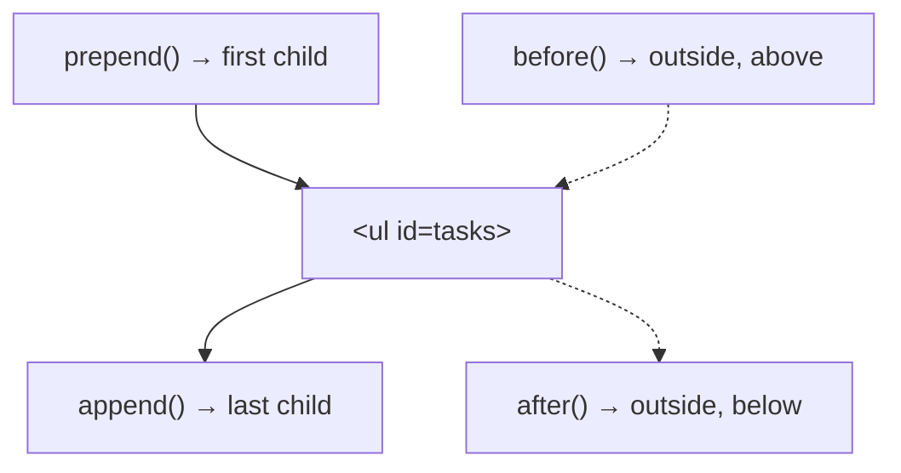

# Session 05: jQuery Effects, DOM Manipulation, Plugins and jQuery UI

> Module: Bootstrap and jQuery for Responsive Web Pages · Term 1 (CPISM) · ⏱ ~2 hours

## 🎯 Learning Objectives

By the end of this session you will be able to:

- Use fade, slide and `animate()` effects, with speed and callback functions
- Read and change text, HTML and attributes with `text()`, `html()` and `attr()`
- Create, append, prepend and remove elements, and use event delegation
- Explain what a jQuery plugin is and write a very small one
- Add jQuery UI widgets: Datepicker, Dialog and Accordion

## 📖 Concepts Explained

### 1. Effects
Effects change how an element appears over time. Every effect accepts a **speed** (`"slow"`, `"fast"` or milliseconds like `400`) and an optional **callback**, a function that runs when the effect finishes.

| Group | Methods | What changes |
|-------|---------|--------------|
| Fade | `fadeIn`, `fadeOut`, `fadeToggle`, `fadeTo(speed, 0.5)` | Opacity |
| Slide | `slideDown`, `slideUp`, `slideToggle` | Height |
| Custom | `animate({ prop: value }, speed)` | Any numeric CSS property |
| Control | `stop()`, `delay(ms)` | Stops or pauses the queue |

Animations on the same element **queue** up and run one after another. `stop(true)` empties the queue. `animate()` cannot animate colours (that needs jQuery UI).

### 2. Getting and setting content

| Method | Get | Set |
|--------|-----|-----|
| `.text()` | Plain text | Text (HTML tags shown as text, safe) |
| `.html()` | Inner HTML | HTML (tags are rendered, be careful with user input) |
| `.val()` | Input value | Input value |
| `.attr("src")` | Attribute | `.attr("src", "new.png")` |

> ⚠️ Never put what a user typed into `.html()`. Someone could type a `<script>` and run code on your page. Use `.text()` for user data.

### 3. Adding and removing elements



- Create an element: `$("<li></li>")` or `$("<li>", { text: "Hi" })`.
- Remove: `.remove()` deletes the element; `.empty()` deletes only its children.

### 4. Event delegation
`$(".del").on("click", ...)` only works for buttons that **already exist**. For items added later, attach the listener to a parent that always exists and give a filter:

```js
$("#tasks").on("click", ".del", function () { ... });
```

The click "bubbles" up from the button to `#tasks`, and jQuery checks whether it came from a `.del`.

### 5. Plugins
A **plugin** is extra code that adds new methods to jQuery. Thousands exist (sliders, lightboxes, counters, scroll animations). You load the plugin file **after** jQuery and call it like any other method: `$("#gallery").somePlugin()`. Internally, a plugin adds a function to `$.fn`.

**Choosing a plugin safely:** check it was updated recently, has documentation, works with jQuery 3, and has a clear licence.

### 6. jQuery UI
**jQuery UI** is the official widget library for jQuery. It needs its JS file **and** a CSS theme.

| Widget / feature | Call |
|------------------|------|
| Datepicker | `$("#date").datepicker()` |
| Dialog | `$("#box").dialog()` |
| Accordion / Tabs | `$("#faq").accordion()`, `$("#t").tabs()` |
| Draggable / Sortable | `$("#card").draggable()`, `$("#list").sortable()` |

## 💻 Code Examples

### Example 1: Effects

📄 Saved in this folder as [`effects.html`](effects.html).

```html
<!DOCTYPE html>
<html lang="en">
<head>
  <meta charset="UTF-8">
  <meta name="viewport" content="width=device-width, initial-scale=1">
  <title>jQuery Effects</title>
  <link rel="stylesheet" href="https://cdn.jsdelivr.net/npm/bootstrap@5.3.3/dist/css/bootstrap.min.css">
  <style>
    #box { width: 120px; height: 120px; background: #0d6efd; position: relative; }
  </style>
</head>
<body class="container my-4">
  <h1 class="h3">Effects</h1>

  <button id="fadeBtn" class="btn btn-primary">Fade toggle</button>
  <button id="slideBtn" class="btn btn-success">Slide toggle</button>
  <button id="moveBtn" class="btn btn-warning">Animate</button>
  <button id="resetBtn" class="btn btn-secondary">Reset</button>

  <div id="box" class="mt-4 rounded"></div>

  <script src="https://code.jquery.com/jquery-3.7.1.min.js"></script>
  <script>
    $(function () {
      // Fade: changes opacity. 600 = milliseconds
      $("#fadeBtn").on("click", function () {
        $("#box").fadeToggle(600);
      });

      // Slide: changes height, like a curtain
      $("#slideBtn").on("click", function () {
        $("#box").slideToggle("slow");
      });

      // animate(): change number-based CSS properties smoothly
      $("#moveBtn").on("click", function () {
        $("#box")
          .animate({ left: "200px" }, 500)              // step 1: move right
          .animate({ width: "60px", opacity: 0.5 }, 500) // step 2: shrink and fade
          .animate({ left: "0px" }, 500, function () {   // step 3: move back
            console.log("Animation finished!");           // callback runs at the end
          });
      });

      // stop() cancels running animations, then we restore the original style
      $("#resetBtn").on("click", function () {
        $("#box").stop(true).removeAttr("style").show();
      });
    });
  </script>
</body>
</html>
```

**How it works**

- `fadeToggle(600)` and `slideToggle("slow")` hide or show the box with animation.
- Three chained `animate()` calls run one after another (queue); the last has a callback.
- `stop(true)` clears the queue and `removeAttr("style")` removes inline styles added by the animation.

### Example 2: DOM manipulation

📄 Page: [`dom.html`](dom.html) (input box, list, counter and an image). Script:

📄 Saved in this folder as [`dom.js`](dom.js).

```javascript
$(function () {

  // Helper: build one <li> for a task
  function makeTask(text) {
    const item = $("<li></li>");                     // create a new element
    item.addClass("list-group-item");
    item.text(text);                                 // .text() is safe: no HTML injection
    item.append(' <button class="btn btn-sm btn-danger float-end del">x</button>');
    return item;
  }

  // Helper: update the counter
  function updateCount() {
    $("#count").text($("#tasks li").length);
  }

  // append() = add at the END of the list
  $("#addBtn").on("click", function () {
    const text = $("#taskInput").val().trim();
    if (text === "") return;                          // ignore empty input
    const newItem = makeTask(text);
    $("#tasks").append(newItem);
    newItem.flash();                                  // our own plugin (my-plugin.js)
    $("#taskInput").val("");                          // clear the box
    updateCount();
  });

  // prepend() = add at the START of the list
  $("#topBtn").on("click", function () {
    const text = $("#taskInput").val().trim();
    if (text === "") return;
    $("#tasks").prepend(makeTask(text));
    $("#taskInput").val("");
    updateCount();
  });

  // Delete button. We use "event delegation": the listener is on #tasks,
  // so it also works for buttons that are added later.
  $("#tasks").on("click", ".del", function (event) {
    event.stopPropagation();                          // do not also trigger the <li> click
    $(this).parent().fadeOut(300, function () {
      $(this).remove();                               // remove from the DOM after fading
      updateCount();
    });
  });

  // Click a task to mark it done (toggle a Bootstrap class)
  $("#tasks").on("click", "li", function () {
    $(this).toggleClass("text-decoration-line-through");
  });

  // attr() reads or changes an attribute
  $("#swapBtn").on("click", function () {
    const oldAlt = $("#pic").attr("alt");
    $("#pic").attr("alt", "Logo of the Bootstrap framework");
    console.log("alt changed from:", oldAlt, "to:", $("#pic").attr("alt"));
  });

});
```

**How it works**

- `makeTask()` creates a new `<li>` with `.text()`, so typed HTML cannot break the page.
- `append` adds to the end, `prepend` to the top; `updateCount()` reads `.length`.
- Delete uses **delegation**, so new items work too; `fadeOut` then `remove` in the callback.
- `attr()` reads and changes the image's `alt` text.

### Example 3: A tiny plugin

📄 Saved in this folder as [`my-plugin.js`](my-plugin.js).

```javascript
// A tiny jQuery plugin: makes any element "flash" yellow for a moment.
// Usage:  $("#title").flash();    or    $(".card").flash(1000);

// $.fn is where jQuery keeps its methods. Adding a function here
// makes it available on every selection, just like .hide() or .text().
$.fn.flash = function (duration) {
  // Default duration if none is given
  const time = duration || 600;

  // "this" = the jQuery selection. return it so chaining still works.
  return this.each(function () {
    const element = $(this);
    element.css("background-color", "yellow");

    // After "time" milliseconds, remove the colour again
    setTimeout(function () {
      element.css("background-color", "");
    }, time);
  });
};
```

**How it works**

- Adding `flash` to `$.fn` makes `$(anything).flash()` possible. `dom.html` loads it and new tasks flash yellow.
- `return this.each(...)` handles many elements and keeps chaining working.

### Example 4: jQuery UI widgets

📄 Open [`jquery-ui.html`](jquery-ui.html). It loads the jQuery UI theme CSS, then jQuery, then jQuery UI, and turns an input into a **Datepicker** (`minDate: 0` blocks past dates), a `div` into a modal **Dialog** opened by a button, and headings + panels into an **Accordion**.

## 🧪 Lab Practice

1. In `effects.html`, add a "Pulse" button that fades the box to 0.2 and back to 1 using `fadeTo` twice.
2. In the to-do list, add a "Clear all" button using `.empty()` and update the counter.
3. Show a Bootstrap alert with `slideDown()` when a task is added, then `delay(1500).slideUp()`.
4. In `jquery-ui.html`, add a second datepicker that only allows the next 30 days (`maxDate: 30`).
5. Make the to-do list **sortable** with jQuery UI (load jQuery UI in `dom.html` and call `$("#tasks").sortable()`).

## 📝 Assignment

Create a **Student Notice Board**: a form to add notices (title + text) that are prepended with a fade-in, each with a delete button (delegation), a date chosen with jQuery UI Datepicker, and a dialog that confirms "Delete this notice?" before removing.

## ❓ Quick Quiz

**Q1.** Which effect changes an element's height?

- a) `fadeToggle`
- b) `slideToggle`
- c) `show`
- d) `animate` only

**Q2.** Which method adds content as the first child?

- a) `append`
- b) `before`
- c) `prepend`
- d) `after`

**Q3.** What is a callback in an effect?

**Q4.** Why should user input be written with `.text()` and not `.html()`?

**Q5.** What two files does jQuery UI need besides jQuery?

<details>
<summary>Show answers</summary>

1. b) `slideToggle`
2. c) `prepend`
3. A function that runs after the animation finishes.
4. `.html()` renders tags, so malicious input could inject scripts (XSS); `.text()` shows it as plain text.
5. `jquery-ui.min.js` and a theme CSS file (e.g. `jquery-ui.css`).

</details>

## 💼 Interview Questions

**1. What is event delegation and why use it?**

<details>
<summary>Model answer</summary>

Attaching one listener to a parent and filtering by a child selector. It works for elements added later and uses fewer listeners.

</details>

**2. Difference between `.remove()` and `.empty()`?**

<details>
<summary>Model answer</summary>

`.remove()` deletes the selected elements themselves (and their events/data). `.empty()` keeps the element but deletes everything inside it.

</details>

**3. How do you write a jQuery plugin?**

<details>
<summary>Model answer</summary>

Add a function to `$.fn`, loop with `this.each()`, accept options with defaults, and return `this` so chaining works.

</details>

## ✅ Summary

- Fade, slide and `animate()` give motion; callbacks run afterwards.
- `text()`, `html()`, `val()`, `attr()` read and write content.
- `append/prepend/remove` change the DOM; delegation handles new elements.
- Plugins extend `$.fn`; jQuery UI adds Datepicker, Dialog, Accordion and more.

---

[⬅ Previous](../Session-04-Practice-Lab-Bootstrap-and-jQuery-Basics/README.md) · [🏠 Module Home](../README.md) · [Next ➡](../Session-06-Responsive-Design-with-Bootstrap/README.md)

Prepared by Zeeshan Abbas · Aptech Learning North Nazimabad
