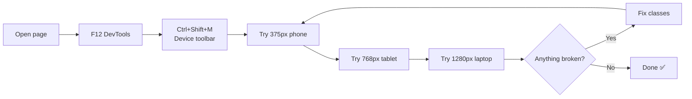

# Session 06: Responsive Design with Bootstrap

> Module: Bootstrap and jQuery for Responsive Web Pages · Term 1 (CPISM) · ⏱ ~2 hours

## 🎯 Learning Objectives

By the end of this session you will be able to:

- Explain responsive design and the mobile-first approach
- Use responsive utility classes for spacing, display, flexbox, text and ordering
- Make images and carousels scale to any screen
- Build a responsive form with floating labels, input groups and validation classes
- Test a page on phone, tablet and desktop sizes with DevTools

## 📖 Concepts Explained

### 1. What is responsive design?
A **responsive** website changes its layout to fit the screen it is viewed on. One page, one URL, many screen sizes. In Pakistan most visitors browse on phones, so a site that breaks on mobile loses most of its users.

> 💧 **Analogy:** Water takes the shape of any glass. A responsive page takes the shape of any screen.

Three ingredients: **flexible grids** (columns in %), **flexible images** (`max-width: 100%`), and **media queries** (rules per width). Bootstrap gives all three through class names.

### 2. The utility class pattern
Most Bootstrap utilities follow one pattern:

```
{property}{sides}-{breakpoint}-{value}
   p        t      md        3      →  pt-md-3 = padding-top size 3 from md upward
```

| Group | Examples | Meaning |
|-------|----------|---------|
| Spacing | `m-0`, `mt-3`, `px-2`, `p-md-5`, `mx-auto` | Margin / padding, 0 to 5 (5 = 3rem) |
| Display | `d-none`, `d-md-block`, `d-flex`, `d-grid` | Show, hide, layout mode |
| Flex | `flex-column`, `flex-md-row`, `justify-content-between`, `align-items-center`, `gap-3` | Arrange children |
| Text | `text-center`, `text-lg-start`, `fs-4`, `fw-bold` | Alignment, size, weight |
| Sizing | `w-100`, `h-100`, `mw-100` | Width and height in % |
| Order | `order-1`, `order-md-2` | Change visual order of columns |
| Colours | `bg-primary`, `text-white`, `border`, `rounded`, `shadow` | Look and feel |

**Sides:** `t` top, `b` bottom, `s` start (left), `e` end (right), `x` left+right, `y` top+bottom.

### 3. Responsive images and media
- `img-fluid` → `max-width: 100%; height: auto;` so the image shrinks but never stretches.
- `ratio ratio-16x9` around an `<iframe>` keeps YouTube videos in shape.
- A **carousel** is a slideshow. Use `d-block w-100` on images and hide long captions on phones with `d-none d-md-block`.

### 4. Responsive forms
| Feature | Classes |
|---------|---------|
| Text inputs | `form-control` (`form-control-lg` for big) |
| Dropdown | `form-select` |
| Radio / checkbox | `form-check`, `form-check-input`, `form-check-label` |
| Floating labels | wrapper `form-floating` (input **before** label, needs a placeholder) |
| Input group | `input-group` + `input-group-text` |
| Layout | `row g-3` with `col-md-6` per field |
| Validation | add `was-validated` to the form; messages in `invalid-feedback` |

### 5. Testing responsiveness



Also test on a real phone: with Live Server, open `http://<your-PC-IP>:5500` on the phone (same Wi-Fi).

## 💻 Code Examples

### Example 1: Responsive utilities

📄 Saved in this folder as [`utilities.html`](utilities.html).

```html
<!DOCTYPE html>
<html lang="en">
<head>
  <meta charset="UTF-8">
  <meta name="viewport" content="width=device-width, initial-scale=1">
  <title>Responsive Utilities</title>
  <link rel="stylesheet" href="https://cdn.jsdelivr.net/npm/bootstrap@5.3.3/dist/css/bootstrap.min.css">
</head>
<body>
  <div class="container py-4">

    <!-- 1. Spacing: p = padding, m = margin, number 0-5 -->
    <div class="bg-light border p-2 p-md-5 mb-4">
      Small padding on phones (p-2), big padding from tablets (p-md-5).
    </div>

    <!-- 2. Responsive text alignment -->
    <h1 class="h3 text-center text-lg-start">Centered on phones, left-aligned on laptops</h1>

    <!-- 3. Show / hide by screen size -->
    <p class="d-block d-md-none alert alert-info">📱 You are on a small screen.</p>
    <p class="d-none d-md-block alert alert-success">💻 You are on a medium or larger screen.</p>

    <!-- 4. Flexbox utilities: stacked on phones, side by side from md -->
    <div class="d-flex flex-column flex-md-row gap-3 mb-4">
      <div class="p-3 bg-primary text-white flex-fill">Box 1</div>
      <div class="p-3 bg-secondary text-white flex-fill">Box 2</div>
      <div class="p-3 bg-dark text-white flex-fill">Box 3</div>
    </div>

    <!-- 5. Responsive image: never wider than its parent -->
    

    <!-- 6. Column order: on phones the image comes first, on md the text comes first -->
    <div class="row align-items-center">
      <div class="col-md-6 order-2 order-md-1">
        <h2 class="h4">About us</h2>
        <p>We teach practical web skills in Karachi.</p>
      </div>
      <div class="col-md-6 order-1 order-md-2">
        
      </div>
    </div>

  </div>
</body>
</html>
```

**How it works**

- `p-2 p-md-5` gives small padding on phones and large from tablets.
- `d-block d-md-none` and `d-none d-md-block` show one message per screen size.
- `flex-column flex-md-row` stacks boxes on phones and puts them side by side from md.
- `order-2 order-md-1` moves the image above the text only on phones.

### Example 2: Carousel

📄 Open [`carousel.html`](carousel.html). Key points: the wrapper has an `id` and `data-bs-ride="carousel"`; exactly one `.carousel-item` is `active`; the arrow buttons use `data-bs-target="#gallery"` and `data-bs-slide="prev|next"`; each image uses `d-block w-100` to fill the width.

### Example 3: Responsive form with validation

📄 Open [`form.html`](form.html). Fields sit in `row g-3`: two per row on tablets (`col-md-6`), one per row on phones. It shows a floating label, an input group, a select, inline radios and a required checkbox. The small script at the bottom:

```javascript
const form = document.getElementById("admission");
form.addEventListener("submit", function (event) {
  if (!form.checkValidity()) {        // any required field empty or wrong?
    event.preventDefault();           // stop sending the form
  } else {
    event.preventDefault();           // demo only: do not reload the page
    alert("Form submitted. Thank you!");
  }
  form.classList.add("was-validated"); // Bootstrap now shows red/green borders
});
```

**How it works**

- `novalidate` on the form hides the browser's own pop-ups so Bootstrap's styled messages appear.
- `checkValidity()` uses the HTML `required` and `type="email"` rules.
- Adding `was-validated` makes `.invalid-feedback` text visible under wrong fields.

## 🧪 Lab Practice

1. Open `utilities.html` in device mode at 375 px, 768 px and 1280 px. Write down three things that change.
2. Add a row of three "feature" boxes that use `text-center text-md-start` and `shadow-sm`.
3. Add a fourth slide to the carousel and a caption on every slide.
4. In `form.html`, add a phone field with `pattern="03[0-9]{9}"` and an `invalid-feedback` message.
5. Embed a YouTube video inside `<div class="ratio ratio-16x9">` and check it scales.

## 📝 Assignment

Make the **About** and **Contact** pages of a small institute site fully responsive: an about section whose image moves above the text on phones, a three-image carousel, and an enquiry form (name, email, course, message, agree checkbox) with Bootstrap validation. Attach three screenshots: phone, tablet, desktop.

## ❓ Quick Quiz

**Q1.** What does `mt-md-4` mean?

- a) Margin top 4 on all screens
- b) Margin top 4 from medium screens upward
- c) Margin top 4 only on phones
- d) Max top 4

**Q2.** Which class makes an image shrink with its container?

- a) `img-responsive`
- b) `img-fluid`
- c) `w-auto`
- d) `img-scale`

**Q3.** Which class do you add to a form to show Bootstrap validation styles?

**Q4.** How do you hide an element on phones but show it from tablets?

**Q5.** Why do floating labels need a `placeholder` on the input?

<details>
<summary>Show answers</summary>

1. b) Margin top 4 from medium screens upward
2. b) `img-fluid`
3. `was-validated`
4. `d-none d-md-block` (or `d-md-flex`, `d-md-inline`)
5. Bootstrap uses the `:placeholder-shown` CSS state to know when to move the label up.

</details>

## 💼 Interview Questions

**1. What is mobile-first design?**

<details>
<summary>Model answer</summary>

You design and style for the smallest screen first, then add rules with min-width media queries for larger screens. It keeps phone CSS light and forces focus on essential content.

</details>

**2. How do you reorder columns on different screens in Bootstrap?**

<details>
<summary>Model answer</summary>

With order utilities like `order-1` and `order-md-2`; the HTML order stays the same, only the visual order changes.

</details>

**3. How would you test that a site is responsive?**

<details>
<summary>Model answer</summary>

Use DevTools device mode at common widths, check real phones, look for horizontal scrolling, readable text, tappable buttons, and images that scale.

</details>

## ✅ Summary

- Responsive = flexible grid + flexible images + media queries.
- Utilities follow `{property}{sides}-{breakpoint}-{value}`.
- `img-fluid`, `ratio`, and carousels keep media responsive.
- Bootstrap forms use `form-control`, `form-floating`, `input-group` and `was-validated`.
- Always test at phone, tablet and desktop widths.

---

[⬅ Previous](../Session-05-jQuery-Effects-DOM-Plugins-and-jQuery-UI/README.md) · [🏠 Module Home](../README.md) · [Next ➡](../Session-07-Integrating-Bootstrap-and-jQuery-and-Deployment/README.md)

Prepared by Zeeshan Abbas · Aptech Learning North Nazimabad
