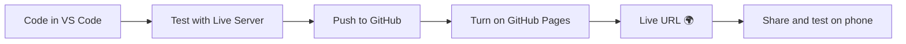

# Session 07: Integrating Bootstrap and jQuery, and Deployment

> Module: Bootstrap and jQuery for Responsive Web Pages · Term 1 (CPISM) · ⏱ ~2 hours

## 🎯 Learning Objectives

By the end of this session you will be able to:

- Organise a front-end project into clear folders (`css/`, `js/`, `img/`)
- Decide which job belongs to Bootstrap and which to jQuery
- Add smooth scrolling, a back-to-top button and an active menu highlight with jQuery
- Validate a Bootstrap form with jQuery and open a Bootstrap modal from code
- Publish a static website for free on GitHub Pages or Netlify

## 📖 Concepts Explained

### 1. Who does what?
Bootstrap and jQuery work well together because they do different jobs.

| Job | Bootstrap | jQuery |
|-----|-----------|--------|
| Layout and grid | ✅ | |
| Look of buttons, cards, forms | ✅ | |
| Built-in widgets (modal, collapse, carousel) | ✅ (own JS) | can trigger them |
| Custom behaviour (scroll, filters, counters) | | ✅ |
| Reading/validating form values | gives the red/green styles | ✅ checks the values |

> 🎭 **Analogy:** Bootstrap is the costume and stage; jQuery is the actor who moves and speaks.

### 2. Project structure

```
bright-tutors/
├── index.html
├── css/
│   └── style.css
├── js/
│   └── app.js
└── img/
```

Your own CSS loads **after** Bootstrap so your rules can override it. Your own JS loads **after** Bootstrap JS and jQuery.

### 3. Calling Bootstrap components from jQuery code
Bootstrap 5 components have a JavaScript API. You can use it inside any jQuery handler:

```js
const modal = bootstrap.Modal.getOrCreateInstance("#thanksModal");
modal.show();   // also: modal.hide()
```

Similar APIs: `bootstrap.Collapse`, `bootstrap.Carousel`, `bootstrap.Toast`, `bootstrap.Tooltip`.

### 4. Validation styles
Bootstrap shows a red border and the `.invalid-feedback` text when an input has class **`is-invalid`**, and a green border with **`is-valid`**. jQuery's `toggleClass("is-invalid", condition)` adds the class when the condition is `true` and removes it when `false`.

### 5. What is deployment?
**Deployment** means copying your site to a **web server** so anyone can open it with a URL. A site made only of HTML, CSS and JS is called a **static site** and can be hosted for free.

| Host | How | Your URL |
|------|-----|----------|
| GitHub Pages | Push to a repo → Settings → Pages → Branch `main` / root | `username.github.io/repo-name` |
| Netlify | Drag the project folder onto app.netlify.com/drop | `random-name.netlify.app` |
| Vercel | Import a GitHub repo | `project.vercel.app` |



You will learn Git properly in Module 04; for now you can also upload files on github.com with **Add file → Upload files**.

## 💻 Code Examples

### Example 1: `index.html`
📄 Open [`index.html`](index.html). A one-page site with a fixed navbar, a hero, a subjects grid, a contact form (`novalidate`, no `required`, because jQuery checks it), a hidden Bootstrap modal and a back-to-top link.

### Example 2: `css/style.css`

📄 Saved in this folder as [`css/style.css`](css/style.css).

```css
/* Push content below the fixed navbar */
body {
  padding-top: 56px;
}

/* Hero: full screen height with a gradient background */
.hero {
  min-height: 90vh;
  background: linear-gradient(135deg, #0d6efd, #6610f2);
}

/* Back-to-top button: fixed in the corner, hidden at first */
#toTop {
  position: fixed;
  right: 20px;
  bottom: 20px;
  width: 48px;
  height: 48px;
  display: none;            /* jQuery fades it in */
}

/* Highlight for the current menu item (added by jQuery) */
.navbar .nav-link.active {
  color: #0d6efd;
  font-weight: 600;
}
```

**How it works**

- `padding-top: 56px` stops the fixed navbar from covering the first section.
- `#toTop` starts hidden; jQuery fades it in.
- `.nav-link.active` styles the link of the section currently on screen.

### Example 3: `js/app.js`

📄 Saved in this folder as [`js/app.js`](js/app.js).

```javascript
$(function () {

  // ---------- 1. Smooth scroll for links that start with "#" ----------
  $('a[href^="#"]').on("click", function (event) {
    const targetId = $(this).attr("href");        // e.g. "#contact"
    const target = $(targetId);
    if (target.length === 0) return;               // no such section: do nothing

    event.preventDefault();                        // stop the instant jump
    $("html, body").animate({ scrollTop: target.offset().top - 56 }, 600);

    // Close the mobile menu after a click (Bootstrap collapse API)
    $("#nav").removeClass("show");
  });

  // ---------- 2. Back-to-top button + active menu item on scroll ----------
  $(window).on("scroll", function () {
    const scrolled = $(window).scrollTop();

    // Show the button after 300px
    if (scrolled > 300) {
      $("#toTop").fadeIn();
    } else {
      $("#toTop").fadeOut();
    }

    // Find which section is on screen and highlight its link
    $("section").each(function () {
      const top = $(this).offset().top - 80;
      const bottom = top + $(this).outerHeight();
      if (scrolled >= top && scrolled < bottom) {
        const id = $(this).attr("id");
        $(".nav-link").removeClass("active");
        $('.nav-link[href="#' + id + '"]').addClass("active");
      }
    });
  });

  // ---------- 3. Form validation with jQuery + Bootstrap classes ----------
  function showResult(input, isValid) {
    // Bootstrap shows the red message when "is-invalid" is present
    input.toggleClass("is-invalid", !isValid);
    input.toggleClass("is-valid", isValid);
  }

  $("#demoForm").on("submit", function (event) {
    event.preventDefault();                        // stay on this page

    const name = $("#name").val().trim();
    const email = $("#email").val().trim();
    const emailPattern = /^[^\s@]+@[^\s@]+\.[^\s@]+$/;   // simple email check

    const nameOk = name.length >= 3;
    const emailOk = emailPattern.test(email);

    showResult($("#name"), nameOk);
    showResult($("#email"), emailOk);

    if (nameOk && emailOk) {
      // ---------- 4. jQuery fills the text, Bootstrap opens the modal ----------
      $("#thanksName").text(name);
      const modal = bootstrap.Modal.getOrCreateInstance("#thanksModal");
      modal.show();
      this.reset();                                // clear the form
      $("#demoForm .form-control").removeClass("is-valid");
    }
  });

});
```

**How it works**

1. **Smooth scroll:** `a[href^="#"]` selects links that start with `#`; `animate({ scrollTop })` scrolls to the section minus the navbar height.
2. **Scroll handler:** shows the back-to-top button after 300 px and loops over sections with `.each()` to highlight the matching menu link.
3. **Validation:** checks name length and email with a simple pattern; `showResult()` sets `is-valid` / `is-invalid`.
4. **Modal:** jQuery writes the name into the modal, then the Bootstrap API opens it.

### Example 4: Deployment checklist
📄 [`deploy-checklist.md`](deploy-checklist.md) is a tick list to run before every deployment (files, quality, publish).

### Deploy to GitHub Pages (step by step)
1. Sign in at github.com → **New repository** → name it `bright-tutors` → Public → Create.
2. Click **uploading an existing file**, drag `index.html`, `css/` and `js/` in, then **Commit changes**.
3. Go to **Settings → Pages**. Under *Build and deployment* choose **Deploy from a branch**, branch `main`, folder `/ (root)` → **Save**.
4. Wait about a minute and refresh; the live URL appears at the top of the Pages screen.
5. Open the URL on your phone and run through the checklist.

## 🧪 Lab Practice

1. Run the site with Live Server. Click every menu link and watch the active highlight change while scrolling.
2. Add a phone field and validate it with the pattern `/^03\d{9}$/`.
3. Add a Bootstrap **toast** that says "Copied!" and show it from jQuery when a "Copy email" button is clicked (`bootstrap.Toast.getOrCreateInstance(...)`).
4. Add an `img/` folder with a compressed logo and use it in the navbar brand.
5. Deploy the site to GitHub Pages **or** Netlify Drop and send the link to your instructor.

## 📝 Assignment

Take your Session 04 or Session 06 work and turn it into a deployed one-page site with: folder structure as above, smooth scrolling, back-to-top button, jQuery form validation with Bootstrap styles, a modal on success, and a live URL. Submit the repository link and the live link.

## ❓ Quick Quiz

**Q1.** Which class shows Bootstrap's red error style on an input?

- a) `has-error`
- b) `is-invalid`
- c) `error`
- d) `invalid`

**Q2.** Where should your own `style.css` be linked?

- a) Before Bootstrap CSS
- b) After Bootstrap CSS
- c) In the footer
- d) It does not matter

**Q3.** What does `a[href^="#"]` select?

**Q4.** What is a static website?

**Q5.** Name two free hosts for static sites.

<details>
<summary>Show answers</summary>

1. b) `is-invalid`
2. b) After Bootstrap CSS, so your rules can override it
3. All links whose `href` begins with `#` (in-page links).
4. A site made only of files (HTML, CSS, JS, images) sent to the browser as they are, with no server-side code or database.
5. Any two of GitHub Pages, Netlify, Vercel, Cloudflare Pages.

</details>

## 💼 Interview Questions

**1. How do you open a Bootstrap 5 modal using JavaScript?**

<details>
<summary>Model answer</summary>

Get an instance with `bootstrap.Modal.getOrCreateInstance(elementOrSelector)` and call `.show()`; `.hide()` closes it.

</details>

**2. How would you deploy a static site on GitHub Pages?**

<details>
<summary>Model answer</summary>

Push the files with `index.html` at the root to a public repo, then in Settings → Pages choose Deploy from a branch, select `main` and `/root`, and save. The site appears at `username.github.io/repo`.

</details>

**3. Why validate on the client if the server must validate anyway?**

<details>
<summary>Model answer</summary>

Client-side validation gives instant feedback and better user experience; server-side validation is still needed for security because client checks can be bypassed.

</details>

## ✅ Summary

- Bootstrap handles layout and widgets; jQuery handles custom behaviour.
- Keep `css/`, `js/` and `img/` folders; load your files after the libraries.
- `is-valid` / `is-invalid` + jQuery checks = friendly validation.
- Static sites deploy free on GitHub Pages, Netlify or Vercel.

---

[⬅ Previous](../Session-06-Responsive-Design-with-Bootstrap/README.md) · [🏠 Module Home](../README.md) · [Next ➡](../Session-08-Practice-Lab-and-Module-Review/README.md)

Prepared by Zeeshan Abbas · Aptech Learning North Nazimabad
