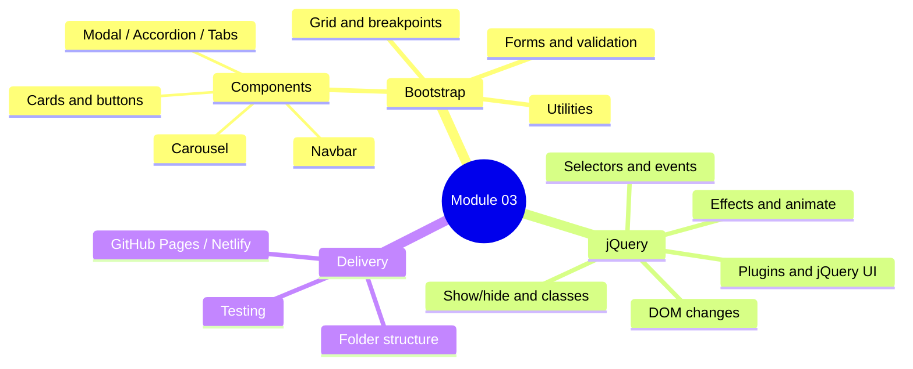

# Session 08: Practice Lab and Module Review

> Module: Bootstrap and jQuery for Responsive Web Pages · Term 1 (CPISM) · ⏱ ~2 hours

## 🎯 Learning Objectives

By the end of this session you will be able to:

- Recall the key Bootstrap and jQuery ideas from Sessions 01 to 07
- Read custom `data-*` attributes with jQuery's `.data()`
- Build a category filter and a live search for a list of cards
- Animate numbers with `animate()` and a `step` function
- Plan and start the module mini-project ("Karachi Café")

## 📖 Concepts Explained

### 1. Module map



### 2. Quick revision table

| Need | Bootstrap answer | jQuery answer |
|------|------------------|---------------|
| Two columns on tablet, one on phone | `col-12 col-md-6` | |
| Hide on phone | `d-none d-md-block` | `.hide()` (any size) |
| Popup box | `.modal` + `data-bs-toggle` | `bootstrap.Modal...show()` from a handler |
| Collapsible text | `.collapse` / accordion | `.slideToggle()` |
| Change style on click | | `.toggleClass()` |
| Add an item to a list | | `.append()` / `.prepend()` |
| Form error style | `is-invalid` + `invalid-feedback` | check value, toggle the class |

### 3. Custom data attributes
HTML lets you store your own information on any element with `data-` attributes. jQuery reads them with `.data()`:

```html
<button data-filter="drink">Drinks</button>
```
```js
$(this).data("filter");   // "drink"
```

Numbers are converted automatically: `data-target="12"` → `12` (a number). This is a clean way to connect buttons to the items they control, without writing a separate function for each button.

### 4. Filter vs search

| Feature | Input | Logic |
|---------|-------|-------|
| Filter | Button with `data-filter` | Hide all → show items whose `data-category` matches |
| Search | Text box (`input` event) | For each item, show it if its text includes the typed word |

Both use `.each()` or attribute selectors like `.item[data-category="food"]`.

### 5. Animating a number
`animate()` normally changes CSS, but it can animate **any object property**. We animate `{ value: 0 }` to `{ value: 900 }` and on every `step` write the current number into the page.

## 💻 Code Examples

### Example 1: `index.html`
📄 Open [`index.html`](index.html). It contains three counters with `data-target`, three filter buttons with `data-filter`, a search box, and six menu cards with `data-category="drink"` or `"food"`.

### Example 2: `app.js`

📄 Saved in this folder as [`app.js`](app.js).

```javascript
$(function () {

  // ---------- 1. Category filter ----------
  $("#filters button").on("click", function () {
    const category = $(this).data("filter");      // reads data-filter="..."

    // Button styles: make only the clicked one dark
    $("#filters button").removeClass("btn-dark").addClass("btn-outline-dark");
    $(this).removeClass("btn-outline-dark").addClass("btn-dark");

    if (category === "all") {
      $(".item").fadeIn(200);
    } else {
      $(".item").hide();                                        // hide everything
      $('.item[data-category="' + category + '"]').fadeIn(200); // show matching
    }
  });

  // ---------- 2. Live search ----------
  $("#search").on("input", function () {
    const word = $(this).val().toLowerCase();
    let visibleCount = 0;

    $(".item").each(function () {
      const itemText = $(this).text().toLowerCase();
      if (itemText.includes(word)) {
        $(this).show();
        visibleCount++;
      } else {
        $(this).hide();
      }
    });

    // Show the message only when nothing matched
    $("#noResults").toggle(visibleCount === 0);
  });

  // ---------- 3. Counters that count up once ----------
  $(".counter").each(function () {
    const counter = $(this);
    const target = counter.data("target");        // reads data-target="..."

    // animate() can animate ANY number, not just CSS
    $({ value: 0 }).animate({ value: target }, {
      duration: 1500,
      step: function (now) {
        counter.text(Math.floor(now));            // update text on every frame
      },
      complete: function () {
        counter.text(target);                     // make sure we end on the exact number
      }
    });
  });

});
```

**How it works**

1. **Filter:** reads the button's category, switches button styles, then hides all items and fades in the matching ones with an attribute selector.
2. **Search:** lowercases both the typed word and each card's text so "COFFEE" finds "Cold Coffee"; counts visible cards and toggles the "No items found" message.
3. **Counters:** for each `.counter`, animates a plain object from 0 to its target; `step` updates the text and `complete` sets the exact final number.

### Example 3: Self-review
📄 [`review-checklist.md`](review-checklist.md) lists every skill from this module. Rate yourself honestly and revisit weak sessions.

## 🧪 Lab Practice

1. Add two more items to the menu, including a new category "dessert", and a "Desserts" filter button.
2. Make the search work **together** with the filter (search only inside the selected category).
3. Wrap the page with a Bootstrap navbar and a footer from earlier sessions.
4. Start the counters only when the counter row scrolls into view (hint: compare `$(window).scrollTop()` with the row's `offset().top`, and use a flag so it runs once).
5. Add an "Order" button on each card that opens one shared Bootstrap modal showing that item's name (read it with `.closest(".card")`).

## 📝 Assignment

**Module mini-project: Karachi Café one-page website.** Combine everything: responsive navbar, hero, menu grid with filter and search, carousel gallery, FAQ accordion, "Book a Table" form (name, phone, date with jQuery UI Datepicker) validated with jQuery and Bootstrap styles, smooth scrolling, back-to-top button, and deployment to GitHub Pages or Netlify. Submit the repository link and the live link. See the [module README](../README.md#module-mini-project) for the full brief.

## ❓ Quick Quiz

**Q1.** What does `$(this).data("filter")` read from `<button data-filter="food">`?

- a) `"data-filter"`
- b) `"food"`
- c) `undefined`
- d) The button text

**Q2.** Which selector matches items whose `data-category` is `drink`?

- a) `.item#drink`
- b) `.item[data-category="drink"]`
- c) `.item.drink`
- d) `item:drink`

**Q3.** Which Bootstrap class combination gives 2 cards per row on phones and 4 on large screens?

**Q4.** Name the jQuery method that runs a function once for every element in a selection.

**Q5.** How do you open a Bootstrap modal without any JavaScript of your own?

<details>
<summary>Show answers</summary>

1. b) `"food"`
2. b) `.item[data-category="drink"]`
3. `col-6 col-lg-3`
4. `.each()`
5. A button with `data-bs-toggle="modal"` and `data-bs-target="#modalId"`.

</details>

## 💼 Interview Questions

**1. What are `data-*` attributes and why are they useful?**

<details>
<summary>Model answer</summary>

Custom attributes for storing extra information on HTML elements. JavaScript reads them (`dataset` or jQuery `.data()`), so one generic handler can work for many elements without hard-coding.

</details>

**2. How would you build a live search over a list of cards?**

<details>
<summary>Model answer</summary>

Listen to the input event, lowercase the query, loop over the cards, compare each card's text with `includes()`, show or hide it, and show a "no results" message if none match.

</details>

**3. When would you choose plain JavaScript over jQuery today?**

<details>
<summary>Model answer</summary>

For new projects where modern browser APIs (`querySelector`, `classList`, `fetch`) are enough, to avoid an extra library. jQuery remains useful in existing codebases, WordPress and when using jQuery plugins.

</details>

## ✅ Summary

- Bootstrap = layout, components, utilities; jQuery = behaviour.
- `data-*` + `.data()` connect controls to content cleanly.
- Filters use attribute selectors; search loops with `.each()`.
- `animate()` can count numbers with a `step` function.
- Finish and deploy the Karachi Café mini-project.

---

[⬅ Previous](../Session-07-Integrating-Bootstrap-and-jQuery-and-Deployment/README.md) · [🏠 Module Home](../README.md) · [Next ➡](../../04-Distributed-Version-Control-with-Git/README.md)

Prepared by Zeeshan Abbas · Aptech Learning North Nazimabad
