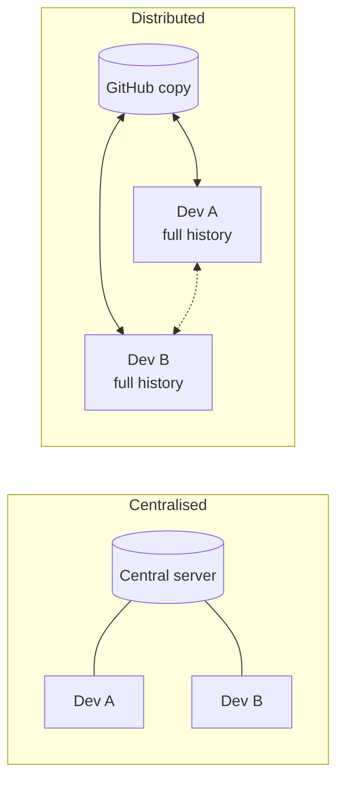
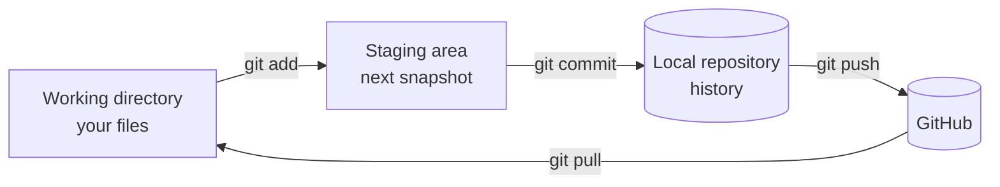

# Session 01: Version Control, Git and GitHub Basics

> Module: Distributed Version Control with Git · Term 1 (CPISM) · ⏱ ~2 hours

## 🎯 Learning Objectives

By the end of this session you will be able to:

- Explain what version control is and the problems it solves
- Compare local, centralised and distributed version control systems
- Explain the difference between Git and GitHub, and name key GitHub features
- Install and configure Git, and create a GitHub account
- Create a repository with the command line, make a first commit, push it and clone a repository

## 📖 Concepts Explained

### 1. The problem
Have you ever had files like `project-final.html`, `project-final-2.html`, `project-final-REAL.html`? Now imagine five students editing the same files and sending them on WhatsApp. Work gets lost and nobody knows which copy is correct.

A **version control system (VCS)** records every change to your files over time, who made it and why. You can go back to any earlier version, compare versions, and many people can work on the same project safely.

> 🎮 **Analogy:** Version control is like **save points in a video game**. Each commit is a save point; if something goes wrong you load an earlier save.

### 2. Evolution of version control

| Type | How it works | Example | Weakness |
|------|--------------|---------|----------|
| Local | Versions kept on one computer | Copying folders, RCS | No teamwork, disk failure loses all |
| Centralised (CVCS) | One central server holds history; users check out files | SVN, Perforce | Server down = nobody can commit |
| Distributed (DVCS) | **Every** developer has the full history | **Git**, Mercurial | Takes a little longer to learn |



Git was created in 2005 by **Linus Torvalds** to manage the Linux kernel. Today it is the most used VCS in the world.

### 3. Git vs GitHub

| Git | GitHub |
|-----|--------|
| A **program** installed on your computer | A **website / cloud service** |
| Tracks changes, works offline | Stores repositories online, works in the browser |
| Commands: `git add`, `git commit` | Features: Issues, Pull Requests, Actions, Pages |
| Free and open source | Free plan + paid plans (owned by Microsoft) |

Other Git hosting sites: GitLab, Bitbucket. Git works with all of them.

### 4. Important words

| Term | Meaning |
|------|---------|
| Repository (repo) | A project folder tracked by Git (contains a hidden `.git` folder) |
| Commit | A saved snapshot with a message, author and unique ID (hash) |
| Remote | A copy of the repo on another computer, usually GitHub; default name `origin` |
| Push / Pull | Send commits to the remote / get new commits from it |
| Clone | Download a full copy of a remote repo |
| Issue | A task or bug report on GitHub |
| Pull Request (PR) | A request to merge your changes, with review and discussion |

### 5. The three areas of Git



You **edit** in the working directory, **choose** what to save with `git add`, and **save** with `git commit`. Session 02 practises this cycle in depth.

### 6. HTTPS vs SSH
Both connect your computer to GitHub. **HTTPS** is easiest: on first push a browser window asks you to sign in (Git Credential Manager remembers it). **SSH** uses a key pair; once the public key is added to GitHub you never type a password.

## 💻 Code Examples

### Example 1: One-time setup

📄 Saved in this folder as [`01-setup-git.sh`](01-setup-git.sh).

```bash
#!/usr/bin/env bash
# One-time Git setup on a new computer. Run these in Git Bash (Windows) or Terminal (Mac/Linux).

# 1. Check Git is installed
git --version

# 2. Tell Git who you are (this name/email is stamped on every commit)
git config --global user.name "Ayesha Khan"
git config --global user.email "ayesha@example.com"   # use the SAME email as your GitHub account

# 3. Name the first branch "main" in every new repository
git config --global init.defaultBranch main

# 4. Use VS Code as the editor for commit messages
git config --global core.editor "code --wait"

# 5. See all your settings
git config --list

# 6. (Optional) Create an SSH key so you can push without typing a password
ssh-keygen -t ed25519 -C "ayesha@example.com"   # press Enter to accept the defaults
cat ~/.ssh/id_ed25519.pub                        # copy this line into GitHub → Settings → SSH and GPG keys
ssh -T git@github.com                            # test: "Hi <username>! You've successfully authenticated"
```

**How it works**

- `--global` saves settings for every repository on this computer.
- The commit email should match your GitHub email so commits are linked to your profile.
- The SSH part is optional; `ed25519` is the modern, recommended key type.

### Example 2: First repository and first push

📄 Saved in this folder as [`02-first-repo.sh`](02-first-repo.sh).

```bash
#!/usr/bin/env bash
# Create a project, save it with Git, and push it to GitHub.

# 1. Make a folder and go inside it
mkdir my-website
cd my-website

# 2. Turn the folder into a Git repository (creates a hidden .git folder)
git init

# 3. Create a file
echo "<h1>Hello Git</h1>" > index.html

# 4. Ask Git what changed (index.html is "untracked")
git status

# 5. Put the file in the staging area (the "box" for the next snapshot)
git add index.html

# 6. Save the snapshot with a message
git commit -m "feat: add home page"

# 7. See the history
git log --oneline

# 8. Connect to an EMPTY repository you created on github.com
#    (replace YOUR-USERNAME; use the SSH URL git@github.com:... if you set up SSH)
git remote add origin https://github.com/YOUR-USERNAME/my-website.git

# 9. Upload. -u remembers "origin main" so next time just type: git push
git push -u origin main
```

**How it works**

- `git init` creates the `.git` folder where all history is stored. Never delete it.
- `git status` is your best friend: run it often to see what Git sees.
- On github.com, create the repo **without** a README so it is empty, then copy its URL into `git remote add`.

### Example 3: Cloning

📄 Saved in this folder as [`03-clone-repo.sh`](03-clone-repo.sh).

```bash
#!/usr/bin/env bash
# Download (clone) an existing repository from GitHub.

# Option A: HTTPS - works everywhere, GitHub asks you to sign in on first push
git clone https://github.com/octocat/Hello-World.git

# Option B: SSH - needs the SSH key from 01-setup-git.sh
git clone git@github.com:octocat/Hello-World.git hello-ssh   # last word = folder name

# Go inside and look around
cd Hello-World
git log --oneline     # full history came with the clone
git remote -v         # "origin" points back to GitHub automatically
```

**How it works**

- `clone` downloads all files **and** the whole history, and sets `origin` for you.
- `octocat/Hello-World` is GitHub's official public practice repository.

### Example 4: `.gitignore`

📄 Saved in this folder as [`sample.gitignore`](sample.gitignore).

```gitignore
# Rename this file to .gitignore and put it in the ROOT of your project.
# Each line is a pattern. Matching files are NOT tracked by Git.

# Operating system junk
.DS_Store
Thumbs.db

# Editor settings
.vscode/

# Dependencies (can be re-downloaded with npm install)
node_modules/

# Secrets - NEVER commit passwords or API keys
.env

# Log and build output
*.log
dist/
```

**How it works**

- Git skips files that match these patterns, so secrets and junk never reach GitHub.
- GitHub can create one for you: **Add .gitignore** when creating a new repo.

### The same thing with GitHub Desktop (GUI)
**File → New repository** → name and local path → **Create**. Edit a file, write a summary in the bottom-left box → **Commit to main** → **Publish repository**.

## 🧪 Lab Practice

1. Install Git, open Git Bash and run every command in `01-setup-git.sh` (with your own name and email).
2. Create a free GitHub account; turn on two-factor authentication in Settings.
3. Follow `02-first-repo.sh` to push a one-page site to a new repo called `my-website`.
4. Edit `index.html` on github.com (pencil icon), commit there, then run `git pull` on your PC and check the file changed.
5. Clone `octocat/Hello-World` with HTTPS and run `git log --oneline`.

## 📝 Assignment

Create a public repository `about-me` containing `index.html` (a short profile page), a `README.md` describing the project, and a `.gitignore`. Make at least **3 commits** from the command line, push them, and submit the repo link plus a screenshot of `git log --oneline`.

## ❓ Quick Quiz

**Q1.** Which type of VCS gives every developer the complete history?

- a) Local
- b) Centralised
- c) Distributed
- d) Cloud-only

**Q2.** Which command turns a folder into a Git repository?

- a) `git start`
- b) `git init`
- c) `git new`
- d) `git create`

**Q3.** Is GitHub the same as Git? Explain in one line.

**Q4.** What is the default name of the remote created by `git clone`?

**Q5.** What does `git add` do?

<details>
<summary>Show answers</summary>

1. c) Distributed
2. b) `git init`
3. No. Git is the version control program; GitHub is a website that hosts Git repositories and adds collaboration features.
4. `origin`
5. Moves changes into the staging area so they will be included in the next commit.

</details>

## 💼 Interview Questions

**1. What is the difference between centralised and distributed version control?**

<details>
<summary>Model answer</summary>

In centralised systems the full history lives on one server and clients need it to commit. In distributed systems every clone has the full history, so you can commit, branch and view logs offline, and any copy can restore the project.

</details>

**2. What is a commit?**

<details>
<summary>Model answer</summary>

A snapshot of the staged files at a point in time, with an author, date, message and a unique SHA hash that points to its parent commit.

</details>

**3. Why should you never commit a `.env` file?**

<details>
<summary>Model answer</summary>

It usually holds secrets such as API keys and passwords. Once pushed, they stay in the history and can be stolen, so list `.env` in `.gitignore`.

</details>

## ✅ Summary

- Version control records every change and allows teamwork and undo.
- Git is distributed: every clone has the full history.
- Git is the tool; GitHub hosts repos and adds Issues, PRs, Actions and Pages.
- Cycle: edit → `git add` → `git commit` → `git push`.
- Use `.gitignore` to keep junk and secrets out of the repo.

---

[⬅ Previous](../README.md) · [🏠 Module Home](../README.md) · [Next ➡](../Session-02-Practice-Lab-Git-Essentials/README.md)

Prepared by Zeeshan Abbas · Aptech Learning North Nazimabad
