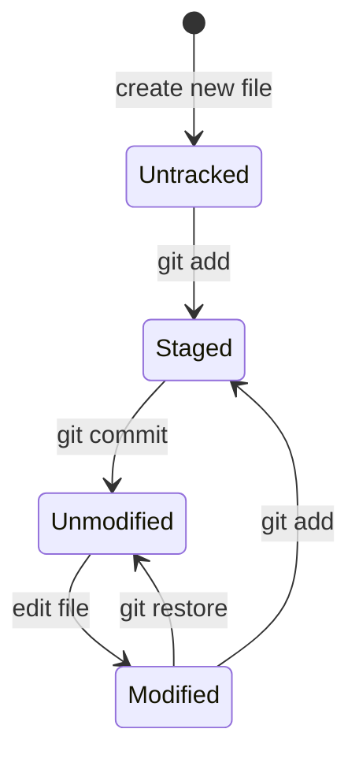

# Session 02: Practice Lab: Git Essentials and Commit Management

> Module: Distributed Version Control with Git · Term 1 (CPISM) · ⏱ ~2 hours

## 🎯 Learning Objectives

By the end of this lab you will be able to:

- Describe the life cycle of a file in Git: untracked, modified, staged, committed
- Use `status`, `add`, `commit`, `diff` and `log` confidently
- Write clear commit messages using the Conventional Commits style
- Keep your computer and GitHub in sync with `push`, `fetch` and `pull`
- Undo mistakes with `restore`, `commit --amend`, `revert` and `reset`, and know which is safe when

## 📖 Concepts Explained

### 1. File life cycle



| State | `git status -s` shows | Meaning |
|-------|-----------------------|---------|
| Untracked | `??` | Git has never seen this file |
| Modified | ` M` (red) | Changed since last commit, not staged |
| Staged | `M ` / `A ` (green) | Will go into the next commit |
| Unmodified | *(nothing)* | Same as the last commit |

> 📦 **Analogy:** The staging area is a **parcel box**. You put chosen items in (`git add`), seal and label it (`git commit -m`), and send it by courier (`git push`).

### 2. Why stage at all?
Staging lets you split work into **small, logical commits**. If you fixed a bug *and* added a page, commit them separately. Small commits are easier to review and to undo.

### 3. Writing good commit messages
Your history is a diary that other people read. Use the format `type: short summary` (e.g. `feat: add gallery page`). See [`commit-message-guide.md`](commit-message-guide.md) for types and examples.

### 4. `.gitignore` reminder
Files listed in `.gitignore` never show as untracked. If a file was already committed, adding it to `.gitignore` is not enough; remove it from tracking with `git rm --cached file`.

### 5. Branches in one minute
A **branch** is a separate line of work. `main` is the default. You will master branches in Session 03; for now learn three commands:

| Command | Does |
|---------|------|
| `git branch` | List branches (`*` marks the current one) |
| `git switch -c feature-x` | Create a new branch and move to it (older form: `git checkout -b feature-x`) |
| `git switch main` | Go back to main |

### 6. fetch vs pull

| Command | Downloads commits | Changes your files |
|---------|-------------------|--------------------|
| `git fetch` | ✅ | ❌ (just updates `origin/main`) |
| `git pull` | ✅ | ✅ (fetch + merge) |

### 7. Undo toolbox

| Situation | Command | Safe after push? |
|-----------|---------|------------------|
| Discard unstaged edits | `git restore file` | ✅ (local only) |
| Unstage a file | `git restore --staged file` | ✅ |
| Fix last commit message / add a file | `git commit --amend` | ❌ rewrites history |
| Undo a pushed commit | `git revert <hash>` | ✅ adds a new commit |
| Remove local commits | `git reset --soft HEAD~1` (or `--hard`) | ❌ rewrites history |

**Rule:** if it is already on GitHub, use `revert`. `reset --hard` deletes work, so double-check first.

## 💻 Code Examples

### Example 1: The daily cycle

📄 Saved in this folder as [`01-daily-cycle.sh`](01-daily-cycle.sh).

```bash
#!/usr/bin/env bash
# The everyday Git cycle. Run inside your project folder (e.g. my-website).

# 1. Make two changes
echo "<p>About me</p>" > about.html        # new file  -> "untracked"
echo "<p>Welcome!</p>" >> index.html        # edit file -> "modified"

# 2. What changed?
git status                 # long view
git status -s              # short view: ?? = untracked, M = modified

# 3. See the exact lines that changed (only for tracked files)
git diff

# 4. Stage ONE file and commit it
git add about.html
git commit -m "feat: add about page"

# 5. Stage everything else and commit
git add .                  # "." = all changes in this folder
git commit -m "style: add welcome text to home page"

# 6. Read the history
git log                    # full details
git log --oneline          # one line per commit
git log --oneline --graph --all   # with a branch drawing

# 7. Look at one commit (copy a short hash from the log)
# git show a1b2c3d
```

**How it works**

- Two changes are committed **separately** by staging one file first, then the rest.
- `git diff` shows unstaged line changes; `git log --oneline --graph --all` draws history.

### Example 2: Syncing with GitHub

📄 Saved in this folder as [`02-push-pull-fetch.sh`](02-push-pull-fetch.sh).

```bash
#!/usr/bin/env bash
# Keeping your computer and GitHub in sync.

# Send your new commits to GitHub
git push                        # same as: git push origin main (after the first -u)

# Download new commits WITHOUT changing your files
git fetch
git status                      # "Your branch is behind 'origin/main' by 1 commit"
git log --oneline main..origin/main   # list the commits you do not have yet

# Download AND merge them into your files
git pull                        # = git fetch + git merge

# Golden rule for beginners: pull before you start work, push when you finish.
```

**How it works**

- `fetch` lets you **look before you merge**; `main..origin/main` lists commits on GitHub that you do not have.
- `pull` brings them into your files.

### Example 3: Undoing mistakes

📄 Saved in this folder as [`03-undo-changes.sh`](03-undo-changes.sh).

```bash
#!/usr/bin/env bash
# Undoing mistakes - from safest to most dangerous.

# A. Throw away edits in a file you have NOT staged yet
git restore index.html

# B. Unstage a file (keep your edits, just take it out of the box)
git restore --staged index.html

# C. Fix the LAST commit message, or add a forgotten file to it
git add forgotten.css
git commit --amend -m "feat: add home page with styles"
#    ⚠️ Only amend commits you have NOT pushed yet.

# D. Undo a commit that is ALREADY on GitHub: make a new "opposite" commit
git revert HEAD                 # HEAD = the latest commit; history is kept
git push

# E. Move back in LOCAL history (commits not pushed yet)
git reset --soft HEAD~1         # undo commit, keep changes staged
git reset HEAD~1                # undo commit, keep changes in files (default --mixed)
git reset --hard HEAD~1         # ⚠️ undo commit AND delete the changes
```

**How it works**

- Sections A and B are everyday, harmless fixes.
- `--amend` replaces the last commit, so only use it before pushing.
- `revert` is the team-safe undo: it adds a new commit that cancels an old one.
- `HEAD~1` means "one commit before the latest".

## 🧪 Lab Practice

Use your `my-website` repo from Session 01. Run `git status` after **every** step.

1. Create `about.html` and `css/style.css`. Commit them as **two separate commits** with good messages.
2. Add a `.gitignore` that ignores `*.log`; create `debug.log` and prove Git ignores it.
3. Make a typo in a commit message, then fix it with `git commit --amend -m "..."`.
4. Edit `index.html` on github.com, then on your PC run `git fetch`, `git status`, and finally `git pull`.
5. Commit a "bad" change, push it, then undo it with `git revert HEAD` and push again. Look at the history on GitHub.
6. Create a branch `test-branch` with `git switch -c`, make one commit, switch back to `main`, and notice the file change disappears.

## 📝 Assignment

In a new repo `git-diary`, make **8 commits** that tell a small story (create page, add style, fix typo, revert something, etc.). Use at least four commit types (`feat`, `fix`, `docs`, `style`, `chore`). Include one `revert` commit. Submit the repo link and the output of `git log --oneline` in your README.

## ❓ Quick Quiz

**Q1.** What does `??` mean in `git status -s`?

- a) Conflict
- b) Untracked file
- c) Deleted file
- d) Staged file

**Q2.** Which command is safe to undo a commit that is already pushed?

- a) `git reset --hard`
- b) `git commit --amend`
- c) `git revert`
- d) `git restore`

**Q3.** What is the difference between `git fetch` and `git pull`?

**Q4.** Rewrite this commit message properly: `changes`

**Q5.** Which command creates a branch and switches to it in one step?

<details>
<summary>Show answers</summary>

1. b) Untracked file
2. c) `git revert`
3. `fetch` only downloads commits; `pull` downloads and merges them into your working files.
4. Something specific, e.g. `fix: correct footer email link`.
5. `git switch -c <name>` (or `git checkout -b <name>`).

</details>

## 💼 Interview Questions

**1. Explain `git reset` vs `git revert`.**

<details>
<summary>Model answer</summary>

`reset` moves the branch pointer back and can drop commits, rewriting history; good for local cleanup. `revert` creates a new commit that undoes an earlier one, keeping history intact; safe for shared branches.

</details>

**2. What is the staging area and why is it useful?**

<details>
<summary>Model answer</summary>

An intermediate area (the index) holding changes chosen for the next commit. It lets you build focused, logical commits from a messy working directory.

</details>

**3. What makes a good commit message?**

<details>
<summary>Model answer</summary>

A short, specific summary in present tense, often with a type prefix (feat, fix, docs), plus an optional body explaining why. One logical change per commit.

</details>

## ✅ Summary

- Files move: untracked → staged → committed; modified files are re-staged.
- Commit small, logical changes with `type: summary` messages.
- `fetch` looks, `pull` merges, `push` uploads.
- Undo safely: `restore` for files, `revert` for pushed commits; `amend` and `reset` only locally.

---

[⬅ Previous](../Session-01-Version-Control-Git-and-GitHub-Basics/README.md) · [🏠 Module Home](../README.md) · [Next ➡](../Session-03-Branching-Merging-Conflicts-Rebase-and-Fork/README.md)

Prepared by Zeeshan Abbas · Aptech Learning North Nazimabad
