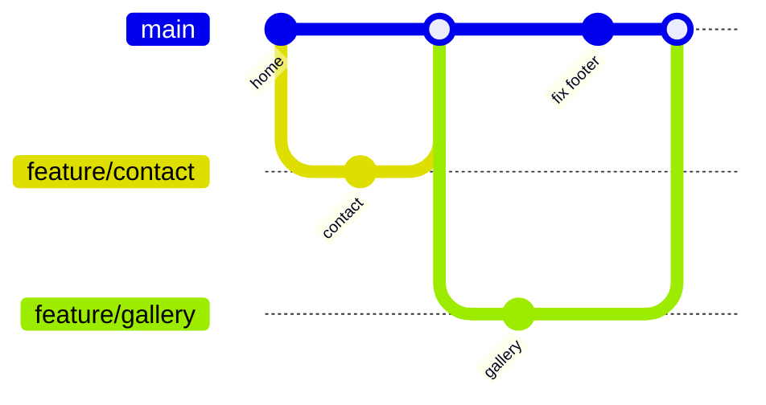

# Session 03: Branching, Merging, Conflicts, Rebase and Forks

> Module: Distributed Version Control with Git · Term 1 (CPISM) · ⏱ ~2 hours

## 🎯 Learning Objectives

By the end of this session you will be able to:

- Explain why teams use feature branches and how to name them
- Merge branches and tell a fast-forward merge from a three-way merge
- Create and resolve a merge conflict step by step
- Use rebase, squash, stash, cherry-pick and tags, and know when not to rebase
- Explain forking vs cloning and contribute to someone else's project with a pull request

## 📖 Concepts Explained

### 1. Why branches?
`main` should always contain **working** code. New work happens on a separate **branch**, so a half-finished feature never breaks the live site. When it is ready, the branch is **merged** back.

> 🌳 **Analogy:** `main` is the trunk of a tree. Each feature grows on its own branch. A finished branch is grafted back onto the trunk.

A branch is just a **movable label** pointing at a commit, so creating one is instant and costs nothing. `HEAD` is a pointer to the branch you are on now.

**Naming:** `feature/contact-form`, `fix/navbar-overlap`, `docs/readme-setup`. Lowercase, hyphens, no spaces.

### 2. Two kinds of merge



| Merge type | When it happens | Result |
|------------|-----------------|--------|
| **Fast-forward** | `main` has no new commits since the branch started | `main` label simply moves forward; no extra commit |
| **Three-way** | Both branches have new commits | Git creates a **merge commit** with two parents |

### 3. Merge conflicts
A **conflict** happens when two branches change **the same lines** of the same file (or one edits a file the other deleted). Git stops and asks you to decide. Common causes: two people editing the same section, formatting the whole file, long-lived branches.

Conflict markers:

```text
<<<<<<< HEAD
your version (current branch)
=======
their version (branch being merged)
>>>>>>> feature-branch
```

**Resolve in 4 steps:** open the file → keep the correct text and delete all three marker lines → `git add file` → `git commit`. VS Code shows buttons *Accept Current / Accept Incoming / Accept Both*; GitHub Desktop opens the file in your editor.

**Prevent conflicts:** pull often, keep branches short, commit small, talk to your team about who edits what.

### 4. Rebase
`git rebase main` takes your branch's commits and **replays** them on top of the latest `main`, giving a straight, tidy history.

| | Merge | Rebase |
|-|-------|--------|
| History | Keeps the true shape, adds a merge commit | Straight line, rewrites your commits |
| Safe on shared branches? | ✅ Yes | ❌ Only on your own, not-yet-shared branch |

**Golden rule:** never rebase commits that others already pulled. **Squashing** (`git rebase -i`) combines many small "wip" commits into one clean commit before a PR.

### 5. Other handy tools

| Tool | Use it when |
|------|------------|
| `git stash` / `stash pop` | You must switch branch but are not ready to commit |
| `git cherry-pick <hash>` | You need one specific commit from another branch |
| `git tag -a v1.0.0` | Marking a release version |
| `git mv` / `git rm` | Renaming or deleting tracked files so Git records it cleanly |

### 6. Fork vs clone

| Clone | Fork |
|-------|------|
| A copy on **your computer** | A copy on **your GitHub account** |
| Git command | GitHub button |
| Used for repos you can push to | Used for repos you **cannot** push to (open source) |

The fork workflow: fork → clone your fork → branch → commit → push to your fork → open a **pull request** to the original.

## 💻 Code Examples

> These scripts assume `init.defaultBranch` is `main` (set in Session 01). Scripts 01 and 02 are safe to run: they build a fresh practice folder.

### Example 1: Branch and fast-forward merge

📄 Saved in this folder as [`01-branch-and-merge.sh`](01-branch-and-merge.sh).

```bash
#!/usr/bin/env bash
# Feature branch -> merge back into main. Safe to run: it works in a new practice folder.
set -e
mkdir -p branch-demo && cd branch-demo
git init -q

# 1. A first commit on main
echo "<h1>Home</h1>" > index.html
git add . && git commit -q -m "feat: add home page"

# 2. Create a feature branch and switch to it
git switch -c feature/contact

# 3. Work on the branch
echo "<h1>Contact</h1>" > contact.html
git add . && git commit -q -m "feat: add contact page"

# 4. Go back to main: contact.html is NOT here yet
git switch main
ls

# 5. Merge the feature into main.
#    main has no new commits, so Git just moves main forward = "fast-forward" merge
git merge feature/contact
ls

# 6. Delete the finished branch and view history
git branch -d feature/contact
git log --oneline --graph
```

**How it works**

- `contact.html` exists only on the feature branch until the merge.
- Because `main` did not move, the merge is a fast-forward.

### Example 2: A conflict on purpose

📄 Saved in this folder as [`02-merge-conflict-demo.sh`](02-merge-conflict-demo.sh).

```bash
#!/usr/bin/env bash
# Create a merge conflict ON PURPOSE, so you learn to fix it calmly.
mkdir -p conflict-demo && cd conflict-demo
git init -q

# 1. Starting point: one line of text
echo "Welcome to our website" > welcome.txt
git add . && git commit -q -m "feat: add welcome text"

# 2. Branch "ali" changes the SAME line
git switch -q -c ali
echo "Welcome to Ali's website" > welcome.txt
git commit -q -am "feat: personalise welcome (Ali)"

# 3. Meanwhile main also changes that SAME line
git switch -q main
echo "Welcome to the Tech Club website" > welcome.txt
git commit -q -am "feat: rename to Tech Club"

# 4. Merge -> CONFLICT, because Git cannot choose between the two lines
git merge ali

# 5. Look at the file. Git added markers:
#    <<<<<<< HEAD          (your branch: main)
#    Welcome to the Tech Club website
#    =======
#    Welcome to Ali's website
#    >>>>>>> ali           (the branch being merged)
cat welcome.txt

# 6. FIX: write the final text you want and delete ALL marker lines
echo "Welcome to the Tech Club website by Ali" > welcome.txt

# 7. Tell Git it is solved, then finish the merge
git add welcome.txt
git commit -q -m "merge: combine welcome text from ali"
git log --oneline --graph
```

**How it works**

- Both branches edit line 1 of `welcome.txt`, so `git merge ali` stops with `CONFLICT`.
- We write the final text (removing the markers), `git add` it and commit; the graph shows a three-way merge.

### Example 3: Rebase, squash, stash, cherry-pick, tags

📄 Saved in this folder as [`03-rebase-stash-tag.sh`](03-rebase-stash-tag.sh).

```bash
#!/usr/bin/env bash
# Advanced everyday commands. Read each block; run them in your own practice repo.

# ---------- Rebase: replay my branch on top of the latest main ----------
git switch feature/gallery
git rebase main                 # my commits now sit after main's newest commit (straight line)
# If a conflict appears: fix the file, then
#   git add <file>  and  git rebase --continue      (or git rebase --abort to cancel)

# ---------- Squash: combine my last 3 commits into one (before pushing) ----------
git rebase -i HEAD~3            # in the editor, change "pick" to "squash" on lines 2 and 3

# ---------- Stash: park unfinished work to switch branch quickly ----------
git stash                       # saves changes and cleans the working folder
git switch main                 # do something urgent...
git switch feature/gallery
git stash pop                   # bring the parked changes back
git stash list                  # see all stashes

# ---------- Cherry-pick: copy ONE commit from another branch ----------
git switch main
git cherry-pick a1b2c3d         # replace with a real hash from git log

# ---------- Tags: mark a release ----------
git tag -a v1.0.0 -m "First release"
git push origin v1.0.0
git tag                         # list tags

# ---------- Move, rename and delete files with Git ----------
git mv old-name.html new-name.html
git rm unused.html
git commit -m "chore: rename and remove pages"

# ---------- Clean up branches ----------
git branch --merged             # branches already merged into the current one
git branch -d feature/gallery   # delete local branch
git push origin --delete feature/gallery   # delete it on GitHub
```

**How it works**

- Read it as a recipe card; replace branch names and hashes with ones from your repo.
- `rebase --abort` always takes you back to safety if a rebase goes wrong.

### Example 4: Fork and pull request

📄 Saved in this folder as [`04-fork-workflow.sh`](04-fork-workflow.sh).

```bash
#!/usr/bin/env bash
# Contribute to a project you do NOT own (open-source style).

# 1. On github.com open the project and click "Fork" -> a copy appears under YOUR account.

# 2. Clone YOUR fork (not the original)
git clone https://github.com/YOUR-USERNAME/class-website.git
cd class-website

# 3. Remember the original project as "upstream"
git remote add upstream https://github.com/TEACHER-USERNAME/class-website.git
git remote -v                   # origin = your fork, upstream = original

# 4. Work on a branch
git switch -c fix/typo-in-footer
# ...edit files...
git commit -am "fix: correct spelling in footer"

# 5. Push the branch to YOUR fork
git push -u origin fix/typo-in-footer

# 6. On github.com click "Compare & pull request" -> describe the change -> Create pull request.

# 7. Later, keep your fork up to date with the original
git switch main
git fetch upstream
git merge upstream/main
git push origin main
```

**How it works**

- `origin` = your fork (you can push), `upstream` = the original (you can only read).
- The pull request is created on github.com, where the owner reviews and merges it.

## 🧪 Lab Practice

1. Run `01-branch-and-merge.sh` and `02-merge-conflict-demo.sh` in Git Bash. Read every line of output.
2. In `conflict-demo`, create another conflict yourself and solve it in **VS Code** using the Accept buttons.
3. Make a three-way merge: create `feature/footer`, commit on it, commit something different on `main`, then merge. Check `git log --oneline --graph`.
4. Make 3 small commits on a branch and squash them into one with `git rebase -i HEAD~3`.
5. Fork `octocat/Spoon-Knife` on GitHub, clone your fork, add a file, push, and open a pull request (to your own fork's main is fine for practice).

## 📝 Assignment

Write `branching-notes.md` in your `git-diary` repo explaining (in your own words, with a screenshot each): a fast-forward merge, a three-way merge, a resolved conflict, and a stash you used. Push it using a branch `docs/branching-notes` and merge it into `main`.

## ❓ Quick Quiz

**Q1.** When does Git perform a fast-forward merge?

- a) When there is a conflict
- b) When the target branch has no new commits since the branch was created
- c) Always
- d) Only on GitHub

**Q2.** Which marker separates the two versions in a conflict?

- a) `<<<<<<<`
- b) `=======`
- c) `>>>>>>>`
- d) `-------`

**Q3.** Why should you not rebase a shared branch?

**Q4.** What is the difference between a fork and a clone?

**Q5.** Which command saves unfinished work temporarily without committing?

<details>
<summary>Show answers</summary>

1. b) When the target branch has no new commits since the branch was created
2. b) `=======`
3. Rebase rewrites commit hashes; teammates who already have the old commits get confusing duplicates and conflicts.
4. A clone is a local copy on your computer; a fork is a server-side copy of someone else's repo under your GitHub account.
5. `git stash`

</details>

## 💼 Interview Questions

**1. Merge vs rebase: which do you prefer and why?**

<details>
<summary>Model answer</summary>

Merge for shared branches because it is safe and keeps true history. Rebase for cleaning up my own local feature branch before opening a PR, to get a linear, readable history. Never rebase public commits.

</details>

**2. How do you resolve a merge conflict?**

<details>
<summary>Model answer</summary>

Run `git status` to see conflicted files, open each, decide the correct content, remove the markers, test, `git add` the files and `git commit` (or `git rebase --continue`).

</details>

**3. What is a pull request?**

<details>
<summary>Model answer</summary>

A GitHub feature that proposes merging one branch into another, showing the diff and allowing discussion, review, automated checks and approval before merging.

</details>

## ✅ Summary

- Work on feature branches; keep `main` stable.
- Fast-forward merges just move the label; three-way merges create a merge commit.
- Conflicts = same lines changed; fix, remove markers, add, commit.
- Rebase/squash only your own unshared work; stash, cherry-pick and tags help daily.
- Fork + branch + pull request is how you contribute to others' projects.

---

[⬅ Previous](../Session-02-Practice-Lab-Git-Essentials/README.md) · [🏠 Module Home](../README.md) · [Next ➡](../Session-04-Practice-Lab-Branching-and-Pull-Requests/README.md)

Prepared by Zeeshan Abbas · Aptech Learning North Nazimabad
