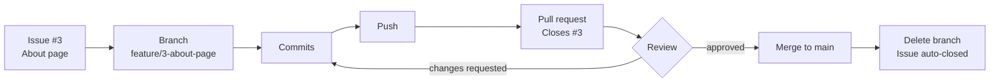

# Session 04: Practice Lab: Team Workflow with Branches and Pull Requests

> Module: Distributed Version Control with Git · Term 1 (CPISM) · ⏱ ~2 hours

## 🎯 Learning Objectives

By the end of this lab you will be able to:

- Set up a shared repository with collaborators, issues and a pull request template
- Follow the GitHub Flow: branch → commit → push → pull request → review → merge
- Review a teammate's pull request and leave useful comments
- Fix a pull request that is out of date or has conflicts
- Merge visually with GitHub Desktop and on github.com

## 📖 Concepts Explained

### 1. GitHub Flow
Most small teams use a simple workflow called **GitHub Flow**. There is one long-lived branch, `main`, and every change goes through a short-lived branch and a pull request.



### 2. Roles in today's lab (groups of 3)

| Role | Responsibility |
|------|----------------|
| **Maintainer** | Creates the repo, adds collaborators, protects `main`, merges PRs |
| **Developer A** | Builds the About page on a branch |
| **Developer B** | Builds the Services page on a branch; creates a conflict on purpose |

Everyone reviews someone else's PR. Rotate roles in the next lab.

### 3. Issues: plan before coding
An **issue** is a to-do item on GitHub. Write one issue per task, assign it to a person, and add a label (`enhancement`, `bug`, `documentation`). Writing `Closes #3` in a PR description automatically closes issue 3 when the PR is merged.

### 4. Protecting `main`
In **Settings → Branches → Add branch ruleset / protection rule** the maintainer can require a pull request (and at least one approval) before merging into `main`. Then nobody can push broken code directly. (On free private repos some rules need a paid plan; public repos have them for free.)

### 5. A good pull request

| Part | Tip |
|------|-----|
| Title | `feat: add about page` |
| Description | What and why, how you tested, screenshot, `Closes #3` |
| Size | Small: one task per PR |
| Template | Use [`pull_request_template.md`](pull_request_template.md) |

### 6. Merge options on GitHub

| Button | What it does | Use when |
|--------|--------------|----------|
| Create a merge commit | Keeps all commits + a merge commit | Default, full history |
| Squash and merge | All PR commits become one commit on `main` | Many small "wip" commits |
| Rebase and merge | Replays commits on top of `main`, no merge commit | Clean, linear history |

### 7. GitHub Desktop (visual) in 4 clicks
**Current Branch → New Branch** · make changes · **Commit to feature/...** · **Push origin → Create Pull Request**. To bring `main` into your branch: **Branch → Update from main**; conflicts open with an "Open in Visual Studio Code" button.

## 💻 Code Examples

### Example 1: The daily team routine

📄 Saved in this folder as [`01-team-workflow.sh`](01-team-workflow.sh).

```bash
#!/usr/bin/env bash
# Team workflow ("GitHub Flow") - each member repeats this for every task.

# 0. Team leader only (once): create the repo on GitHub and add members in
#    Settings -> Collaborators. Everyone else clones it:
git clone https://github.com/TEAM-LEADER/team-portfolio.git
cd team-portfolio

# 1. Always start from the newest main
git switch main
git pull

# 2. One branch per task (use the issue number in the name)
git switch -c feature/3-about-page

# 3. Work and commit in small steps
echo "<h1>About our team</h1>" > about.html
git add about.html
git commit -m "feat: add about page (#3)"

# 4. Push the branch to GitHub
git push -u origin feature/3-about-page

# 5. On github.com: "Compare & pull request" -> write description with "Closes #3"
#    -> choose a reviewer -> Create pull request.

# 6. After the PR is merged on GitHub, clean up locally
git switch main
git pull
git branch -d feature/3-about-page
```

**How it works**

- Always `pull` on `main` first so your branch starts from the newest code.
- The branch name and commit message include the issue number to keep work traceable.
- After the merge, delete the local branch to keep things tidy.

### Example 2: Updating a branch that has conflicts

📄 Saved in this folder as [`02-update-branch.sh`](02-update-branch.sh).

```bash
#!/usr/bin/env bash
# Your PR says "This branch has conflicts" or "is out-of-date with main".
# Bring the newest main into YOUR branch, fix conflicts on your computer, push again.

git switch feature/3-about-page

# 1. Get the latest commits from GitHub
git fetch origin

# 2. Merge the newest main into your branch
git merge origin/main
#    If you see CONFLICT: open the files, keep the right text, delete the markers, then:
#    git add <file>
#    git commit

# 3. Test the site in the browser, then update the pull request
git push
#    The PR updates automatically - no need to open a new one.
```

**How it works**

- Merging `origin/main` into your branch moves conflict fixing to **your** computer, where you can test.
- Pushing again updates the same PR automatically.

### Example 3: Templates
📄 [`pull_request_template.md`](pull_request_template.md): copy to `.github/pull_request_template.md` in your repo so every PR starts with the same checklist.
📄 [`review-checklist.md`](review-checklist.md): what a reviewer checks before approving.

## 🧪 Lab Practice

Work in groups of three. Take a screenshot after each step for your report.

1. **Maintainer:** create a public repo `team-portfolio` with a README, add a Bootstrap `index.html`, add the other two as collaborators, and add the PR template.
2. **Maintainer:** create three issues: "About page", "Services page", "Footer text". Assign them. Turn on a rule that requires a pull request before merging to `main`.
3. **Developers A and B:** clone, create branches named after the issues, build the pages, and open PRs with `Closes #n`.
4. **Conflict on purpose:** both developers change the **same** footer line in `index.html` on their branches. Merge A's PR first; B then fixes the conflict with `02-update-branch.sh` and pushes.
5. **Review:** each person reviews another's PR using the checklist, leaves at least one comment, and approves. The maintainer merges with **Squash and merge**. Check that the issues closed automatically.

## 📝 Assignment

Write a short lab report (`LAB-REPORT.md` in the team repo, added through a PR) with: the team roles, links to the three PRs, a screenshot of the conflict and how it was solved, and one thing each member learned. Submit the repo link.

## ❓ Quick Quiz

**Q1.** Which text in a PR description closes issue 7 when merged?

- a) `Fixes issue seven`
- b) `Closes #7`
- c) `Issue: 7`
- d) `@7`

**Q2.** Which merge button turns all PR commits into one commit?

- a) Create a merge commit
- b) Squash and merge
- c) Rebase and merge
- d) Fast merge

**Q3.** Why protect the `main` branch?

**Q4.** Your PR shows "This branch has conflicts". What do you do?

**Q5.** Name two things a reviewer should check.

<details>
<summary>Show answers</summary>

1. b) `Closes #7`
2. b) Squash and merge
3. So changes reach `main` only through reviewed pull requests, preventing broken or accidental pushes.
4. Fetch and merge the latest `main` into your branch, resolve conflicts locally, test, commit and push; the PR updates.
5. Any two: only related files changed, no secrets, code works when run, clear names, valid HTML/alt text, good description.

</details>

## 💼 Interview Questions

**1. Describe the workflow your team used for collaboration.**

<details>
<summary>Model answer</summary>

GitHub Flow: issues for tasks, a short feature branch per issue, small commits, a pull request with a template, at least one review, protected `main`, squash merge, then delete the branch.

</details>

**2. How do you give good code review feedback?**

<details>
<summary>Model answer</summary>

Be specific and polite, explain the reason, suggest a fix, separate must-fix issues from nice-to-haves, and also mention what was done well.

</details>

**3. What is the difference between "Squash and merge" and "Rebase and merge"?**

<details>
<summary>Model answer</summary>

Squash combines all PR commits into a single new commit on main. Rebase keeps each commit but replays them on top of main without a merge commit.

</details>

## ✅ Summary

- GitHub Flow: issue → branch → commits → PR → review → merge → delete branch.
- Use templates, small PRs and `Closes #n`.
- Protect `main` so every change is reviewed.
- Fix out-of-date PRs by merging `main` into your branch locally.
- Choose merge, squash or rebase merge to shape history.

---

[⬅ Previous](../Session-03-Branching-Merging-Conflicts-Rebase-and-Fork/README.md) · [🏠 Module Home](../README.md) · [Next ➡](../Session-05-GitHub-Copilot-and-GitHub-Actions-CI-CD/README.md)

Prepared by Zeeshan Abbas · Aptech Learning North Nazimabad
