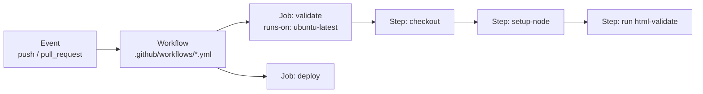

# Session 05: GitHub Copilot and GitHub Actions CI/CD

> Module: Distributed Version Control with Git · Term 1 (CPISM) · ⏱ ~2 hours

## 🎯 Learning Objectives

By the end of this session you will be able to:

- Explain what GitHub Copilot is, how it helps, and its limits
- Install Copilot in VS Code and use inline suggestions, Chat and slash commands responsibly
- Name other AI coding assistants (Amazon Q Developer, formerly CodeWhisperer; Tabnine)
- Explain CI and CD and the parts of a GitHub Actions workflow file
- Write workflows that check HTML on every pull request and deploy a site to GitHub Pages

## 📖 Concepts Explained

### 1. GitHub Copilot: an AI pair programmer
**GitHub Copilot** is an AI assistant inside your editor. It reads the code and comments around your cursor and **suggests** the next lines or whole functions. Copilot Chat answers questions about your code.

> 🧑‍✈️ **Analogy:** Copilot is the co-pilot, **you** are the pilot. It can suggest a route, but you decide where the plane goes and you are responsible if it lands in the wrong city.

| Copilot is good at | Copilot is weak at |
|--------------------|--------------------|
| Boilerplate HTML, repeated patterns | Knowing your project's real requirements |
| Explaining unfamiliar code | Always being correct or up to date |
| Writing comments, tests, commit messages | Security: it can suggest unsafe code |
| Suggesting fixes for error messages | Understanding why the business needs a feature |

**Getting it:** VS Code → Extensions → install **GitHub Copilot** (Chat is included) → sign in with GitHub. There is a free plan with monthly limits; verified students get Copilot Pro free through the **GitHub Student Developer Pack**.

**Other AI tools:** Amazon Q Developer (formerly CodeWhisperer), Tabnine, Gemini Code Assist. They work in a similar way.

### 2. CI/CD in plain words

| Term | Meaning | Example |
|------|---------|---------|
| **CI** (Continuous Integration) | Every push/PR is automatically **checked** | Validate HTML, run tests |
| **CD** (Continuous Delivery/Deployment) | Passing code is automatically **released** | Publish the site to GitHub Pages |
| **Pipeline** | The chain of automatic steps | checkout → check → build → deploy |

Without CI/CD a person must remember to test and upload manually. With CI/CD, a robot does it the same way every time.

### 3. GitHub Actions vocabulary



| Word | Meaning |
|------|---------|
| Workflow | A YAML file in `.github/workflows/` |
| Event (`on:`) | What starts it: `push`, `pull_request`, `schedule`, `workflow_dispatch` |
| Job | A group of steps that runs on one machine (**runner**) |
| Step | One command (`run:`) or one ready-made **action** (`uses:`) |
| Action | Reusable step from the Marketplace, e.g. `actions/checkout@v4` |
| Secret | Encrypted value (API key) stored in repo Settings, used as `${{ secrets.NAME }}` |

### 4. YAML in 30 seconds
YAML uses **indentation with spaces** (never tabs) to show structure. `key: value` pairs, and `-` starts a list item. One wrong space breaks the file, so copy carefully and watch the Actions tab for errors.

### 5. Netlify and Vercel
Both can connect to your GitHub repo and **redeploy automatically on every push** without writing YAML, and they create a preview link for every pull request. GitHub Actions gives you more control and keeps everything inside GitHub.

## 💻 Code Examples

> These `.yml` files only run when saved inside `.github/workflows/` at the **root** of a repository. Here they are stored as examples.

### Example 1: Hello Actions

📄 Saved in this folder as [`hello-actions.yml`](hello-actions.yml).

```yaml
# The smallest possible GitHub Actions workflow.
# Save as: .github/workflows/hello-actions.yml  (in the ROOT of your repo)

name: Hello Actions              # name shown in the "Actions" tab

on: [push]                       # WHEN: run on every push to any branch

jobs:
  say-hello:                     # a job id (any name you like)
    runs-on: ubuntu-latest       # WHERE: a fresh Linux machine from GitHub
    steps:                       # WHAT: steps run one after another
      - name: Download my code
        uses: actions/checkout@v4          # ready-made action: copies the repo onto the machine

      - name: Say hello
        run: echo "Hello from GitHub Actions! Commit by ${{ github.actor }}"

      - name: List my files
        run: ls -la
```

**How it works**

- `on: [push]` triggers it; `runs-on` asks GitHub for a Linux virtual machine.
- `uses:` runs a ready-made action; `run:` runs a shell command. `${{ github.actor }}` is the username who pushed.

### Example 2: CI that checks HTML

📄 Saved in this folder as [`ci-html-check.yml`](ci-html-check.yml).

```yaml
# CI = Continuous Integration: automatically CHECK every push and pull request.
# Save as: .github/workflows/ci-html-check.yml

name: CI - check HTML

on:
  push:
    branches: [main]
  pull_request:                  # also runs on every PR, the result shows inside the PR

jobs:
  validate:
    runs-on: ubuntu-latest
    steps:
      - name: Get the code
        uses: actions/checkout@v4

      - name: Install Node.js 20
        uses: actions/setup-node@v4
        with:
          node-version: 20

      # html-validate checks for mistakes such as unclosed tags or missing alt text.
      # If it finds an error, the step fails and the PR shows a red ❌.
      - name: Validate all HTML files
        run: npx --yes html-validate "**/*.html"
```

**How it works**

- Runs on pushes to `main` and on every pull request; a ❌ or ✅ appears next to the PR.
- `html-validate` uses its recommended rules. If it is too strict for your project (for example it flags inline `style=`), add a file `.htmlvalidate.json` with `{ "extends": ["html-validate:standard"] }`.
- Combine with branch protection: "Require status checks to pass" so broken HTML cannot be merged.

### Example 3: CD to GitHub Pages

📄 Saved in this folder as [`deploy-pages.yml`](deploy-pages.yml).

```yaml
# CD = Continuous Deployment: automatically PUBLISH the site when main changes.
# Save as: .github/workflows/deploy-pages.yml
# One-time setting: repo Settings -> Pages -> Source: "GitHub Actions".

name: Deploy site to GitHub Pages

on:
  push:
    branches: [main]
  workflow_dispatch:             # adds a "Run workflow" button for manual runs

# The workflow needs permission to publish to Pages
permissions:
  contents: read
  pages: write
  id-token: write

jobs:
  deploy:
    runs-on: ubuntu-latest
    environment:
      name: github-pages
      url: ${{ steps.deployment.outputs.page_url }}   # live link shown in the run
    steps:
      - name: Get the code
        uses: actions/checkout@v4

      - name: Set up Pages
        uses: actions/configure-pages@v5

      - name: Package the website files
        uses: actions/upload-pages-artifact@v3
        with:
          path: .                # upload the whole repo folder (index.html must be here)

      - name: Publish to GitHub Pages
        id: deployment
        uses: actions/deploy-pages@v4
```

**How it works**

- `permissions` let the job publish to Pages; set **Settings → Pages → Source → GitHub Actions** once.
- The four official actions: get code → configure Pages → upload files → deploy. The live URL appears in the run summary.

### Example 4: Copilot practice
📄 [`copilot-prompts.md`](copilot-prompts.md): inline prompts, Chat questions, slash commands (`/explain`, `/fix`, `/doc`) and rules for responsible use.

## 🧪 Lab Practice

1. Install the GitHub Copilot extension, sign in, and try three prompts from `copilot-prompts.md`. Note one suggestion you had to correct.
2. Select a function from Module 03 and use `/explain`. Then ask Copilot to generate a commit message from the Source Control panel.
3. In your `my-website` repo create `.github/workflows/hello-actions.yml`, push, and watch it run in the **Actions** tab.
4. Add `ci-html-check.yml`. Break your HTML on purpose (remove a closing tag) in a branch, open a PR and see the red ❌. Fix it and see ✅.
5. Add `deploy-pages.yml`, switch Pages source to GitHub Actions, push to `main` and open the live link.

## 📝 Assignment

In your team portfolio repo add both the CI and the deployment workflows, protect `main` so the CI check must pass, and add a status badge to your README (Actions tab → workflow → ••• → *Create status badge*). Submit the repo link, the live link and a screenshot of a failed and a passed check.

## ❓ Quick Quiz

**Q1.** Where must a GitHub Actions workflow file be saved?

- a) `/workflows/`
- b) `.github/workflows/`
- c) `.git/actions/`
- d) Anywhere

**Q2.** Which key decides what starts a workflow?

- a) `jobs:`
- b) `runs-on:`
- c) `on:`
- d) `steps:`

**Q3.** What is the difference between CI and CD?

**Q4.** Give two responsible-use rules for Copilot.

**Q5.** What is the difference between `uses:` and `run:` in a step?

<details>
<summary>Show answers</summary>

1. b) `.github/workflows/`
2. c) `on:`
3. CI automatically builds and checks every change; CD automatically releases or deploys changes that pass.
4. Any two: review and test every suggestion, never submit code you cannot explain, never paste secrets, follow AI rules and disclose use.
5. `uses:` runs a ready-made action; `run:` runs a shell command you write.

</details>

## 💼 Interview Questions

**1. What is a CI/CD pipeline and why is it valuable?**

<details>
<summary>Model answer</summary>

An automated series of steps triggered by code changes that builds, tests and deploys software. It catches errors early, makes releases repeatable, and removes manual mistakes.

</details>

**2. How do you keep secrets safe in GitHub Actions?**

<details>
<summary>Model answer</summary>

Store them as encrypted repository or environment secrets and reference them with `${{ secrets.NAME }}`; never hard-code them in the YAML or commit them. Give workflows the minimum `permissions` they need.

</details>

**3. How do you use AI coding tools in your work?**

<details>
<summary>Model answer</summary>

For boilerplate, explanations and first drafts, then I review, test and adapt everything, check for security issues, and never share confidential code or keys with the tool.

</details>

## ✅ Summary

- Copilot suggests code and answers questions; you remain responsible for correctness.
- CI checks every change; CD publishes passing changes automatically.
- Workflows live in `.github/workflows/`: `on` → `jobs` → `steps` (`uses` / `run`).
- Combine CI checks with branch protection, and deploy with GitHub Pages actions.

---

[⬅ Previous](../Session-04-Practice-Lab-Branching-and-Pull-Requests/README.md) · [🏠 Module Home](../README.md) · [Next ➡](../Session-06-Practice-Lab-and-Module-Review/README.md)

Prepared by Zeeshan Abbas · Aptech Learning North Nazimabad
