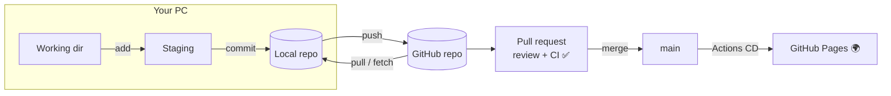

# Session 06: Practice Lab and Module Review

> Module: Distributed Version Control with Git · Term 1 (CPISM) · ⏱ ~2 hours

## 🎯 Learning Objectives

By the end of this session you will be able to:

- Recall and connect every Git and GitHub idea from Sessions 01 to 05
- Simulate a two-developer workflow on one computer using a bare repository
- Complete an end-to-end project: repo, branches, PRs, conflict, tag, release, CI and Pages
- Choose the right command for common real-life situations
- Prepare for viva and interview questions on Git

## 📖 Concepts Explained

### 1. The whole picture



### 2. Which command do I need?

| Situation | Command |
|-----------|---------|
| Start tracking a new project | `git init` |
| Get a project from GitHub | `git clone <url>` |
| See what changed | `git status`, `git diff` |
| Save my work | `git add .` → `git commit -m "..."` |
| Start a new feature safely | `git switch -c feature/name` |
| Get teammates' work | `git pull` |
| Typo in last (unpushed) commit message | `git commit --amend -m "..."` |
| Undo a commit already on GitHub | `git revert <hash>` |
| Switch branch but work is half done | `git stash` → later `git stash pop` |
| Mark version 1.0 | `git tag -a v1.0.0 -m "..."` → `git push origin v1.0.0` |
| Contribute to someone else's repo | Fork → clone → branch → push → PR |

### 3. What is a bare repository?
A **bare repository** (`git init --bare`) stores only the history, without working files. That is exactly what GitHub keeps on its servers. By creating one in a folder, you can practise push, pull and merges between two "developers" **without internet**.

### 4. Releases
A **GitHub Release** is built on a **tag**. On github.com go to **Releases → Draft a new release**, choose the tag `v1.0.0`, write notes (what is new) and publish. Releases follow **semantic versioning**: `MAJOR.MINOR.PATCH`, e.g. `1.2.3` (major = breaking change, minor = new feature, patch = bug fix).

### 5. Common mistakes and fixes

| Mistake | Fix |
|---------|-----|
| `fatal: not a git repository` | You are in the wrong folder; `cd` into the project |
| `rejected ... fetch first` on push | Someone pushed before you: `git pull`, then `git push` |
| Committed to `main` by accident (not pushed) | `git switch -c feature/x` (takes the commit with you), then reset `main` to `origin/main` |
| Pushed a secret | Revoke/rotate the key **immediately**; deleting the file is not enough |
| Huge `node_modules` committed | Add to `.gitignore`, `git rm -r --cached node_modules`, commit |

## 💻 Code Examples

### Example 1: Two developers on one PC

📄 Saved in this folder as [`team-simulation.sh`](team-simulation.sh).

```bash
#!/usr/bin/env bash
# Practise teamwork ALONE: one computer, two "developers", and a fake GitHub.
# A "bare" repository has no working files - it only stores history, just like GitHub.
set -e
mkdir -p team-sim && cd team-sim

# 1. Create the fake GitHub server
git init -q --bare server.git

# 2. Developer Sara clones it and makes the first commit
git clone -q server.git sara
cd sara
echo "<h1>Team Site</h1>" > index.html
git add . && git commit -q -m "feat: add home page"
git push -q origin main
cd ..

# 3. Developer Bilal clones the same server
git clone -q server.git bilal

# 4. Sara adds a footer and pushes first
cd sara
echo "<footer>Made by Sara</footer>" >> index.html
git commit -q -am "feat: add footer"
git push -q
cd ..

# 5. Bilal (without pulling) adds a menu on his own branch
cd bilal
git switch -q -c feature/menu
echo "<nav>Home | About</nav>" > nav.html
git add . && git commit -q -m "feat: add menu"

# 6. Before merging, Bilal gets Sara's work, then merges his branch into main
git switch -q main
git pull -q                         # brings in Sara's footer
git merge -q --no-edit feature/menu # three-way merge (both sides changed)
git push -q
cd ..

# 7. Sara pulls and now has everything
cd sara
git pull -q
echo "--- Files Sara has now:"
ls
echo "--- Shared history:"
git log --oneline --graph --all
```

**How it works**

- `server.git` plays the role of GitHub; `sara` and `bilal` are two clones.
- Sara pushes first; Bilal pulls her work before merging his branch, then pushes.
- The final graph shows a three-way merge, exactly as on a real team.

### Example 2: Cheat sheet
📄 [`git-cheatsheet.md`](git-cheatsheet.md): every command from this module on one page, plus the conflict recipe. Print it or keep it open while you work.

## 🧪 Lab Practice

**Final lab: complete the module mini-project** (groups of 2-3; see the [module README](../README.md#module-mini-project)).

1. Run `team-simulation.sh` in Git Bash and explain each output line to your partner.
2. Create the `team-portfolio` repo (or continue from Session 04) with a README, `.gitignore`, PR template and a protected `main`.
3. Each member adds a page through an issue → branch → PR → review → merge. Create and resolve at least one conflict.
4. Add the CI HTML check and the Pages deployment workflows from Session 05; make CI a required check.
5. Tag `v1.0.0`, publish a GitHub Release with notes, and add the live link and CI badge to the README.

## 📝 Assignment

Submit the team repository link and live URL, plus a one-page `REFLECTION.md` (through a PR) answering: Which Git command saved you most? Describe the conflict you solved. How did CI help? What would you do differently next time?

## ❓ Quick Quiz

**Q1.** Your push is rejected with "fetch first". What should you do?

- a) `git push --force`
- b) `git pull` then `git push`
- c) Delete the repo
- d) `git init` again

**Q2.** In version `2.4.1`, what does `4` represent?

- a) Major
- b) Minor
- c) Patch
- d) Build

**Q3.** What is a bare repository?

**Q4.** You pushed an API key to GitHub. What is the first thing to do?

**Q5.** Write the commands to create branch `fix/footer`, commit a change, and push it for the first time.

<details>
<summary>Show answers</summary>

1. b) `git pull` then `git push`
2. b) Minor
3. A repository with only Git history and no working files, used as a central/shared remote (like GitHub's copy).
4. Revoke or rotate the key at the provider immediately; then remove it from the code and history.
5. `git switch -c fix/footer` → `git add .` → `git commit -m "fix: ..."` → `git push -u origin fix/footer`

</details>

## 💼 Interview Questions

**1. Walk me through how you would add a feature to a team project using Git.**

<details>
<summary>Model answer</summary>

Pull the latest `main`, create a feature branch, commit small logical changes, push the branch, open a pull request linked to the issue, respond to review and CI feedback, merge (often squash), delete the branch and pull `main` again.

</details>

**2. Why is `git push --force` dangerous, and what is safer?**

<details>
<summary>Model answer</summary>

It overwrites remote history and can delete teammates' commits. `git push --force-with-lease` is safer because it refuses if the remote has commits you have not seen; on shared branches avoid rewriting history at all.

</details>

**3. What is the purpose of tags and releases?**

<details>
<summary>Model answer</summary>

Tags permanently mark specific commits (usually versions). Releases on GitHub add notes and downloadable assets to a tag so users know what changed in each version.

</details>

## ✅ Summary

- Git flow: edit → add → commit → push → PR → review/CI → merge → deploy.
- A bare repo lets you practise teamwork offline.
- Tags + semantic versions + GitHub Releases mark what you shipped.
- Know the fixes for common errors; never force-push shared branches.
- Next module: making your published site easy to find on search engines.

---

[⬅ Previous](../Session-05-GitHub-Copilot-and-GitHub-Actions-CI-CD/README.md) · [🏠 Module Home](../README.md) · [Next ➡](../../05-Optimize-Web-for-Search-Engines/README.md)

Prepared by Zeeshan Abbas · Aptech Learning North Nazimabad
