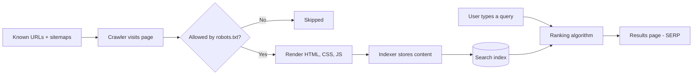

# Session 01: Search Engines and SEO Components, On-page and Off-page Optimization

> Module: Optimize Web for Search Engines (SEO) · Term 1 (CPISM) · ⏱ ~2 hours

## 🎯 Learning Objectives

By the end of this session you will be able to:

- Name the main parts of a search engine and explain crawling, indexing and ranking
- Define SEO and describe its three pillars: technical, on-page and off-page
- Read a Search Engine Results Page (SERP) and name its features
- Use Google Search settings and advanced search operators
- Explain on-page basics (keywords, title, meta description, headings, URLs, images, internal links)
- Explain off-page SEO: quality backlinks, brand mentions and social media

## 📖 Concepts Explained

### 1. What is a search engine?

A search engine is a giant **library with a very fast librarian**. The library is the *index* (a copy of billions of pages), and the librarian is the *ranking algorithm* that picks the best books for your question in less than a second.

| Component | Job | Library analogy |
|-----------|-----|-----------------|
| **Crawler** (spider, bot, e.g. Googlebot, Bingbot) | Follows links and downloads pages | Staff who collect new books |
| **Indexer** | Reads, understands and stores pages | Catalogue cards on the shelves |
| **Index** (database) | Stores words, links, images, page data | The shelves |
| **Ranking algorithm** | Orders results by relevance and quality | The librarian choosing the best book |
| **Search interface** | The search box and results page | The front desk |

### 2. Crawl → Index → Rank



- **Crawling:** bots discover pages through links and `sitemap.xml`. `robots.txt` tells them which folders not to crawl.
- **Indexing:** the page is read and stored. A `noindex` meta tag keeps a page *out* of the index.
- **Ranking:** hundreds of signals decide the order: relevance to the query, content quality, usability (mobile, speed, HTTPS), links from other sites, location and language of the searcher.

### 3. Google, Bing and others

| Engine | Notes |
|--------|-------|
| Google | Largest share in Pakistan and the world; tools: Search Console, Analytics |
| Bing | Powers Microsoft Copilot search results and Yahoo; tool: Bing Webmaster Tools; supports **IndexNow** for instant URL submission |
| Yandex, Baidu | Strong in Russia and China |
| DuckDuckGo | Privacy-focused; uses several sources including Bing |

Good SEO for Google is almost always good for Bing too.

### 4. What is SEO?

**Search Engine Optimization (SEO)** is improving a website so that it appears higher in the **organic (unpaid)** results for searches that matter to your business. Paid ads are **SEM/PPC**, not SEO.

Why it matters: most people click a result on the first page, organic clicks are free, and a well-optimized site is also faster and easier for humans.

| Pillar | Question it answers | Examples |
|--------|--------------------|----------|
| **Technical SEO** | Can search engines crawl and index my site? | HTTPS, speed, mobile, `robots.txt`, `sitemap.xml`, clean URLs |
| **On-page SEO** | Does each page clearly answer a search? | Keywords, title, meta description, headings, content, alt text |
| **Off-page SEO** | Do other people trust and talk about my site? | Backlinks, reviews, social shares, brand mentions |

> **White-hat** SEO follows search engine guidelines. **Black-hat** tricks (hidden text, keyword stuffing, bought links) can get a site penalised or removed.

### 5. Anatomy of a SERP

| Feature | What it is |
|---------|-----------|
| Sponsored results | Paid ads, marked "Sponsored" |
| Organic results | Title link (blue), URL/breadcrumb, snippet (often your meta description) |
| Featured snippet | A short direct answer box at the top |
| People also ask | Expandable related questions |
| Local pack | Map with 3 nearby businesses |
| Images, videos, top stories | Special result blocks |
| AI Overviews | AI-generated summary with source links (shown for some queries) |
| Knowledge panel | Facts about a brand, person or place on the side |

### 6. Google Search settings and advanced operators

Open **google.com → Settings → Search settings** to change SafeSearch, language, results region and personal results. Use an **Incognito** window to see results that are less personalised.

| Operator | Example | Finds |
|----------|---------|-------|
| `"..."` | `"web development course"` | Exact phrase |
| `-` | `jaguar -car` | Excludes a word |
| `OR` | `html OR css tutorial` | Either word |
| `site:` | `site:developer.mozilla.org` | Pages from one site (rough index check) |
| `intitle:` | `intitle:"seo checklist"` | Word in the page title |
| `inurl:` | `inurl:blog seo` | Word in the URL |
| `filetype:` | `seo guide filetype:pdf` | Only PDFs |
| `before:` / `after:` | `core web vitals after:2025-01-01` | Date range |
| `*` | `"best * in Karachi"` | Wildcard |

More examples are in [`search-operators.md`](search-operators.md).

### 7. On-page SEO at a glance

| Element | Best practice |
|---------|---------------|
| Keyword | One main topic per page; use it naturally in title, H1, first paragraph |
| `<title>` | Unique, 50-60 characters, keyword near the start |
| Meta description | 120-155 characters, a "mini advert" that earns the click |
| Headings | One `<h1>`, then `<h2>`/`<h3>` in order |
| URL | Short, lowercase, hyphens: `/courses/web-design` |
| Images | Descriptive `alt`, small file size, `width`/`height` set |
| Internal links | Link related pages with meaningful anchor text (not "click here") |

The `<meta name="keywords">` tag is **ignored by Google**; do not waste time on it.

### 8. Off-page SEO at a glance

A **backlink** is a link from another website to yours, like a **recommendation letter**. One letter from a respected university is worth more than 100 letters from strangers.

- Earn links with useful content, guides, tools, local news, partnerships and directories that real people use.
- Mark paid or untrusted links with `rel="sponsored"` or `rel="nofollow"`; user comments with `rel="ugc"`.
- Social media shares do not directly raise rankings, but they bring visitors, mentions and natural links.
- Avoid spam: comment spam, link farms and bought links break Google's spam policies.

## 💻 Code Examples

### Example 1: An SEO-ready page head - [`meta-tags.html`](meta-tags.html)

```html
<!DOCTYPE html>
<html lang="en">
<head>
  <meta charset="UTF-8">
  <!-- Makes the page fit mobile screens (important for mobile-first indexing) -->
  <meta name="viewport" content="width=device-width, initial-scale=1.0">
  <!-- Title: shown as the blue link in Google -->
  <title>Web Design Course in Karachi | Karachi Tech Hub</title>
  <!-- Description: often shown as the grey snippet -->
  <meta name="description" content="Learn HTML5, CSS3 and JavaScript in 3 months at Karachi Tech Hub. Small classes, real projects and evening batches in North Nazimabad.">
  <!-- Allow indexing and following links (this is the default) -->
  <meta name="robots" content="index, follow">
  <!-- The one official address of this page -->
  <link rel="canonical" href="https://www.example.com/courses/web-design">
</head>
```

**How it works**

- `title` and `description` are what searchers see first, so they must be clear and unique.
- `robots` tells crawlers what to do with this page; use `noindex` for pages like a thank-you page.
- `canonical` prevents duplicate-content confusion when the same page has several URLs.
- The full file also shows a good heading order, an image with `alt`, internal links and a `nofollow` example.

### Example 2: Crawl rules - [`robots.txt`](robots.txt)

```text
User-agent: *
Disallow: /admin/
Disallow: /cart/
Allow: /

Sitemap: https://www.example.com/sitemap.xml
```

**How it works**

- `robots.txt` lives at the root: `https://www.example.com/robots.txt`.
- `User-agent: *` means "all bots". `Disallow` blocks crawling of a folder.
- It controls **crawling**, not indexing; use `noindex` to keep a page out of results.

### Example 3: A map of your pages - [`sitemap.xml`](sitemap.xml)

```xml
<?xml version="1.0" encoding="UTF-8"?>
<urlset xmlns="http://www.sitemaps.org/schemas/sitemap/0.9">
  <url>
    <loc>https://www.example.com/</loc>
    <lastmod>2026-10-01</lastmod>
  </url>
  <url>
    <loc>https://www.example.com/courses/web-design</loc>
    <lastmod>2026-09-20</lastmod>
  </url>
</urlset>
```

**How it works**

- Each `<url>` lists one page with its full address (`<loc>`) and last change date (`<lastmod>`).
- Submit it in Google Search Console and Bing Webmaster Tools so new pages are found faster.

## 🧪 Lab Practice

1. Search `site:wikipedia.org karachi` and then `site:` with your own GitHub Pages URL. Compare how many pages are indexed.
2. Try five operators from [`search-operators.md`](search-operators.md) and write down one useful result for each.
3. Open any news site, press **Ctrl + U**, and find its `<title>`, meta description and canonical link.
4. Open [`meta-tags.html`](meta-tags.html) with Live Server, then run **Lighthouse → SEO** in Chrome DevTools. Note the score.
5. Visit `https://www.google.com/robots.txt` and `https://www.bbc.com/robots.txt`. List two folders each one blocks.

## 📝 Assignment

Choose three websites of Karachi businesses (a school, a restaurant and a shop). For each one, record in a table: title length, meta description (present? length?), number of `<h1>` tags, HTTPS (yes/no), `robots.txt` (exists?), and `sitemap.xml` (exists?). Write two improvement suggestions per site.

## ❓ Quick Quiz

**Q1.** Which step stores a page's content in the search engine's database?

- a) Crawling
- b) Indexing
- c) Ranking
- d) Rendering

**Q2.** Which file asks bots not to crawl a folder?

- a) sitemap.xml
- b) index.html
- c) robots.txt
- d) .htaccess

**Q3.** Which operator shows only pages from one website?

- a) `inurl:`
- b) `site:`
- c) `filetype:`
- d) `intitle:`

**Q4.** Give one example each of on-page and off-page SEO.

**Q5.** Why should a paid link use `rel="sponsored"`?

<details>
<summary>Show answers</summary>

1. b) Indexing
2. c) robots.txt
3. b) `site:`
4. On-page: a keyword-rich title tag. Off-page: a backlink from a respected news site.
5. Search engines' rules say paid links must be marked, so they do not pass ranking credit; unmarked paid links can lead to a penalty.

</details>

## 💼 Interview Questions

**1. Explain crawling, indexing and ranking in simple words.**

<details>
<summary>Model answer</summary>

Crawling is the bot visiting and downloading pages by following links. Indexing is understanding and storing that page in a database. Ranking is choosing and ordering the best indexed pages for a user's query.

</details>

**2. Does `robots.txt` stop a page from appearing in Google?**

<details>
<summary>Model answer</summary>

Not reliably. It stops crawling, but the URL can still be indexed if other sites link to it. To keep a page out, allow crawling and add `<meta name="robots" content="noindex">`.

</details>

**3. What makes a backlink "high quality"?**

<details>
<summary>Model answer</summary>

It comes from a trusted, relevant site, is placed naturally inside content, uses descriptive anchor text, and was earned rather than bought.

</details>

## ✅ Summary

- Search engines crawl, index and rank; SEO helps at every step.
- SEO has three pillars: technical, on-page and off-page.
- The SERP has many features beyond the ten blue links.
- Advanced operators make research fast and precise.
- Titles, descriptions, headings, URLs, alt text and internal links are the core on-page tools.
- Earn backlinks with useful content; never buy or spam them.

---

[⬅ Previous](../README.md) · [🏠 Module Home](../README.md) · [Next ➡](../Session-02-Practice-Lab-Keywords-Meta-Tags-and-Backlinks/README.md)

Prepared by Zeeshan Abbas · Aptech Learning North Nazimabad
