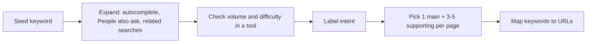

# Session 02: Practice Lab: Search Operators, Keyword Research, Meta Tags and Backlinks

> Module: Optimize Web for Search Engines (SEO) · Term 1 (CPISM) · ⏱ ~2 hours

## 🎯 Learning Objectives

By the end of this lab you will be able to:

- Find and group keywords by **search intent** (informational, navigational, commercial, transactional)
- Choose long-tail keywords and related terms for one page
- Rewrite a weak page into an optimized page (title, description, headings, URL, alt text, internal links)
- Research a competitor's backlinks with free tools and plan your own link building
- Do a quick 10-point SEO check of any web page

## 📖 Concepts Explained

### 1. Search intent: why is the person searching?

| Intent | The searcher wants to... | Example query | Best page type |
|--------|-------------------------|---------------|----------------|
| Informational | Learn something | `what is seo` | Blog post, guide |
| Navigational | Go to a known site | `github login` | Home / login page |
| Commercial | Compare before buying | `best laptop for students 2026` | Comparison, review |
| Transactional | Buy or sign up now | `web design course admission karachi` | Course / product page |

Rule: **match the page to the intent.** A sales page will not rank for "what is SEO".

### 2. Head terms vs long-tail keywords

| Type | Example | Volume | Competition | Conversion |
|------|---------|--------|-------------|------------|
| Head (short) | `web design` | Very high | Very hard | Low |
| Mid-tail | `web design course` | Medium | Hard | Medium |
| Long-tail | `evening web design course north nazimabad` | Low | Easy | High |

Beginners and small businesses should start with **long-tail** keywords. They are easier to win and bring people who are ready to act.

**Related terms (sometimes called LSI keywords):** words that naturally appear around a topic, e.g. for "web design course": *HTML, CSS, portfolio, fee, duration, certificate*. Use them naturally; they help search engines and readers understand the full topic.

### 3. The keyword research process



Free sources: Google autocomplete, "People also ask", "Related searches", Google Trends, Search Console (queries you already appear for), and free tiers of Ubersuggest or Semrush. Keep everything in a sheet like [`keyword-research.csv`](keyword-research.csv).

> One page = one main keyword. If two pages target the same keyword they compete with each other (**keyword cannibalisation**).

### 4. Writing meta tags that earn clicks

| Element | Weak | Strong |
|---------|------|--------|
| Title | `Home` | `Evening Web Design Course in North Nazimabad | Karachi Tech Hub` |
| Description | `Welcome to our website.` | `Learn HTML, CSS and JavaScript in 12 weeks. Evening classes, small batches and a portfolio project. Book a free demo class today.` |
| URL | `/page.php?id=27` | `/courses/web-design-evening` |
| H1 | (none) | `Evening Web Design Course` |
| Image alt | `img001` | `Student showing her portfolio website on a laptop` |

Formula for a description: **what you offer + main benefit + call to action**, within ~155 characters.

### 5. Off-page: backlink research and building

A tool like **MozBar** (Chrome extension), **Ahrefs Webmaster Tools** (free for your own verified site), Semrush or Ubersuggest shows who links to a site and a strength score (Domain Authority / Domain Rating). These scores are the tool's estimate, not Google's.

White-hat link ideas for a local business or student portfolio:

| Idea | Example |
|------|---------|
| Useful resource | "Free HTML cheat sheet" others want to share |
| Local directories | Google Business Profile, trusted city directories |
| Partnerships | A local software house links to your training page |
| Guest articles | Write a genuine tutorial for a tech blog |
| Unlinked mentions | Ask sites that mention your name to add a link |
| Broken link building | Find a dead link on a site and suggest your page as a replacement |

Track your outreach in [`backlink-tracker.csv`](backlink-tracker.csv).

## 💻 Code Examples

### Example 1: Before and after - [`before.html`](before.html) and [`after.html`](after.html)

`before.html` (weak):

```html
<head>
  <title>Home</title>
</head>
<body>
  <p><b>WEB DESIGN WEB DESIGN WEB DESIGN cheap web design</b></p>
  
  <a href="page.php?id=27">click here</a>
</body>
```

`after.html` (optimized, shortened here):

```html
<head>
  <meta charset="UTF-8">
  <meta name="viewport" content="width=device-width, initial-scale=1.0">
  <title>Evening Web Design Course in North Nazimabad | Karachi Tech Hub</title>
  <meta name="description" content="Learn HTML, CSS and JavaScript in 12 weeks. Evening classes, small batches and a portfolio project. Book a free demo class today.">
  <link rel="canonical" href="https://www.example.com/courses/web-design-evening">
</head>
<body>
  <h1>Evening Web Design Course</h1>
  <p>Our 12-week evening course is made for students and working people in Karachi...</p>
  
  <a href="/courses/web-design-evening/fee">See the course fee and timings</a>
</body>
```

**How it works**

- The weak page repeats the keyword (keyword stuffing), has no description, no `<h1>`, no alt text and a vague link.
- The strong page puts the keyword once in the title, H1 and first sentence, then writes naturally.
- `loading="lazy"` delays off-screen images, and `width`/`height` stop the layout from jumping.
- "See the course fee and timings" tells users and search engines exactly where the link goes.

### Example 2: Keyword map - [`keyword-research.csv`](keyword-research.csv)

```csv
keyword,intent,type,monthly_volume_estimate,difficulty_estimate,target_url
web design course karachi,transactional,mid-tail,TOOL_VALUE,TOOL_VALUE,/courses/web-design
evening web design course north nazimabad,transactional,long-tail,TOOL_VALUE,TOOL_VALUE,/courses/web-design-evening
what is responsive web design,informational,long-tail,TOOL_VALUE,TOOL_VALUE,/blog/what-is-responsive-web-design
```

**How it works**

- Replace `TOOL_VALUE` with the numbers your keyword tool shows (different tools give different estimates, so note which tool you used).
- `target_url` ensures each keyword has exactly one page.

## 🧪 Lab Practice

1. **Operators warm-up (10 min):** use `site:`, `intitle:` and `"..."` to find three competitor course pages in Karachi. Paste the URLs into your notes.
2. **Keyword research (30 min):** start with the seed `web design course`. Use Google autocomplete, "People also ask" and one free tool to collect 15 keywords. Fill [`keyword-research.csv`](keyword-research.csv) (open it in Excel) with intent and target URL.
3. **On-page rewrite (30 min):** open [`before.html`](before.html). Using your best long-tail keyword, rewrite it into your own `my-page.html`. Compare with [`after.html`](after.html).
4. **Check it (15 min):** run Lighthouse → SEO on your page and fix every warning. Check that your title is 50-60 characters and description 120-155 characters (VS Code shows the column number in the status bar).
5. **Backlink research (20 min):** install MozBar or open a free backlink checker, analyse one competitor, and add five realistic link opportunities to [`backlink-tracker.csv`](backlink-tracker.csv).

## 📝 Assignment

Create a keyword map for a 5-page website of a local business (home, about, 2 services, contact). For each page give: main keyword, intent, 3 supporting keywords, optimized title, meta description and URL. Submit as an Excel file plus one fully optimized HTML page.

## ❓ Quick Quiz

**Q1.** "buy wireless mouse online pakistan" has which intent?

- a) Informational
- b) Navigational
- c) Transactional
- d) None

**Q2.** Why are long-tail keywords good for a new website?

**Q3.** What is keyword stuffing and why is it harmful?

**Q4.** What is the recommended length range for a meta description?

**Q5.** Which is the better anchor text: "click here" or "web design course fee"? Why?

<details>
<summary>Show answers</summary>

1. c) Transactional
2. Less competition, clearer intent and higher conversion, so a new site can rank and get the right visitors.
3. Repeating a keyword unnaturally; it reads badly and breaks spam policies, which can lower rankings.
4. Roughly 120-155 characters (Google may cut longer ones or write its own snippet).
5. "web design course fee", because it describes the target page to users and search engines.

</details>

## 💼 Interview Questions

**1. How do you choose keywords for a new page?**

<details>
<summary>Model answer</summary>

Start from the business goal and a seed term, expand with autocomplete, related searches and a keyword tool, check volume, difficulty and intent, then pick one main keyword the page can realistically win and a few related terms, making sure no other page targets it.

</details>

**2. Does Google always show my meta description?**

<details>
<summary>Model answer</summary>

No. Google may rewrite the snippet from page text if it better matches the query. A clear, relevant description still increases the chance it is used and improves click-through rate.

</details>

**3. How would you build backlinks for a local institute?**

<details>
<summary>Model answer</summary>

Complete Google Business Profile and trusted local directories, partner with local companies and events, publish shareable resources such as free guides, and ask sites that already mention the institute to link to it.

</details>

## ✅ Summary

- Match every page to one search intent and one main keyword.
- Long-tail keywords are easier to rank for and convert better.
- Strong titles, descriptions, headings, URLs and alt text help both people and bots.
- Backlinks are earned with value and relationships, then tracked in a sheet.

---

[⬅ Previous](../Session-01-Search-Engines-On-Page-and-Off-Page-SEO/README.md) · [🏠 Module Home](../README.md) · [Next ➡](../Session-03-Mobile-SEO-Content-and-Local-SEO/README.md)

Prepared by Zeeshan Abbas · Aptech Learning North Nazimabad
