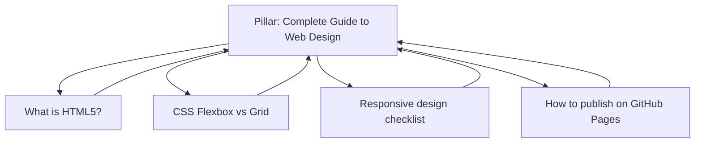

# Session 03: Mobile SEO, SEO-friendly Content and Local SEO

> Module: Optimize Web for Search Engines (SEO) · Term 1 (CPISM) · ⏱ ~2 hours

## 🎯 Learning Objectives

By the end of this session you will be able to:

- Explain mobile-first indexing and why mobile SEO decides your rankings
- List the factors that affect mobile rankings, including Core Web Vitals (LCP, INP, CLS)
- Build a responsive, fast page with correct viewport, images and tap targets
- Write SEO-friendly, people-first content (intent, readability, freshness, topic clusters)
- Explain local SEO, Google Business Profile and NAP consistency, and add LocalBusiness schema
- Name the main social networks and how each supports visibility

## 📖 Concepts Explained

### 1. Mobile SEO and mobile-first indexing

More than half of all searches happen on phones, and in Pakistan most people browse mainly on mobile data. Google now uses **mobile-first indexing**: it crawls and judges the **mobile version** of your page. If something is missing on mobile (text, images, links, structured data), Google treats it as missing.

| Mobile setup | How it works | Recommendation |
|--------------|-------------|----------------|
| **Responsive design** | One URL, one HTML, CSS adapts to screen | ✅ Recommended by Google |
| Dynamic serving | One URL, server sends different HTML per device | Harder to maintain |
| Separate mobile site (`m.example.com`) | Two URLs | Avoid for new sites |

With a responsive site you need **one** normal `sitemap.xml`. Separate "mobile sitemaps" were for old feature-phone pages and are not needed today.

### 2. Factors that affect mobile rankings

| Factor | Good practice |
|--------|---------------|
| Viewport | `<meta name="viewport" content="width=device-width, initial-scale=1">` |
| Readable text | Base font about 16px, good contrast, no horizontal scroll |
| Tap targets | Buttons/links at least ~48×48px with space between them |
| No intrusive pop-ups | Do not cover the content with full-screen ads on arrival |
| Speed | Compress images (WebP/AVIF), lazy-load, minify CSS/JS |
| HTTPS | Secure connection is a ranking and trust signal |
| Same content | Mobile and desktop show the same main content and metadata |

### 3. Core Web Vitals (page experience)

| Metric | Measures | Good score | Analogy |
|--------|----------|-----------|---------|
| **LCP** - Largest Contentful Paint | Loading: time until the main content shows | ≤ 2.5 s | How fast the main dish arrives |
| **INP** - Interaction to Next Paint | Responsiveness: delay after a tap or click | ≤ 200 ms | How fast the waiter responds |
| **CLS** - Cumulative Layout Shift | Visual stability: content jumping around | ≤ 0.1 | The table not wobbling |

INP replaced the older FID metric in March 2024. Check them in **PageSpeed Insights**, **Lighthouse** (Chrome DevTools) or the **Core Web Vitals report** in Search Console. Google's old "Mobile-Friendly Test" tool was retired; use Lighthouse instead.

### 4. SEO-friendly content

Google rewards **helpful, reliable, people-first content**. A useful check is **E-E-A-T**: Experience, Expertise, Authoritativeness and Trust. Show who wrote the page and why they know the topic.

| Do | Don't |
|----|-------|
| Answer the searcher's question early | Hide the answer under long introductions |
| Short paragraphs, headings, lists, tables | Walls of text |
| Use the keyword and related terms naturally | Stuff the keyword (no magic "keyword density") |
| Update old posts (freshness) and show the date | Copy content from other sites |
| Add original images, examples and data | Mass-produce thin AI text without checking |

**Pillar page and topic cluster:** one big guide (pillar) links to several detailed posts (cluster) and they all link back. This builds topical authority and strong internal linking.



**Featured snippets:** to win the answer box, put a clear 40-60 word answer right after a question heading (`<h2>What is responsive design?</h2>`), or use a numbered list/table for steps and comparisons.

**Image and video SEO:** descriptive file names (`karachi-sea-view.webp`), `alt` text, captions, compressed files, and a transcript or description for videos.

### 5. Local SEO

Local SEO helps people **nearby** find you: "computer institute near me", "biryani in North Nazimabad". Results appear in the **local pack** (map + 3 businesses) and Google Maps.

Three main local ranking factors: **relevance** (does your profile match the search?), **distance** (how close you are), and **prominence** (reviews, links, how well known you are).

Checklist:

1. Create and verify a **Google Business Profile** (formerly "Google My Business"). Choose the right category, hours, phone, website, photos and services.
2. Keep **NAP** (Name, Address, Phone) exactly the same on your website, profile and directories.
3. Ask happy customers for reviews and reply to every review politely.
4. Create local content: an area page, local events, a "how to reach us" page with an embedded map.
5. Add **LocalBusiness** structured data (JSON-LD) to your contact or home page.

Bing has **Bing Places for Business**; Apple has **Apple Business Connect**.

### 6. Structured data in one minute

Structured data is a label on your content written in **Schema.org** vocabulary, usually as **JSON-LD** inside a `<script>` tag. It is like a **name badge**: it tells search engines "this is a business, this is its address, these are its hours". It can unlock rich results (stars, prices, event dates) but never guarantees them.

### 7. Social networks you should know

| Platform | Best for |
|----------|----------|
| Facebook | Local communities, events, ads |
| Instagram | Visual brands, reels, food and fashion |
| LinkedIn | B2B, careers, professional authority |
| YouTube | Tutorials and video search (second biggest search engine) |
| TikTok | Short videos, young audience, discovery |
| X (Twitter) | News, quick updates, tech community |
| WhatsApp (Channels, Business) | Direct customer contact in Pakistan |
| Pinterest | Ideas, design, recipes |

You will connect these to SEO in Session 05 (SMO).

## 💻 Code Examples

### Example 1: Mobile-friendly page - [`responsive-seo-page.html`](responsive-seo-page.html)

```html
<meta name="viewport" content="width=device-width, initial-scale=1">
<!-- Hero image: not lazy, high priority, size set to avoid layout shift -->

```

**How it works**

- `srcset` + `sizes` let a phone download the small 400px image instead of the large one (better LCP).
- `width`/`height` reserve space so text does not jump (better CLS).
- `fetchpriority="high"` loads the main image first; images lower down use `loading="lazy"` instead.
- The full file also has large tap targets and readable font sizes in simple CSS.

### Example 2: LocalBusiness JSON-LD - [`local-business-schema.html`](local-business-schema.html)

```html
<script type="application/ld+json">
{
  "@context": "https://schema.org",
  "@type": "LocalBusiness",
  "name": "Karachi Tech Hub",
  "telephone": "+92-21-0000-0000",
  "address": {
    "@type": "PostalAddress",
    "streetAddress": "Block H, North Nazimabad",
    "addressLocality": "Karachi",
    "addressRegion": "Sindh",
    "postalCode": "74700",
    "addressCountry": "PK"
  },
  "openingHours": "Mo-Sa 09:00-21:00",
  "url": "https://www.example.com/"
}
</script>
```

**How it works**

- `@context` says we use the Schema.org vocabulary; `@type` says what the thing is.
- `address` is a nested object of type `PostalAddress`.
- The same name, address and phone must appear as visible text on the page (NAP consistency).
- Test it at the Rich Results Test or Schema Markup Validator.

A content checklist you can print is in [`seo-content-checklist.md`](seo-content-checklist.md).

## 🧪 Lab Practice

1. Open [`responsive-seo-page.html`](responsive-seo-page.html) with Live Server, press **Ctrl + Shift + M** in DevTools and test it at 360px, 768px and 1280px widths.
2. Run Lighthouse (Mobile) on it and on any news site. Record LCP, CLS and Total Blocking Time for both.
3. Paste [`local-business-schema.html`](local-business-schema.html) code into the Rich Results Test (**Code** tab). Fix any warnings.
4. Search "computer institute near me" on your phone. Study the top 3 in the local pack: categories, reviews, photos.
5. Score one of your old pages with [`seo-content-checklist.md`](seo-content-checklist.md).

## 📝 Assignment

Plan a topic cluster for a Karachi food blog: one pillar page and five cluster posts. For each, write the title, main keyword, H2 outline (3-5 headings) and a 50-word featured-snippet answer for one question.

## ❓ Quick Quiz

**Q1.** Under mobile-first indexing, which version of a page does Google mainly use?

- a) Desktop
- b) Mobile
- c) AMP only
- d) Whichever is faster

**Q2.** Which Core Web Vital measures visual stability?

- a) LCP
- b) INP
- c) CLS
- d) TTFB

**Q3.** What does NAP stand for in local SEO?

**Q4.** What is a pillar page?

**Q5.** Does adding structured data guarantee a rich result?

<details>
<summary>Show answers</summary>

1. b) Mobile
2. c) CLS
3. Name, Address, Phone - must match everywhere.
4. A broad, in-depth guide on a topic that links to (and is linked from) detailed cluster articles.
5. No. It makes a page eligible; Google decides whether to show it.

</details>

## 💼 Interview Questions

**1. How would you improve a page with a poor LCP?**

<details>
<summary>Model answer</summary>

Compress and resize the hero image (WebP/AVIF, `srcset`), do not lazy-load it, give it `fetchpriority="high"`, reduce render-blocking CSS/JS, use caching/CDN and a faster server.

</details>

**2. Why is responsive design preferred over a separate mobile site?**

<details>
<summary>Model answer</summary>

One URL and one HTML means no duplicate content, easier maintenance, all links pointing to one address, and identical content for mobile-first indexing.

</details>

**3. List three quick wins for a local business's SEO.**

<details>
<summary>Model answer</summary>

Verify and complete Google Business Profile, make NAP consistent everywhere, and collect and reply to genuine customer reviews.

</details>

## ✅ Summary

- Google judges the mobile version of your site; responsive design is the safe choice.
- Core Web Vitals: LCP ≤ 2.5 s, INP ≤ 200 ms, CLS ≤ 0.1.
- Write helpful, people-first content organised in topic clusters.
- Local SEO = Google Business Profile + consistent NAP + reviews + local content + schema.
- JSON-LD structured data labels your content for search engines.

---

[⬅ Previous](../Session-02-Practice-Lab-Keywords-Meta-Tags-and-Backlinks/README.md) · [🏠 Module Home](../README.md) · [Next ➡](../Session-04-Practice-Lab-Mobile-Content-and-Local-SEO/README.md)

Prepared by Zeeshan Abbas · Aptech Learning North Nazimabad
