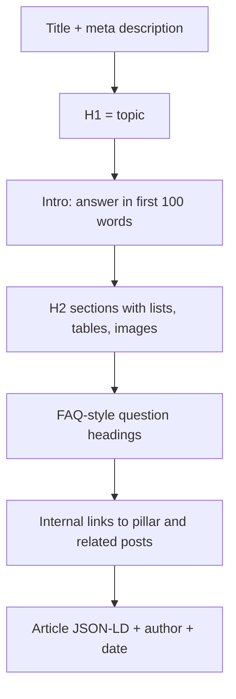

# Session 04: Practice Lab: Mobile-friendly Page, Blog Post and Local Business Schema

> Module: Optimize Web for Search Engines (SEO) · Term 1 (CPISM) · ⏱ ~2 hours

## 🎯 Learning Objectives

By the end of this lab you will be able to:

- Measure a page with PageSpeed Insights and Lighthouse and fix the top mobile problems
- Write and publish an SEO-optimized blog post with Article structured data
- Plan a complete Google Business Profile for a local business
- Validate JSON-LD with the Rich Results Test and Schema Markup Validator
- Submit a site and sitemap to Google Search Console

## 📖 Concepts Explained

### 1. Reading a PageSpeed Insights report

PageSpeed Insights (PSI) shows two kinds of data:

| Data type | Where it comes from | Use it for |
|-----------|--------------------|-----------|
| **Field data** (real users) | Chrome users visiting the page over 28 days | The real Core Web Vitals verdict (needs enough traffic) |
| **Lab data** (Lighthouse) | One simulated test on a mid-range phone | Debugging and quick improvements |

A new student site usually has no field data; that is normal. Use the lab results and the **Opportunities** and **Diagnostics** lists.

Most common fixes, from biggest to smallest win:

1. Resize and compress images (WebP/AVIF), add `width`/`height`
2. Lazy-load images below the fold
3. Remove unused CSS/JS libraries; load scripts with `defer`
4. Use a fast host or CDN with caching (GitHub Pages already uses a CDN)
5. Avoid big pop-ups and web fonts that block text (`font-display: swap`)

### 2. Anatomy of an optimized blog post



About **FAQ structured data:** Google now shows FAQ rich results mainly for well-known government and health sites. You can still write FAQ sections (they help readers and featured snippets), but do not expect the expandable FAQ result for a normal blog.

### 3. Yoast SEO (WordPress) in one paragraph

On WordPress sites, the **Yoast SEO** plugin gives you a box under each post where you type a *focus keyphrase*, an *SEO title* and a *meta description*. It shows traffic-light scores for SEO and readability, generates `sitemap.xml` automatically and adds basic schema. It is a helper: a green light does not guarantee rankings. Today we do the same checks by hand so you understand what the plugin does.

### 4. Google Business Profile (GBP) setup steps

1. Go to the official Google Business Profile page and sign in with the business Google account.
2. Enter the exact business name (no extra keywords; that breaks the guidelines).
3. Choose the most accurate **primary category** (e.g. "Computer training school").
4. Add address (or service area), phone, website and opening hours.
5. **Verify** the business (video, phone, SMS or postcard; Google picks the method).
6. Add a logo, cover photo and real photos of the place, team and work.
7. Add services/products, a description (up to 750 characters) and attributes.
8. Publish **posts** for offers and events, answer **Q&A**, and reply to every **review**.

Use [`gbp-setup-checklist.md`](gbp-setup-checklist.md) during the lab.

### 5. Submitting to Google Search Console

| Step | Action |
|------|--------|
| 1 | Open Search Console → **Add property** |
| 2 | Choose **URL prefix** (easiest for GitHub Pages: `https://username.github.io/site/`) |
| 3 | Verify with the **HTML tag** method: paste the `<meta name="google-site-verification" ...>` tag into your home page `<head>` and push it |
| 4 | Go to **Sitemaps** → enter `sitemap.xml` → Submit |
| 5 | Use **URL Inspection** → *Request indexing* for your most important page |
| 6 | Come back after a few days: check **Pages** (indexing) and **Performance** reports |

Do the same in **Bing Webmaster Tools**; it can import your site from Search Console in one click.

## 💻 Code Examples

### Example 1: Optimized blog post with Article schema - [`blog-post.html`](blog-post.html)

```html
<script type="application/ld+json">
{
  "@context": "https://schema.org",
  "@type": "Article",
  "headline": "What Is Responsive Web Design? A Beginner's Guide",
  "author": { "@type": "Person", "name": "Ayesha Khan" },
  "datePublished": "2026-10-10",
  "dateModified": "2026-10-20",
  "image": "https://www.example.com/images/responsive-devices.webp"
}
</script>
```

**How it works**

- `@type: Article` tells search engines this page is an article.
- `author`, `datePublished` and `dateModified` support trust and freshness (show them on the page too).
- The full file contains the matching visible article: H1, quick answer, H2 sections, a comparison table, an FAQ section and internal links.

### Example 2: Track your speed fixes - [`pagespeed-log.csv`](pagespeed-log.csv)

```csv
date,page_url,device,performance,seo,accessibility,lcp_seconds,cls,fix_applied
YYYY-MM-DD,https://username.github.io/site/,mobile,,,,,,baseline - before any change
```

**How it works**

- Record a **baseline** first, then one row after each fix. You will see which change helped most.
- Run each test 2-3 times; lab scores vary a little between runs.

## 🧪 Lab Practice

1. **Speed test (25 min):** run PageSpeed Insights on your Module 02/03 site (or any GitHub Pages site). Log the baseline in [`pagespeed-log.csv`](pagespeed-log.csv). Fix the top two opportunities and test again.
2. **Write a blog post (35 min):** copy [`blog-post.html`](blog-post.html) as a template and write your own 500-word post on a topic from your Session 03 topic cluster. Use [`../Session-03-Mobile-SEO-Content-and-Local-SEO/seo-content-checklist.md`](../Session-03-Mobile-SEO-Content-and-Local-SEO/seo-content-checklist.md) and score 18/21 or more.
3. **Validate schema (15 min):** test your post in the Rich Results Test (Article) and the Schema Markup Validator. Fix errors until none remain.
4. **Local SEO plan (25 min):** pick a real local business (your family's shop, a tuition centre, a cafe). Fill [`gbp-setup-checklist.md`](gbp-setup-checklist.md) completely and write a 750-character description.
5. **Search Console (20 min):** publish your site on GitHub Pages, verify it with the HTML tag method and submit `sitemap.xml`.

## 📝 Assignment

Publish one optimized blog post and one contact page with LocalBusiness JSON-LD on GitHub Pages. Submit: the live URLs, screenshots of a passing Rich Results Test, before/after Lighthouse mobile scores, and the completed GBP checklist.

## ❓ Quick Quiz

**Q1.** Which PageSpeed Insights data comes from real Chrome users?

- a) Lab data
- b) Field data
- c) Diagnostics
- d) Opportunities

**Q2.** Which verification method is easiest for a GitHub Pages site in Search Console?

- a) DNS record
- b) HTML meta tag
- c) Postcard
- d) Phone call

**Q3.** Why should you not add extra keywords to your business name on GBP?

**Q4.** Name two properties of the `Article` schema type.

**Q5.** What does the Yoast SEO plugin generate automatically?

<details>
<summary>Show answers</summary>

1. b) Field data
2. b) HTML meta tag
3. It breaks Google Business Profile guidelines and can get the listing suspended; use the real name only.
4. Any two of: `headline`, `author`, `datePublished`, `dateModified`, `image`.
5. An XML sitemap (plus SEO title/description fields, basic schema and readability checks).

</details>

## 💼 Interview Questions

**1. A client's page has a Lighthouse performance score of 45 on mobile. What do you check first?**

<details>
<summary>Model answer</summary>

The largest image and LCP element, render-blocking CSS/JS, unused libraries and server response time. I fix images first (resize, compress, `srcset`, dimensions) because that is usually the biggest win.

</details>

**2. How do you get a new page indexed quickly?**

<details>
<summary>Model answer</summary>

Link to it from an important page, add it to the sitemap, submit the sitemap in Search Console, use URL Inspection to request indexing, and use IndexNow/Bing Webmaster Tools for Bing.

</details>

**3. How do you handle a negative review on Google Business Profile?**

<details>
<summary>Model answer</summary>

Reply quickly, politely and publicly, apologise for the experience, offer to solve it privately, and never argue or post fake positive reviews.

</details>

## ✅ Summary

- PSI field data is the real verdict; lab data helps you debug.
- A good blog post answers fast, is well structured and carries Article schema.
- Google Business Profile is the heart of local SEO.
- Always validate structured data and submit your sitemap in Search Console and Bing.

---

[⬅ Previous](../Session-03-Mobile-SEO-Content-and-Local-SEO/README.md) · [🏠 Module Home](../README.md) · [Next ➡](../Session-05-Advanced-SEO-International-SMO-Tools-and-Analytics/README.md)

Prepared by Zeeshan Abbas · Aptech Learning North Nazimabad
