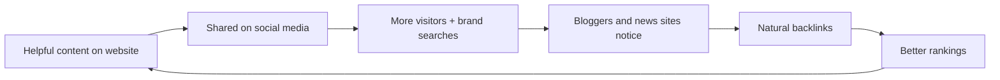

# Session 05: Advanced SEO: International SEO, SMO, SEO Tools and Google Analytics

> Module: Optimize Web for Search Engines (SEO) · Term 1 (CPISM) · ⏱ ~2 hours

## 🎯 Learning Objectives

By the end of this session you will be able to:

- Apply advanced SEO strategies: canonical tags, redirects, structured data, internal-link depth, E-E-A-T
- Explain internationalization vs localization and use `hreflang` for language/country versions
- Use Social Media Optimization (SMO) and Open Graph tags to boost reach
- Compare essential SEO tools (Search Console, Semrush, Ahrefs, Moz, Screaming Frog, GTmetrix)
- Explain Google Analytics 4 basics and the main SEO KPIs
- Strengthen local SEO for several locations

## 📖 Concepts Explained

### 1. Advanced on-site strategies

| Technique | Problem it solves | How |
|-----------|-------------------|-----|
| Canonical tag | Same content at many URLs (`?sort=`, `http`/`https`, `www`) | `<link rel="canonical" href="...">` |
| 301 redirect | Page moved permanently | Server/host setting; passes ranking signals to the new URL |
| 404 / 410 | Page deleted | Return a real 404 with a helpful page and links |
| Shallow site structure | Important pages buried deep | Any key page reachable in about 3 clicks from home |
| Breadcrumbs | Users and bots get lost | Visible breadcrumb + `BreadcrumbList` schema |
| HTTPS everywhere | Trust and security | Free SSL (Let's Encrypt, GitHub Pages "Enforce HTTPS") |
| E-E-A-T signals | Low trust | Author bios, About page, contact details, sources, reviews |

### 2. Internationalization vs localization

- **Internationalization (i18n):** building the site so it *can* support many languages and regions (UTF-8, flexible layouts, right-to-left support for Urdu/Arabic, separate URLs per language).
- **Localization (l10n):** actually *adapting* content for one market: language, currency (PKR, AED), dates, phone formats, local examples and culture.

Analogy: i18n is building a house with sockets that accept any plug; l10n is putting the right plug on for each country.

### 3. International SEO tactics

| URL structure | Example | Notes |
|---------------|---------|-------|
| Country domain (ccTLD) | `example.pk`, `example.ae` | Strongest country signal, costs more |
| Sub-folder | `example.com/ur/`, `example.com/en-ae/` | Easiest, shares domain strength (recommended for most) |
| Sub-domain | `ur.example.com` | Works, a bit more setup |
| `?lang=ur` parameter | `example.com/?lang=ur` | Not recommended |

**hreflang** tells Google which version to show to which audience. Every version lists **all** versions **including itself**, plus an `x-default` fallback:

```html
<link rel="alternate" hreflang="en-pk" href="https://www.example.com/en-pk/">
<link rel="alternate" hreflang="ur-pk" href="https://www.example.com/ur-pk/">
<link rel="alternate" hreflang="en-ae" href="https://www.example.com/en-ae/">
<link rel="alternate" hreflang="x-default" href="https://www.example.com/">
```

Codes: language (ISO 639-1, e.g. `ur`) then optional region (ISO 3166-1, e.g. `PK`). Never auto-redirect visitors only by IP; offer a language switcher.

### 4. Social Media Optimization (SMO)

SMO means making content **easy to share** and **attractive when shared**, and building an active social presence. Social signals are not a direct Google ranking factor, but SMO brings traffic, brand searches, mentions and natural backlinks, which all help SEO.



SMO checklist: Open Graph and Twitter/X card tags, share buttons, consistent profile names and bios with your website link, a posting calendar, short video (Reels, Shorts, TikTok), and **UTM links** so you can measure social traffic in Analytics.

### 5. Essential SEO tools

| Tool | Main use | Free option |
|------|----------|-------------|
| Google Search Console | Queries, clicks, impressions, indexing, Core Web Vitals | Free |
| Bing Webmaster Tools | Bing indexing, SEO reports, IndexNow | Free |
| Google Analytics 4 | Visitor behaviour and key events | Free |
| PageSpeed Insights / Lighthouse | Speed, Core Web Vitals | Free |
| Semrush / Ubersuggest | Keyword and competitor research | Limited free |
| Ahrefs (Webmaster Tools) | Backlinks and site audit of *your* sites | Free for verified sites |
| Moz (MozBar) | Domain Authority (DA) / Page Authority (PA) estimates | Free extension |
| Screaming Frog SEO Spider | Crawls a site like a bot: broken links, titles, redirects | Free up to 500 URLs |
| GTmetrix | Speed waterfall and history | Free with limits |

**DA / PA / DR** are scores (roughly 1-100) invented by tool companies to estimate link strength. Google does **not** use them; use them only to compare sites.

### 6. Google Analytics 4 basics

GA4 measures **events** (page_view, scroll, click, form_submit). Universal Analytics stopped collecting data in 2023, so learn GA4 only.

| Metric | Meaning |
|--------|---------|
| Users | Number of people (devices) who visited |
| Sessions | Visits; one user can have many sessions |
| Engaged session | Lasted 10+ seconds, or had 2+ page views, or a key event |
| Engagement rate | % of sessions that were engaged |
| Bounce rate | % of sessions that were **not** engaged (opposite of engagement rate) |
| Key events | Important actions you mark, e.g. form submit, WhatsApp click (formerly called "conversions") |
| Traffic acquisition | Where visitors came from: Organic Search, Direct, Social, Referral, Paid |

Link GA4 with Search Console to see search queries next to on-site behaviour.

### 7. SEO KPIs

| KPI | Where | Formula / note |
|-----|-------|----------------|
| Impressions | Search Console | Times your page appeared in results |
| Clicks | Search Console | Times someone clicked |
| CTR | Search Console | Clicks ÷ Impressions × 100 |
| Average position | Search Console | Average ranking (lower number = better) |
| Organic sessions | GA4 | Visits from organic search |
| Engagement / dwell time | GA4 (average engagement time) | How long people actually stay |
| Key events from organic | GA4 | Leads or sales from SEO |
| Referring domains | Ahrefs / Semrush / Moz | Number of unique sites linking to you |

Example: 2,000 impressions and 60 clicks → CTR = 60 ÷ 2,000 × 100 = **3%**.

### 8. Local SEO at the next level

- **Several branches:** one Google Business Profile per real location and one landing page per branch (`/branches/north-nazimabad`, `/branches/gulshan`), each with its own NAP and LocalBusiness schema.
- **Local links:** local news, university events, sponsorships, chambers of commerce.
- **Reviews strategy:** ask at the right moment, reply to all, never buy reviews.
- **Track:** GBP Performance (calls, directions, website clicks) and UTM-tagged website link (`?utm_source=google&utm_medium=organic&utm_campaign=gbp`).

## 💻 Code Examples

### Example 1: Language versions - [`hreflang-example.html`](hreflang-example.html)

The snippet above shows the important part. The file is a full English (Pakistan) page with a visible language switcher.

**How it works**

- Each language page contains the **same** set of `hreflang` links.
- `x-default` is shown to users whose language/region matches none of the versions.
- `lang="en"` on `<html>` declares the page language; the Urdu page would also use `dir="rtl"`.

### Example 2: Social sharing tags - [`social-meta-tags.html`](social-meta-tags.html)

```html
<meta property="og:title" content="Free HTML Cheat Sheet for Beginners">
<meta property="og:description" content="All the HTML5 tags you need on one printable page.">
<meta property="og:image" content="https://www.example.com/images/html-cheat-sheet-1200x630.png">
<meta property="og:url" content="https://www.example.com/free/html-cheat-sheet">
<meta property="og:type" content="article">
<meta name="twitter:card" content="summary_large_image">
```

**How it works**

- WhatsApp, Facebook, LinkedIn and X read **Open Graph** (`og:`) tags to build the link preview card.
- A 1200×630 px image gives a sharp preview. Use a full `https://` URL.
- `twitter:card` chooses a large image card on X.

### Example 3: Google Analytics 4 tag - [`ga4-tag.html`](ga4-tag.html)

```html
<script async src="https://www.googletagmanager.com/gtag/js?id=G-XXXXXXXXXX"></script>
<script>
  window.dataLayer = window.dataLayer || [];
  function gtag(){ dataLayer.push(arguments); }
  gtag('js', new Date());
  gtag('config', 'G-XXXXXXXXXX');
</script>
```

**How it works**

- Replace `G-XXXXXXXXXX` with your **Measurement ID** (Admin → Data streams → Web).
- The first line loads Google's library; `gtag('config', ...)` starts sending page views.
- The full file also sends a custom `whatsapp_click` event when a button is clicked.

UTM link recipes are in [`utm-links.md`](utm-links.md) and a monthly KPI sheet in [`seo-kpi-tracker.csv`](seo-kpi-tracker.csv).

## 🧪 Lab Practice

1. Paste a link to any big news article into a WhatsApp chat (to yourself) and view its preview. Then open the page source and find its `og:` tags.
2. Open [`social-meta-tags.html`](social-meta-tags.html), change it for your own site and publish it. Test it with the LinkedIn Post Inspector or Facebook Sharing Debugger.
3. Create a free GA4 property, add [`ga4-tag.html`](ga4-tag.html)'s code (with your ID) to your site, and watch yourself in **Reports → Realtime**.
4. Build three UTM links from [`utm-links.md`](utm-links.md) (Facebook, Instagram bio, WhatsApp) and click each one. Find them in **Traffic acquisition**.
5. Run Screaming Frog (free) or Ahrefs Webmaster Tools on your site and list 5 issues it finds.

## 📝 Assignment

Write a one-page "Go International" plan for a Karachi clothing brand selling to Pakistan and the UAE: URL structure, hreflang tags for English and Urdu (PK) plus English (AE), what to localize (currency, sizes, holidays, payment), and three SMO actions with UTM links.

## ❓ Quick Quiz

**Q1.** Which tag tells Google about language/region versions of a page?

- a) `rel="canonical"`
- b) `hreflang`
- c) `og:locale`
- d) `meta keywords`

**Q2.** 50 clicks from 2,500 impressions gives a CTR of:

- a) 0.5%
- b) 2%
- c) 5%
- d) 20%

**Q3.** In GA4, bounce rate is the opposite of which metric?

**Q4.** Is Domain Authority a Google ranking factor?

**Q5.** What is the difference between internationalization and localization?

<details>
<summary>Show answers</summary>

1. b) `hreflang`
2. b) 2% (50 ÷ 2,500 × 100)
3. Engagement rate.
4. No. It is a third-party estimate from Moz, useful only for comparing sites.
5. Internationalization prepares the site to support many languages/regions; localization adapts the content for one specific market.

</details>

## 💼 Interview Questions

**1. How would you measure whether SEO work is paying off?**

<details>
<summary>Model answer</summary>

Track impressions, clicks, CTR and average position in Search Console, organic sessions, engagement and key events in GA4, and referring domains in a backlink tool, comparing month-on-month against a baseline.

</details>

**2. When do you use a 301 redirect versus a canonical tag?**

<details>
<summary>Model answer</summary>

Use a 301 when a page has moved and users should no longer see the old URL. Use a canonical when several URLs must stay accessible (filters, tracking parameters) but one should be the main indexed version.

</details>

**3. How does social media help SEO if it is not a direct ranking factor?**

<details>
<summary>Model answer</summary>

It increases visibility and traffic, creates brand searches and mentions, and helps content reach people who may link to it, so it supports SEO indirectly.

</details>

## ✅ Summary

- Canonicals, redirects, shallow structure and E-E-A-T are advanced on-site essentials.
- i18n prepares the site; l10n adapts it; `hreflang` connects the versions.
- SMO and Open Graph tags make content shareable and bring natural links.
- Use free tools first: Search Console, Bing Webmaster Tools, GA4, Lighthouse.
- Measure with KPIs: impressions, clicks, CTR, position, organic sessions, key events.

---

[⬅ Previous](../Session-04-Practice-Lab-Mobile-Content-and-Local-SEO/README.md) · [🏠 Module Home](../README.md) · [Next ➡](../Session-06-Practice-Lab-SEO-Audit-and-Strategy/README.md)

Prepared by Zeeshan Abbas · Aptech Learning North Nazimabad
