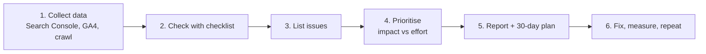

# Session 06: Practice Lab: Full SEO Audit and 30-day SEO Strategy

> Module: Optimize Web for Search Engines (SEO) · Term 1 (CPISM) · ⏱ ~2 hours

## 🎯 Learning Objectives

By the end of this lab you will be able to:

- Run a complete SEO audit (technical, on-page, off-page, local, analytics) with a checklist
- Use a crawler and a small Python script to find on-page problems quickly
- Prioritise fixes by impact and effort
- Use AI tools responsibly to draft meta descriptions, keyword ideas and FAQs
- Build a 30-day SEO strategy for a real local business, connected with social campaigns
- Present findings in a short, professional audit report

## 📖 Concepts Explained

### 1. What is an SEO audit?

An SEO audit is a **medical check-up for a website**. You test each "organ" (crawling, speed, content, links, local presence), note the problems, and write a treatment plan ordered by importance.



### 2. The five audit areas

| Area | Key questions | Tools |
|------|---------------|-------|
| Technical | Is it on HTTPS? Indexed? Any 404s, redirect chains, blocked pages? Sitemap and robots.txt OK? Mobile and fast? | Search Console, Screaming Frog, Lighthouse, PSI |
| On-page | Unique titles and descriptions? One H1? Alt text? Internal links? Thin or duplicate content? | Screaming Frog, `quick_seo_check.py`, manual review |
| Off-page | How many referring domains? Any spam links? Brand mentions? | Ahrefs Webmaster Tools, Semrush, Moz |
| Local | GBP complete and verified? NAP consistent? Reviews? LocalBusiness schema? | GBP dashboard, Rich Results Test |
| Analytics | GA4 installed? Key events set? Search Console linked? | GA4, Tag Assistant |

The full tick-box list is in [`seo-audit-checklist.md`](seo-audit-checklist.md).

### 3. Prioritising: impact vs effort

| | Low effort | High effort |
|---|-----------|-------------|
| **High impact** | **Do first** (quick wins): fix titles, add missing meta descriptions, submit sitemap, fix broken links | **Plan**: rewrite thin pages, speed overhaul, new pillar content |
| **Low impact** | **Do when free**: tidy alt text on old images | **Skip for now** |

Severity labels for the report: **Critical** (blocks indexing, e.g. `noindex` on home page), **High** (hurts rankings, e.g. duplicate titles), **Medium**, **Low**.

### 4. AI in SEO - helper, not replacement

AI tools (ChatGPT, Gemini, Copilot, Surfer SEO and others) can speed up research and drafting:

| Good uses | Be careful |
|-----------|-----------|
| Brainstorm keyword and topic ideas | AI does not know real search volumes; verify in a keyword tool |
| Draft 3 meta description options | Check length, accuracy and tone yourself |
| Suggest FAQ questions and outlines | Facts can be wrong or outdated; check official sources |
| Summarise a long audit into plain English | Never paste private client data or passwords |
| Write alt text drafts for many images | Mass-published unedited AI text is low value and can break spam policies |

Google's position: content is judged on **quality and helpfulness, not how it was produced**. Add your own experience, examples and checks. Prompts to start with are in [`ai-seo-prompts.md`](ai-seo-prompts.md).

### 5. A 30-day SEO strategy

| Week | Focus | Example tasks |
|------|-------|---------------|
| 1 | Foundation | Audit, set up Search Console + Bing + GA4, fix critical issues, submit sitemap |
| 2 | On-page | Keyword map, rewrite titles/descriptions, headings, internal links, schema |
| 3 | Content + local | Publish 2 helpful posts, complete GBP, NAP clean-up, request reviews |
| 4 | Off-page + social | Share content with UTM links, 5 outreach emails, measure KPIs, plan next month |

**Integrating SEO with social campaigns:** every blog post becomes 3-5 social posts (a reel, a carousel, a WhatsApp broadcast) that link back with UTM tags; popular social questions become new blog topics. Template: [`30-day-seo-plan.md`](30-day-seo-plan.md).

## 💻 Code Examples

### Example 1: Quick on-page checker - [`quick_seo_check.py`](quick_seo_check.py)

```python
# Run:  python quick_seo_check.py index.html
from html.parser import HTMLParser

class SeoParser(HTMLParser):
    def __init__(self):
        super().__init__()
        self.h1_count = 0
        self.images_without_alt = 0

    def handle_starttag(self, tag, attrs):
        attributes = dict(attrs)
        if tag == "h1":
            self.h1_count += 1
        elif tag == "img" and not attributes.get("alt"):
            self.images_without_alt += 1
```

**How it works**

- `HTMLParser` (built into Python) calls `handle_starttag` for every opening tag in the file.
- We count `<h1>` tags and images with no `alt`; the full file also checks title length, meta description length, viewport, canonical and `lang`.
- Output uses `PASS` / `FIX` labels. Example run on the weak page from Session 02:

```text
python quick_seo_check.py ../Session-02-Practice-Lab-Keywords-Meta-Tags-and-Backlinks/before.html
[FIX ] Title length is 4 (aim 30-60, ideal 50-60): 'Home'
[FIX ] Meta description length is 0 (aim 120-155)
[FIX ] Number of <h1> tags is 0 (aim exactly 1)
[FIX ] Images without alt text: 1
```

### Example 2: Audit report skeleton - [`audit-report-template.md`](audit-report-template.md)

```markdown
| # | Issue | Area | Severity | Fix | Effort |
|---|-------|------|----------|-----|--------|
| 1 | Home page has no meta description | On-page | High | Write 150-char description | Low |
```

**How it works**

- One row per issue, so the client can tick them off.
- Severity + effort columns turn the list into a plan.

## 🧪 Lab Practice

Work in pairs. Audit **your own Module 02/03 website** or a small real local business site (with permission).

1. **Collect (20 min):** open Search Console (Pages, Performance), run PageSpeed Insights (mobile), and crawl the site with Screaming Frog (free) or Ahrefs Webmaster Tools.
2. **Check (30 min):** go through [`seo-audit-checklist.md`](seo-audit-checklist.md) and run `python quick_seo_check.py page.html` on your three main pages.
3. **AI assist (15 min):** use two prompts from [`ai-seo-prompts.md`](ai-seo-prompts.md) to draft meta descriptions and FAQ ideas. Edit the results yourself and note what you changed.
4. **Report (30 min):** fill [`audit-report-template.md`](audit-report-template.md) with at least 10 issues, severity and fixes.
5. **Plan (25 min):** complete [`30-day-seo-plan.md`](30-day-seo-plan.md) and present your top 3 quick wins to the class in 3 minutes.

## 📝 Assignment

**Module final task:** submit a 2-page SEO audit report and a 30-day SEO plan for a real Karachi business or your own site, including: screenshots of Lighthouse and Search Console, at least 10 prioritised issues, before/after examples for 3 pages, a keyword map, and the KPI baseline you will measure against.

## ❓ Quick Quiz

**Q1.** Which issue is **Critical** in an audit?

- a) Two images missing alt text
- b) `noindex` on the home page
- c) Meta description of 170 characters
- d) No Open Graph image

**Q2.** Which tool crawls a site like a search engine bot to list broken links and titles?

- a) Google Analytics 4
- b) Screaming Frog SEO Spider
- c) Google Trends
- d) Canva

**Q3.** Name two safe uses of AI in SEO work.

**Q4.** What goes in week 1 of a 30-day SEO plan?

**Q5.** How can a social campaign support SEO?

<details>
<summary>Show answers</summary>

1. b) `noindex` on the home page
2. b) Screaming Frog SEO Spider
3. Any two: brainstorming topics, drafting meta descriptions, suggesting FAQ questions, summarising reports, drafting alt text (always reviewed by a human).
4. Audit, tool setup (Search Console, Bing, GA4), fixing critical issues and submitting the sitemap.
5. It drives traffic and brand searches to the content, attracts mentions and natural links, and gives ideas for new search-focused content.

</details>

## 💼 Interview Questions

**1. Walk me through how you audit a website.**

<details>
<summary>Model answer</summary>

I gather data from Search Console, GA4, a crawler and PageSpeed Insights, check technical, on-page, off-page, local and analytics items with a checklist, list issues with severity, prioritise by impact and effort, then deliver a report and a dated action plan with KPIs to measure.

</details>

**2. A client wants 100 AI-generated blog posts next week. What do you advise?**

<details>
<summary>Model answer</summary>

Fewer, better posts. Use AI to research and draft, but have experts edit, fact-check and add original experience. Mass unedited content adds little value and can be treated as spam.

</details>

**3. How do you show a client SEO progress after 30 days?**

<details>
<summary>Model answer</summary>

Compare against the baseline: issues fixed, pages indexed, impressions, clicks, CTR and positions in Search Console, organic sessions and key events in GA4, new reviews and referring domains, and explain that rankings often take months to fully move.

</details>

## ✅ Summary

- An audit checks technical, on-page, off-page, local and analytics health.
- Prioritise fixes by impact and effort; quick wins first.
- AI is a fast assistant; humans check facts, quality and privacy.
- A 30-day plan moves from foundation to on-page, content/local and off-page/social.
- Measure against a baseline and repeat the cycle every month.

---

[⬅ Previous](../Session-05-Advanced-SEO-International-SMO-Tools-and-Analytics/README.md) · [🏠 Module Home](../README.md) · [Next ➡](../../eProject/README.md)

Prepared by Zeeshan Abbas · Aptech Learning North Nazimabad
