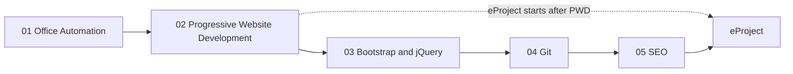

# Term 1: CPISM (Certificate of Proficiency in Information Systems Management)

       

> ACCP in AI · Term 1 · about 6 months · 70 sessions in total · ⏱ ~2 hours per session

Term 1 is where your software career starts. You begin with the digital office skills every professional needs, then learn to **build websites from scratch** with HTML5, CSS3 and JavaScript, make them responsive with Bootstrap and jQuery, manage your code with Git and GitHub, and finally make your sites **easy to find on Google**. The term ends with a team eProject: a complete responsive website.

## Modules

| No | Module | Sessions | Link |
|---|---|---|---|
| 01 | Effective Productivity through Office Automation | 12 | [Open module](./01-Office-Automation/README.md) |
| 02 | Progressive Website Development (HTML5, CSS3 and JavaScript) | 20 | [Open module](./02-Progressive-Website-Development/README.md) |
| 03 | Bootstrap and jQuery for Responsive Web Pages | 8 | [Open module](./03-Bootstrap-and-jQuery-for-Responsive-Web-Pages/README.md) |
| 04 | Distributed Version Control with Git | 6 | [Open module](./04-Distributed-Version-Control-with-Git/README.md) |
| 05 | Optimize Web for Search Engines (SEO) | 6 | [Open module](./05-Optimize-Web-for-Search-Engines/README.md) |
| — | eProject: Responsive Website Development | 10 | [Open eProject](./eProject/README.md) |

**How the 70 sessions add up:** 52 module sessions + 8 extra practice sessions for Progressive Website Development + 10 eProject sessions.

## Learning Outcomes

After completing Term 1 you will be able to:

- Use Windows 11 and Microsoft Office (Word, Excel, PowerPoint, OneNote, Outlook, Teams, OneDrive) productively, with AI helpers
- Build valid, semantic, accessible multi-page websites with HTML5 and CSS3 (Flexbox, Grid, animation)
- Program web pages with modern JavaScript: DOM, events, JSON, Web Storage, Canvas and Geolocation
- Create mobile-first, responsive layouts with Bootstrap 5 and add interactivity with jQuery
- Track, share and collaborate on code with Git, GitHub, branches and pull requests, and publish with GitHub Pages
- Optimize websites for search engines: keywords, meta tags, sitemaps, structured data, Core Web Vitals, local SEO and Google Analytics 4
- Plan, build, test, document and present a complete website as part of a team

## Suggested Study Order

The eProject is usually registered at the end of Module 02 and continues while you study Modules 03-05, so each new module improves your project: Bootstrap makes it responsive, Git lets your team work together, and SEO gets it ready for Google.

## eProject

A group project of **up to 4 students** over **10 sessions**: a responsive, multi-page website built with HTML5, CSS3, JavaScript, Bootstrap and jQuery. You submit the **source code** and a **project report**, then present it in a **viva**. Marks: 60% code and working website, 20% report, 20% viva. Read the [eProject guide](./eProject/README.md) for phases, project ideas, folder structure and tips.

## How to Study

1. **Set up once:** install VS Code (with the Live Server extension), Google Chrome, Git and Microsoft Office. Each module README lists its tools with official links.
2. **One session at a time:** read the concepts, then type (do not copy-paste) and run every example in the session folder.
3. **Do the lab:** the lab practice builds the skill; the assignment proves it. Practice-lab sessions are as important as theory sessions.
4. **Check yourself:** answer the quiz before opening the answers, then practise the interview questions aloud.
5. **Build the mini-projects:** every module ends with one. Reuse the same website across Modules 02-05 so it grows into a portfolio piece.
6. **Commit to GitHub weekly:** from Module 04 onwards, push your practice work and publish it on GitHub Pages.
7. **Ask early:** bring questions to class or open an Issue on this repository.

---

[🏠 Repository Home](../README.md) · [Start Module 01 ➡](./01-Office-Automation/README.md)

Prepared by Zeeshan Abbas · Aptech Learning North Nazimabad
