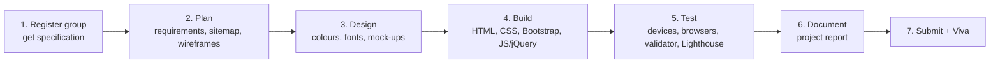

# Term 1 eProject: Responsive Website Development

     

> Term 1 (CPISM) · Group project (up to 4 students) · ~10 sessions · Build and present a complete, responsive, multi-page website

## What is the eProject?

The eProject is your first **real team project**. Instead of small lab exercises, your group receives a project specification (for example, a website for a shop, a school or a travel company) and builds the whole thing: planning, design, coding, testing, documentation and a final viva.

It joins everything from Term 1:

| Module | What you use from it |
|--------|---------------------|
| [01 Office Automation](../01-Office-Automation/README.md) | Word for the report, Excel for the task tracker, PowerPoint for the demo |
| [02 Progressive Website Development](../02-Progressive-Website-Development/README.md) | HTML5, CSS3, JavaScript, forms, media |
| [03 Bootstrap and jQuery](../03-Bootstrap-and-jQuery-for-Responsive-Web-Pages/README.md) | Responsive grid, components, effects and interactivity |
| [04 Git](../04-Distributed-Version-Control-with-Git/README.md) | Team collaboration, branches, GitHub, GitHub Pages |
| [05 SEO](../05-Optimize-Web-for-Search-Engines/README.md) | Meta tags, sitemap, structured data, Lighthouse checks |

## Team rules

- Groups of **up to 4 students**. Choose one **team leader** who talks to the faculty project guide.
- Your centre registers the group; the detailed **project specification** is given to you after registration.
- Every member must write code and must be able to explain **any** part of the project in the viva.
- Keep a simple task log (who did what, when). Git commit history is the best proof.

## Phases (about 10 sessions)



| Session | Phase | Output |
|---------|-------|--------|
| 1 | Kick-off: read the specification, assign roles, create the GitHub repo | Repo + task list |
| 2 | Requirements and site map (list of pages and features) | Requirements page |
| 3 | Wireframes (paper or Figma/Draw.io) for mobile and desktop | Wireframes |
| 4 | Layout: shared header, navigation, footer with Bootstrap 5 | Base template |
| 5-6 | Build all pages and content | Working pages |
| 7 | Interactivity: forms with validation, jQuery/JS effects, search/filter, gallery | Interactive site |
| 8 | Testing and fixes: phones, tablets, Chrome/Edge/Firefox, W3C validator, Lighthouse | Test log |
| 9 | SEO and polish: titles, meta descriptions, alt text, `sitemap.xml`, favicon; write report | Report draft |
| 10 | Final submission and viva rehearsal | Final package |

## Deliverables checklist

### 1. Source code and working website (60% of marks)
- [ ] All pages work and match the specification
- [ ] Responsive on mobile, tablet and desktop (Bootstrap 5 grid + your own CSS)
- [ ] Valid HTML5 (W3C validator) and organised CSS/JS files
- [ ] At least one form with validation, plus JavaScript/jQuery interactivity
- [ ] Accessible: alt text, labels on form fields, good colour contrast
- [ ] Basic SEO: unique titles and descriptions, one H1 per page, `sitemap.xml`
- [ ] Works when opened from the submitted folder (relative paths, no broken links)
- [ ] Optional but impressive: live on GitHub Pages with a clean commit history

### 2. Project report - soft copy in MS Word (20% of marks)
- [ ] Title page (project name, group members, student IDs, centre, date)
- [ ] Acknowledgement and table of contents
- [ ] Problem definition and objectives
- [ ] Requirements (functional and non-functional)
- [ ] Site map and wireframes
- [ ] Screenshots of every page (mobile and desktop)
- [ ] Testing table (test case, expected result, actual result, pass/fail)
- [ ] Task sheet: who did what
- [ ] Conclusion, limitations and future improvements
- [ ] References (official documentation only)

### 3. Viva (20% of marks)
- [ ] 5-7 minute live demo per group
- [ ] Each member explains the part they built and answers questions on any page

## Suggested project ideas

Your official specification comes from your centre. Use these ideas for practice or as a personal portfolio project:

| Idea | Key features to build |
|------|-----------------------|
| **Karachi Food Street Guide** | Restaurant cards with filters (area, cuisine), image gallery, reviews section, contact form |
| **Online Bookstore Showcase** | Book catalogue with categories, search box, "add to wishlist" stored in `localStorage`, FAQ accordion |
| **Travel Agency: Discover Pakistan** | Tour packages (Hunza, Skardu, Swat), itinerary pages, booking enquiry form, embedded map and video |
| **School / Institute Portal** | Courses, faculty profiles, events calendar table, admission form with validation, photo gallery |
| **Fitness Club Website** | Membership plans comparison, BMI calculator in JavaScript, class timetable, trainer profiles |
| **Electronics Shop Catalogue** | Product grid, compare feature, carousel of offers, store locator page |
| **Event Management Company** | Services, portfolio gallery with lightbox, countdown timer for next event, quote request form |

## Suggested folder structure

```text
group-project-name/
├── index.html
├── about.html
├── products.html            # or courses.html, tours.html ...
├── gallery.html
├── contact.html
├── sitemap.xml
├── robots.txt
├── css/
│   └── style.css            # your custom styles (after Bootstrap)
├── js/
│   └── main.js              # your JavaScript / jQuery code
├── images/
│   ├── logo.svg
│   └── ...                  # compressed .webp / .jpg files
├── data/
│   └── products.json        # optional: data loaded with fetch()
├── docs/
│   └── Project-Report.docx
└── README.md                # how to open the project, team members
```

Load Bootstrap 5 and jQuery from their official CDN links (or keep a local copy in `css/` and `js/` if the lab has no internet), and always load your own `style.css` **after** Bootstrap.

## Evaluation tips

1. **Start with the specification.** Tick every required feature in a checklist; missing features cost more marks than fancy effects.
2. **Mobile first.** Examiners often resize the browser; test at 360px width before anything else.
3. **Commit often** with clear messages (`Add contact form validation`). It shows teamwork and protects your work.
4. **Keep code clean:** indentation, comments, meaningful file and class names, no unused files.
5. **Use real-looking content.** Avoid "lorem ipsum" in the final version; write short, real text.
6. **Test like a user:** every link, every button, every form error message.
7. **Report = evidence.** Screenshots and the testing table prove that your site works.
8. **Prepare for the viva:** each member should be able to explain the Bootstrap grid, one jQuery/JS feature and how the form validation works.
9. **Submit early.** Make a final ZIP, open it on another computer and check everything works before the deadline.

---

[⬅ Previous Module](../05-Optimize-Web-for-Search-Engines/README.md) · [🏠 Term Home](../README.md)

Prepared by Zeeshan Abbas · Aptech Learning North Nazimabad
