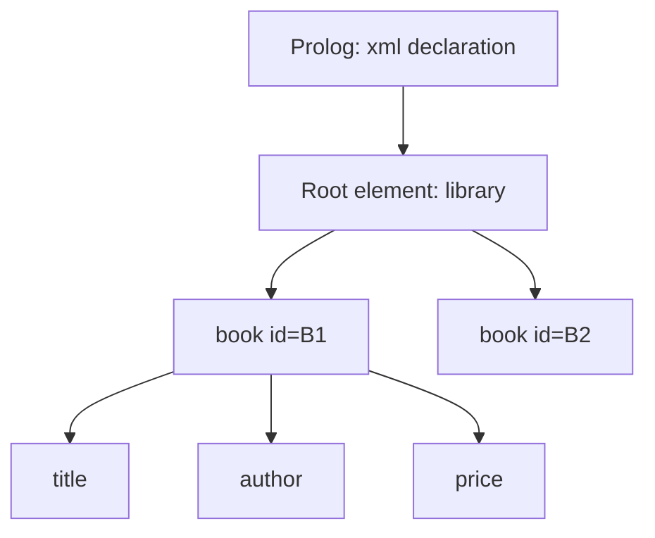
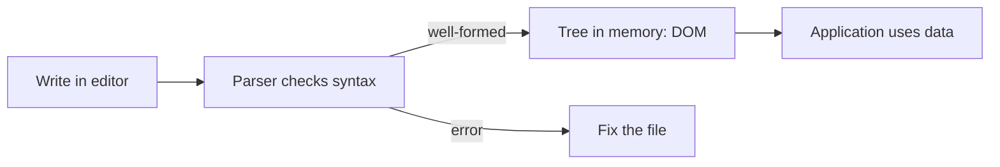

# Session 01: Introduction to XML and Basic Syntax

> Module: Data Processing with XML and JSON · Term 2 (DISM) · ⏱ ~2 hours

## 🎯 Learning Objectives

By the end of this session you will be able to:

- Explain what XML is and why it is used for storing and exchanging data
- Compare XML with HTML and identify the role of each
- Describe the parts of an XML document: prolog, root, elements, attributes, comments
- Apply the syntax rules that make an XML document well-formed
- Use entities, CDATA sections and processing instructions correctly
- Validate and view an XML file in VS Code and a browser

## 📖 Concepts Explained

### 1. What is XML?

**XML (eXtensible Markup Language)** is a text format for describing data with your own tags. HTML tells a browser *how to show* content; XML tells a program *what the data means*.

Think of XML as a **labelled storage box**: every value sits inside a label (`<price>`, `<city>`), so any program in any language can open the box and understand what is inside.

```xml
<student>
  <name>Ayesha Khan</name>
  <batch>2510A</batch>
</student>
```

### 2. Why do we need XML?

| Need | How XML helps |
|---|---|
| Share data between different systems (PHP, Java, .NET, Python) | Plain text + self-describing tags |
| Keep data separate from design | Data in XML, look in CSS/XSLT |
| Long-term storage | Human-readable, vendor-neutral, W3C standard |
| Configuration files | Android layouts, Maven `pom.xml`, .NET `web.config` |
| Document formats | `.docx`, `.xlsx`, SVG and RSS are all XML inside |

### 3. Features and limitations

**Features:** extensible (you invent the tags), strict and predictable, Unicode support, hierarchical (tree) structure, supported by every major language.

**Limitations:** verbose (closing tags repeat names), larger files than JSON, parsing is slower, no built-in data types unless you add a schema.

### 4. XML vs HTML

| Point | XML | HTML |
|---|---|---|
| Purpose | Describe and carry data | Display content in a browser |
| Tags | User-defined | Predefined (`<p>`, `<div>`) |
| Case sensitive | Yes | No |
| Closing tags | Always required | Some optional (`<br>`) |
| Errors | Parser stops at the first error | Browser tries to fix them |

### 5. Structure of an XML document



1. **Prolog** (optional but recommended): `<?xml version="1.0" encoding="UTF-8"?>`
2. **Root element**: exactly one element that wraps everything.
3. **Child elements**: nested inside the root, forming a tree.
4. **Attributes**: extra information inside the start tag, e.g. `<book id="B1">`.
5. **Comments**: `<!-- note -->`
6. **Processing instructions (PI)**: instructions for an application, e.g. `<?xml-stylesheet type="text/css" href="style.css"?>`

### 6. Lifecycle of an XML document



- **Editors:** VS Code (with the *XML by Red Hat* extension), Notepad++, Oxygen XML.
- **Parsers:** read the text and build a tree. Examples: browser built-in `DOMParser`, libxml2 (used by PHP), Java SAX/DOM, .NET `XmlReader`.
- **Browsers:** Chrome, Firefox and Edge show XML as a collapsible tree and report errors.

### 7. Rules for well-formed XML

| Rule | Wrong | Right |
|---|---|---|
| One root element | `<a/><b/>` | `<root><a/><b/></root>` |
| Every tag closes | `<name>Ali` | `<name>Ali</name>` or `<br/>` |
| Proper nesting | `<b><i>x</b></i>` | `<b><i>x</i></b>` |
| Case must match | `<Name>..</name>` | `<name>..</name>` |
| Attribute values quoted | `id=5` | `id="5"` |
| No duplicate attributes | `<a x="1" x="2">` | `<a x="1" y="2">` |
| Names cannot start with a number or `xml` | `<1st>` | `<first>` |

### 8. Entities and CDATA

Some characters have special meaning, so we write them as **entities**:

| Character | Entity |
|---|---|
| `<` | `&lt;` |
| `>` | `&gt;` |
| `&` | `&amp;` |
| `"` | `&quot;` |
| `'` | `&apos;` |

A **CDATA section** holds text that the parser must not read as markup: `<![CDATA[ if (a < b && c > d) ]]>`.

### 9. Elements vs attributes: which one?

Use **elements** for the main data (it can have children and repeat). Use **attributes** for metadata such as IDs, units or language: `<price currency="PKR">2500</price>`.

## 💻 Code Examples

All examples below are also saved as files in this folder, so you can open and run them directly.

### Example 1: A well-formed employee list (`employees.xml`)

```xml
<?xml version="1.0" encoding="UTF-8"?>
<!-- Employee list for a small software house -->
<company name="CodeCraft Solutions" city="Karachi">
  <employee id="E101" status="active">
    <name>Ayesha Khan</name>
    <designation>Frontend Developer</designation>
    <salary currency="PKR">180000</salary>
    <joined>2024-03-15</joined>
    <skills>
      <skill>HTML</skill>
      <skill>CSS</skill>
      <skill>JavaScript</skill>
    </skills>
  </employee>
  <employee id="E102" status="active">
    <name>Bilal Ahmed</name>
    <designation>Backend Developer</designation>
    <salary currency="PKR">210000</salary>
    <joined>2023-11-01</joined>
    <skills>
      <skill>PHP</skill>
      <skill>MySQL</skill>
    </skills>
  </employee>
  <employee id="E103" status="on-leave">
    <name>Sara &amp; Co. Intern</name>
    <designation>QA Intern</designation>
    <salary currency="PKR">45000</salary>
    <joined>2025-07-01</joined>
    <skills/>
    <notes><![CDATA[Test rule: salary < 50000 && status = "intern"]]></notes>
  </employee>
</company>
```

**How it works:**

- Line 1 is the **prolog** declaring version and encoding.
- `<company>` is the single **root element**; every employee sits inside it.
- `id`, `status` and `currency` are **attributes** (metadata), while name, salary and skills are **elements** (data).
- `<skills/>` is an empty element written with a self-closing tag.
- `&amp;` is used because a bare `&` would break the document, and the `CDATA` block lets us write `<` and `&&` freely.

### Example 2: Spot the errors (malformed XML) (`broken.xml`)

```xml
<?xml version="1.0" encoding="UTF-8"?>
<!-- This file is intentionally BROKEN. Fix it in Lab Task 2. -->
<products>
  <product id=P1>
    <Name>Wireless Mouse</name>
    <price>1500
    <stock>25</stock>
  </product>
  <product id="P2" id="P3">
    <name>Keyboard & Mouse Combo</name>
    <price>3200</price>
  </product>
</products>
<extra>Second root</extra>
```

**How it works:**

Open this file in a browser and it will refuse to show the tree. The errors are:
1. `id=P1` has no quotes.
2. `<Name>` and `</name>` do not match (case sensitive).
3. `<price>1500` never closes.
4. The attribute `id` appears twice in one tag.
5. A bare `&` in the combo name must be `&amp;`.
6. `<extra>` creates a second root element.

## 🧪 Lab Practice

1. **Create** a file `books.xml` with a root `<library>` and at least four `<book>` elements. Each book needs an `isbn` attribute and child elements `title`, `author`, `year` and `price`.
2. **Fix** `broken.xml` from this folder until Chrome shows it as a tree. Keep a list of each change you made.
3. **Validate** your `books.xml` at an online well-formedness checker such as https://www.xmlvalidation.com and screenshot the result.
4. **Install** the *XML* extension by Red Hat in VS Code, open `employees.xml`, and use *Format Document* (Shift+Alt+F). Collapse and expand nodes in the outline view.
5. **Add** a `<description>` element to one book that contains the text `Price < 1000 & free delivery` in two ways: once with entities and once with CDATA.

## 📝 Assignment

Design an XML file `college.xml` for a computer institute. It must hold at least 2 departments, each with 3 courses (code attribute, name, duration, fee with a currency attribute) and 2 faculty members. Include one comment, one entity and one CDATA section. Submit a screenshot showing the file opened as a tree in your browser.

## ❓ Quick Quiz

1. XML stands for:
   - a) Extra Modern Language
   - b) eXtensible Markup Language
   - c) Executable Markup Logic
   - d) Extended Machine Language
2. How many root elements can a well-formed XML document have?
   - a) Zero
   - b) One
   - c) Two
   - d) Unlimited
3. Which is the correct way to write `&` inside element text?
   - a) &
   - b) &and;
   - c) &amp;
   - d) \&
4. True or False: `<Price>` and `<price>` are the same tag in XML.
5. What is a CDATA section used for?

<details>
<summary>Show answers</summary>

1. b) eXtensible Markup Language
2. b) Exactly one
3. c) `&amp;`
4. False. XML is case sensitive.
5. To hold text containing characters like `<` and `&` that the parser should not treat as markup.

</details>

## 💼 Interview Questions

1. **What is the difference between well-formed and valid XML?**

   <details><summary>Model answer</summary>

   Well-formed means the document follows XML syntax rules (one root, closed and nested tags, quoted attributes). Valid means it is well-formed **and** follows the rules of a DTD or schema that defines which elements and attributes are allowed.

   </details>

2. **When would you use an attribute instead of a child element?**

   <details><summary>Model answer</summary>

   Attributes suit small metadata that describes the element (id, unit, language) and never needs children. Elements suit the main data, values that can repeat, or anything that may grow a structure later.

   </details>

3. **Name three real places where XML is still used today.**

   <details><summary>Model answer</summary>

   Office files (.docx/.xlsx are zipped XML), SVG graphics, RSS/Atom feeds, Android layout files, SOAP web services, sitemaps, and config files such as Maven pom.xml.

   </details>

## ✅ Summary

- XML is a text format for describing data with custom, meaningful tags.
- HTML displays data; XML describes and transports it.
- A document has a prolog, one root element, nested child elements, attributes and optional comments/PIs.
- Well-formed XML follows strict rules: one root, closed and properly nested tags, matching case, quoted attributes.
- Use entities (`&lt; &gt; &amp; &quot; &apos;`) or CDATA for special characters.
- Parsers turn XML text into a tree that applications can use.

---

[⬅ Previous](../README.md) · [🏠 Module Home](../README.md) · [Next ➡](../Session-02-Namespaces-and-DTD/README.md)

<sub>Prepared by Zeeshan Abbas · Aptech Learning North Nazimabad</sub>
